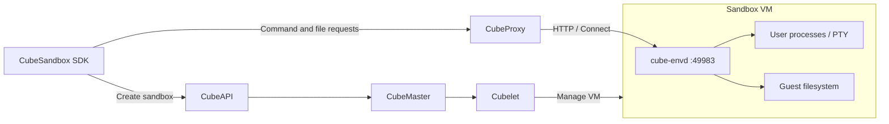
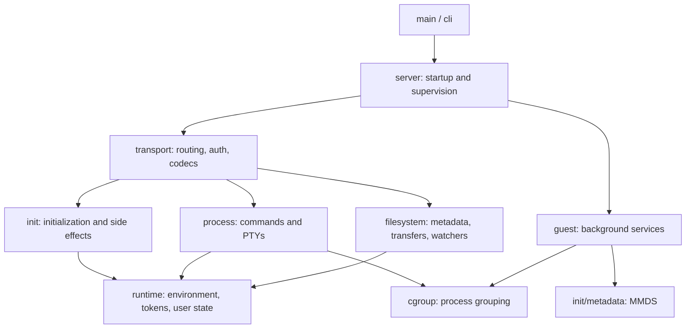
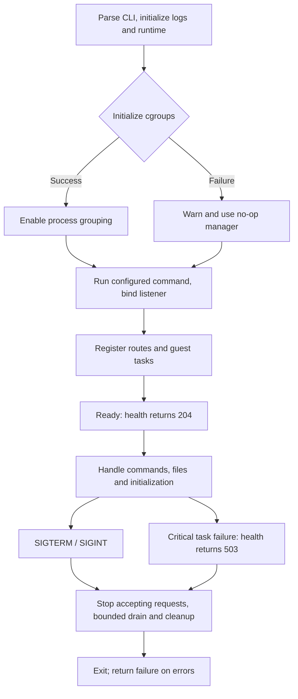

# cube-envd

[中文](README_zh.md)

[API reference](doc/cube-envd-api.md)

`cube-envd` is CubeSandbox's Rust implementation of the sandbox data-plane
daemon. It runs inside the guest and serves command execution, PTYs, filesystem
operations and file transfers through the existing envd HTTP/Connect interfaces.
Its default port is **49983**.

**Upstream Go envd remains the default.** Rust is an explicitly selected
alternative, built from this repository. Selecting the CubeSandbox SDK does not
select the daemon: the template's image determines which implementation runs.

To run Rust envd in a sandbox, build a release binary and inject it into a new
template. See [Use Rust envd in a sandbox](#use-rust-envd-in-a-sandbox).

## Contents

- [Features](#features)
- [Architecture](#architecture)
- [Directory structure](#directory-structure)
- [Prerequisites](#prerequisites)
- [Build the component](#build-the-component)
- [Run the daemon](#run-the-daemon)
- [Use Rust envd in a sandbox](#use-rust-envd-in-a-sandbox)
- [Runtime configuration and diagnosis](#runtime-configuration-and-diagnosis)
- [Tests](#tests)

## Features

- **Process execution**: run commands, stream stdin/stdout/stderr, and manage
  PTYs, signals and exit status.
- **File operations**: inspect metadata, create directories, move and remove
  files, and watch directories; upload, download and compose file content over HTTP.
- **Runtime initialization**: accept `/init` to configure environment variables,
  access tokens, default users and working directories, guest certificates and mounts.
- **Guest services**: expose health checks and resource metrics, manage TCP
  forwarding and idle connections, and fetch MMDS metadata and export logs in
  Firecracker mode.

See the [API reference](doc/cube-envd-api.md) for the implemented HTTP endpoints
and Process/Filesystem protocols. The envd compatibility version does not imply
complete coverage of every upstream feature.

## Architecture

### System context

CubeAPI, CubeMaster and Cubelet manage templates, scheduling and VM lifecycles.
SDK command and file requests reach cube-envd inside the guest through CubeProxy.
Sandbox creation and command execution use separate control and data paths.



### Module boundaries

`server` assembles and supervises services, `transport` adapts protocols, and
`process` and `filesystem` perform domain operations. File bytes travel through
`/files`; Filesystem RPC handles metadata and directory operations.



### Execution flow

The main startup and shutdown paths are shown below. Unavailable cgroup setup
logs a warning and falls back to a no-op manager. Once grouping is enabled, a
later placement failure still rejects the affected process. Critical task
failures make health checks fail and trigger bounded shutdown.



## Directory structure

`cube-envd` is a standalone Cargo project with its own
[`rust-toolchain.toml`](rust-toolchain.toml). The tree below maps source files to their responsibilities;
subdirectory `mod.rs` files define each module's main types and interfaces.

```text
cube-envd/
├── Cargo.toml / Cargo.lock       # Dependencies, features and locked versions
├── Makefile                     # build, fmt, clippy, test and ci targets
├── rust-toolchain.toml          # Component-local Rust version and tools
├── build.rs                     # Generate protocol bindings and embed version metadata
├── proto/                       # Process, Filesystem and test protocol definitions
├── src/
│   ├── main.rs                  # Entry point, version commands and service startup
│   ├── lib.rs                   # Module exports, generated bindings and version constants
│   ├── cli.rs                   # Command-line parsing
│   ├── server.rs                # Service assembly, readiness, supervision and shutdown
│   ├── runtime.rs               # Environment, token, default user and working directory state
│   ├── error.rs                 # Domain errors and classification
│   ├── telemetry.rs             # Log formatting, collection and buffering
│   ├── cgroup.rs                # cgroup v2 grouping, no-op fallback and cleanup
│   ├── transport/
│   │   ├── mod.rs              # Routes, middleware and request shutdown
│   │   ├── rest.rs             # health, init, files, envs and metrics HTTP handlers
│   │   ├── connect.rs          # Process / Filesystem RPC adapters
│   │   ├── auth.rs / cors.rs   # Tokens, file signatures, user selection and CORS
│   │   ├── encoding.rs         # Message compression and decompression
│   │   ├── framing.rs          # Streaming message frame adapters
│   │   ├── grpc.rs             # gRPC status and trailer handling
│   │   ├── json.rs             # ProtoJSON adapters
│   │   ├── json_error.rs       # JSON error diagnostics
│   │   ├── end_message.rs      # Connect terminal messages
│   │   └── limits.rs / timeout.rs # Parser limits and request timeouts
│   ├── process/
│   │   ├── mod.rs              # Process registry, RPC operations and lifecycle
│   │   ├── linux.rs            # Linux user identity, process and PTY primitives
│   │   ├── input.rs / output.rs # Input writes, output subscriptions and exit events
│   │   └── snapshot_test.rs    # Scheduling and observation fixtures for VM snapshot tests
│   ├── filesystem/
│   │   ├── mod.rs              # Paths, permissions, metadata and directory operations
│   │   ├── download.rs         # Downloads, ranges and conditional requests
│   │   ├── download_metadata.rs # MIME types and content detection
│   │   ├── upload.rs           # Streaming uploads and destination writes
│   │   ├── multipart.rs        # Multipart upload parsing
│   │   ├── compose.rs          # File composition and source cleanup
│   │   ├── watch/mod.rs        # Directory notifications and streaming responses
│   │   ├── watch/polling.rs    # Polling watcher registry and event queues
│   │   └── snapshot_test.rs    # Scheduling and observation fixtures for VM snapshot tests
│   ├── init/
│   │   ├── mod.rs              # Initialization request parsing and state updates
│   │   ├── effects.rs          # CA, NFS and event forwarding configuration
│   │   └── metadata.rs         # MMDS client and metadata parsing
│   └── guest/
│       ├── startup.rs          # Metadata refresh and log export tasks
│       ├── port_forward.rs     # TCP listener scanning and socat management
│       ├── metrics.rs          # Guest CPU, memory and disk metrics
│       └── idle.rs             # HTTP idle connection handling
├── tests/                      # Rust integration tests, Python scenarios and shared fixtures
└── doc/                        # English/Chinese API references and local usage guides
```

Tokio provides async execution, Axum and connectrpc provide the server and
transport layer, buffa supplies protobuf messages, and libc provides Linux
syscalls. `build.rs` uses a dependency-provided protoc; no system protoc is
required. Generated bindings live in Cargo's build output directory.

Image publishing, deployment bundles and SDK/platform E2E integration are outside
this component change. The test-only container below provides Linux component
isolation; it is not a sandbox runtime or release image.

## Prerequisites

Run the commands below from the **repository root**.

- Linux, Git, Make, a native compiler/linker and rustup. The component pins Rust
  **1.89.0**, rustfmt and Clippy in its own toolchain file; other projects retain
  their existing toolchain selection.
- The complete test suite needs Python 3, socat, sudo, capability tools, iproute2,
  a `user` account with `/home/user`, and a private writable cgroup v2 hierarchy.
  Use the isolated component container documented under [Tests](#tests).

## Build the component

For a native development build with the pinned host toolchain:

```bash
make -C cube-envd build
(cd cube-envd && cargo --version && rustc --version)

cube-envd/target/debug/cube-envd -version
cube-envd/target/debug/cube-envd cube-version
cube-envd/target/debug/cube-envd -commit
```

These commands assume `CARGO_TARGET_DIR` is unset. If you set it, the executable
is under that directory's `debug/` subdirectory. `-version` reports the envd
compatibility version, `cube-version` reports the Rust product version, and
`-commit` reports the build's source revision. A compatibility version is not a
claim that every upstream feature is supported. Source archives without Git
metadata must supply `CUBE_ENVD_COMMIT` as the full source commit SHA for native
Cargo builds.

A native release build uses the same locked dependencies:

```bash
(cd cube-envd && cargo build --release --locked)
```

For a musl binary, install the corresponding Rust target and a compatible linker,
then build from `cube-envd`, for example:

```bash
(cd cube-envd && cargo build --release --locked --target x86_64-unknown-linux-musl)
```

Cross-compilation requires a target sysroot/linker and is not native ARM
validation. This component does not add Docker export or image-selection targets.

## Run the daemon

See the [local usage guide](doc/usage.md) for launching the binary and exercising
health and file operations. Run in a disposable Linux guest or container: file,
process and initialization requests operate on that environment. Image lifecycle,
entrypoint supervision and platform provisioning are maintained separately.

## Use Rust envd in a sandbox

For direct API testing, run the daemon locally as described above. To use your
own Rust build through the CubeSandbox SDK or E2B SDK, use `cubemastercli` to
inject the release binary into a new sandbox template.

The following example targets Linux x86_64. Install the matching Rust target
and linker, then run these commands from the repository root. Set `BASE_IMAGE`
to an image that the cluster can pull and whose entrypoint leaves envd startup
to the platform.

```bash
(cd cube-envd && cargo build --locked --release --target x86_64-unknown-linux-musl)
ENVD_BIN="$PWD/cube-envd/target/x86_64-unknown-linux-musl/release/cube-envd"
BASE_IMAGE=my-registry.example.com/my-team/my-sandbox:v1

file "$ENVD_BIN"
cubemastercli tpl create-from-image \
  --image "$BASE_IMAGE" --instance-type cubebox --writable-layer-size 1G \
  --expose-port 49983 --probe 49983 --probe-path /health \
  --enable-inject-envd --envd-path "$ENVD_BIN"
```

If you set `CARGO_TARGET_DIR`, point `ENVD_BIN` to the actual build output. The
CLI reads the binary from the machine on which it runs and uploads it. The
platform installs it at `/usr/local/bin/envd` in the new template. The binary
must be a Linux ELF executable that matches the guest architecture and is at
most 16 MiB. Once the template is ready, pass the returned `template_id` to the
SDK, for example `Sandbox.create(template="tpl-...")`. Each new `cubebox`
sandbox created from that template starts the injected envd.

An image that inherits the `cubesandbox-base` entrypoint already starts
`/usr/bin/envd`. For that setup, replace `/usr/bin/envd` with your Rust binary
in a custom image and omit the injection flags when creating the template.
This lets the image entrypoint start a single daemon on port `49983`.

For the complete image build, template injection and troubleshooting workflow,
see [Custom Template Images](../docs/guide/tutorials/bring-your-own-image.md) or
the [Chinese tutorial](../docs/zh/guide/tutorials/bring-your-own-image.md).

## Runtime configuration and diagnosis

| Setting | Meaning |
| --- | --- |
| `-port` | Listen port, default `49983`. |
| `-cgroup-root` | Daemon cgroup root, default `/sys/fs/cgroup`. |
| `-isnotfc` | Non-Firecracker mode; disables MMDS/log export tasks. |
| `--log-format json` | Structured daemon logs on stdout/stderr. |

Rust uses writable cgroup v2 with CPU and memory controllers for its additional
process groups. If initialization fails, including on cgroup v1 or a read-only
hierarchy, it logs the reason and uses a no-op manager. Children inherit the
existing cgroup placement; VM/platform limits remain separate. A placement
failure after successful initialization still rejects the affected child.
TCP forwarding also needs socat and the guest address `169.254.0.21`.

Inspect daemon logs and `/health` when diagnosing startup. For protocol calls,
check the endpoint, access token, selected user and filesystem permissions.
The standalone binary does not read the image entrypoint's ENVD_* wrapper options.

## Tests

Run the complete component checks with `make -C cube-envd ci`.
Run it in the isolated environment defined by the component-local
[validation Dockerfile](tests/isolate/Dockerfile) and
[cgroup bootstrap](tests/isolate/prepare-cgroup.sh). This keeps source
read-only, uses Docker-managed Cargo/build cache volumes and a private writable cgroup, and
removes SYS_TIME before starting test daemons. Do not run the test cgroup bootstrap
on the host or grant access to the host clock to make a test pass. The test command
sets `CARGO_TARGET_DIR` inside the container; it requires no particular host
directory layout. Native builds use `cube-envd/target` unless you override it.

From the repository root on a Linux Docker host with cgroup v2, run the same
component environment:

```bash
version=$(sed -n 's/^channel = "\(.*\)"/\1/p' cube-envd/rust-toolchain.toml)
docker build --build-arg RUST_VERSION="$version" \
  -f cube-envd/tests/isolate/Dockerfile -t envd-ci cube-envd
docker run --rm --init --privileged --cgroupns private \
  -v "$PWD:/workspace:ro" \
  -v envd-ci-cargo:/usr/local/cargo -v envd-ci-target:/target \
  -e NO_PROXY=localhost,127.0.0.1,::1 -e no_proxy=localhost,127.0.0.1,::1 \
  -e CARGO_TARGET_DIR=/target -e CARGO_BUILD_JOBS=2 \
  -w /workspace envd-ci \
  bash cube-envd/tests/isolate/prepare-cgroup.sh make -C cube-envd ci
```

Bare-host `cargo test` is not equivalent to this environment. The validation
image creates the `user` account and `/home/user` for the fixtures.
The startup-command tests intentionally exercise `-cmd`, which runs in
`/home/user` as root, matching [upstream Go envd](https://github.com/e2b-dev/infra/blob/2026.16/packages/envd/main.go#L206-L225).
Both implementations reject a missing startup directory; this does not mean
ordinary Process RPC calls always use `/home/user`.
The bootstrap removes SYS_TIME from the capability sets before running tests;
`--privileged --cap-drop SYS_TIME` alone is not a substitute. Keep the capability
assertions enabled. To run a focused suite, replace the final
`make -C cube-envd ci` with, for example,
`cargo test --manifest-path cube-envd/Cargo.toml --locked --test daemon`.

| Scope | Entry point | Coverage |
| --- | --- | --- |
| Component | `make -C cube-envd ci` | Formatting, Clippy, build, Rust tests and type checking. |
| Daemon / RPC | [Daemon tests](tests/daemon.rs), [wire tests](tests/filesystem_wire_errors.rs) | Readiness, init, authorization, shutdown and Connect JSON/protobuf. |
| Process / PTY | [Process tests](tests/process_start_list.rs), [PTY tests](tests/process_pty.rs) | Command lifecycle, input/output and terminal behavior. |
| Filesystem / HTTP files | [Filesystem tests](tests/FILESYSTEM.md), [transfer tests](tests/FILE_TRANSFERS.md) | Metadata, watchers, upload/download and compose. |
| Guest services | [Guest service tests](tests/GUEST_SERVICES.md) | Initialization, metadata, logs, metrics, forwarding and idle handling. |

VM snapshot cases require the fixtures documented with those tests. A skipped
case is not evidence of compatibility. Cross-compilation and QEMU execution do
not establish native arm64 platform behavior; Firecracker and Cloud Hypervisor
also require their own platform validation.
