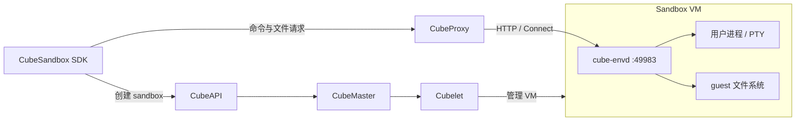
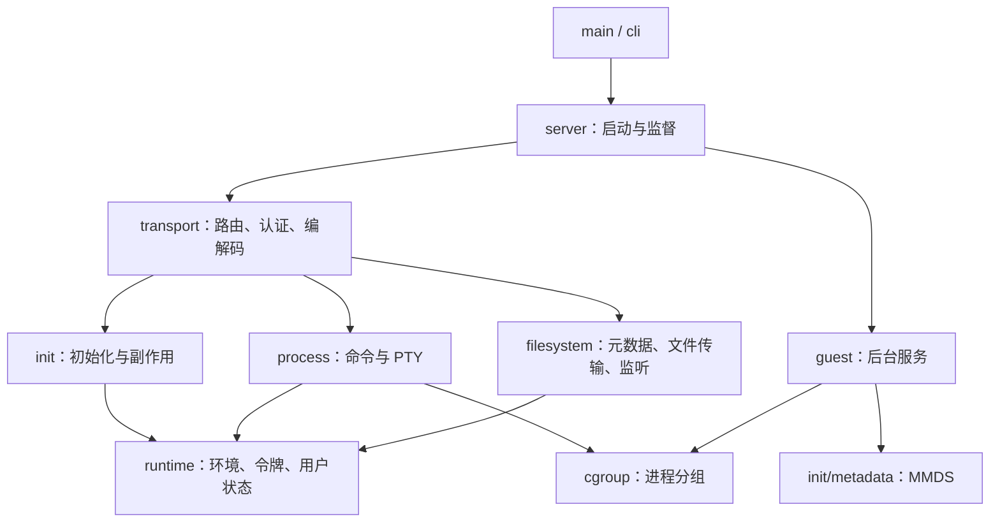
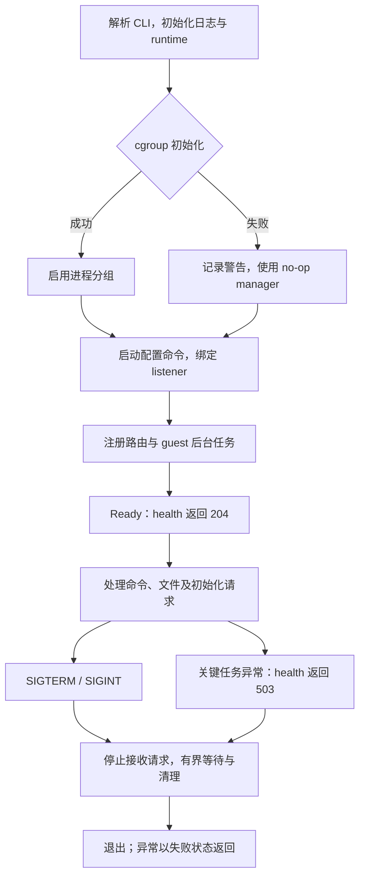

# cube-envd

[English](README.md)

[API 文档](doc/cube-envd-api_zh.md)

`cube-envd` 是 CubeSandbox 使用 Rust 实现的沙箱数据面守护进程。它运行在 guest
内部，通过现有 envd HTTP/Connect 接口提供命令执行、PTY、文件系统操作和文件
传输服务，默认监听 **49983** 端口。

**上游 Go envd 保持默认。** Rust 是从本仓库构建、需要显式选择的替代实现。
选择 CubeSandbox SDK 不等于选择 Rust daemon；实际使用哪种实现由模板镜像决定。

## 目录

- [功能](#功能)
- [架构](#架构)
- [目录结构](#目录结构)
- [前提条件](#前提条件)
- [构建组件](#构建组件)
- [运行 daemon](#运行-daemon)
- [运行配置与排查](#运行配置与排查)
- [测试](#测试)

## 功能

- **进程执行**：启动命令，传输 stdin/stdout/stderr，管理 PTY、信号和退出状态。
- **文件操作**：查询元数据、创建目录、移动和删除文件、监听目录变化；通过 HTTP
  上传、下载和拼接文件内容。
- **运行时初始化**：接收 `/init`，设置环境变量、访问令牌、默认用户及工作目录，
  执行 guest 证书和挂载配置。
- **guest 服务**：提供健康检查与资源指标，管理 TCP 转发和空闲连接；在
  Firecracker 模式下获取 MMDS 元数据并导出日志。

接口定义见 [API 文档](doc/cube-envd-api_zh.md)。兼容范围以已实现的 HTTP 接口和
Process/Filesystem 协议为准；envd 兼容版本号不代表完整覆盖上游全部功能。

## 架构

### 系统位置

CubeAPI、CubeMaster 和 Cubelet 管理模板、调度及 VM 生命周期。SDK 的命令与文件
请求经 CubeProxy 到达 guest 内的 cube-envd。控制面创建 sandbox 与数据面执行
命令是两条调用路径。



### 模块边界

`server` 负责组装和监督，`transport` 适配协议，`process` 与 `filesystem` 执行
领域操作。文件字节传输由 `/files` 处理，Filesystem RPC 负责元数据和目录操作。



### 执行流程

下面展示 daemon 的主要启动和关闭路径。cgroup 初始化不可用时记录警告并降级；
已经启用的 cgroup 后续归组失败仍会拒绝对应进程。关键任务异常使健康检查失败，
并触发有界关闭。



## 目录结构

`cube-envd` 是独立的 Cargo 项目，由组件内的
[`rust-toolchain.toml`](rust-toolchain.toml) 指定工具链。以下为源码导航；各子目录中的 `mod.rs` 定义该模块的主要类型和接口。

```text
cube-envd/
├── Cargo.toml / Cargo.lock       # 依赖、feature 与锁定版本
├── Makefile                     # build、fmt、clippy、test、ci 入口
├── rust-toolchain.toml          # 组件自己的 Rust 版本与工具
├── build.rs                     # 生成协议绑定并注入版本信息
├── proto/                       # Process、Filesystem 及测试协议定义
├── src/
│   ├── main.rs                  # 程序入口、版本命令与服务启动
│   ├── lib.rs                   # 模块导出、生成的协议绑定与版本常量
│   ├── cli.rs                   # 命令行参数解析
│   ├── server.rs                # 服务组装、就绪状态、任务监督与关闭
│   ├── runtime.rs               # 环境变量、令牌、默认用户和工作目录状态
│   ├── error.rs                 # 领域错误及错误分类
│   ├── telemetry.rs             # 日志格式、采集与缓冲
│   ├── cgroup.rs                # cgroup v2 分组、no-op 降级与清理
│   ├── transport/
│   │   ├── mod.rs              # 路由、中间件与请求关闭
│   │   ├── rest.rs             # health、init、files、envs、metrics HTTP handler
│   │   ├── connect.rs          # Process / Filesystem RPC 适配
│   │   ├── auth.rs / cors.rs   # 令牌、文件签名、用户选择与 CORS
│   │   ├── encoding.rs         # 消息压缩与解压
│   │   ├── framing.rs          # 流式消息帧适配
│   │   ├── grpc.rs             # gRPC 状态与 trailer 处理
│   │   ├── json.rs             # ProtoJSON 适配
│   │   ├── json_error.rs       # JSON 错误诊断
│   │   ├── end_message.rs      # Connect 终止消息
│   │   └── limits.rs / timeout.rs # 解析限制与请求超时
│   ├── process/
│   │   ├── mod.rs              # 进程注册、RPC 操作与生命周期
│   │   ├── linux.rs            # Linux 用户身份、进程与 PTY 原语
│   │   ├── input.rs / output.rs # 输入写入、输出订阅与退出事件
│   │   └── snapshot_test.rs    # VM 快照测试的调度与观测夹具
│   ├── filesystem/
│   │   ├── mod.rs              # 路径与权限、元数据和目录操作
│   │   ├── download.rs         # 下载、Range 与条件请求
│   │   ├── download_metadata.rs # MIME 类型与内容识别
│   │   ├── upload.rs           # 流式上传与目标文件写入
│   │   ├── multipart.rs        # multipart 上传解析
│   │   ├── compose.rs          # 文件拼接与源文件清理
│   │   ├── watch/mod.rs        # 目录事件监听与流式响应
│   │   ├── watch/polling.rs    # 轮询 watcher 注册与事件队列
│   │   └── snapshot_test.rs    # VM 快照测试的调度与观测夹具
│   ├── init/
│   │   ├── mod.rs              # 初始化请求解析与状态更新
│   │   ├── effects.rs          # CA、NFS 与事件转发配置
│   │   └── metadata.rs         # MMDS 客户端与元数据解析
│   ├── guest/
│   │   ├── startup.rs          # 元数据刷新与日志导出任务
│   │   ├── port_forward.rs     # TCP listener 扫描与 socat 管理
│   │   ├── metrics.rs          # guest CPU、内存与磁盘指标
│   │   └── idle.rs             # HTTP 空闲连接处理
│   └── conformance/            # test-support feature 下的协议测试服务
├── tests/                      # Rust 集成测试、Python 场景与共享夹具
└── doc/                        # 中英文 API 文档和本地使用指南
```

Tokio 提供异步执行，Axum 和 connectrpc 提供服务及传输层，buffa 提供 protobuf
消息，libc 提供 Linux 系统调用。`build.rs` 使用依赖提供的 protoc，无需额外安装
系统 protoc。生成的绑定位于 Cargo 构建输出目录；生产构建不应启用 `test-support`。

本次组件改动不包含镜像发布、部署包和 SDK/平台 E2E 接线。下文测试容器仅为
Linux 组件测试提供隔离，不作为沙箱运行镜像或发布镜像。

## 前提条件

下文命令均从**仓库根目录**执行。

- Linux、Git、Make、本机编译器/链接器和 rustup。组件内工具链文件指定
  Rust **1.89.0**、rustfmt 和 Clippy；其他项目沿用各自的工具链选择。
- 完整测试需要 Python 3、socat、sudo、capability 工具、iproute2、具有
  `/home/user` 的 `user` 账号及私有可写 cgroup v2。使用[测试节](#测试)的
  组件隔离容器。

## 构建组件

使用已安装的锁定工具链执行本机开发构建：

```bash
make -C cube-envd build
(cd cube-envd && cargo --version && rustc --version)

cube-envd/target/debug/cube-envd -version
cube-envd/target/debug/cube-envd cube-version
cube-envd/target/debug/cube-envd -commit
```

这些命令假定未设置 `CARGO_TARGET_DIR`；若已设置，程序位于该目录下的 `debug/`
子目录。`-version` 输出 envd 兼容版本，`cube-version` 输出 Rust 产品版本，
`-commit` 输出构建使用的源码 revision。兼容版本号不代表支持上游所有功能。
没有 Git 元数据的源码归档，本机 Cargo 构建需通过 `CUBE_ENVD_COMMIT` 提供完整
源码提交 SHA。

本机 release 构建仍使用锁定依赖：

```bash
(cd cube-envd && cargo build --release --locked)
```

需要 musl 程序时，先安装对应 Rust target 和兼容链接器，再在组件目录构建，例如：

```bash
(cd cube-envd && cargo build --release --locked --target x86_64-unknown-linux-musl)
```

交叉编译还需要目标 sysroot/链接器，不代表原生 ARM 验收。本组件不新增
Docker 导出或镜像选择目标。

## 运行 daemon

启动程序及检查 health、文件操作见[本地使用指南](doc/usage_zh.md)。应在可丢弃的
Linux guest 或容器内运行：文件、进程和初始化请求会操作所在环境。镜像生命周期、
entrypoint 监督及平台创建流程独立维护。

## 运行配置与排查

| 配置 | 含义 |
| --- | --- |
| `-port` | 监听端口，默认 `49983`。 |
| `-cgroup-root` | daemon cgroup 根目录，默认 `/sys/fs/cgroup`。 |
| `-isnotfc` | 非 Firecracker 模式，关闭 MMDS/日志导出任务。 |
| `--log-format json` | 向 stdout/stderr 输出结构化日志。 |

Rust 使用带 CPU、memory controller 的可写 cgroup v2 创建额外进程分组。
如果初始化失败，例如环境使用 cgroup v1 或只读层级，会记录原因并使用 no-op
manager。子进程继承既有 cgroup 归属，VM/平台限制独立存在；如果已经成功初始化，
后续归组失败仍会拒绝对应子进程。TCP 转发还需要 socat 和 guest 地址 `169.254.0.21`。

启动异常时检查 daemon 日志与 `/health`。协议调用失败时，核对端点、访问令牌、
执行用户和文件权限。独立程序不解析镜像 entrypoint 的 ENVD_* 包装选项。

## 测试

完整组件检查命令为 `make -C cube-envd ci`。
应在组件内[验证 Dockerfile](tests/isolate/Dockerfile)和
[cgroup bootstrap](tests/isolate/prepare-cgroup.sh)定义的隔离环境中运行：源码只读
挂载，使用 Docker 管理的 Cargo/构建缓存卷及私有可写 cgroup，并在启动测试 daemon 前移除
SYS_TIME。不要在宿主执行测试 cgroup bootstrap，也不要为通过测试而授权修改宿主时钟。
测试命令在容器内设置 `CARGO_TARGET_DIR`，不要求宿主具有特定目录结构；
本机构建在没有覆盖设置时使用 `cube-envd/target`。

在使用 cgroup v2 的 Linux Docker 宿主上，从仓库根目录运行组件测试环境：

```bash
version=$(sed -n 's/^channel = "\(.*\)"/\1/p' cube-envd/rust-toolchain.toml)
docker build --build-arg RUST_VERSION="$version" \
  -f cube-envd/tests/isolate/Dockerfile -t envd-ci cube-envd
docker run --rm --init --privileged --cgroupns private \
  -v "$PWD:/workspace:ro" \
  -v envd-ci-cargo:/usr/local/cargo -v envd-ci-target:/target \
  -e NO_PROXY=localhost,127.0.0.1,::1 -e no_proxy=localhost,127.0.0.1,::1 \
  -e CARGO_TARGET_DIR=/target -e CARGO_BUILD_JOBS=2 \
  -w /workspace envd-ci \
  bash cube-envd/tests/isolate/prepare-cgroup.sh make -C cube-envd ci
```

裸机直接运行 `cargo test` 不等同于上述环境。测试镜像为夹具创建 `user` 账号和 `/home/user`。启动命令测试有意覆盖 `-cmd`：它以 root
在 `/home/user` 中执行，与[上游 Go envd](https://github.com/e2b-dev/infra/blob/2026.16/packages/envd/main.go#L206-L225)一致。
两种实现都会拒绝不存在的启动目录；这不代表普通 Process RPC 总是使用 `/home/user`。
bootstrap 在测试前从 capability 集合移除 SYS_TIME；仅使用
`--privileged --cap-drop SYS_TIME` 不能替代这一步。应保留权限断言。
如需运行特定测试，可将末尾的 `make -C cube-envd ci` 替换为
`cargo test --manifest-path cube-envd/Cargo.toml --locked --test daemon`。

| 范围 | 入口 | 覆盖内容 |
| --- | --- | --- |
| 组件 | `make -C cube-envd ci` | 格式、Clippy、构建、Rust 测试和类型检查。 |
| 进程 / PTY | [进程测试](tests/process_start_list.rs)、[PTY 测试](tests/process_pty.rs) | 命令生命周期、输入输出及终端行为。 |
| 文件系统 / HTTP 文件 | [文件系统测试](tests/FILESYSTEM.md)、[文件传输测试](tests/FILE_TRANSFERS.md) | 元数据、监听、上传下载和拼接。 |
| guest 服务 | [guest 服务测试](tests/GUEST_SERVICES.md) | 初始化、元数据、日志、指标、转发和空闲处理。 |

VM 快照用例需要对应测试文档说明的夹具。跳过的用例不代表兼容性已验证。
交叉编译和 QEMU 执行不能证明原生 arm64 平台行为；Firecracker 与 Cloud Hypervisor
也需要各自的平台验证。
