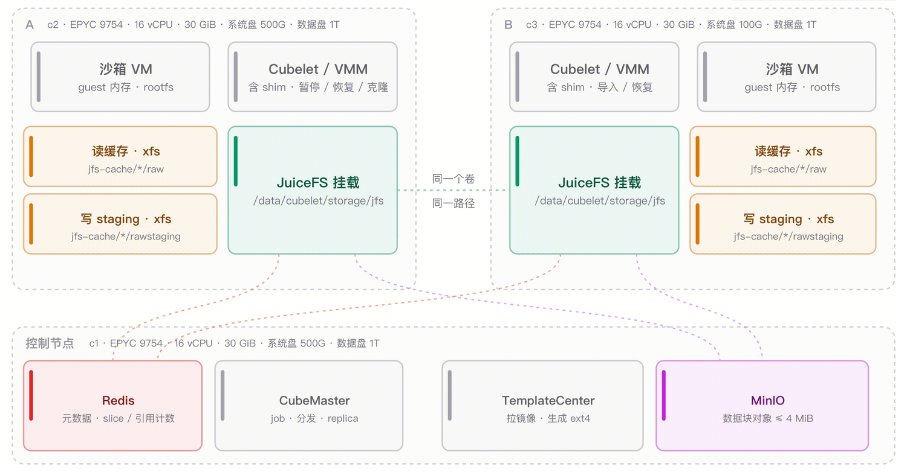
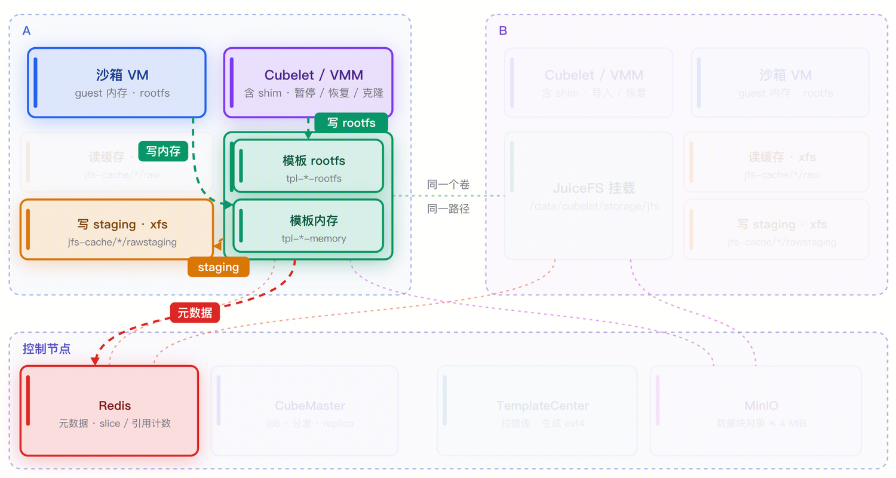
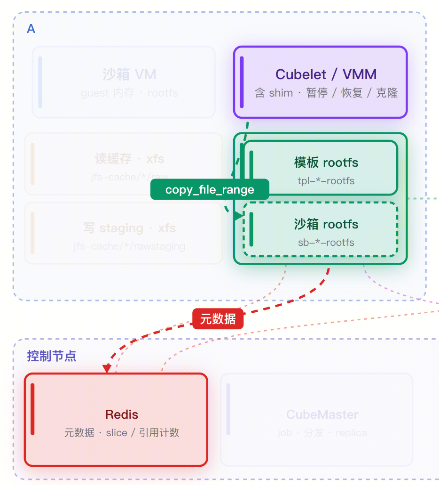
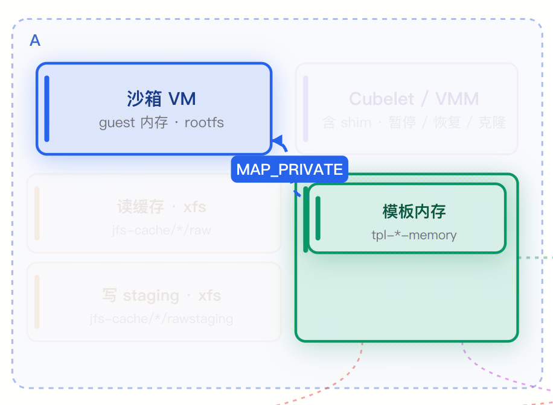
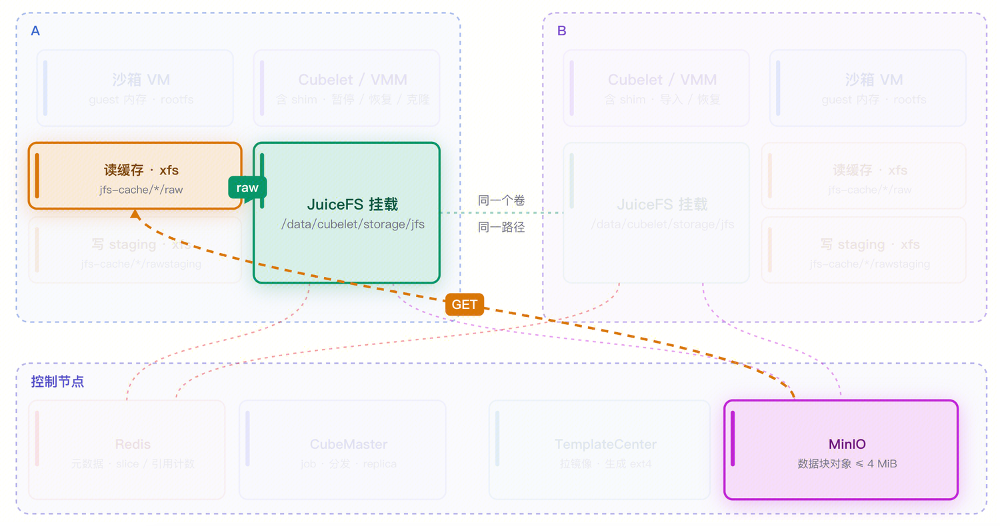
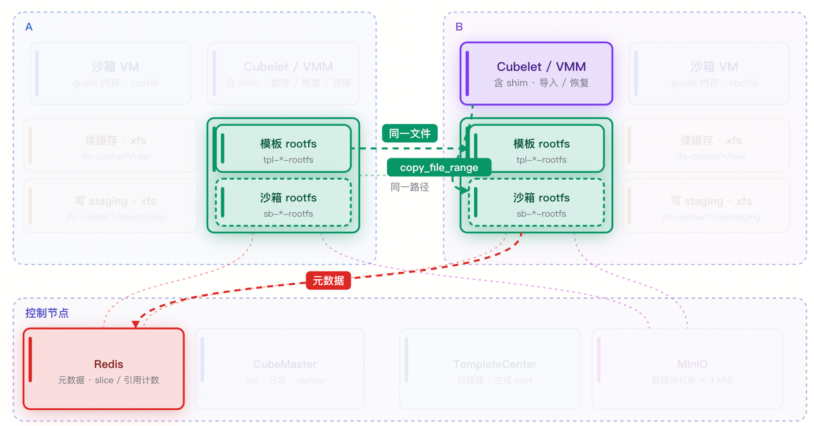
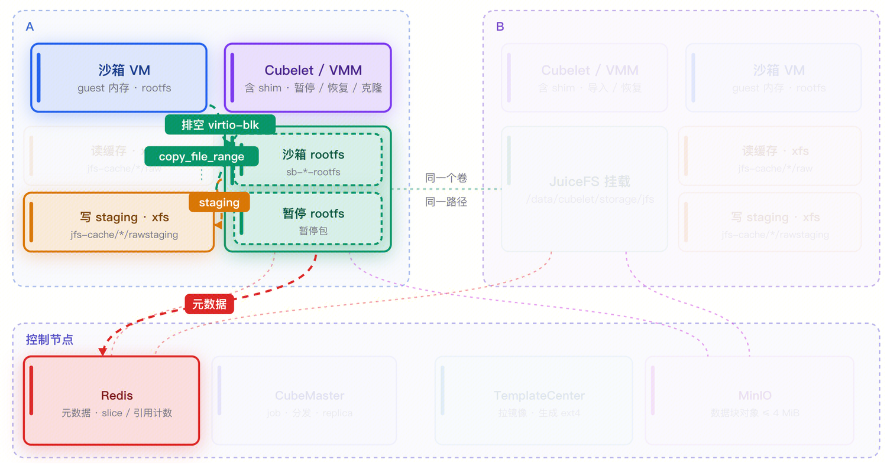
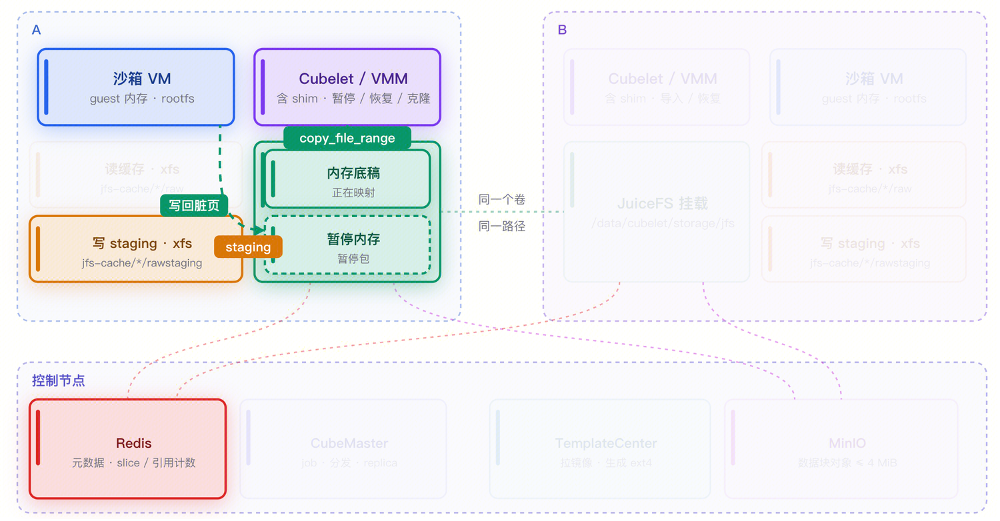
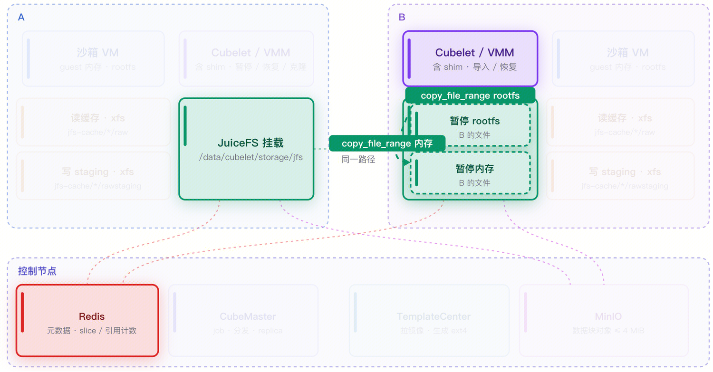

# Cube + JuiceFS Cross-Node Storage Architecture

This page describes CubeSandbox's JuiceFS-based cross-node storage design: the problem it solves, why JuiceFS was chosen, how the architecture is layered, and how data flows during template creation, sandbox startup, pause, and restore.

> For deployment, see [JuiceFS service configuration](../guide/cross-node-snapshot/juicefs.md).
>
> For performance data, see [JuiceFS performance benchmarks](/blog/posts/2026-11-04-cubesandbox-juicefs-perf-benchmark).

## Background

A CubeSandbox sandbox is a complete MicroVM, and it needs three things:

- a read-only rootfs;
- a writable disk;
- a memory image that can restore its running state.

These three kinds of data make up all of Cube's storage objects -- templates, snapshots, and paused packages are all, in essence, "a set of files".

Cube's core storage solution is currently based on XFS. XFS separates metadata from data, so cloning a file only copies inode and data-block references rather than the blocks themselves. Building on that, Cube expresses templates, sandbox disks, and memory snapshots as ordinary files, and a single `FICLONE` derives a new sandbox state in constant time. Snapshots and clones cost almost nothing and require no extra data copies.

The catch is that XFS is node-local. Templates, snapshots, and paused packages all sit on the source node's data disk; another machine can neither see those files nor move their reference relationships over. So when a host runs short on resources, needs an upgrade or reboot, or the platform's load distribution shifts, a long-running Agent sandbox can only be rebuilt, and its task context is lost. The lack of cross-node capability limits Cube's schedulable scope to a single machine.

The JuiceFS solution therefore has a precise goal: **keep the existing file-operation model and swap the local filesystem for a cluster-wide shared filesystem with almost no change to the layers above**, so that any node can see and use the same templates, snapshots, and paused packages.

## Why JuiceFS

JuiceFS is a POSIX-compatible distributed filesystem whose characteristics map directly onto Cube's needs:

- **POSIX compatibility.** The layers above still perform open, read, write, and clone operations. Cube does not need to rewrite its storage logic against an object API or maintain its own distributed metadata.
- **Distribution with strong consistency.** Multiple nodes can mount the same volume and see an identical file view. This is exactly the precondition for cross-node restore: a file written by node A is visible to node B at the same path, and it is the same content.
- **Metadata and data separation.** File data is split into blocks and stored in object storage, while the directory tree, inodes, and block mappings live in a separate metadata engine. This mirrors XFS's extent model, so `copy_file_range` on JuiceFS degrades into a pure metadata operation, equivalent in effect to XFS reflink.
- **Replaceable backends.** The metadata engine can be Redis, MySQL, PostgreSQL, or TiKV, and object storage can be MinIO, S3, COS, and so on, so one design can evolve from a trial environment to production.
- **FUSE-based.** The client runs in user space, which makes its behavior easy to observe and tune -- valuable for a storage solution that is still evolving quickly.
- **Maturity.** JuiceFS is widely used and recognized in the industry, and the stability of its filesystem was an important factor in Cube's choice.

## Architecture

The Cube + JuiceFS architecture has three layers:

The **shared storage layer** runs on the control node and consists of the JuiceFS metadata engine (Redis on the control node by default) and object storage (MinIO on the control node by default). Both addresses can point at dedicated machines or cloud services; hosting them on the control node is simply a delivery convenience for quick evaluation.

On the **node side**, every machine runs a JuiceFS client that mounts the same volume at the **same path**, `/data/cubelet/storage/jfs`.

The **compute and cache layer** is Cubelet and the VMM. A sandbox's rootfs and memory files live under the JuiceFS mount point and are opened and mapped directly by the VMM. In parallel, each node also keeps a local cache directory with two kinds of data:

- `raw`: the read cache, holding data blocks fetched from object storage, evictable under LRU;
- `rawstaging`: the write cache, holding dirty blocks not yet uploaded under `--writeback`. Blocks written here are uploaded asynchronously and deleted once the upload completes.

The cache directory can sit on any local filesystem (usually XFS on the data disk); only the mount point itself is JuiceFS.

| Layer | Component | Responsibility |
|---|---|---|
| Shared storage | JuiceFS metadata (Redis) | Directory tree, inodes, chunk/slice mappings, reference counts |
| Shared storage | JuiceFS data (MinIO / S3 / COS) | Data-block objects, each no larger than 4 MiB |
| Node side | JuiceFS client (FUSE mount) | Mounts the shared volume at a uniform path, manages read and write caches |
| Node side | Cubelet / VMM | Clones rootfs, maps memory, pauses and restores |

Note that **the complexity of distribution does not leak into Cube's upper layers**. To Cubelet, the files under `/data/cubelet/storage/jfs` are ordinary files; when it reads, writes, or copies them it does not care whether the data comes from a local block or a remote object. JuiceFS handles that complexity.

## Main flows

### Template creation

Template creation is almost identical to XFS: a temporary sandbox is started, and the rootfs and memory are written to the corresponding location. The only difference is where they land -- XFS writes to `/data/cubelet/storage/xfs`, JuiceFS to `/data/cubelet/storage/jfs`.

Beyond the path, there is one key difference in **build scope**. XFS builds a template once per machine, so every machine ends up holding its own copy of the rootfs and memory image. JuiceFS instead groups all nodes by machine type, splitting them into groups by CPU and kernel, and **builds one template per group**. The output is written to the local write-staging directory and uploaded to object storage asynchronously.

### Starting a sandbox from a template

Startup begins by cloning the rootfs: Cubelet uses `copy_file_range` within JuiceFS to derive the sandbox's own rootfs from the template rootfs, copying only slice references and no data.

The second step is mapping memory: the VMM maps the template memory file directly with `MAP_PRIVATE`. The VM then restores from the memory snapshot and the sandbox enters the running state.

On first access to certain data blocks the local read cache is empty, so page faults pull the blocks from object storage into the `raw` directory; subsequent reads of the same block hit the local cache.

For cross-node startup, because every file under `/data/cubelet/storage/jfs` is shared by all nodes, the flow is exactly the same: operate on the files directly, copy and map, then start the sandbox.

### Pause

Pausing a sandbox follows the same flow as creating a snapshot, with the addition of destroying the sandbox.

Pause proceeds along two tracks, disk and memory. On the disk side it **drains virtio-blk**, flushing in-flight I/O requests onto the rootfs the sandbox is currently using.

On the memory side it first clones the memory baseline -- at this point the cloned file does not yet contain this round's dirty pages, because those pages still live in the VM's anonymous memory. The VMM then freezes the vCPUs, scans the page table to collect dirty pages, and writes them all back into the cloned file, with the writes synced into staging. Once the metadata commits, pause returns.

At this point the paused package is complete at the file level and can be used directly on the local node. For cross-node use, the package is only marked ready after writeback finishes uploading the relevant blocks, and only then will the control plane allow it to be scheduled onto another node.

### Local restore

Local restore does not wait for any upload. The VMM maps the paused package's memory file directly with `MAP_PRIVATE`; the rootfs is cloned once more into the sandbox's own file, because the sandbox will keep writing to disk after resuming.

Because the dirty-page blocks just written are still in local staging and previously read blocks are still in the `raw` cache, local restore hits local data almost entirely and is the fastest path in this design.

### Cross-node restore

The first question in cross-node restore is whether the sandbox *can* move. When the source node is healthy and schedulable, the scheduler always prefers to put the sandbox back on the source node; only when the source node is unavailable or isolated does it check whether the shared data is ready and whether the target node's CPU and kernel are compatible with the source node's. Only when every condition holds does the sandbox land on the target node.

The restore flow resembles starting from a template: the VMM copies the rootfs file, maps the imported memory image with `MAP_PRIVATE`, and page faults fetch blocks from object storage into the target node's read cache as needed. The target node's cache is cold, so the first restore is noticeably slower than local and warm starts; the source node's read cache does not travel with the sandbox.

There is one more detail: a freshly restored guest needs to be woken up. Cubelet health-checks the guest, and the check itself touches the guest's code and data pages, so those page faults become the object-storage GET requests. The API therefore only returns once the health check succeeds, which means cross-node restore time includes an unavoidable cold-start jitter.

## Comparison with XFS

| Dimension | XFS backend | JuiceFS backend |
|---|---|---|
| Clone mechanism | `FICLONE` (reflink) | `copy_file_range` (copies slice references) |
| Template distribution | One copy per node | Built per machine group, uploaded to object storage |
| Data visibility | Local node only | Cluster-wide, same volume and same path |
| Cross-node capability | Not supported | Paused packages and snapshots can be restored on another node |
| Local path overhead | No network involved, lowest | Extra FUSE layer, metadata may traverse the network |
| Dependencies | Local data disk | FUSE, metadata engine, object storage |
| Best fit | Single-machine density, local lifecycle | Migration, rescheduling, host maintenance |

## Summary

The core idea of the Cube + JuiceFS design can be stated in one sentence: **replace the local filesystem with a distributed filesystem, rather than building another distributed storage system inside Cube**.

Three things make it work:

- First, JuiceFS provides POSIX interfaces, so Cube's existing file-operation model -- cloning, mapping, organizing snapshots as files -- carries over unchanged.
- Second, metadata and data separation turns `copy_file_range` into a constant-time metadata operation, so neither cloning nor sharing requires moving data.
- Third, a strongly consistent multi-node view makes "a file written on A is usable on B" a natural consequence, which is why cross-node restore needs no extra data channel.

The costs concentrate on write granularity and state semantics: dirty pages must be aggregated into windows of a sensible size, or metadata transactions and background compaction will drag pause down; and writeback separates "the write has completed" from "the data is safely readable from another node", which requires clear readiness semantics and timely notification. Both points received targeted design and optimization in this solution.

The result: Cube gains cross-node scheduling, host maintenance, and load rebalancing while keeping a file model almost isomorphic to the local one.
