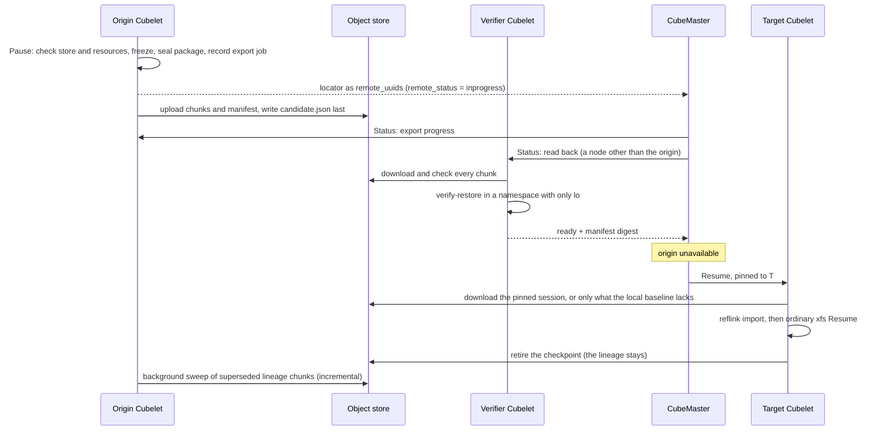

# xfs-s3 Storage Architecture

`xfs-s3` keeps a sandbox on the node-local XFS reflink store, exactly like `xfs`, and publishes every pause package to an S3-compatible object store as a self-contained checkpoint. A node other than the origin verifies the checkpoint, and when the origin cannot take a Resume, another node downloads it and resumes the sandbox there.

This page describes the design: the recovery contract, how a pause package crosses nodes, the checkpoint format, incremental checkpoints, the safety argument of the background sweep, and how Resume is kept from starting a sandbox twice.

> For deployment, configuration keys and operations, see [xfs-s3 backend](../guide/cross-node-snapshot/xfs-s3.md).
>
> For placement and CPU/kernel compatibility, see [Cross-node migration requirements](../guide/cross-node-snapshot/requirements.md).

## Background

The `xfs` backend expresses templates, sandbox disks and memory snapshots as files on node-local XFS and derives new state with `FICLONE`, so pause and resume cost almost nothing. A pause package, however, stays on its origin: when the origin goes away, so does the paused sandbox.

The other cross-node backends move the runtime data plane onto shared storage: `jfs` keeps every file on a JuiceFS mount, and `s3` runs sandboxes on CubeS3lvol block devices with a local WAL. Every read and write a running sandbox makes then depends on that shared layer.

`xfs-s3` separates the two concerns:

- the running sandbox reads and writes only the local disk, as with `xfs`;
- only a pause publishes data, as one self-contained checkpoint that any compatible node can verify and restore;
- the object store is the only shared dependency, and it is touched only by background uploads, verification and cross-node Resume.

Templates and user snapshots of an `xfs-s3` sandbox stay plain `xfs`; only pause packages cross nodes.

## Recovery contract

| Boundary | What it means | Accepted / not accepted |
|---|---|---|
| Pause succeeded | Before the guest froze, Cubelet confirmed a usable store and resources a checkpoint can carry. After the freeze the package is sealed (files and directories fsync'ed), an export job is recorded beside it, and the checkpoint locator is returned as `remote_uuids`. | The remote copy may not be ready yet. A node without a usable store refuses the pause before the freeze, and the sandbox keeps running. |
| Export committed | Every chunk and the manifest are uploaded, and the fixed key `candidate.json` is written last, so a reader sees a complete checkpoint or none. | Losing the origin before the commit loses the latest checkpoint for cross-node use. This window is accepted. |
| `remote_status = ready` | A node other than the origin read the checkpoint back against its manifest; with `verify = full` it also restored it in an isolated network namespace and reached the guest agent. Master pins the verified manifest digest. | An upload that merely succeeded, or a read on the origin, never makes a checkpoint ready. A single-node cluster never publishes ready. |
| Cross-node Resume | The target accepts only the pinned session, checks what it downloads, imports it, and runs the ordinary `xfs` Resume. The remote checkpoint is retired afterwards. | A Resume whose outcome is unknown can never start the sandbox on a second node, and a failed Resume does not consume the checkpoint. |

## Components

| Component | Role |
|---|---|
| Cubelet, `storage/checkpoint` | Self-contained checkpoint package: S3 client, manifest format, full and incremental export, readback, import, sweep. |
| Cubelet, `storage/xfss3_*.go` | Backend wiring: pause seal and export jobs, Status, verification and trial restore, cross-node import, baselines, retirement. |
| `cube-runtime verify-restore` | Restores a pause package into a throwaway VM in an isolated network namespace and checks the guest agent. |
| CubeMaster | Accepts the backend, settles remote status in two steps, pins Resume attempts, reconciles orphans. |
| S3-compatible object store | Holds checkpoints under their own prefix; can share a bucket with CubeS3lvol. |

Everything that selects a Store treats `xfs-s3` as `xfs`. Only Pause, Status, cross-node Resume and package cleanup look at the raw backend.

## Lifecycle

State is kept in two places:

- **CubeMaster pause row.** `remote_status` goes pending → inprogress → ready / failed. At ready, `export_uuids` becomes the locator with the verified digest: `{"checkpoint": "<prefix>/<snapshot>/candidate.json", "manifest_sha256": "..."}`. Resume pin columns `resume_target`, `resume_state` and `resume_attempt` are added by migration `20261116120000_pause_resume_attempt`.
- **Cubelet job record.** `checkpoint.json` beside the package records its role (`origin` for an export, `materialized` for an import), its state (exporting, exported, failed, retired), the session, manifest digest, lineage generation, the checkpoint the instance was restored from, transfer statistics and per-stage timings. An unfinished export resumes with the same session after a Cubelet restart.

## Checkpoint format

| Key | Content | Write rule |
|---|---|---|
| `<prefix>/<snapshot>/candidate.json` | Points at one session's manifest, its digest and size | Written last with `If-None-Match: *`; derived from the snapshot id alone, so a reader needs nothing else to find it |
| `.../<snapshot>/s-<session>/manifest.json` | Every file of the package with per-chunk SHA-256; version 2 adds each volume's kind and chunk size, the sandbox and template, and the lineage generation | `If-None-Match: *`; a retried session rebuilds it byte for byte |
| `.../<snapshot>/s-<session>/c/<sha256>` | Session chunks (a full export, or chunks an incremental export does not reuse) | Content-addressed, never rewritten |
| `.../<snapshot>/s-<session>/verified.json` | Readback and trial evidence of the verifier | Written after a passed verification |
| `<prefix>/lineage/<sandbox>/g/<generation>/c/<sha256>` | Chunks of incremental checkpoints, one directory per generation (19-digit, zero-padded) | Each export writes only its own new generation |
| `<prefix>/template/<template>/c/<sha256>`, `base.json` | A template's memory base, shared by all its sandboxes | Uploaded once per template |

- Ranges no chunk covers are zero, so holes and all-zero chunks are not uploaded.
- Manifests are rejected when an entry is out of range, overlaps another, crosses sessions or traverses paths. A chunk may live only in its session, its own sandbox's lineage or its template's base, never in another sandbox's.
- A checkpoint may name only the package's own disks, `tpl-<snapshot>-rootfs` and `tpl-<snapshot>-memory`, so a forged but hash-consistent checkpoint cannot make an import delete another sandbox's objects.

### Commit protection

Cubelet probes the store at start-up to see whether it honours `If-None-Match`. Until that probe has an answer, a pause asks the store itself before it freezes the guest (within 10 s), so a pause that arrives first is still refused in time.

- With `conditional_writes = required` (the default), a store that ignores it refuses xfs-s3 pauses before the freeze.
- With `optional`, such a store gets a degraded commit: HEAD first, PUT only if the object is missing, then read it back and compare byte for byte. This is not mutual exclusion; it relies on the exporter's guarantees: only the origin exports a snapshot, one job at a time, and a retried session rebuilds byte-identical commit objects.

## Export

**Full export** (`incremental = off`, the default): upload every non-zero chunk, then the manifest. The export commits only after a definite "no candidate"; a lookup failure is retried, and a candidate of another session is a permanent conflict. Writing `candidate.json` commits the session, and the job is recorded exported.

**Incremental export** (`incremental = on`):

1. Each volume is cut into fixed windows (`chunk_profile`: 4 MiB memory and 16 MiB rootfs windows for a remote store), so equal bytes always get equal keys.
2. A window whose blocks FIEMAP shows still shared with the node's reflink baseline of the sandbox reuses the baseline's chunk without being read. Other windows are read, hashed and uploaded only if the store lacks them.
3. Before the commit every referenced chunk is listed; a missing one is uploaded again into the new generation and the manifest is rewritten to name it there.
4. After the commit the node keeps reflink copies of the exported files and the manifest as the sandbox's new baseline, with each file's extent map, and sweeps superseded lineage chunks in the background.

**Baseline identity.** For each sandbox the node records the checkpoint its instance was restored from, at pause and at import. An export reuses lineage chunks only when its baseline *is* that checkpoint; otherwise it uploads everything except the template's memory base and logs why. A sandbox's first export may reuse its template's memory base.

**Transfers.** Exports and readbacks move 32 chunks at once by default (1–64). `max_bandwidth_mbps` caps one node's checkpoint traffic, uploads and downloads together, with a single limiter. 429 and 503 are retried up to 10 times with jittered backoff from 1 s to 30 s, honouring `Retry-After` up to a minute; other failures keep a short budget. The export job itself retries with backoff from 2 s to 5 min. An error every retry would meet again fails the job instead: a package file no checkpoint can carry (a metadata name the manifest would reject, such as one starting with `.`), or a session already committed by another job. Each throttled request is logged at WARN and counted, and the job record keeps plan, transfer, ensure and commit times and the workers' read, hash, upload and limiter-wait totals.

## Verification

CubeMaster first asks the origin for its export progress. Once the origin has committed, or cannot be asked at all, it picks a verifier among healthy nodes other than the origin, by hashing the snapshot id over the candidates and skipping nodes excluded for this snapshot. The verifier also checks the origin recorded in the manifest itself: by the node id Cubelet registers with Master (`CUBE_SANDBOX_NODE_ID`, else the node IP), never by hostname, which several nodes may share.

- **`verify = full`** (the default): the verifier downloads the committed session, checks every chunk and rebuilds the package. It then runs `cube-runtime verify-restore` in a network namespace created at clone that holds only `lo`. `verify-restore` checks VMM, kernel, image and agent compatibility and every read-only dependency, rejects passthrough devices, a writable pmem and any writable disk not mapped to a private copy, restores the VM, and runs the agent handshake and `reset_guest` within 15 s. Ready requires a passed trial, a confirmed process exit and removed trial files; the evidence is stored beside the session.
- **`verify = existence`**: every chunk must be stored with its size. Nothing is downloaded or restored, so corruption in the store or an incompatible target shows up only at Resume, where downloaded chunks are still checked against their digests.

| Trial failure | Meaning | Handling |
|---|---|---|
| `config` | The package cannot be restored | The checkpoint fails at once |
| Corrupt data | A chunk or the manifest is missing from the store, or does not match | The node reads the checkpoint back again after 30 s and fails it only if that readback finds it corrupt too, so a store whose listings or reads lag a write cannot fail a good checkpoint |
| `restore` | May be the package or the node | The node reports `retry(restore)` and stops trying; Master records the node and asks another. The checkpoint fails only once **two different nodes** failed to restore it |
| `compat`, `deps`, `isolation` | The node differs in CPU or kernel (a CPU feature mismatch counts as compat), lacks a read-only dependency, or cannot isolate the trial | The node is skipped as verifier for this snapshot for 30 minutes |
| `infra`, `agent` | VMM creation, memory, file descriptors or space; agent not ready | Stays pending; retried with backoff from 30 s doubling to 10 min |
| 6 failed trials on one node | Failed downloads do not count, since they are the store's problem | The node reports `retry(exhausted)` and Master treats it like any node that cannot vouch |

When no node other than the origin exists, nothing can vouch for the checkpoint: it stays inprogress and Master logs a warning. Resuming on the origin is unaffected.

## Cross-node Resume

When the origin cannot be scheduled, the target is chosen by the usual rules (`remote_status = ready` plus CPU and kernel compatibility).

### Resume pin

A cross-node Resume downloads a whole checkpoint before Cubelet answers, which can outlast the 120 s Redis resume lock. A lost reply or a Master crash between Create and the routing commit must not let the next Resume start the same sandbox on a second node.

| Mechanism | Behaviour |
|---|---|
| Record the attempt | Before each xfs-s3 Resume, Master records the target, an inflight state and an attempt number on the pause row with an update conditional on what it read, so concurrent Masters cannot both succeed. |
| Pinned routing | While an attempt is inflight, every Resume goes to its node without consulting placement. Master renews the sandbox lifecycle lock while the Resume runs and stops once ownership is lost. |
| Repeated requests | The target Cubelet takes the lifecycle lock before it downloads. A sandbox of the same id that is RUNNING is answered as a replay; any other state but PAUSED is a lifecycle conflict, which never releases the pin. |
| Releasing the pin | A failure reply releases the pin only after the target confirms, by looking the id up, that it holds no live instance: no record of the sandbox, or only the PAUSED tombstone the pause left on the origin, which a failed Resume there leaves as it was. Any other state, EXITED included, keeps the pin. It releases only that attempt (target, state and attempt number must still match). An attempt whose request never left Master releases its own pin at once; an inherited pin is kept. |
| Node down for good | `cubemastercli cubebox release-resume-pin <sandbox-id>` or `POST /cube/sandbox/resume-pin/release`. The operator confirms the node is down; Master refuses while the node still answers. |
| Deleting the paused sandbox | Master first asks the last attempt's node: an instance in any state but PAUSED is destroyed there and that node's copy of the package cleaned up. A node that cannot be asked fails the Delete and keeps the binding. |

### Import on the target

1. Take the session the locator pins, refuse any other, and stage it under `objects/checkpoint-staging`.
2. Incremental import: each volume starts as a reflink clone of the node's baseline of the sandbox when kind and chunk size match. A chunk the baseline holds at the same offset with the same digest is read back and hashed (`import_verify = full`, the default), or, with `import_verify = fiemap`, taken without a readback when the clone still shares its blocks with a baseline whose extents have not moved since it was saved. Other chunks are downloaded and checked, and whatever the clone holds outside the manifest is punched out, so the result is byte for byte what a full download writes. A stale baseline costs a download, never a wrong package.
3. Write a durable import marker, then import the disks into the local reflink pool under the package's own object names and write the catalog. An existing object of that name is replaced only when the marker shows an earlier import of this snapshot left it; otherwise the import refuses and deletes nothing.
4. Record the checkpoint the instance is restored from; the imported files become the sandbox's baseline on this node. The ordinary `xfs` Resume runs.
5. After a successful Resume, Master asks both the target and the origin to clean up the package. The target retires the remote checkpoint before the check that keeps a package a live sandbox still maps, so the checkpoint goes even when the origin is down. Retirement is idempotent.

## Lineage generations and the background sweep

Deleting superseded lineage chunks synchronously after each commit dominated the time to remote ready on a store that processes deletes slowly. The sweep therefore runs in the background, and lineage generations make it safe beside any later export on any node.

**Invariant: the sweep after checkpoint N never deletes a chunk that a checkpoint newer than N names.**

1. An export decides its generation when the job is created: above the generation of the checkpoint the instance was restored from, so the clocks of two nodes cannot reorder it. It writes new chunks only under `g/<generation>/`.
2. An export reuses lineage chunks only through its baseline, and only when that baseline is the checkpoint N it was restored from. It never lists the lineage for reuse.
3. Missing chunks found before the commit are uploaded into the new generation and the manifest is rewritten to name them there; an old key is never written again.
4. The sweep after checkpoint N deletes only keys it listed that are in generation N or older and that N does not name.

A checkpoint newer than N names only chunks N names, or chunks of its own, newer generation. Hence no interleaving of a sweep and a newer export, cancelled or not, on any node, can delete a chunk the newer checkpoint names.

- The sweep keeps at most 4 requests in flight and at most `sweep_requests_per_second` (default 30), uses DeleteObjects when the store has it, and retries 429/503 like every request.
- The sandbox's next export on the node cancels the running sweep and waits for it, only so the two do not share the store's request quota. The job record times the sweep apart from the transfer.
- A sweep lost in a restart is recorded as lost; the next sweep of the sandbox deletes what it left.
- Manifests from before generations still load, but their chunks are never reused.

## Cleanup and reconciliation

- **Retirement.** CleanupTemplate writes a durable retirement intent under `objects/checkpoint-retire` before it stops the export, deletes the checkpoint's whole prefix, and removes the intent only once everything is gone. The deletes go like a sweep: DeleteObjects batches when the store has it, at most `sweep_requests_per_second`. Intents are retried at start-up and every five minutes. The lineage is kept for the sandbox's next pause.
- **Orphans.** Every two minutes, after a ten-minute grace, Master cleans xfs-s3 pause packages no binding names any more and drops PAUSED tombstones of sandboxes that run elsewhere or were deleted. Unreadable bindings or node listings skip the round.
- **Start-up.** Cubelet resumes unfinished exports and reaps leftover trial directories.

## Resource restrictions

A checkpoint carries the sandbox's own disks only. CubeMaster refuses to create an xfs-s3 sandbox with host mounts, `host_dir` or Plugin Volumes. Before the guest is frozen, Cubelet refuses to pause a sandbox with host mounts or host paths, `host_dir`, a directory `sandbox_path`, Plugin Volumes, more than one disk-backed `empty_dir`, or a pmem without `discard_writes`. The sandbox keeps running when the pause is refused.

## Configuration

The store and the xfs-s3 keys are read from `CUBE_XFSS3_CONFIG`, else `RCOW_S3_CFG`, else `/data/cubelet/s3.cfg`, the file one-click writes for CubeS3lvol. The keys and their defaults are listed in [xfs-s3 backend](../guide/cross-node-snapshot/xfs-s3.md#configure-the-store). Two choices follow from the design:

- **Chunk size.** A remote object store answers each request in tens to hundreds of milliseconds, and a request's time grows much more slowly than its size, so bigger chunks move more bytes per request. `chunk_profile = remote` (default) uses 4 MiB memory and 16 MiB rootfs chunks; `low_latency` (1 MiB and 4 MiB) suits a store on or next to the node, where smaller chunks keep incremental checkpoints small. Chunks of different sizes are never shared.
- **Every node reads the same configuration**, since any node may verify or resume a checkpoint another node wrote.

## Measured behaviour

Two test clusters, both with a 4 GiB memory sandbox that wrote 4 GiB with fio before each pause and verified all data after each resume:

- **Test cluster A**: 2 nodes on SAS HDD RAID, an S3-compatible store behind a bandwidth-limited proxy, 2,000 Mbit/s per node, 16 workers, 1 MiB / 4 MiB chunks.
- **Test cluster B**: 3 nodes with XFS on dedicated NVMe drives, a production S3-compatible store that first capped requests per account and later only bandwidth; final configuration (4 MiB / 16 MiB chunks, 32 workers, background sweep).

Both runs used `incremental = on`, `verify = existence` and `import_verify = fiemap`.

| Measurement | Test cluster A | Test cluster B |
|---|---|---|
| Cross-node runs passed | 3/3 | 3/3 |
| Pause | 15.5 s (seal fsync on HDD) | 0.69 s |
| Remote ready | 28.2 s | 5.5 s |
| Cross-node Resume | 31.1 s (full download) | 4.3 s |
| Pause to running on another node | about 75 s | 10.5 s |
| Chains of four pauses passed | 2/2 | 2/2 |
| Remote ready of an incremental pause | 13.8–14.3 s | 3.1–3.4 s |
| Throttled requests | — | 0 |

On test cluster B:

- 4 / 16 MiB chunks were 30–85% faster than 1 / 4 MiB with the same 16 workers. Going from 16 to 32 workers cut a cross-node Resume from 6.4 s to 4.3 s.
- While the store capped requests per account, 1 / 4 MiB chunks drew about 26 throttled requests per import and 4 / 16 MiB none.
- Moving the sweep off the ready path cut the remote ready time of a chained pause from 32.3 s to 9.7 s.
- Data checks matched in every run, including runs where a sweep and an export of the same lineage overlapped on two nodes.

On test cluster A, FIEMAP-trusted imports were 35–51 s faster than reading the baseline back.

Earlier, a fault-injection matrix ran on a full-verify build before incremental checkpoints and passed all 13 scenarios: a tampered chunk, the origin down at Resume, export and verifier restarts, a duplicate Resume, Resume pins, and orphan reconciliation.

## Limitations

- Deleting a sandbox does not delete its lineage in the store or its baselines on the nodes, and deleting a template does not delete its memory base.
- A sandbox cannot move between Cubelets with and without xfs-s3 support; deploy Cubelet and CubeMaster together and apply the migration first.
- `verify = existence` and `import_verify = fiemap` trade detection for speed: the first does not trial-restore, and the second does not detect media corruption in place. Both default to `full`.
- `conditional_writes = optional` is not mutual exclusion.
- A single-node cluster never reaches ready. The verifier is any healthy node other than the origin, not chosen by compatibility class; when every candidate is incompatible, a `verify = full` checkpoint stays pending.
- Import staging directories left by a Cubelet crash mid-import are not cleaned up. A crash between writing a retirement intent and marking the job retired re-uploads the package, which orphan reconciliation removes later.
- The fault-injection matrix has not been rerun on incremental checkpoints, FIEMAP import and lineage generations; those paths are covered by unit tests and the chained-pause runs. `low_latency` and 64 workers have not been measured.

## Code map

| Location | Responsibility |
|---|---|
| `CubeShim/shim/src/snapshot/verify.rs`, `CubeShim/cube-runtime` | `cube-runtime verify-restore` |
| `Cubelet/storage/checkpoint/` | S3 client and commit protocol (`s3.go`), node bandwidth limiter, configuration, manifest format, full and incremental export, readback and import, FIEMAP and reflink helpers, sweep |
| `Cubelet/storage/xfss3_checkpoint.go` | Pause seal, export jobs, Status, verification, import, retirement |
| `Cubelet/storage/xfss3_incremental.go`, `xfss3_sweep.go`, `xfss3_trial*.go` | Baselines and restored-from records, generations; background sweep; trial restore in a network namespace |
| `Cubelet/services/cubebox/` | Pause refusal and export start, Resume entry with lifecycle lock and replay, resource whitelist, package cleanup |
| `CubeMaster/pkg/remotestatus/xfss3*.go` | Two-step ready, verifier choice and exclusion, orphan reconciliation |
| `CubeMaster/pkg/pausesnap/`, `CubeMaster/pkg/service/sandbox/` | Resume attempts, pinned routing, deletion of paused sandboxes, create-time restrictions |
| `pkgs/cubedb/migrate/migrations/*/20261116120000_pause_resume_attempt.sql` | Resume pin columns |
