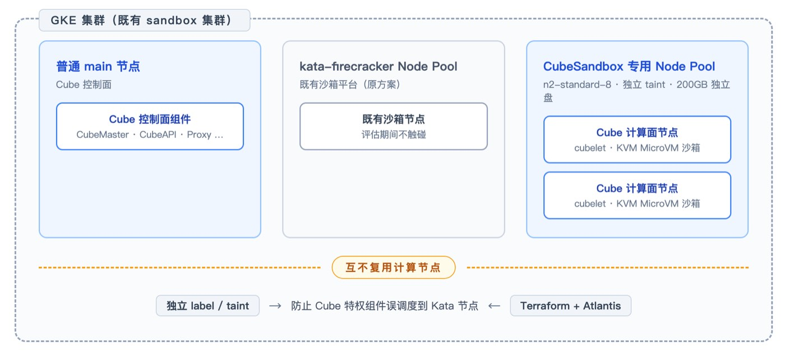

# Taking the Sandbox Overseas: Selection, Troubleshooting, and Performance Notes from Landing CubeSandbox on GKE

By｜Infra Engineer, Alva · RuiPeng Zhang

**Editor's note:** Alva is a financial analysis service where LLM-driven Agents perform analysis work, and Agents need to execute partially untrusted analysis code in isolated environments.

Because the business runs on overseas cloud, Alva's full evaluation of CubeSandbox happened on GKE (Google Kubernetes Engine). This article records the three gates they went through: the ADC fix for private registry credentials, liveness determination for template snapshots, and the guest DNS problem that took the longest to diagnose — while sketching the three kinds of adaptation costs to watch for when a China-born open-source sandbox runs on an overseas cloud. We share it with teams likewise evaluating Agent sandboxes on overseas clouds.

## 1. Coexistence of Multiple Sandbox Options

Alva is a financial analysis service where LLM-driven Agents perform analysis work. During execution, Agents run Python and Shell, install dependencies, and execute partially untrusted analysis code — an isolated execution environment is the prerequisite for the entire chain.

This business chain previously ran on OpenSandbox, backed by Kata 3.x / Cloud Hypervisor-style solutions. It worked, but Alva's workload is typical short-lifecycle tasks — workspaces are created, executed, and destroyed frequently, and nearly every call pays an "environment cold start" cost. The Kata path is designed for general virtualization workloads: instances occupy resources at the granularity of full VMs, and environment readiness depends on a complete boot process. In practice this means the shorter the tasks and the more frequent the creation, the higher the share of fixed overhead per task — startup latency, per-instance overhead, and resource utilization all have room for improvement. **For exactly this reason, we didn't frame the question as "whether to replace the existing solution" — we evaluated four routes in parallel:**

- Continue optimizing the existing Kata path (OpenSandbox)
- Build our own Agent sandbox + MicroVM + a simple operator
- Adopt an existing MicroVM sandbox project
- Start evaluating and testing CubeSandbox

This August, after CubeSandbox v0.6.0 shipped Helm/Kubernetes support, we started a PoC on our STG GKE cluster. We chose it for validation because it combined several points worth testing: MicroVM isolation, an Agent-oriented template and snapshot model, E2B-compatible interfaces, CubeVS/CubeEgress network policies, and a K8s deployment method. **What we wanted to verify was one thing: whether these capabilities hold together under overseas GKE's real networking, image registries, Workload Identity, and CNI data plane.**

## 2. Coexist, Not Migrate

For the evaluation, we didn't create a new cluster — we added a dedicated CubeSandbox Node Pool inside the existing sandbox cluster: the control plane lands on regular main nodes, the compute plane is restricted to the new pool, and the existing sandbox platform stays on the original kata-firecracker nodes, with no mutual reuse. Coexistence without migration guarantees that any problem during evaluation never touches the live business.

*Figure 1: Coexistence deployment inside the GKE cluster*

Nodes are n2-standard-8, Ubuntu Containerd, with nested virtualization enabled and a 200GB dedicated disk; the new pool gets its own label and taint to prevent Cube privileged components from being mis-scheduled onto Kata nodes; all Terraform changes land only through PRs plus Atlantis. Cube Node initialization checks KVM, XFS/reflink, bpffs, host directories, and CIDR conflicts in order.

In practice, XFS/reflink and KVM were not the longest blockers — once the Chart's node-init went through the loopback XFS path, basic prechecks passed. What really took time were three cross-layer problems: private registry authentication, liveness determination for template snapshots, and Kubernetes network compatibility. Below I'll break down the symptoms and solutions of these three problems in detail.

One clarification: our current PoC does not enable Cube's PVM host kernel. Upstream v0.6.0's host-kernel bootstrap ships as RPM, while our GKE nodes run Ubuntu; to avoid unverified kernel modifications on STG nodes, this evaluation covers the standard KVM MicroVM path.

## 3. Gate One: Credentials for the Private Registry

The first problem after deploying Cube appeared at template import: CubeMaster's manifest requests to the internal Artifact Registry returned unauthenticated, even though the Pod running CubeMaster was in an environment with GKE Workload Identity enabled.

**After investigation, we found the root cause was a mismatch between two credential systems**: the original logic only used authn.DefaultKeychain when the source had no explicit username/password — it reads Docker-config-style keychains; but GKE Workload Identity's short-lived access tokens are only provided through ADC (Application Default Credentials) and the metadata service, and never appear in the Docker keychain automatically.

We fixed this in [PR #1544](https://github.com/TencentCloud/CubeSandbox/pull/1544), merged upstream in early September. The fix follows five principles:

- Use ADC only when the registry is \*.pkg.dev and no explicit credentials exist;
- Explicit username/password takes highest priority;
- Other registries keep the original DefaultKeychain behavior;
- ADC tokens go through a refreshable token source, so a pull lasting over an hour won't fail midway;
- On ADC failure, keep clear logs and fallback, distinguishing three cases: "insufficient permissions," "ADC unavailable," and "anonymous pull."

Insisting on ADC rather than stuffing in a service-account JSON key comes from the principle of minimal component identity: template import only needs one component reading Artifact Registry, so only CubeMaster's KSA is bound to a dedicated GSA, with permissions narrowed to the necessary read scope — no other Cube control-plane component gets a cloud identity. Once a long-lived credential enters Helm values, Kubernetes Secrets, images, hosts, or the business Agent environment, the exposure surface grows from "one component" to "the whole supply chain" — the JSON key is exactly the opposite of that design.

## 4. Gate Two: Liveness Determination for Template Snapshots

The second problem was exposed by an AMD64/ARM64 rootfs mismatch: when syncing images on Apple Silicon environments without confirming the AMD64 child manifest, templates end up with a rootfs of the wrong architecture.

What makes this problem so confusing is how far apart the symptom and the cause are: after guest init exits due to the architecture mismatch, the template build flow continues as usual, the snapshot is generated normally, the status shows READY — and only the subsequent restore fails. At first glance it looks like a snapshot or restore problem. But when we aligned guest init, CubeShim's task lifecycle, and Cubelet's snapshot call onto the same timeline, we located the real gap: before snapshotting, there was no trustworthy task liveness check — a dead guest was persisted as a seemingly usable template.

In the course of fixing this, there's one experience we especially want to share: why not ExitCh / Task.Wait?

The original wait stream was bound to the create RPC's context, and that context is normally canceled once the create RPC returns successfully. Even if the guest is still running, the waiting side may receive context canceled. Judging "the guest has exited" from that would create a reverse false positive: a live guest judged dead, the build flow wrongly interrupted. Based on this finding, the final approach in our [PR #1541](https://github.com/TencentCloud/CubeSandbox/pull/1541) is: CubeShim registers an init-task watcher when the app snapshot is created, and Cubelet calls Task.Status under the containerd namespace with an independent short-timeout context — two Running checks before the snapshot, with a very short stability window in between.

We want to stress: the purpose of this fix is not to make snapshots wait indefinitely, but to avoid freezing a dead environment into a "seemingly usable" template. For downstream users, the latter is more dangerous than a build failure: it postpones the failure to the most unrelated moment.

## 5. Gate Three: Guest DNS

The last problem took us the longest to diagnose. The requirement came from the real business chain, which needs to resolve internal model gateway domains; accessing LLMs, third-party APIs, and package repositories likewise depends on DNS.

The initial symptom: the guest's /etc/resolv.conf pointed at the GKE kube-dns ClusterIP, and resolving the internal gateway, api.openai.com, and google.com all timed out — while directly accessing the model gateway's IP on port 443 succeeded. We first took a detour to rule out the upper layers: after the business temporarily bypassed DNS through a proxy and got a real CUBE_CODEX_OK reply, the model, SDK, key, and basic HTTPS path were all eliminated, converging the problem onto DNS itself.

Then came three layers of path verification: pointing the guest directly at the kube-dns ClusterIP — failed; switching to GKE NodeLocal DNSCache — the template correctly wrote 169.254.20.10, still failed; running a self-hosted DNS relay inside the Pod — the relay itself was healthy and the template correctly wrote the relay address, yet the guest still couldn't get UDP/53 packets delivered. After all three failed, we examined Cubelet/CubeVS runtime configuration and v0.6.0 source code, and concluded at the time: the guest uses an independent internal address and gateway, CubeVS has special handling for UDP to that internal gateway, and neither Helm-configured DNS servers, added allow_out, nor an in-Pod CoreDNS could establish the complete forward-and-return path for guest DNS packets. This judgment later turned out to be only half right.

The turning point came from a controlled experiment: when creating a sandbox, explicitly passing network.allow_out=\["10.204.0.10/32"\] made that sandbox's DNS and TLS all succeed — the internal gateway domain, api.openai.com, and google.com all resolved, TLS 1.3 handshake succeeded, end-to-end in 1.068 seconds. This experiment showed that CubeVS's existing UDP NAT, DNS learning, and reverse-NAT paths were working all along; what was really missing was Cubelet's policy allowance for the resolver — the original shouldAppendDNSAllowOut guard only auto-allowed the resolver when the sandbox had domains or L7 rules configured, while a sandbox with a pure IP/CIDR policy never got access to the resolver configured in its own resolv.conf.

*Figure 2: Guest DNS diagnosis approach*

Once the root cause was corrected, the fix itself was narrow. In [PR #1741](https://github.com/TencentCloud/CubeSandbox/pull/1741) we did exactly one thing: when the effective guest resolver is a private, link-local, or loopback IPv4 address (such as GKE kube-dns's 10.204.0.10), Cubelet automatically allows a /32 for that resolver, even if the policy itself is IP-only. The original guard was deliberately kept, to prevent sandboxes targeting only IPs from gaining resolver access their policy doesn't need; public resolvers still follow the original condition; a list mixing private and public resolvers won't auto-allow the public ones. The entire fix reuses CubeVS's existing data plane without changing CubeVS. It also has honest limitations: v0.6.0's policy mapping is CIDR-granular, so the resolver exception currently grants all ports of that IP — future port-aware policies can narrow it to UDP/TCP 53; IPv6 is still skipped under the existing IPv4 data plane.

This gate also left a lesson: when all three layers of verification fail, the two hypotheses "data plane broken" and "policy not allowing" look exactly the same symptomatically. Distinguishing them requires not more path experiments, but a minimal control — explicitly allow first, then see whether it works.

## 6. Performance Test Results

Throughout the evaluation we held one line: never loosen what shouldn't be loosened just to get things running first. Concretely, all changes stayed within well-isolated boundaries: the dedicated Node Pool never touches existing Kata nodes; control plane and compute plane are scheduled separately; all images are synced to the internal Artifact Registry; Cube API and Proxy are exposed to testers through dedicated Internal LoadBalancers with source CIDR restrictions; no public entrypoints, no reuse of existing Ingress, no touching the existing platform's releases; no long-lived service-account JSON keys.

For production responsibilities, we also drew a fairly clear division: CubeSandbox only carries the restricted execution plane; business user identity, approval, tenancy, and call audit belong to the upper-layer platform; each workload class uses its own template, network policy, and identity; third-party credentials prefer short-term tokens or CubeEgress's per-request injection over environment variables.

Performance-wise, the currently verified template create—execute—delete short-task path is indeed fast. The data below comes from the business cluster calling across clusters via a dedicated Internal LoadBalancer, the same pre-warmed template, 5 serial plus 2 concurrent runs:

| Metric | p50 | Max This Round |
|:--|:--|:--|
| Sandbox.create | 0.228s | 0.758s |
| Shell | 0.103s | 0.178s |
| Python | 0.281s | 0.308s |
| Full lifecycle (incl. delete) | 0.779s | 1.348s |

All seven executions succeeded. But we did not make a one-to-one comparison between these numbers and Cube's nominal "bare-metal cold start" or the existing sandbox solution's results, for three reasons:

1. Pre-warmed template, single dedicated node, minimal concurrency — not a complete cold-start benchmark;
2. The Cube side measured Shell/Python short tasks;
3. The existing sandbox solution's business image was measured on the Agent HTTP/SSE path, with different resource specs, network locations, and ready semantics.

So our takeaway is "on Cube, short-lifecycle tasks do feel fast," but since the comparison conditions are unclear, we cannot yet claim how many times faster Cube is than the existing solution — that awaits further verification.

## 7. Advice for Similar Teams

Based on the exploration and hands-on experience above, we want to offer seven pieces of advice to teams likewise considering an Agent sandbox on overseas clouds:

- Build a dedicated compute Node Pool from day one; never share hosts with existing business sandboxes/runtimes.
- Control image architecture explicitly; when syncing images on Apple Silicon and similar environments, always confirm the AMD64 child manifest (the original trigger of our second gate was right here).
- Design Workload Identity/ADC for private registries from day one; never introduce long-lived JSON keys just to pull templates.
- Verify KVM, storage, CIDR conflicts, and Node Pool upgrade strategy before deploying; don't conflate the guest address pool with Pod/Service/VPC ranges.
- Don't treat Helm Ready as network compatibility passing; on day one you should run real-sandbox E2E for DNS, HTTPS, Service DNS, ClusterIP, and internal-network denial (our longest-diagnosed gate appeared exactly after all deployment prechecks were green).
- Budget adaptation cost separately for GKE Dataplane V2 / Cilium-style data planes — currently you cannot assume they work out of the box like TKE VPC-CNI or Flannel.
- Put performance benchmarks after networking, template reliability, and security policies — otherwise what you measure is only "can create," not whether business Agents can run stably.
