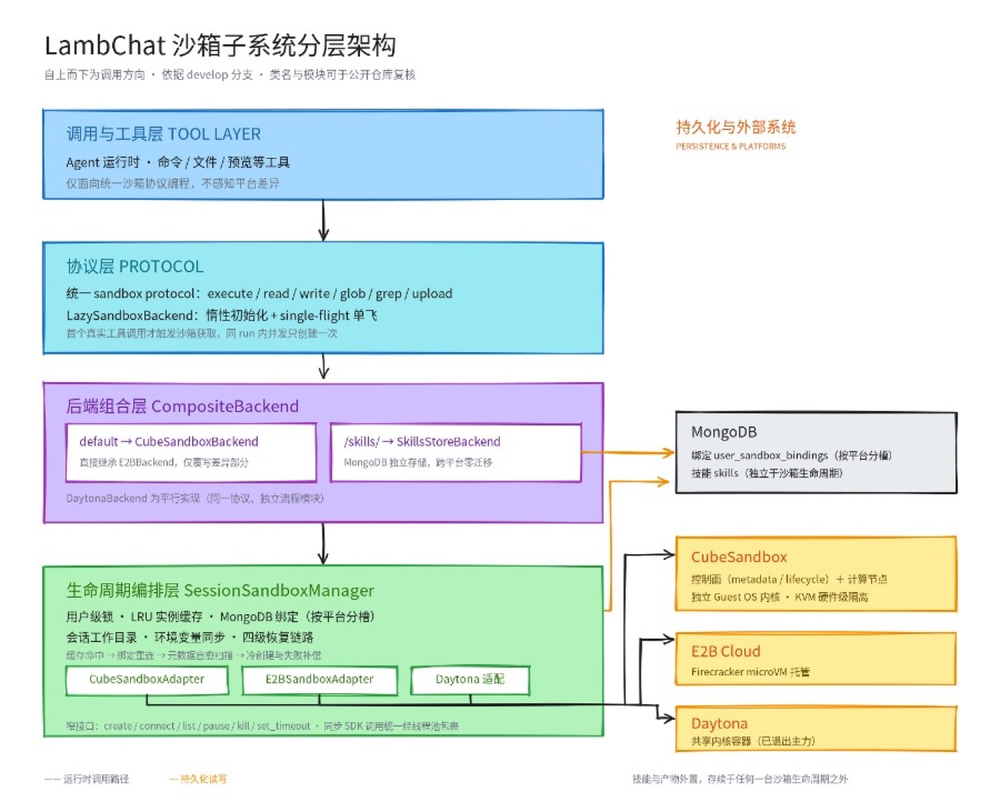

# How Much Code Does Switching Sandbox Backends Take? Selection and Field Notes from Migrating an Agent Platform

By｜Clivia, Author of LambChat

**Editor's note:** LambChat is a multi-tenant Agent system with integrated Skills capabilities. Its sandbox layer supports three backends: E2B, CubeSandbox, and Daytona.

This article records the real pitfalls the project hit when adopting CubeSandbox: user-level persistent binding, a four-level lookup chain, post-resume 504s, and the bash -lc login-shell environment problem. For developers building Agent platforms who need to pick a sandbox backend, these are directly reusable samples.

## 1. Introduction

LambChat is a multi-tenant Agent system with integrated Skills capabilities, built on deepagents / LangGraph. The project has a concept called "digital space": every user binds to a resident sandbox of their own that persists across sessions — not a new sandbox per conversation. Users install Python packages, upload files, and let the Agent tinker freely inside. Precisely because users tinker freely, isolation is a hard requirement — one user's actions must not affect other users or the host system.

The reasons for choosing CubeSandbox are straightforward: KVM hardware-level isolation with an independent kernel per sandbox; snapshot/pause/resume is essential for user-level persistent sandboxes — auto-pause when idle, auto-resume on the next request, memory state preserved; and its API is E2B-protocol compatible, so our existing E2B backend code can be reused.

**The question this article answers is concrete: for an Agent platform already in production, switching the sandbox from the default backend to CubeSandbox — how much code actually changes, and how many pitfalls?**

## 2. Where the Sandbox Sits in the Project: A Four-Layer Structure

LambChat's sandbox layer is not a single "executor" — it's a four-layer structure:

*Figure 1: The sandbox's four-layer structure*

**Layer 1 is the Router (CompositeBackend)**: the routing layer, sending /skills/ path requests to a dedicated skill-storage backend and everything else to the active sandbox backend. Sandbox execution and skill storage can therefore evolve independently.

**Layer 2 is the Backend layer**: E2BBackend is the base implementation; CubeSandboxBackend inherits from it and only overrides the differences (ls, get_info, pause); DaytonaBackend is implemented independently. Switching backends means changing a single field in the config.

**Layer 3 is SessionManager**: responsible for user-to-sandbox bindings. Each user's sandbox ID is stored in MongoDB's user_sandbox_bindings collection, with an in-memory OrderedDict serving as an LRU cache.

**Layer 4 is the Sandbox SDK**: directly calling each vendor SDK's native APIs.

## 3. What CubeSandboxBackend Inherits and What It Writes

CubeSandboxBackend inherits from E2BBackend — a deliberate design: CubeSandbox's API is E2B-compatible, the two share lifecycle-management semantics, and only a few behaviors differ. Inheriting the base class means the CubeSandbox-specific adaptation code is only about 200 lines.

Four methods were written:

- **ls**: CubeSandbox has no native file-listing API, so we run an inline Python script inside the sandbox to implement it.
- **get_info**: the returned sandbox info fields come in both camelCase and snake_case styles; we made bidirectional compatibility handling.
- **pause**: a CubeSandbox-only capability that the base class lacks — implemented separately.
- **list_user_sandboxes**: CubeSandbox supports enumerating sandboxes by metadata.user_id — a capability E2B doesn't have — used to power the four-level lookup chain.

## 4. User-Level Persistent Binding + the Four-Level Lookup Chain

LambChat's design: one user maps to one sandbox, shared across sessions — the sandbox lifecycle follows the user, not the conversation. This differs from the common session-level binding.

Finding a user's sandbox goes through a four-level lookup chain:

1. **In-memory cache hit**: the process-local OrderedDict LRU cache — the fastest path;
2. **MongoDB binding reconnect**: after a process restart the in-memory cache is lost; restore the binding from the user_sandbox_bindings collection and reconnect with sandbox.connect();
3. **Enumerate existing sandboxes for reuse**: if MongoDB has nothing either, call list_user_sandboxes() filtered by metadata.user_id — maybe a sandbox was created before but the binding record was lost;
4. **Create a new sandbox**: only when the first three levels all miss.

There's also a fifth-level fallback: if multiple sandboxes are found for the same user (an abnormal case, e.g. duplicates from concurrent creation), asynchronously clean up the extras and keep only one.

## 5. AutoPause Configuration and the Real Pitfall of Post-Resume 504s

At sandbox creation, we configure on_timeout=pause and auto_resume=true via the lifecycle field. Sandboxes auto-pause after idle timeout and auto-resume on the next request — one of the core reasons we chose CubeSandbox.

After running it for real, we found a rather hidden problem: after pause, on resume, the control plane returns running, but the data plane may not be truly ready yet. When a user request arrives, envd returns 504 Gateway Timeout instead of the normal response we expected.

**The debugging process at the time:**

The symptom was users reporting "sandbox command execution failed with a timeout." We first suspected LambChat-side logic — checked our timeout settings and retry logic, all fine. Then we looked at the CubeSandbox side: sandbox.get_info() returned running, everything looked normal. But executing a simple command directly against the sandbox returned 504.

**The control plane says running, the data plane says 504 — the two don't match.**

The real root cause: CubeSandbox's pause/resume is asynchronous. After resume triggers, the control plane flips the state to running first, but the data-plane envd process needs time to fully restore service. Within this window, the control-plane and data-plane states are inconsistent.

Our solution is to treat this window as an anomaly to actively detect: in SessionManager's health check, beyond judging the control-plane state, we also send a lightweight request to the data plane; a 504 is judged unhealthy, triggering fallback to another sandbox or creating a new one.

This 504 tolerance logic is code that only gets written after stepping into the pit for real. It's not in the docs, not in the API reference — you only meet it once you run it.

## 6. The bash -lc Login-Shell Problem in the Python e2b SDK

Another pitfall comes from the Python e2b SDK's default behavior: command execution is wrapped with bash -lc by default, which launches a new login shell.

Single executions are fine, but if a task runs in two phases — say install dependencies first, then run the script — environment variables and PATH set in phase one don't carry into phase two, because every execution is a fresh login shell.

The root cause here is not CubeSandbox itself but the E2B SDK protocol's default execution mode. Our workaround is to explicitly re-set the environment variables that need to persist between the two phases, rather than relying on shell state carrying over automatically.

## 7. Migration Workload Assessment

Actual code changed when switching from the default backend to CubeSandbox:

| Change | Code Size |
|:--|:--|
| CubeSandboxBackend class (inheritance + 4 methods) | ~200 lines |
| CubeSandbox-specific enumeration lookup in SessionManager | ~50 lines |
| 504 health-check tolerance logic | ~30 lines |
| Config items (CUBE_API_URL, CUBE_TEMPLATE, etc.) | ~10 fields |
| **Total** | **~300 lines** |

For an Agent platform already in production, this is a one-day workload. The premise: CubeSandbox is E2B-protocol compatible, so our E2BBackend base class can be inherited directly. If the two protocols were incompatible, the magnitude would be entirely different.

## 8. CubeSandbox Capabilities We Haven't Used

CubeSandbox capabilities LambChat hasn't used so far:

- **Snapshot API**: untouched. WeKnora turned snapshots into a skill-image cache layer; our skill storage currently goes through a dedicated backend, not the snapshot path.
- **Template management**: the template ID is passed in via external config; there's no logic to auto-create or rebuild templates.
- **Network policies**: allowInternetAccess, allowOut, denyOut are all unused — default allow.

These three are CubeSandbox's differentiated capabilities; our integration depth hasn't reached them yet. If skill storage later moves to the snapshot path, or per-tenant network policies become necessary, those are the next directions to evaluate.

## 9. References for Other Teams

If you're also building an Agent platform and choosing a sandbox backend, our suggestions:

1. **Decide the binding granularity first**: session-level or user-level? This determines your lookup chain and lifecycle-management complexity. User-level binding is simpler, but you must handle the "one user, multiple sandboxes" anomaly cleanup.
2. **E2B compatibility is leverage**: if you already have an E2B backend, CubeSandbox's compatible protocol lets you integrate at very low cost. Inheriting the base class and overriding differences is far faster than writing an adapter layer from scratch.
3. **Treat pause/resume state inconsistency as an anomaly**: control-plane running doesn't mean data-plane ready — health checks must hit the data plane.
4. **Know the bash -lc problem in advance**: environment variables between two-phase tasks must be passed explicitly; don't rely on shell state.
5. **Differentiated capabilities can come later**: snapshots, template management, and network policies — CubeSandbox's differentiated capabilities — can start with minimal integration and be adopted on demand.

## 10. Closing Thoughts

Switching from the default backend to CubeSandbox took us about 300 lines of code and one day. The premise of that magnitude: CubeSandbox is E2B-protocol compatible, and our E2BBackend base class could be inherited directly.

What really took time wasn't writing code — it was the pitfalls: designing the four-level lookup chain, the 504 tolerance logic, the bash -lc environment variable problem. These pits aren't in the docs; you only meet them once you run it. We hope this article helps the next person doing the same thing step into a few fewer of them.
