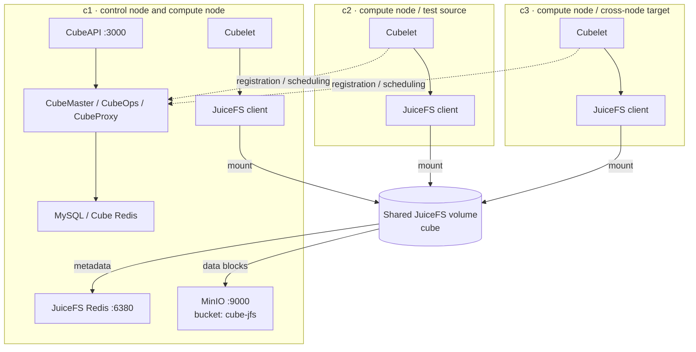

# CubeSandbox JuiceFS Multi-Node Performance Benchmark

## 1. Introduction

This report benchmarks CubeSandbox lifecycle operations using JuiceFS shared storage: template start, snapshot creation, pause and resume, plus cross-node snapshot start and pause/resume.

**Important:** Results are highly dependent on hardware, network, template contents, JuiceFS cache state, object-storage and Redis latency, and sandbox workload. They describe this deployment and are not performance guarantees for other environments.

## 2. Test environment

### 2.1 Three-node hardware

All three nodes were Tencent Cloud PVM instances with identical CPU and data-disk specifications. Their system-disk capacities differed.

| Node | Role | CPU | Memory | System disk | Data disk |
|---|---|---|---|---|---|
| c1 | Control node, compute node, and storage services | 16 vCPU, AMD EPYC 9754 | 32 GiB (about 30 GiB visible to the OS) | 500 GiB XFS | 1 TiB XFS mounted at `/data` |
| c2 | Compute node and test source | 16 vCPU, AMD EPYC 9754 | 32 GiB (about 30 GiB visible to the OS) | 500 GiB XFS | 1 TiB XFS mounted at `/data` |
| c3 | Compute node and cross-node target | 16 vCPU, AMD EPYC 9754 | 32 GiB (about 30 GiB visible to the OS) | 100 GiB XFS | 1 TiB XFS mounted at `/data` |

All nodes used the following software environment:

| Item | Value |
|---|---|
| OS | TencentOS Server 4.4 |
| Kernel | `6.6.69-opencloudos9.cubesandbox.pvm.host-g0de43d6b3bcd` |
| CPU topology | 1 socket × 16 cores × 1 thread, 1 NUMA node |
| CubeSandbox version | v0.7.3 package with core components built from the tested branch |
| Test date | 2026-10-28 |

### 2.2 Deployment topology

c1 ran the CubeSandbox control plane and one Cubelet. c2 and c3 were compute nodes connected to c1. Both local and cross-node tests were started from c1 through its CubeAPI.



Local operations were performed on c2; cross-node operations ran from c2 to c3. The scripts request placement through CubeAPI `distribution_scope`. Control-plane queries and node-isolation commands run locally on c1.

### 2.3 JuiceFS, Redis, and MinIO

Each node mounted the same JuiceFS volume named `cube`. See [JuiceFS service configuration](/guide/cross-node-snapshot/juicefs) for setup details.

| Item | Value |
|---|---|
| JuiceFS client | `juicedata/mount:ce-v1.4.1` |
| Mount point | `/data/cubelet/jfs` |
| Metadata engine | Redis 7 on c1, `redis://c1:6380/0` |
| Object storage | MinIO on c1, `http://c1:9000/cube-jfs` |
| Local cache directory | `/data/cubelet/jfs-cache` |
| Per-node cache limit | 102400 MiB (100 GiB) |
| JuiceFS trash retention | 1 day |

All nodes used the same mount options:

```text
--no-usage-report
--cache-dir /data/cubelet/jfs-cache
--cache-size 102400
--prefetch 16
--max-fuse-io 1M
--cache-large-write
--writeback
```

`--writeback` writes dirty data to local staging before uploading it asynchronously to MinIO. The benchmark therefore records both API latency and the time until data reaches `remote_status=ready`.

### 2.4 Sandboxes and templates

| Item | Value |
|---|---|
| Backend | JFS |
| Image | `cube-sandbox-cn.tencentcloudcr.com/cube-sandbox/sandbox-code:latest` |
| Sandbox size | 2 vCPU / 2000 MiB |
| Writable layer | 1 GiB |
| Exposed ports | 49999, 49983 |
| Health check | HTTP 49999 |

Create the template with:

```bash
cubemastercli tpl create-from-image \
  --image cube-sandbox-cn.tencentcloudcr.com/cube-sandbox/sandbox-code:latest \
  --writable-layer-size 1G \
  --expose-port 49999 \
  --expose-port 49983 \
  --probe 49999 \
  --backend jfs
```

Record the resulting template ID for the following tests.

## 3. Test scripts and procedure

### 3.1 Scripts

The benchmark uses `tests/perf/cubebench_jfs_local.py` and `tests/perf/cubebench_jfs_cross_node.py`. Both run on c1. The cross-node script requests cross-node scheduling through CubeAPI; its database queries and optional node isolation use Docker/MySQL and `cubeopscli` locally on c1. Shared logic is in `tests/perf/jfs_bench_common.py`.

### 3.2 SDK and environment variables

Install the local Python SDK from the repository root:

```bash
python3 -m venv /tmp/cube-perf-venv
source /tmp/cube-perf-venv/bin/activate
pip install -e ./sdk/python
```

Set cluster addresses:

```bash
export CUBE_API_URL=http://<cubeapi-host>:3000
export CUBE_PROXY_NODE_IP=<cubeproxy-ip>
export CUBE_CONTROL_NODE=c1
export CUBE_NODES="c1=<c1-ip>,c2=<c2-ip>,c3=<c3-ip>"
```

Neither local nor cross-node tests require SSH: run them on `CUBE_CONTROL_NODE`. `CUBE_CONTROL_NODE` is required because it identifies the node that hosts the local Docker/MySQL and `cubeopscli` control-plane dependencies. Do not include departed nodes in `CUBE_NODES`, otherwise cross-node recovery may fail while isolating or restoring scheduling state.

### 3.3 Full commands

Local and cross-node results are written to separate JSON files. First run the c2 local benchmark on c1:

```bash
python3 tests/perf/cubebench_jfs_local.py \
  <tpl-id> \
  --section local \
  --origin c2 \
  --samples 10 \
  --concurrency 1 5 10 \
  --warmups 1 \
  --round-gap 10 \
  --label "$(date +%F), c2 local, bundled MinIO" \
  --out /tmp/jfs-local-perf.json
```

Then run the c2 → c3 cross-node benchmark on c1:

```bash
python3 tests/perf/cubebench_jfs_cross_node.py \
  <tpl-id> \
  --backend jfs \
  --section all \
  --origin c2 \
  --target c3 \
  --samples 10 \
  --concurrency 1 5 10 \
  --warmups 1 \
  --round-gap 10 \
  --allow-node-isolation \
  --label "$(date +%F), c2-to-c3, bundled MinIO" \
  --out /tmp/jfs-cross-node-perf.json
```

Render the two JSON files as the Markdown tables used in sections 4.1–4.4:

```bash
python3 tests/perf/cubebench_jfs_report.py \
  /tmp/jfs-local-perf.json \
  /tmp/jfs-cross-node-perf.json \
  --out /tmp/jfs-perf-tables.md
```

### 3.4 Scenarios and measurement scope

| Scenario | Measurement |
|---|---|
| Template start | Create a sandbox from a template on c2 until the SDK create call returns |
| Snapshot creation | Create a snapshot of a sandbox on c2 and wait for remote data readiness |
| Snapshot ready | Time after snapshot API return until CubeMaster records `remote_status=ready` |
| Local snapshot start | Start from a reused snapshot on c2 |
| Pause | Call pause on c2 until the sandbox is paused |
| Pause ready | Time after pause returns until the paused package reaches `remote_status=ready` |
| Local resume | Call connect on the paused sandbox on c2 until resume completes |
| Cross-node cold snapshot start | Create a unique snapshot for each sample, then first start it on c3 |
| Cross-node warm snapshot start | Reuse one snapshot for repeated starts on c3 |
| Cross-node resume | Pause on c2, isolate all nodes except c3, then resume on c3 |

Each scenario is measured at concurrency 1, 5, and 10, retaining 10 valid samples per cell. `--warmups 1` runs one concurrent warmup batch before measurement. `fromsnap-cold` skips warmups because it uses a new snapshot for every sample. The command waits 10 seconds after each batch.

The scripts measure each worker's API call and immediate readiness wait. Cleanup is outside the metric. Values in this report are the average of 10 valid samples per group.

## 4. Results

Tables show average latency only. All values are in `ms`.

### 4.1 Template start and snapshots

| Metric | Concurrency 1 | Concurrency 5 | Concurrency 10 |
|---|---:|---:|---:|
| Template start | 157.7 ms | 231.0 ms | 352.4 ms |
| Snapshot creation | 606.6 ms | 1210.0 ms | 1817.9 ms |
| Snapshot data ready | 240.2 ms | 508.9 ms | 2635.4 ms |
| Snapshot creation to data ready | 846.9 ms | 1718.9 ms | 4453.3 ms |

Template start grows smoothly with concurrency. At concurrency 10, the snapshot API averaged about 1.82 seconds; waiting for writeback data to become safe for cross-node reads added about 2.64 seconds on average.

### 4.2 Local snapshot start, pause, and resume

| Metric | Concurrency 1 | Concurrency 5 | Concurrency 10 |
|---|---:|---:|---:|
| Local snapshot start | 162.3 ms | 381.8 ms | 350.7 ms |
| Pause | 623.3 ms | 1048.8 ms | 1602.8 ms |
| Paused package data ready | 239.4 ms | 808.6 ms | 2846.2 ms |
| Pause to data ready | 862.8 ms | 1857.5 ms | 4449.0 ms |
| Local resume | 380.0 ms | 953.6 ms | 1473.5 ms |

The pause API returns once data has entered local staging. “Paused package data ready” continues waiting until related staging blocks finish uploading. At high concurrency, local resume and background upload both contend for shared FUSE, disk, and object-storage queues.

### 4.3 Cross-node snapshot start

| Metric | Concurrency 1 | Concurrency 5 | Concurrency 10 |
|---|---:|---:|---:|
| c2→c3 cold start | 743.8 ms | 1073.6 ms | 1543.2 ms |
| c2→c3 warm start | 213.7 ms | 339.8 ms | 512.8 ms |

A cold start needs c3 to read data not previously read there for that snapshot. The warm scenario reuses the snapshot and cache, so it is noticeably faster. This test did not explicitly drop c3 JuiceFS or Linux page cache, so cold-start results are not strict cold-cache measurements.

### 4.4 Cross-node pause and resume

| Metric | Concurrency 1 | Concurrency 5 | Concurrency 10 |
|---|---:|---:|---:|
| c2 pause | 631.0 ms | 1077.2 ms | 1769.8 ms |
| Paused package data ready | 242.4 ms | 808.8 ms | 2804.7 ms |
| Pause to data ready | 873.3 ms | 1886.0 ms | 4574.4 ms |
| c3 resume | 907.7 ms | 1427.1 ms | 2416.7 ms |

All 10 samples completed with c3 as the scheduling target. Cross-node resume includes creating target-node-private objects on c3, starting the VMM, and waiting for the guest health check. It excludes the time spent by the test script isolating nodes and restoring scheduling state.

## 5. Conclusions and notes

- **Template start scales well with concurrency.** Average latency at concurrency 1, 5, and 10 was 158, 231, and 352 ms.
- **Snapshots and pauses have API and asynchronous readiness phases.** With writeback, API return does not mean another node can safely read every block; wait for `remote_status=ready` before cross-node consumption.
- **Cross-node behavior was validated.** Snapshots made on c2 started on c3, and sandboxes paused on c2 resumed on c3.
- **Cache state materially affects cross-node start.** At concurrency 10, the first start averaged 1.54 seconds and the warm result 0.51 seconds. Reports must state their cache conditions.
- **High-concurrency resume leaves optimization headroom.** Local resume at concurrency 10 averaged 1.47 seconds, versus 2.42 seconds for cross-node resume. Further analysis can split storage clone, VMM restore, and guest-probe time.

Before reproducing these results, read [`tests/perf/README.md`](https://github.com/TencentCloud/CubeSandbox/blob/master/tests/perf/README.md) for safety guidance, parameter constraints, and cross-node isolation behavior.
