# OMA: A Cloud Managed Agents Platform — From Getting Agents Running to Delivering Reliably

By｜Master Zhang's Blog (张师傅的博客)

> This article was originally published on the WeChat official account "张师傅的博客" (Master Zhang's Blog, by 挖坑的张师傅). It is republished on the Cube Sandbox official blog with the author's authorization; the content stays faithful to the original, with only formatting adaptations.

This article introduces OMA, the cloud-hosted managed agents platform we built, along with its overall architecture and design trade-offs.

While integrating Agents into real business, we found that after connecting models and tools, a large set of operational problems remain: how to recover long tasks after interruption, how to use credentials safely, how to persist files, how to reach intranet tools, and whether execution and cost are traceable. These problems recur across different businesses and are best handled centrally by a shared runtime platform.

That is the work OMA aims to take on. Referencing Anthropic's managed agents design, we implemented session management, inference/execution decoupling, credential custody, and filesystem capabilities on our own infrastructure, letting business teams define and use Agents through APIs. Below we start from this division of labor, then expand on each module's implementation and our considerations in selection and practice.

## From Model APIs to Managed Agents

When building an Agent directly on a model API, the model provider runs the model while the application side runs the agent loop: sending context, parsing tool calls, executing tools, returning results, and deciding whether to continue or finish the task.

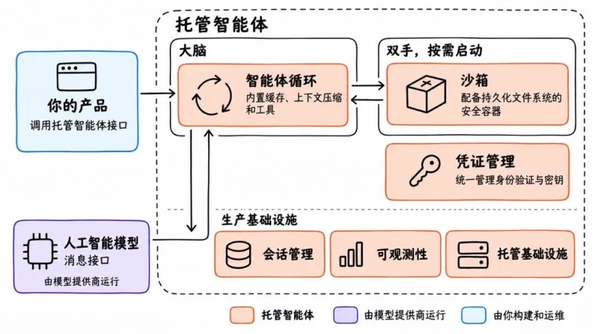

*Figure 1: What application teams must build and operate when using model APIs directly*

The blue parts in the diagram all need to be built and operated by the application team, including context management, tool execution, session persistence, credential management, sandbox isolation, and observability. Off-the-shelf Agent frameworks reduce the work of the loop itself, but these go-live capabilities still need someone to wire them up.

A managed agents platform centralizes these common responsibilities; business systems submit tasks, receive events, and fetch results through interfaces.

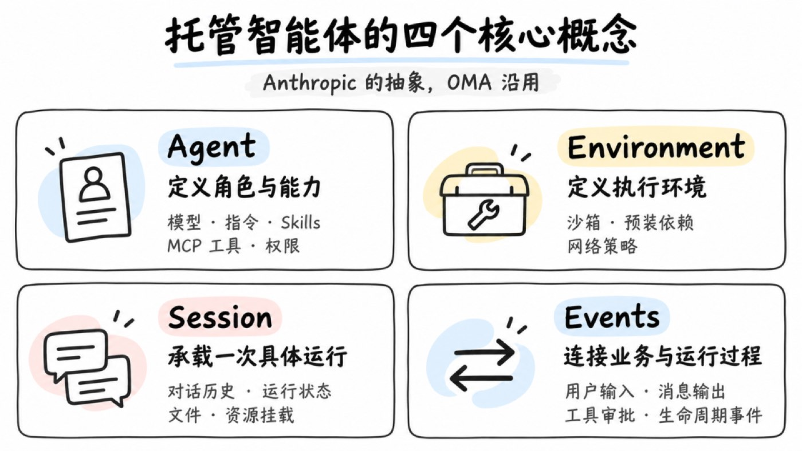

*Figure 2: The division of labor of a managed agents platform*

Business developers define the Agent's role, instructions, Skills, and tools, decide which operations require approval, and feed results back into business flows. The platform handles the underlying execution, state persistence, and security controls.

For a self-hosted platform like OMA, the enterprise still needs to deploy and operate it, but this can be centralized in a platform team so different businesses reuse the same capabilities. Model services are run by the configured model providers; data flows depend on the specific deployment and model configuration.

## Starting from Anthropic's Design

OMA is built primarily with reference to Anthropic's Claude Managed Agents. It offers the agent loop together with production infrastructure as a service, cleanly separating business definition from runtime mechanics. We borrowed its resource model, API design, and architectural ideas such as session persistence, brain-hand separation, and credential custody.

Other vendors are advancing similar products. OpenAI's Agents API offers the Codex runtime framework as a managed service, handling sessions, context compaction, and recovery; Alibaba Cloud's Qoder Cloud Agents also provides interfaces for Agent definition, environment configuration, session management, and event streams.

Implementations differ, but they all solve the same problem: how to organize model calls, tool execution, and state management into tasks that can run continuously. As tasks grow longer, what developers must manage expands from single requests to entire sessions.

OMA aims to provide these capabilities on the enterprise's own infrastructure. We offer an Anthropic-SDK-compatible interface, integrating existing model services, storage, private-network tools, and security systems, while preserving room to swap underlying components.

## Abstraction, Abstraction Again

Anthropic abstracts the managed agents interface into Agent, Environment, Session, and Events — describing capability definition, execution environment, running instance, and interaction process respectively. OMA follows the same abstraction.

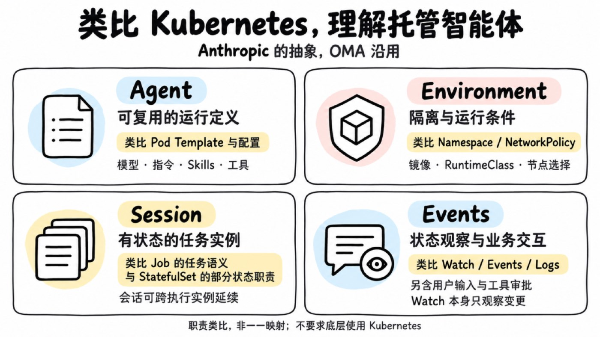

*Figure 3: The four-layer abstraction — Agent, Environment, Session, Events*

Take analysis reports as an example: developers configure the model, report requirements, analysis Skills, and data query tools in the Agent, and prepare Python dependencies with network restrictions in the Environment. When a user submits data, the business system creates a Session, sends the task, subscribes to Events to show progress and handle approvals, and gets the report when done.

When the user follows up, the same Session can be reused; another task creates a new Session, reusing the same Agent definition. Capability configuration and runtime state are thus managed separately, and business code never has to touch processes, sandboxes, or storage directly.

## Understanding the Abstraction via a Kubernetes Analogy

If you know Kubernetes, you can think of Agent as a reusable workload definition, Environment as the execution conditions, Session as a stateful task instance, and Events as connecting state observation with business interaction.

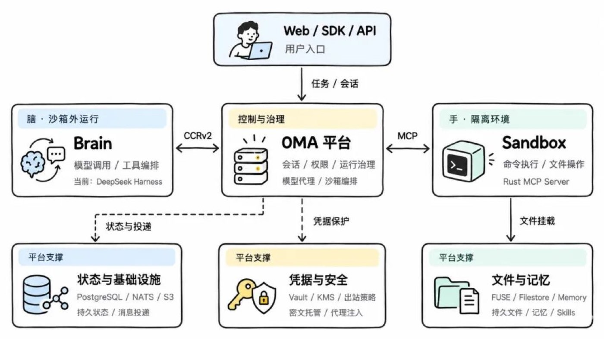

*Figure 4: A responsibility analogy with Kubernetes concepts*

This is an analogy of responsibilities: a Session can outlive execution instances, and Events also carry inputs and approvals. They do not map one-to-one to Kubernetes resources, nor do they require Kubernetes underneath. Refer to the official workload and API concepts for comparison.

## Overall Architecture

In implementation, OMA's core has three parts: the Platform handles control and governance, the Brain handles inference and tool orchestration, and the Sandbox handles command execution and file operations.

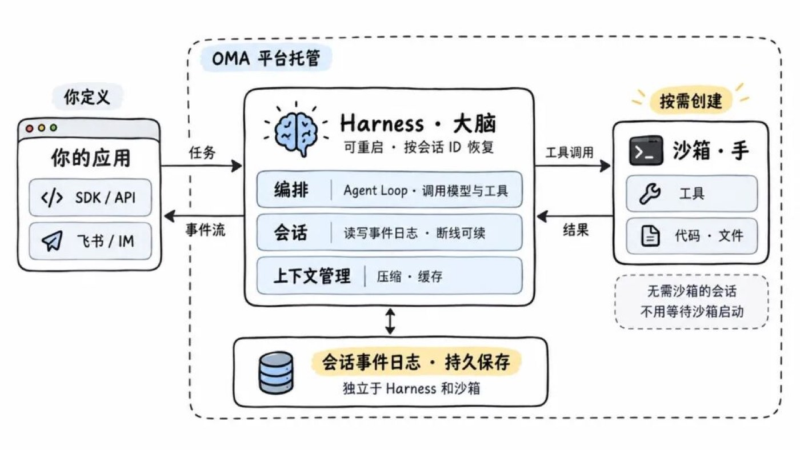

*Figure 5: OMA overall architecture*

The OMA platform is the entry point for business integration and runtime management — it manages sessions, permissions, and resources, provides model proxying and sandbox orchestration, and delivers messages, approval requests, and state changes to business systems.

The Brain runs the agent loop outside the sandbox, exchanging inputs, outputs, and runtime events with the platform over CCRv2. We implemented this part with DeepSeek Harness. When a command needs executing, the Brain initiates a tool call, the platform handles permissions and resources, and the Rust MCP Server inside the sandbox executes and returns the result.

Underneath, PostgreSQL, NATS, and S3 carry state storage, message delivery, and object storage; Vault, KMS, and egress policies protect credentials and network access; FUSE, Filestore, and Memory provide persistent files, Skills, and memory.

The full task flow: the business submits input, the Brain calls the model and orchestrates tools, the Sandbox executes operations, and the platform saves state and returns events and artifacts to the business. The most critical boundary here is giving the inference process, the execution environment, and the session state their own lifecycles.

## Decoupling the "Brain" from the "Hands"

A common deployment approach puts the runtime framework and the command execution environment together inside the sandbox. That's easy to start with, but after a user initiates a task, you wait for the sandbox to start, then for the Agent process to start, and only then does the model call begin. When the sandbox fails, the inference process and session state may go down with it.

Following Anthropic's design, we moved the Brain outside the sandbox; the sandbox only carries tool execution, and session state is persisted independently by the platform.

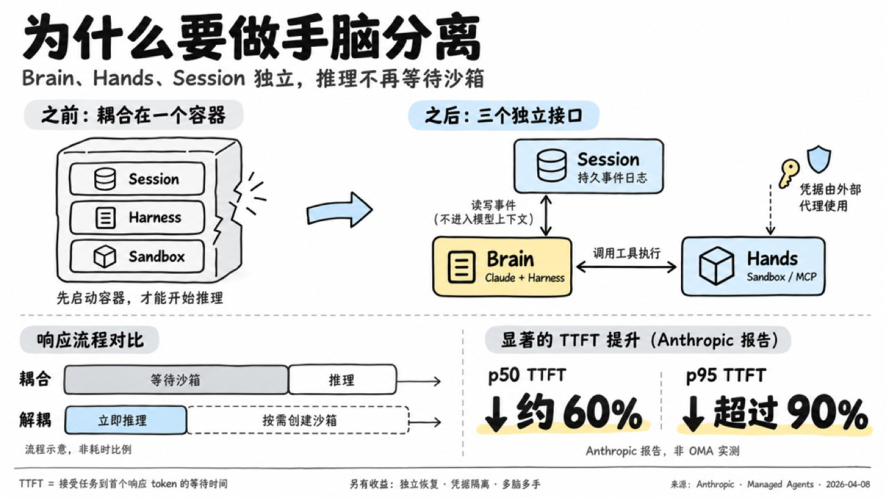

*Figure 6: Brain-hand separation — the Brain outside the sandbox, the sandbox carrying only tool execution*

**First response doesn't wait for the sandbox**

The Brain can start reasoning upon receiving input while the sandbox prepares in parallel — or is created only when a tool genuinely needs executing. Tasks that need no commands skip environment preparation entirely.

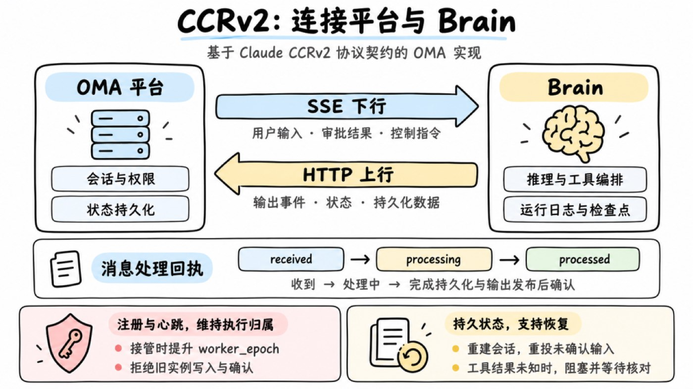

*Figure 7: First response without waiting for the sandbox*

Anthropic's related architecture report cites results of about 60% lower p50 TTFT and over 90% lower p95. TTFT is the wait time for the first response token.

**Runtime processes are replaceable; state must be preserved**

A sandbox can be recreated after failure; a restarted Brain can reload history by session ID. The basis for recovery is that conversations, events, and files are persisted independently in the platform. Whether an already-issued tool call can be retried depends on execution state and business idempotency — more on that in the CCRv2 section.

**The Brain is replaceable; the protocol must stay stable**

After brain-hand separation, the platform and the Brain need a runtime protocol between them. We reference CCRv2, which Claude Code uses for remote-running scenarios. It's Claude's non-public protocol, specifying how the runtime side and the service side exchange inputs, outputs, approvals, and session state.

From OMA's adaptation practice, its binding to Claude models or any specific runtime framework is not deep. It mainly solves communication and lifecycle problems in remote execution: reconnection and redelivery, process recovery, instance takeover, and approval interactions mid-task. Other Brains that implement this contract can plug into the same backend.

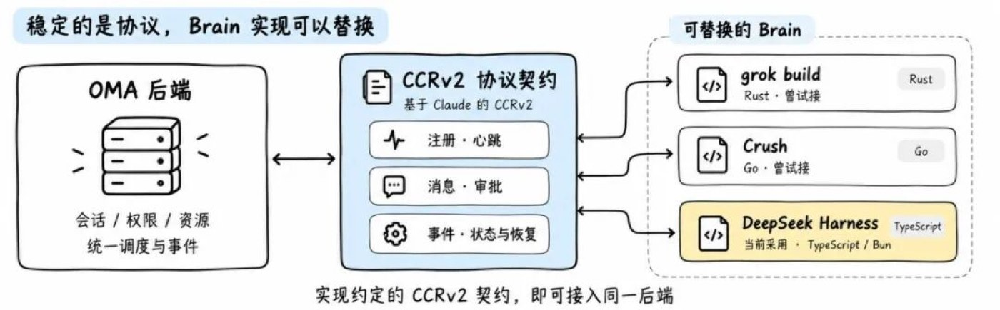

*Figure 8: Leases and takeover under the CCRv2 protocol*

In OMA, a Brain maintains its lease via heartbeats after registration. On takeover, the platform bumps worker_epoch and rejects the old instance's writes and acks. User input, approval results, and control commands go down over SSE; outputs, state, and persistent data come back over HTTP. received, processing, and processed distinguish received / in-progress / done, avoiding equating message delivery with task completion; control responses are handled separately and never blocked by tasks waiting on approval.

Run logs and checkpoints are saved by the platform for session reconstruction. But if a tool already executed and its result wasn't saved, recovery marks it as unknown-result, blocking until manual verification — avoiding duplicate operations from automatic replay. MCP handles tool integration, the model API handles inference calls, and CCRv2 manages execution-platform coordination.

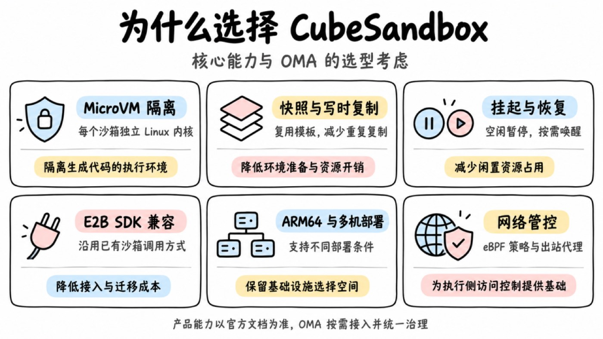

*Figure 9: The division of labor among MCP, model API, and CCRv2*

We tried integrating grok build (Rust) and Crush (Go), and finally chose DeepSeek Harness, mainly for its plugin extension model. Event reporting, platform data reads, and protocol adaptation can all be done via plugins — reducing modifications to core code and lowering the cost of tracking upstream upgrades.

In this selection, language uniformity, performance, and resource footprint all mattered — but how much code long-term maintenance would require was an equally practical consideration. Keeping the protocol boundary exists precisely so that when the Brain is swapped later, business integration and session data keep being reusable.

## The Sandbox Solution

OMA's cloud deployment uses Tencent's open-source CubeSandbox. I started following it right when it was open-sourced and studied its underlying implementation. Compared with the E2B approach we tried before, some of its designs fit our needs better: PVM support lets it run on adapted cloud servers, reducing dependence on bare metal; networking is managed with eBPF; and the overall implementation is lighter.

That said, early versions still had stability gaps, and we ran into problems in use. So OMA keeps an independent sandbox adaptation layer, continuously evaluating alternatives and choosing the underlying implementation by maturity and deployment needs.

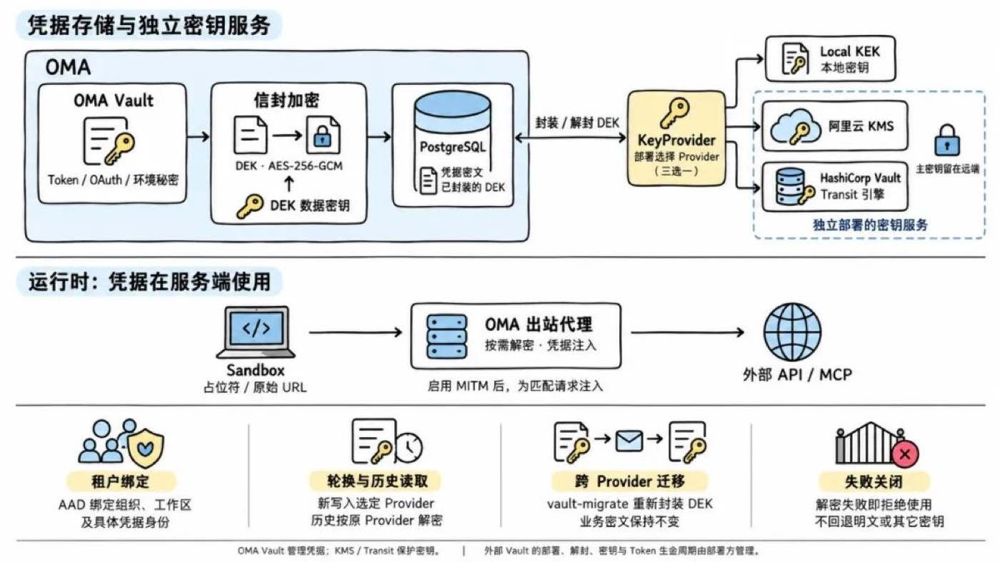

*Figure 10: The sandbox adaptation layer — CubeSandbox in the cloud, e2b-local locally*

For local development we use our own e2b-local, an E2B-compatible gateway written in Go. It accepts E2B SDK requests and runs sandboxes on Docker, Linux VMs managed by OrbStack CLI, or Apple Container. Cloud and local share the same interface, maximizing reuse of call logic and reducing adaptation work when switching environments.

## Credential Security

With the runtime boundary split, the other key problem is credentials. We previously wrote specifically about the design where credentials never enter the Agent or the sandbox; here we revisit it along the call chain.

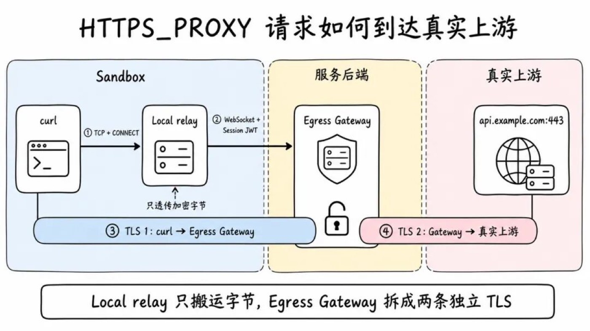

*Figure 11: The call chain where credentials never enter the Agent or sandbox*

Agents touch user input, web pages, repository files, and tool results — any of which may carry malicious instructions. If generated code can read long-lived credentials, copying or exfiltration becomes possible. So OMA keeps long-lived credentials on the platform control plane; the sandbox only holds the session identity needed to access the platform, and real credentials are injected by a proxy when requests go upstream.

Model and MCP addresses are managed by the platform; requests pass through the model proxy and the MCP gateway respectively. Other network access initiated by scripts, CLI tools, or generated code goes through the egress gateway, where the platform checks targets against authorization configuration.

For example, when a CLI tool calls an authenticated business API, there's no need to write the API Key into the sandbox beforehand. The gateway matches the target service against credential bindings, attaches the authentication, and calls upstream.

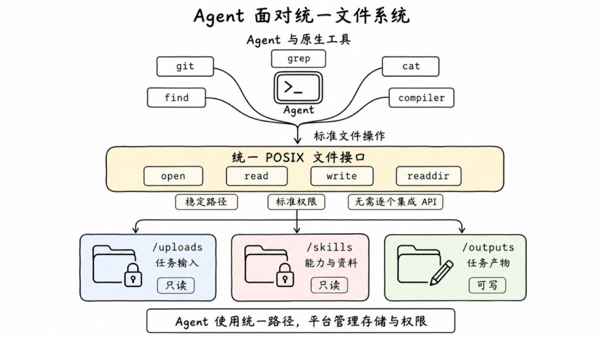

*Figure 12: Credential injection at the egress gateway*

On HTTPS links, the client issues a CONNECT request through the proxy, and the local relay forwards the encrypted bytes to the server side. The egress gateway terminates two independent TLS connections — client-to-gateway and gateway-to-upstream — performing policy checks and credential injection. Clients need the corresponding certificate trust configured.

This chain also has clear protocol boundaries — e.g., HTTPS CONNECT on 443, Git uniformly over HTTPS; real-world effectiveness depends on egress constraints, proxy configuration, and client compatibility.

**Ciphertext and decryption capability are managed separately**

Credential storage is protected with Vault and KMS mechanisms. The database holds ciphertext; runtime services call the key service to decrypt under authorized conditions, then inject into matching upstreams. Holding the database ciphertext does not equal holding a usable credential. The platform must also manage decryption permissions, usage scope, and call auditing.

## A Userspace Filesystem Based on FUSE

When Agents execute tasks in the Sandbox, they still rely heavily on native CLIs like git, find, and grep. These tools demand a stable POSIX file interface underneath: input files, Skills, and task artifacts must land at predictable logical paths, and the access method shouldn't change with the underlying storage form. A filesystem also offers intuitive permission boundaries — for example, mounting /skills read-only and /outputs writable.

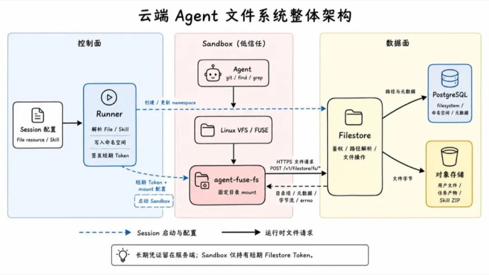

*Figure 13: The permission boundaries of the FUSE filesystem*

The problem: traditional distributed filesystems (NFS, NAS) are designed for long-lived, shared workloads, which doesn't fit Sandboxes that are created per Session, short-lived, and highly concurrent. Taking Alibaba Cloud NAS as an example, official usage limits include:

- A single filesystem can be mounted by at most 1,000 compute nodes simultaneously;
- A single account in a single region can create at most 20 general-purpose NAS filesystems, or 200 extreme-performance NAS filesystems.

If every Sandbox mounts as an independent compute node, or every Session gets its own filesystem, these quotas quickly become the bottleneck for concurrency scaling and resource orchestration.

Another common path is using tools like ossfs to mount a sub-path of an object-storage bucket directly into the Sandbox. That bypasses NAS instance and mount-node quotas and keeps absolute-path file access; but object storage is essentially a flat key-value space, and ossfs merely derives virtual directories from the / separators in object keys. It answers "how to read remote objects via file paths" but not "which files the current task should see."

So Agent-side file mounts must not directly expose physical buckets or host directories — they need a programmable abstraction layer that builds virtual views per task and controls permissions and lifecycle on the server side. FUSE (Filesystem in Userspace) fits this layer exactly — upward it keeps offering the standard POSIX interface, downward it hands namespace, authentication, and lifecycle to the platform.

FUSE provides a programmable abstraction layer between the standard POSIX file interface and platform services. Agents transparently access mount directories through syscalls like open, read, write, and readdir, without caring whether the underlying data source is a database, object storage, or a remote API.

FUSE only hands Linux file operations to a userspace process. To make this mechanism work for cloud Agents, Session orchestration, a virtual namespace, a remote file protocol, and a credential boundary must be built beyond FUSE itself.

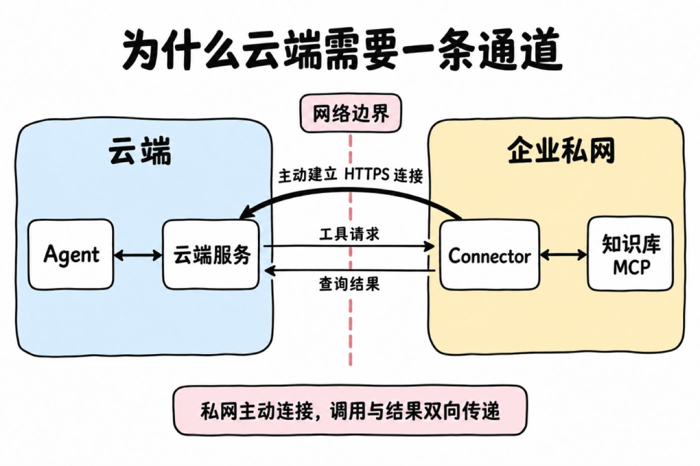

*Figure 14: Session orchestration and virtual namespace on top of FUSE*

In my view, the biggest benefit of building the filesystem on FUSE is giving every Session a virtual view organized by task. The paths an Agent sees need not correspond to actual locations in object storage. The platform can compose files scattered across different locations into one directory tree as the current task requires, while deciding what is visible, what is read-only, and what is writable.

For example, after a user uploads a CSV, the mount position can be specified via mount_path when associating the file with the Session. Setting it to /reports/input.csv, the platform normalizes it to /uploads/reports/input.csv, and the Agent reads it in the sandbox at /mnt/session/uploads/reports/input.csv. This path is determined by the task's needs, independent of the file's actual key in object storage, and no manual copying into the sandbox is required.

Likewise, multiple Skills can be composed into a unified directory, and the same content can be referenced by different Sessions with version and mount path chosen on demand. The platform organizes the view; the Agent uses files at the agreed paths.

This is especially convenient for Skill management. Versions of multiple Skills can be resolved separately during session preparation and then composed into a unified directory; even when content is stored as ZIP packages, the backend can parse in-package directories and read files on demand — reducing advance downloads, full unpacking, and repacking work.

So this layer separates "where files live" from "what the task sees." FUSE carries file operations; Filestore handles requests according to the session's directory mappings and permissions, then reaches the actual content. Uploaded files and Skills can be read-only while output directories allow writes; when the underlying storage layout changes, adjusting the mappings keeps the Agent-facing paths stable.

With file operations passing through the platform, permission checks and change records get a unified entry point. After a sandbox is replaced, the session's file view can be re-mounted; persistent content stays in the backend, and object-storage long-term keys never need to be handed to the execution environment.

## MCP Tunnel: Letting Cloud Agents Call Private-Network Tools

Cloud Agents have strong inference capabilities, but when a task needs to reach private-network core assets (like an internal knowledge base or an intranet OA system), they're usually blocked by the enterprise firewall.

There are three common solutions:

1. Give the MCP Server a public entrypoint: least change, but the private service is directly exposed to the internet, expanding the attack surface.
2. Connect networks via VPN or dedicated lines: wide connectivity, good for whole-network interconnection. If you only need to expose a few tools, the network and ops cost is high.
3. Reverse connection: run a client inside the private network that actively connects to the cloud, then receive tool calls over that connection.

We chose the third. The enterprise only needs to allow this client's outbound connection to the cloud; the MCP Server stays inside the private network. Reverse connection is not authorization: it only changes "who initiates the connection"; once the channel is up, calls still enter the private network and results still return to the cloud. Authorization scope and data flows must be designed separately.

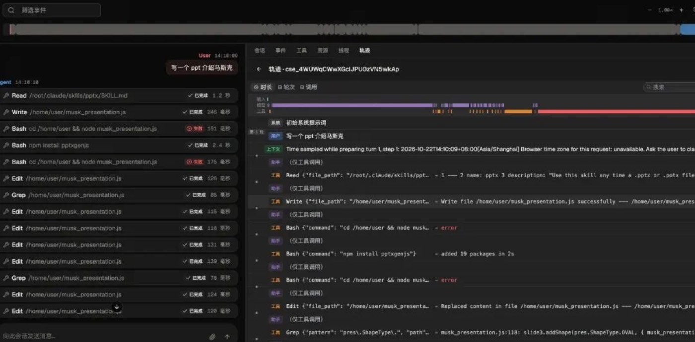

*Figure 15: MCP Tunnel reverse connection*

To let ready-made clients and management tools be used directly, we played Frankenstein:

- The management API fully aligns with Claude Managed Agents' Tunnels interface protocol;
- We didn't develop the private-network client — we use OpenAI's open-source tunnel-client directly, called the Connector below.

The protocols are ready-made; what we really had to design ourselves is the scheduling layer sandwiched in between.

tunnel-client's data plane is based on HTTPS long polling: the Connector opens a long-lived request to the cloud asking "any new tasks?", invokes MCP locally after receiving a task, and submits the result through another Response request. The whole process is plain outbound HTTPS — the friendliest possible to enterprise firewalls.

To the Agent, it's still an ordinary MCP call. This channel carries only tool requests and results — no need to turn internal services into general public entrypoints, nor to bridge the entire private network.

## Observability

Once tasks can run, we also need to know how well they run.

When a report fails to generate, the cause could be model misunderstanding, tool failure, missing dependencies, or permission denial. Looking only at the final reply makes root-causing hard; looking only at total tokens can't explain why one task suddenly got expensive.

OMA displays model and tool calls on a timeline, helping developers inspect execution steps, latencies, and failure points. When a task calls the same tool repeatedly, you can walk the records to check the tool description, parameter design, and Skill instructions.

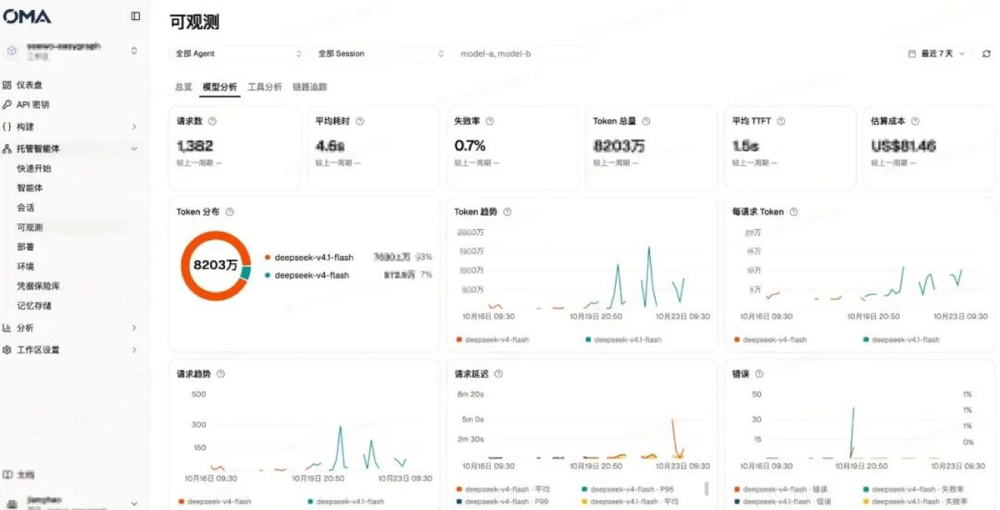

*Figure 16: The task timeline*

The global view aggregates requests, tokens, cost, and failures, supporting usage analysis by team and scenario.

*Figure 17: The global view*

These records currently serve mainly manual troubleshooting. Going forward, we plan to offer diagnostic suggestions based on traces, helping adjust prompts, tool configurations, and execution processes.

## Other Features and Plans

Beyond the designs expanded above, OMA also supports long-term memory, Dream, scheduled runs, session budgets, and GitLab / GitHub repository mounts. Scheduled tasks can generate daily digests or organize accumulated memories at night; repository mounts prepare code and files for development tasks.

Next, we'll focus on Agent evaluation. After adjusting a Skill, adding a tool, or switching models, a few chat experiences can't tell whether real tasks improved. We want to compare versions by actual output: whether the report was generated, whether content meets the bar, where the flow failed, and how cost changed.

## Closing Notes

This project is fundamentally a backend-heavy infrastructure project, and we'll keep sharing more of its implementation details going forward.
