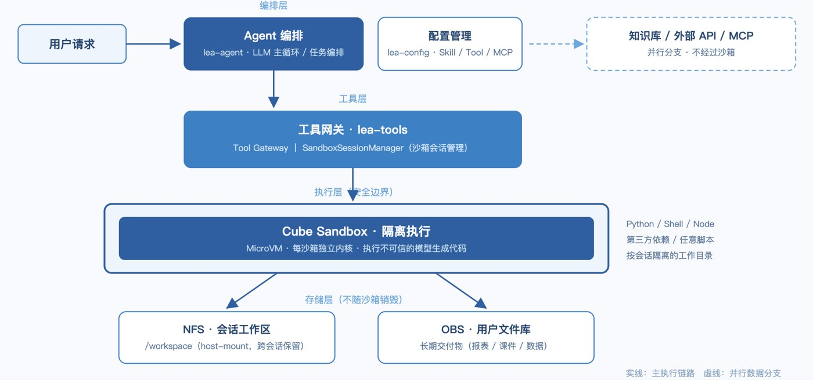
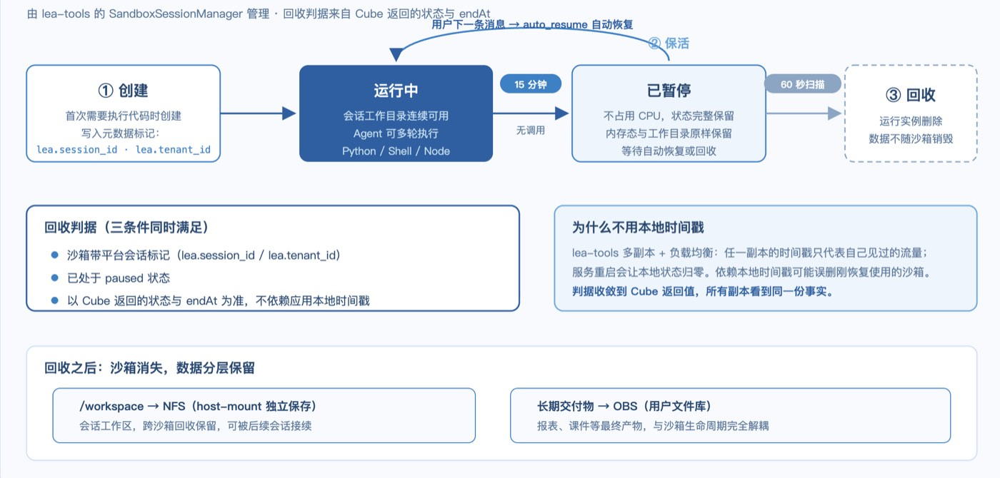
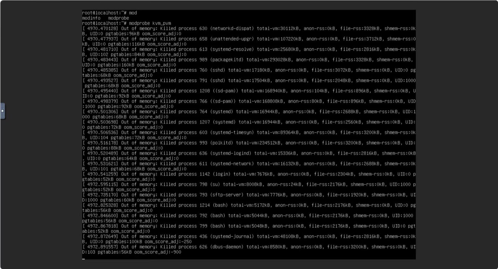

# Building an Agent Code Execution Layer on Cube Sandbox: Session Isolation, a Three-Stage Lifecycle, and Deployment Troubleshooting

By｜AI R&D Engineer, OUC Online · Lu Haoyang

**Editor's note:** Having Agents execute model-generated code is a problem every Agent platform faces: the code is untrusted and its source uncontrollable, so the execution environment itself is the security boundary of the whole chain. OUC Online (China Open University Online Education Technology Co., Ltd.) is building an Agent platform for education and office scenarios, where users define their own Agents, Skills, Tools, knowledge bases, and MCPs, and Agents compose retrieval, file processing, and code execution into continuous tasks.

The platform is still in evaluation and has not entered production; precisely because it is in the exploratory stage, this record preserves plenty of first-hand process detail: how the execution boundary was designed, how the sandbox lifecycle is managed, and the server resource problem hit when deploying by the docs. We share it with teams at a similar stage of Agent development.

## 1. The OUC Online Agent Platform Architecture

What we're building is a Manus-like Agent platform for education and office scenarios. Users configure Agents, Skills, Tools, knowledge bases, and MCPs on the platform, then let Agents compose retrieval, file processing, and code execution into continuous tasks. The currently stable typical tasks include: generating and editing XLSX reports from knowledge bases, generating and validating PPTX courseware, parsing and re-processing user-uploaded documents, scripted data analysis, complex file conversion, and multi-Agent collaboration.

The platform architecture has five layers: lea-agent handles the LLM main loop and task orchestration; lea-config manages the configuration of Agents, Skills, Tools, and MCPs; lea-tools is the tool gateway and also manages sandbox sessions; CubeSandbox performs the actual isolated execution; NFS and OBS respectively carry the session workspace and long-term deliverable storage.

*Figure 1: OUC Online Agent platform architecture*

After a user request comes in, it goes through Agent orchestration first, then through the Tool Gateway into a Cube sandbox for execution; knowledge base, external API, and MCP calls take parallel branches. **The execution role the sandbox must carry**: arbitrary Python, Shell, Node scripts and third-party dependencies may be generated by the model for execution, and the same session's working directory must remain usable across consecutive tasks.

## 2. Why the Execution Layer Uses a Sandbox

After integrating the sandbox, the most frequently asked question is: why can't these tasks run in ordinary containers or VMs?

Our understanding: the question is not whether containers or VMs can do it, but whether ordinary business containers and shared VMs are fit to serve as the execution boundary for untrusted, model-generated code. The capabilities we actually need boil down to these:

- A per-session isolated runtime environment — reusable across tasks but never leaking data between them;
- Timeouts and resource limits, preventing a single runaway task from taking down the host;
- Controlled mounts, letting the session workspace enter and leave the sandbox in a governed way;
- Network and file boundaries, stopping model-generated code from reaching internal services it shouldn't touch;
- A reclaimable lifecycle — sandboxes can be deterministically cleaned up after use.

This complete boundary is something ordinary containers cannot provide, so we placed the execution layer on a sandbox. We had evaluated other options before; Cube productized exactly the capabilities we needed, our tests mapped to every concept, so we decided to validate the whole chain with it first.

## 3. The Three-Stage Lifecycle: Brief Keep-Alive, Auto-Pause, Final Reclamation

After integrating the sandbox, the first engineering question to answer is lifecycle: when a session's sandbox is done, do you delete it immediately, or keep it long-term?

We reasoned from both extremes and concluded neither works. Immediate deletion hurts the multi-turn task experience — the user's next message pays another cold start; long-term retention keeps consuming sandbox slots and host resources. After weighing, we adopted the middle path of "brief keep-alive, auto-pause, final reclamation," managed uniformly by the SandboxSessionManager in lea-tools.

Stage one is creation. A sandbox is created only when a session first needs to execute code, with two metadata tags written at creation: lea.session_id and lea.tenant_id.

Stage two is keep-alive. After 15 minutes without calls, the sandbox is auto-paused via Cube's `on_timeout=pause` plus `auto_resume=true`. Once paused, the sandbox no longer occupies CPU, but its state is fully preserved; when the user's next message arrives, the sandbox resumes automatically with the working directory intact. This behavior fits the product vision of "one resident working environment per user" perfectly — it's one of the features we value most.

Stage three is reclamation. The platform-side lifecycle loop scans Cube every 60 seconds, reclaiming only sandboxes that satisfy two conditions simultaneously: carrying the platform session tag, and already in paused state. After reclamation the running instance disappears, but the session's /workspace is preserved independently via NFS host-mount, and long-term deliverables stay in the OBS of the user's file library — data does not die with the sandbox.

*Figure 2: Three-stage lifecycle state transitions*

In this design, the reclamation criterion uses the state and endAt returned by Cube, not timestamps in the application instance's memory. This choice comes from multi-replica concerns: lea-tools runs multiple replicas behind a load balancer, and any replica's local timestamp only reflects the traffic it has seen; a service restart zeroes local state entirely. If reclamation relied on local timestamps, a sandbox just resumed for use could be judged as timed out and deleted by another replica that never saw it. Once the criterion converges on Cube-returned state, all replicas see the same facts, and the risk of mistaken deletion disappears. To be clear, this logic has so far only been validated in the test environment; its behavior at production scale remains to be observed.

## 4. The First Hurdle: Deploying by the Docs, the Server Froze

Once the platform logic roughly took shape, we began deploying CubeSandbox — and immediately hit the toughest problem of the whole evaluation.

The initially requested machine was 4 cores / 8 GB RAM with a 50 GB system disk. After completing dependency installation per the docs' recommended resources and commands, at the step of loading the PVM KVM module, the server froze right after entering `modprobe kvm_pvm`. The system didn't reboot itself; the SSH connection dropped.

Our first judgment was insufficient resources, so we requested an upgrade from 4C8G to 4C16G. Redeploying after the upgrade produced the exact same phenomenon — still blocked at the modprobe step, still recoverable only via forced console reboot. By then we had confirmed two things: the problem reproduces reliably; the blockage is in module loading itself, unrelated to the system disk or CPU.

The OOM screenshot below confirmed the root cause for us: the host had experienced system-level memory exhaustion before freezing. Unfortunately, this server had no journald persistence — after reboot, the previous boot's kernel logs, memory curves, and slab statistics were all lost, so we couldn't precisely reconstruct how much memory the default parameter 16000 actually consumed at the time.

*Figure 3: OOM screenshot*

The eventual fix was adjusting `kmem_cache.max_num` from the default 16000 to 2000. After the adjustment, the module loaded smoothly and deployment passed on the first try.

It must be stressed: this parameter is not the product of systematic analysis — we had no conditions for root-cause analysis at the time and aimed simply to get deployment through. Looking back, the adjustment is consistent with the direction the OOM screenshot pointed to: memory overhead during module loading does vary with this parameter, and once lowered, 16 GB of memory sufficed. Stability-wise, under our current light samples we've observed no impact — but that conclusion's applicability is limited to just that.

The biggest reminder this problem gave us: **there is a gap between the documented minimum recommended resources and the real resource floor — the floor must be verified yourself**. Had journald and kernel logs been preserved, this could have been a complete root-cause analysis; what we achieved instead is only "symptom confirmation + targeted workaround," missing the mechanism-derivation link in between. Hence our practical advice for teams at the same starting stage: before deploying sandbox hosts, finish log persistence configuration first.

## 5. Performance Observations After Stabilization

After deployment stabilized, we timed the platform's common paths. These numbers all come from light samples without stress testing — more for reference than for assessment.

The first creation after the parameter adjustment took about 5.5 seconds. Once templates and node caches were warmed, the same creation dropped to 0.3–0.6 seconds. The first actual code execution after sandbox readiness took about 2.8 seconds end-to-end.

For a platform in the evaluation stage, these numbers suffice for a preliminary judgment: the wait for a session's first execution is acceptable, and sandbox-creation overhead for subsequent tasks is essentially eliminated by caching. But we don't intend to compare these numbers externally — no stress test has been done, and comparing light samples against other deployment forms wouldn't be fair. Rigorous benchmarking waits until after production.

## 6. For Teams Also Evaluating Sandboxes

After the whole evaluation, we recorded four suggestions that may be valuable for teams at the same stage:

- **Verify the resource floor yourself.** The documented minimum resources may fail at the module-loading stage; we verified that 16 GB with the parameter adjustment works — lower configurations are untested, and we won't draw conclusions for others.
- **Base lifecycle criteria on platform-side state; reduce reliance on application-local timestamps.** Multi-replica deployment and service restarts both pollute local state; building reclamation logic on "all replicas see the same facts" avoids a large class of follow-up problems.
- **Finish log persistence before deploying.** The biggest regret in this freeze investigation was the absence of complete kernel logs, leaving the root cause confirmable only down to "system-level memory exhaustion."
- **Design the reclamation strategy during evaluation.** The three-stage "brief keep-alive, auto-pause, final reclamation" performed well in validation, balancing multi-turn experience with host resource usage — far more comfortable than patching the design after entering production.
