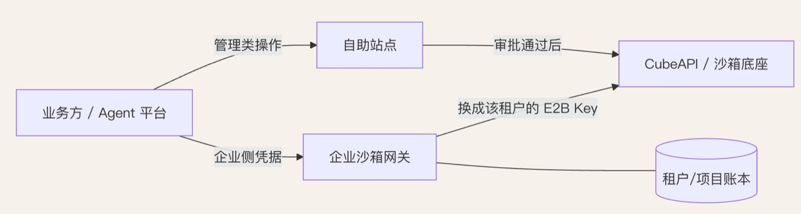
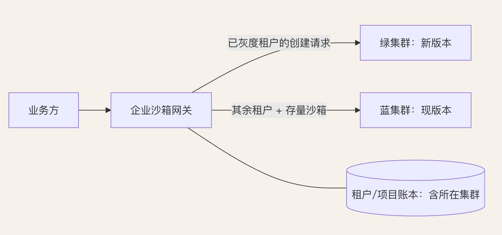

# Four Platform Capabilities Around a Multi-Tenant Sandbox: Gateway, Network, Storage, and Blue-Green Upgrades

*Authors: Liao Xiyou, Chang Zhenhua — Tencent engineers, AnyDev platform*

**Editor's note:** AnyDev is a development platform serving multiple internal Tencent business lines, using CubeSandbox to provide isolated execution environments for agent applications. Once a sandbox joins a multi-tenant platform, creating and running a single sandbox is only the starting point: the platform still has to handle tenant isolation, approval of management operations, enterprise network and storage integration, and protection of running tasks during foundation upgrades.

The AnyDev platform team did not modify the sandbox foundation for these needs; they built the corresponding platform capabilities around it. This article walks through tenant onboarding, enterprise networking, templates with persistent storage, and version upgrades, covering the design rationale, concrete methods and applicability of the scheme.

### 1. Why Build a Layer Around It

CubeSandbox provides millisecond startup, hardware isolation and CoW snapshots, but it mainly models the sandbox itself. AnyDev needs to offer these capabilities to multiple internal business lines, which brings platform concerns: tenant ownership, quotas, approvals, cost and audit.

If business teams called the foundation's E2B APIs directly, the platform could hardly guarantee that every operation respects tenant boundaries: a list API without tenant scoping would expose other tenants' sandboxes, and template create/delete operations would affect other business teams sharing the foundation.

Therefore, **our principle is: do not modify the foundation — build enterprise-side capabilities in three places around it:**

| Where | What it handles |
|:---|:---|
| **Front gateway** | Identity translation, API isolation, quota checks, accounting, upgrade routing |
| **Self-service portal** | Approval-type actions: templates, quotas, egress whitelists |
| **Data consumers** | Metering and archiving of lifecycle events |

The foundation side keeps its simple "only knows the Key" model; tenant-level visibility is carried by the outer layer.

### 2. Multi-Tenancy: Front Gateway + E2B Keys + API Isolation + Self-Service Portal

#### 2.1 How business requests reach the foundation

Business requests enter the foundation through two paths:

- Data plane (create, query, operate sandboxes): business side → gateway → CubeAPI;
- Management plane (templates, quotas, whitelists, etc.): business side → self-service portal → approval → foundation, never through business SDK calls.

*Figure 1: The two request paths into the foundation: the data plane goes through the enterprise sandbox gateway to CubeAPI; management operations go through the self-service portal and approval*

#### 2.2 Four things the gateway does

###### ① Identity translation and E2B key distribution

The gateway assigns each tenant (or project under a tenant) a separate downstream E2B key; business sides hold only enterprise-side credentials and never see the underlying key. Three benefits:

- The foundation rate-limits by key. Since each tenant holds an independent key, this limit naturally lands at tenant level — we don't need another token bucket;
- The underlying key can be rotated or revoked at any time; one tenant leaving does not affect others;
- Business sides integrate only with enterprise APIs, so the foundation is replaceable — switching clusters or shapes is invisible to them.

###### ② API isolation: whitelist allow + blocking interfaces without tenant semantics

The gateway maintains a whitelist by "method + path" and only allows tenant-safe operations; interfaces without tenant semantics are blocked, typically:

| Blocked | Why |
|:---|:---|
| Cluster-wide lists (all sandboxes, all snapshots) | No tenant dimension; forwarding them is a privilege escalation |
| Template operations (create/delete/rebuild) | Impact crosses tenants and cannot be attributed |
| Node and cluster ops | Platform operations, not for business teams |
| Any API that can't read ownership or do row-level filtering | Same as above |

###### ③ Quotas and pre-checks

Checks such as tenant concurrent sandbox counts and template whitelists live in the gateway, not the foundation — because the foundation's auth callback only forwards method and path, never the request body. A rule like "this tenant may only use approved templates" can only be judged after the gateway parses the request body.

###### ④ Accounting and ownership checks

After a create succeeds and returns a sandboxID, the gateway writes tenant, project, creator and timestamp into the ledger; later kill, pause, snapshot and other operations first check ownership against the ledger, so tenants can only touch their own sandboxes. Beyond the ledger, creation also writes tenant/project into the sandbox's metadata for later lookup, egress-policy binding and after-the-fact tracing.

#### 2.3 Self-service portal: funneling management actions

Template creation has cross-tenant impact and needs approval and ownership, so it is not exposed in the SDK and goes uniformly through the self-service portal. Management actions of the same nature are funneled there too:

| Action | Why through the portal |
|:---|:---|
| Create/upgrade/retire templates | Cross-tenant impact; needs approval and version conventions |
| Quota changes | Involves cost; needs approval |
| Egress domain whitelist requests | Security-related; needs security-team approval |
| "Never timeout" sandbox requests | Quota loophole; separate approval and counting |

Behind the portal we still call foundation capabilities, but tenant scoping, approval flow and audit trails live on our side.

#### 2.4 Reclaim: trading auto-pause for cost, constraining "never timeout"

Reclaim policy is built on understanding sandbox states. A sandbox has three states — running / paused / terminated (plus transient pausing and restoring); paused means the snapshot is persisted: no CPU or memory usage, only storage.

The default reclaim policy uses exactly this: auto-pause after N idle minutes, reclaim after M days. Pausing frees compute to cut cost while keeping the snapshot so long tasks can resume from a breakpoint — auto-resume on next access, with cold-resume latency counted into the SLA.

Beyond state-based reclaim there is one exception to handle: the foundation allows timeouts to be set to "never reclaim". Unconstrained, tenants would accumulate resident sandboxes and quotas would be meaningless, so "never timeout" requests get separate approval and counting in the self-service portal.

Two things worth noting about this design:

- The gateway becomes the mandatory path for every request: auth, quotas, accounting and routing all concentrate there, so treat it as a control-plane critical dependency — deploy multiple replicas and prepare a degradation plan. In particular, when the auth callback is unreachable, the foundation returns 5xx rather than a 401 for bad credentials, and the callback service (our gateway/auth service) directly affects all tenants.
- The block list is a continuously maintained item: foundation upgrades introduce new APIs, so we made "new APIs blocked by default" a hard gateway constraint — otherwise every foundation upgrade opens a gap in the blocking surface.

### 3. Networking: Avoid Private Subnet Conflicts and Converge Traffic onto Enterprise Gateways

Inside an enterprise, two networking issues matter most: subnet conflicts and traffic convergence.

#### 3.1 The primary problem: enterprise private subnets vs. Cube private subnets

Cube sandboxes have their own private address model: inside the sandbox, link-local addresses (169.254.68.x) are used, and private ranges — 10/8, 172.16/12, 192.168/16, 169.254/16 — are denied by default. The problem: enterprise intranets, cloud VPCs and container networks almost all fall inside those ranges, producing three classes of conflict:

| Conflict | Symptom | Handling |
|:---|:---|:---|
| Intranet services in "deny-by-default" ranges | Sandboxes cannot reach internal package mirrors, image registries or internal APIs at all | **Explicitly allow** item by item (specific allow beats deny — use it to punch holes); **do not loosen the default policy** |
| Overlapping range occupation | If the enterprise also occupies 169.254.0.0/16 (common for cloud metadata and internal shared services) or overlaps the sandbox address model, routing/policy anomalies appear and are extremely hard to debug | **Plan ranges apart** |
| Multiple VPCs / clusters stacked | Egress policies fragment and maintenance cost explodes | Converge egress points; fewer per-item policies |

We wrote the conclusions into our deployment guide:

1. The VPC/subnet hosting the Cube cluster must avoid enterprise intranet and container ranges;
2. Inventory "internal addresses sandboxes need to reach" in advance, allowing by domain first with CIDR as fallback;
3. For clusters already deployed on overlapping ranges, retrofitting usually costs more than rebuilding — build a new cluster on non-overlapping ranges and migrate.

#### 3.2 Inbound: always through the enterprise gateway

Business sides never connect to sandbox domain/path entries directly; all inbound goes through the enterprise gateway: unified domain, unified auth, rate limiting and audit, then the gateway forwards to the foundation's inbound entries — domain mode \<port\>-\<sandboxID\>.\<domain\> or path mode /sandbox/\<sandboxID\>/\<port\>/...

This gives the outside exactly one entry; certificates, domains and access control stay in enterprise hands, and switching foundation clusters or shapes is invisible to business sides. Sandbox ports are auto-assigned at creation and returned in the response; the gateway assembles backend addresses by sandboxID.

One caveat: a request hitting a paused sandbox triggers auto-resume, so the gateway should set timeouts and retry hints carefully to avoid business sides mistaking it for a failed request.

#### 3.3 Outbound: always through the enterprise egress gateway

Sandbox egress goes uniformly through the enterprise's existing egress gateway/proxy instead of each sandbox reaching the public internet on its own. Domain whitelists, audit, bandwidth and cost control then align with the enterprise's existing systems; converged egress IPs make IP-based allowlisting by external services feasible; and the foundation's egress policy acts as a second gate (deny private ranges by default + domain whitelist).

Once the egress path is converged, capacity planning must cover both ends: the foundation's egress source address pool is shared and finite (connection-count capped), and the enterprise egress gateway has its own connection and bandwidth limits — either end can become the bottleneck before CPU/memory does.

#### 3.4 Credentials and audit

- Credential injection (rewriting auth headers as requests pass the proxy) is our enforced default for business sides: agents can call internal APIs, but secrets never appear in the sandbox file system, environment variables, or model context;
- Egress access logs (requests, security events, TLS handshakes) are collected into the enterprise log platform; secrets are recorded only as fingerprint/name placeholders, never in plaintext;
- Egress logs are correlated with the sandbox ledger by time, attributable to tenants.

### 4. Storage

#### 4.1 Template governance: funneled through the self-service portal

Templates are the sandbox's read-only base and the source of its startup speed, so governance centers on controllable provenance and stable references:

| Item | Convention |
|:---|:---|
| Who may create templates | Submitted via the self-service portal + platform-team approval; image provenance traceable |
| Naming and aliases | Use aliases for stable references (e.g. python-3.12-agent); business sides never hardcode template IDs |
| Version upgrades | New template → canary → repoint the alias; invisible to business sides |
| Base images | Uniformly FROM the foundation-provided base image, keeping the in-sandbox daemon version consistent |

#### 4.2 Volume: persistent workspaces on enterprise shared storage

A Volume's lifecycle is independent of the sandbox, and the design is plugin-based: the control plane handles creation and deletion, nodes handle mount and unmount. We did not use an off-the-shelf object-storage plugin; **we built our own Volume plugin on enterprise shared storage**. The selection rationale:

| Dimension | Enterprise shared-storage plugin | Object storage (COS/S3) plugin |
|:---|:---|:---|
| Performance | Better, especially for agent workloads dense in small files (git clone, dependency installs, build caches) | Object storage request latency and metadata overhead are noticeable |
| Sharing semantics | Multi-sandbox / multi-node mounts of one workspace come naturally | Requires extra synchronization and consistency handling |
| Permissions and quotas | Directly reuses enterprise directory permissions, quotas, backups and lifecycle | Must build a separate set |
| Operations ownership | Stays within the existing storage team's system | A new storage shape and cost model |

In practice, this Volume carries three classes of workloads: code repositories and datasets as resident workspaces, avoiding re-pulling on every sandbox rebuild; dependency directories mounted as build caches, markedly shortening task time; cross-sandbox artifact sharing, mounted read-only by purpose to prevent accidental edits.

The plugin implementation must also cover: mount/unmount happens on the node, so concurrent mounts, reference counting, and mount cleanup on failed nodes need handling; deleting a still-mounted volume returns a conflict (409), which serves as a safety net.

### 5. Version Upgrades: The Blue-Green Pattern Settled After 0.6 → 0.7

#### 5.1 Why we stopped rolling in place

Upgrading from 0.6 to 0.7, we hit compatibility issues related to control-plane component splits and the template/snapshot compatibility baseline. Rolling in place puts that risk directly onto existing sandboxes — if existing ones break, the business side's running long tasks die, and rolling back images is slow and uncontrollable. So we settled on this upgrade principle:

**Keep existing workloads where they are; new ones go to the new version.**

#### 5.2 The blue-green shape

*Figure 2: The blue-green upgrade shape: creation requests from canary tenants route to the green cluster; everyone else and existing sandboxes stay on blue, with the ledger recording each sandbox's cluster*

- Blue = current-version cluster, carrying existing sandboxes and new creations from non-canary tenants;
- Green = new-version cluster, carrying new creations from canary tenants;
- Both clusters share one ledger and one self-service portal on the enterprise side; their foundations (control plane, nodes, templates, storage) are fully independent;
- Creation routing is controlled by the front gateway: by tenant (or tenant group) it decides whether create goes to blue or green; queries/operations route by sandboxID ownership.

**This is the gateway's extra payoff: it is not just auth and quotas — it is also the traffic switch for upgrades.**

#### 5.3 Upgrade steps

Our upgrade proceeded in four steps:

- Build the green cluster (new version), open it only to internal test tenants, and run smoke tests plus SDK compatibility regression;
- Ramp the gateway gradually: switch tenants to green one by one via whitelist, watching create success rate, startup latency, egress, snapshots/Volumes;
- Keep existing workloads on blue: blue stops accepting new creations from canary tenants; set a migration window, snapshot long tasks on blue — if snapshots work cross-cluster, restore from snapshot on green; otherwise rebuild and move data through shared Volumes or object storage;
- Cut over fully to green: default routing moves to green; blue stays through a rollback window, then retires.

#### 5.4 Why blue-green beats rolling back images

- **Rollback cost is minimal**: change gateway routing and it takes effect in seconds; no database schema rollback, no node image re-flashing;
- **Blast radius is controlled**: compatibility issues only affect "new sandboxes cut over to green", never existing ones;
- **Canary pacing by tenant**: important tenants move last, and a problem affects only one tenant group.

#### 5.5 Preconditions and costs

The scheme has clear preconditions and costs:

| Item | Description |
|:---|:---|
| Preconditions | The gateway can route by tenant; the ledger records each sandbox's cluster |
| Costs | Two clusters running simultaneously during upgrades (a doubled-cost window); if templates/snapshots/Volumes cannot be shared cross-cluster, migration cost falls on business sides and must be announced in advance |

### 6. A Few Conclusions Worth Borrowing

To summarize the practices above, for anyone building a multi-tenant sandbox platform:

1. **The engine works out of the box; the management plane must be built.**Our shape: a front gateway (identity translation + E2B key distribution + API isolation + quotas + routing) plus a self-service portal (funneling approval-type actions: templates, quotas, whitelists).
2. **The key to multi-tenancy is "block + funnel"**: interfaces without tenant semantics are blocked at the gateway; cross-tenant actions like template creation go uniformly through the portal. The block list is maintained against foundation versions, with new APIs blocked by default.
3. **The primary networking problem inside an enterprise is private subnet conflict**: before deployment, keep the Cube cluster's VPC/subnet apart from enterprise intranet and container ranges; intranet access works by explicit per-item allowlisting, never by loosening the default policy. Converge both directions onto enterprise gateways — unified auth and audit inbound, unified whitelist and cost control outbound — so cluster switches stay invisible to business sides.
4. **Storage: build the Volume plugin on enterprise shared storage** — performance and the permission system both beat off-the-shelf storage plugins; funnel template governance through the portal and reference templates by alias.
5. **Upgrade blue-green**: existing workloads stay on blue, new ones go green, with the gateway controlling creation routing per tenant; rollback is just a routing change, and compatibility risk is confined to "new sandboxes cut to green" — existing ones are never touched.
