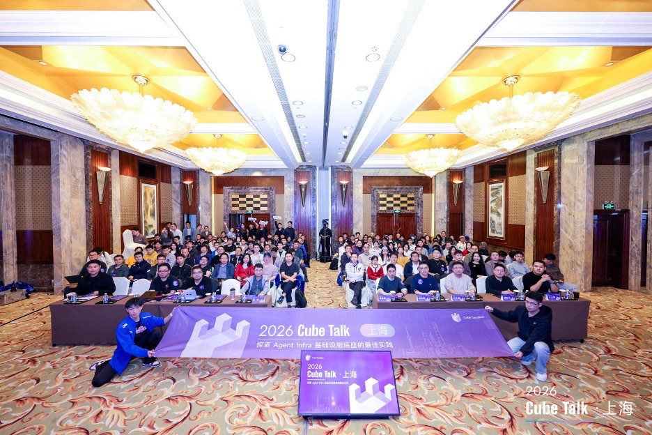
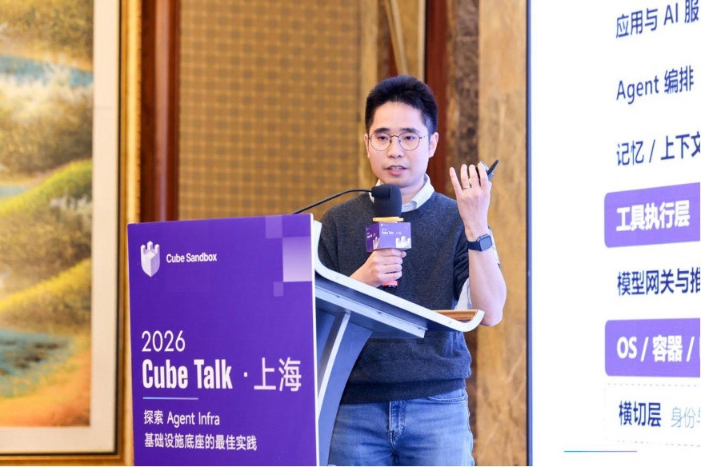
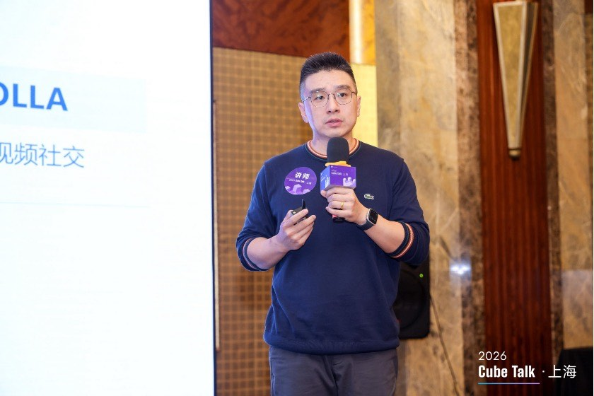
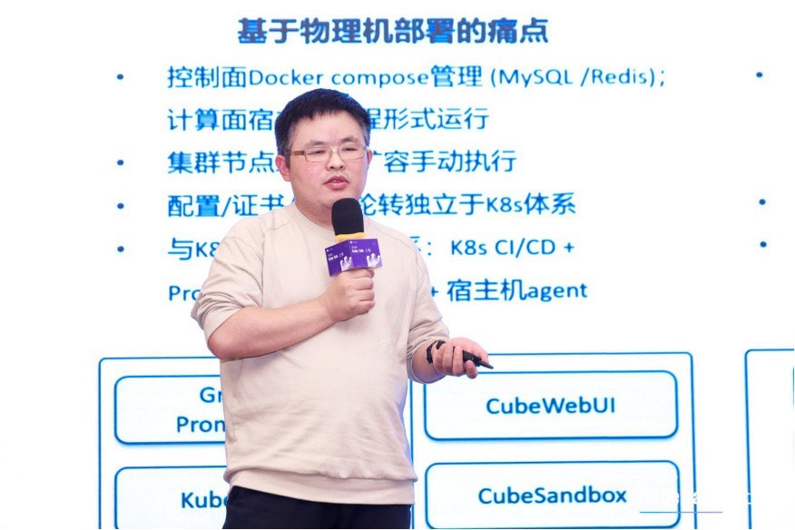
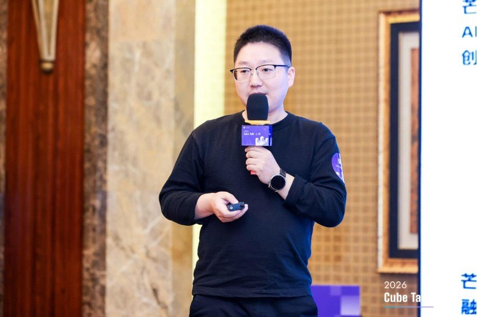
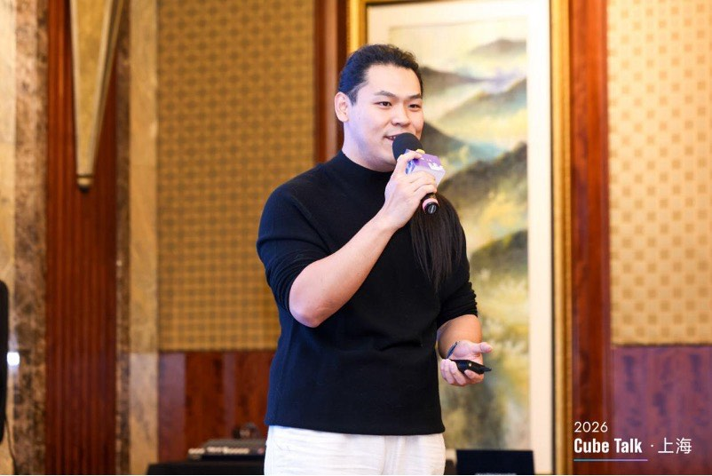
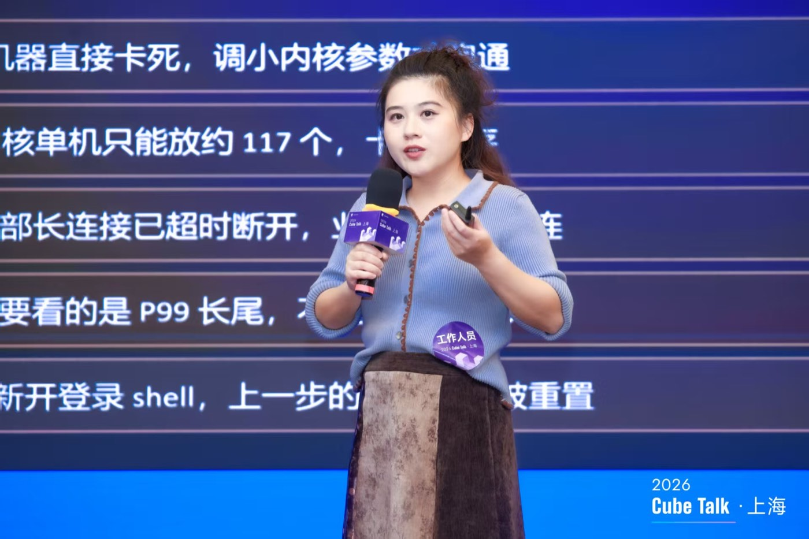
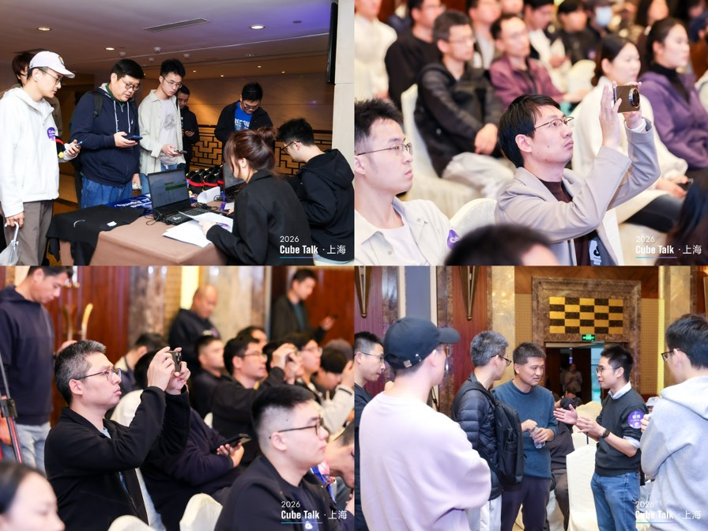

# 2026 Cube Talk Shanghai Recap: Agents Move Toward Production — How Does Infrastructure Go from "Works" to "Reliable"?

As AI moves from "generating answers" to "completing tasks", the industry's focus is shifting too: beyond the model, where do agents run code, call tools, and persist state? Facing dynamic, not-fully-predictable behavior, how do we hold the line on security, performance, cost and operability at the same time?

On November 14, CubeSandbox held its first in-person tech event — **2026 Cube Talk Shanghai**. Engineering leads from CubeSandbox, Huajiao, openFuyao, Mango TV and Horizon Insights shared their practices around the technical evolution and production deployment of Agent Infra. From the engineering design of the open-source foundation to real deployments in enterprise agent platforms, Kubernetes clusters, content production platforms and financial research agents, the event sketched a clear path: **an agent's productivity depends not only on how smart the model is, but also on whether the execution foundation can keep tasks running safely, stably and continuously.**

*Figure 1: Group photo at 2026 Cube Talk Shanghai*

## I. Execution Foundation: From "Isolated Box" to Agent Infrastructure

### Xu Like, Core Maintainer of CubeSandbox | "The Execution Foundation in the Agent Era: CubeSandbox's Sweet Spots and Engineering Challenges"

*Figure 2: Xu Like, core maintainer of CubeSandbox, presenting "The Execution Foundation in the Agent Era"*

How do agent workloads differ from traditional applications? Xu Like started from three classes of target workloads: tool execution environments spun up at high concurrency, Harness long-running tasks that last days to weeks, and service agents that run multi-tenant, 24/7. Together they point to a new set of infrastructure requirements — burst creation, sparse CPU usage, long-lived statefulness, untrusted behavior, and tasks that can be interrupted and resumed.

This means a sandbox can no longer just "lock code up"; it has to become a comprehensive foundation for state, networking, storage, security and lifecycle management. Around these requirements, CubeSandbox offers six groups of core capabilities: **low-latency startup from template snapshots, read-only sharing and copy-on-write for high-density deployment, snapshot/rollback/clone, independent kernel with controlled egress, E2B SDK compatibility, and AutoPause/AutoResume.**

On performance, the measured numbers from CubeBench v0.7.3 give a direct answer: in single-concurrency scenarios, average sandbox creation latency is only 41 ms; the extra VMM memory overhead per sandbox is under 5 MB; at 50 concurrent creations on a single node, creation throughput reaches 512 per second. Together, these numbers show that CubeSandbox has struck an engineering balance between "fast startup" and "low overhead".

## II. Enterprise Platforms: What Truly Compounds Is Task Contracts and Evidence of Results

### Feng Bingqing, CTO of Huajiao and Founder & CEO of ChaoXu AI | "Architecture Evolution of an Enterprise Agent Platform and CubeSandbox Practices"

*Figure 3: Feng Bingqing, CTO of Huajiao, presenting "Architecture Evolution of an Enterprise Agent Platform and CubeSandbox Practices"*

Bringing agents into an enterprise is not as simple as wiring a general-purpose chat assistant into the office system. Business analysis, functional review and AI coding all involve continuous work across documents and systems, plus waiting for confirmation, human review, long command execution and result acceptance. Drawing on real cases, Feng Bingqing presented a unified architecture that connects models, enterprise tools, knowledge and execution environments through an Agent Runtime.

One key design separates **Thread, Sandbox and Session**: the platform persists task context and run events, the sandbox carries isolated resources, and command sessions record processes, input/output and exit statuses. Only by storing task facts and execution resources separately can recovery and cleanup responsibilities be made explicit after failures.

**When a connection breaks, the process may still be running; when a process is lost, the files may still exist; when the outcome of an external operation is unclear, query the original system first instead of retrying blindly.**

Under this runtime contract, CubeSandbox handles the standalone MicroVM, templates and lifecycle management, while the enterprise platform keeps control of identity, task state and business results. The talk also reminded the audience that resident sandboxes must be included in the full resource budget, and that there is a concurrency window between business waiting and resource release that still needs joint validation.

Feng Bingqing argued that the value of enterprise agents cannot be measured by "whether the tool ran". **Tool completion, task quality and business improvement need to be accepted separately**; once infrastructure becomes standardized, what enterprises truly accumulate are task contracts, professional methods and evidence of results.

## III. Kubernetes in Production: K8s Manages Nodes, Cube Manages Sandboxes

### Wang Wentao, Agent Sandbox Architect at openFuyao | "CubeSandbox on K8s: Production Practices in Mission-Critical Industries"

*Figure 4: Wang Wentao, agent sandbox architect at openFuyao, presenting "CubeSandbox on K8s: Production Practices in Mission-Critical Industries"*

Agent sandboxes must not only run — they must fit into enterprises' existing private cloud, x-innovation and cloud-native operations systems. Wang Wentao drew a crisp boundary: **Kubernetes handles node orchestration, Pod scheduling, elastic scaling, rolling upgrades and config/secret management; CubeSandbox handles sandbox lifecycle, sandbox-level scheduling, template distribution, snapshots and pause/resume, and network isolation.**

Architecturally, the access and control layers achieve multi-replica high availability through standard workloads such as Deployment and StatefulSet, while the compute layer's Cubelet, CubeVS and CubeEgress run inside the same Big Pod deployed as a DaemonSet. The production deployment disclosed at the event covers **100+ nodes and 30,000+ sandboxes, running stably for 2 months**.

Even more valuable are the problems only production surfaces: adminToken mismatch causing pause/resume authentication failures, the timing conflict between first deployment and PVM gate checks, Cubelet orphan processes crashing the Big Pod, same-node traffic dropped by the kernel over checksum verification, plus requirements around non-root execution, NFS storage, health checks and unified observability.

From Helm static rendering toward Operator continuous reconciliation, from unified resource-aware scheduling to supernode distributed caching that accelerates image and snapshot distribution — the talk presented not just a deployment recipe, but an evolution path for folding agent sandboxes into enterprise cloud-native systems.

## IV. Mango TV: Security Is Not Cutting the Network, but Giving Every Execution a Boundary

### Liu Xusheng, Head of Fundamental Algorithm Research at Mango TV | "The Security Foundation of an Agent Platform: CubeSandbox Practices at Mango TV"

*Figure 5: Liu Xusheng, head of fundamental algorithm research at Mango TV, presenting "The Security Foundation of an Agent Platform"*

As agents move from content generation to CLI, Skill scripts and media-processing tool execution, task duration, resource needs and side effects all become hard to predict. Mango TV's AgentX chose **Sandbox as Tool**: the trusted agent main loop stays on the platform side, and only untrusted execution enters the remote Sandbox, created on demand and bound dynamically per session.

**A sandbox is not an Execute API; it is a set of remote execution infrastructure.**

Around five classes of challenges — isolation, execution contracts, state and lifecycle, file systems, credentials and networking — AgentX built a unified Sandbox Provider on top of managed CubeSandbox, keeping command execution, file upload/download, create/restore, lease renewal/cancellation and security policies semantically consistent across backends.

In the security architecture, the outer MicroVM provides base isolation, the inner Fence constrains file, network, environment-variable and command behavior; AgentX Vault funnels external service access through a controlled proxy, so agents can use service capabilities without ever holding the real credentials.

Four business scenarios — Mango Lingchuang AIGC content creation, intelligent converged media, intelligent agents, and Mango Chuangying intelligent post-production — are already running on sandboxed execution, with peak concurrency around 100 and evolution toward thousands.

## V. Financial Research: Letting a Complete Agent Keep Researching Inside the Sandbox

### Wang Zhengkai, CTO of Horizon Insights | "Running a Complete Research Agent in CubeSandbox: The Architecture and Practice of Horizon 4as"

*Figure 6: Wang Zhengkai, CTO of Horizon Insights, presenting "Running a Complete Research Agent in CubeSandbox"*

Horizon 4as demonstrated another path: **putting the complete agent — model loop, tool selection, file and code operations — inside CubeSandbox.**This stems from the nature of research work: research is not one-shot Q&A, but a continuous process around existing judgments, evidence and open questions.

4as adopts a two-layer Harness: the BWA Runtime Harness outside the sandbox handles identity, lifecycle, cancellation/timeouts and event persistence, while the Pi Agent Harness inside the sandbox handles the model loop, context, tools and session continuation. Research files (Workspace), continuous sessions (Thread) and execution environments (Cell) are managed separately, so execution environments can be acquired, reused or reclaimed on demand while research accumulation persists.

Through CubeSandbox Host Mount, the research team's curated professional directories are mounted read-only, while each user's own materials, analysis and results live in a private read-write workspace. An "AI researcher" thus gains a way to run that can be published independently, subscribed by version, and embodied on demand.

First-week operating numbers are equally striking: the central cloud service completed 5,600 Runs cumulatively, with 4,890 deduplicated active Cells over seven days, and an 84.5% reuse rate for Cells resumed within 10 minutes. The 4as practice shows that a sandbox is not only a risk-control mechanism — it can become the infrastructure on which professional knowledge keeps running and research results keep accumulating.

## Cube 100 Launch: Looking for the First 100 Production Pioneers of AI Agents

*Figure 7: Cao Qianyun, operations Maintainer of CubeSandbox, launching the "Cube 100" program*

Between a demo and production lies a layer of engineering experience that nobody teaches. Since CubeSandbox went open source in April this year, more and more developers and enterprises have started using it, and "how to use it well" matters more than "how to use it".

That is why Cao Qianyun, operations Maintainer of CubeSandbox, publicly launched the **"Cube 100" program** at the event, calling for 100 real-world AI agent sandbox case studies from around the globe and looking for the first 100 co-creation teams. Whether you run your business on Cube or integrate Cube into your own platform, architecture choices, deployment practices and post-mortems all become community assets worth sharing.

To date, CubeSandbox has earned **13,100+ GitHub stars and 131 contributors**. Selected teams receive one-on-one architecture co-creation and performance tuning support from core engineers, early access to new features, joint promotion across all channels, plus certificates for outstanding cases and co-creation seats.

*Figure 8: Check-in and networking moments from the event*

## The Milestones of Agent Infra Are Calibrated by Deployment, Not Stories

**Today, the competition among agents is shifting from "how strong is the model" to "how solid is the foundation".**These practices sketch a more complete judgment: **the maturity of agent infrastructure depends not on any single technical metric, but on a systemic capability spanning startup speed, resource density, isolation strength, state management, security governance and ecosystem compatibility.**

The agent era has truly arrived, and the people willing to build the foundation for agents are turning "stories" into "milestones".

2026 Cube Talk Shanghai has wrapped up, but the practice of Agent Infra is just getting started. Going forward, CubeSandbox will keep bringing frontline problems back to the community through open-source collaboration, real case studies and in-person events — and help more teams' engineering experience be seen.
