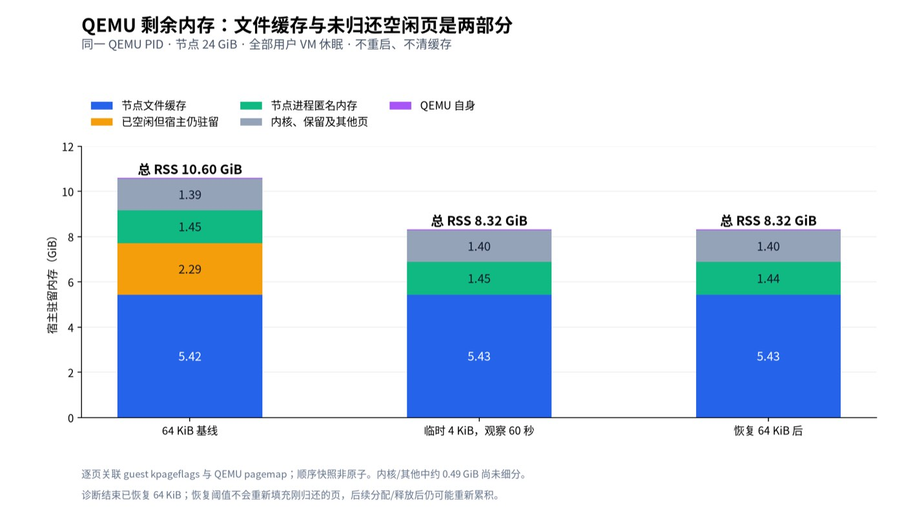
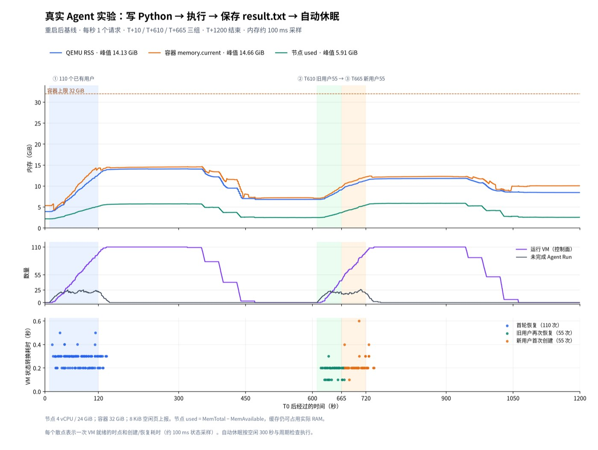

# Sandbox Resource Management on a Multi-Tenant Agent Platform: Scheduling Admission, Free-Page Reclaim, and 100-VM Density Validation

*Author: Zhang Wenjie — author of the Yuxi open-source project, PhD student in Software Engineering at Jiangnan University*

**Editor's note:** Yuxi is a privately deployable multi-tenant knowledge agent platform that unifies RAG, knowledge graphs, multi-agent orchestration, MCP/Skills, sandboxes and permission management in one system, with over 7.5K stars on GitHub. Agents in Yuxi install dependencies, process user files, and execute code they generated themselves, so every user needs an isolated execution environment.

Integrating sandboxes into this kind of platform is hard for two reasons: user environments must be kept alive long-term, and node memory must stay affordable. This practice report runs an in-depth experimental study of "what does putting one sandbox to sleep actually save", validated end to end with 220 real agent tasks — a reference for any team wiring sandboxes into an agent platform.

### 1. Background: The Tension Between Keeping User Environments and Reusing Memory

#### 1.1 Why we switched to Cube Sandbox

Previously, our enterprise agent project [Yuxi](https://github.com/xerrors/Yuxi) used Docker containers as sandboxes — one container and network per environment — and real model calls, code execution and concurrent request paths all worked.

**But the container approach could not solve one thing: keeping user environments alive long-term.**Once a container is reclaimed, the software the user installed and the running state are gone; if it is not reclaimed, hundreds of user containers keep occupying memory. So this time we moved to [CubeSandbox](https://github.com/TencentCloud/CubeSandbox). **What we mainly wanted was long-term retention and resource reuse of user environments: installed software and running state persist, environments sleep when idle, and resume when a task arrives.**

Note: sleep and resume timing is controlled by Yuxi: sandboxes are created with timeout -1 and lifecycle `onTimeout: pause` plus `autoResume: false`; workers decide sleep based on last activity time and actively resume on the next task. The adapter reads status and instance statistics through read-only APIs and never calls `connect`, which would trigger a resume — monitoring never changes VM state.

To run this for many users, we had to answer three questions: **what sleep actually releases, what keeping an environment costs, and how much load a node can take when many environments resume at once.**This article records one round of practice answering those questions, using CubeSandbox v0.7.3 with QEMU 8.2.2 and virtiofsd 1.10.0 on a node running the OpenCloudOS 6.6.119 kernel. Capacity units GiB/MiB/KiB are base-1024.

#### 1.2 6 GiB of memory with all user VMs asleep

We used nested deployment: a QEMU Linux node runs inside a Docker container, and Cube inside that node creates MicroVMs for users. User code runs in the inner MicroVM; the outer QEMU carries the whole execution node, including Cube services, the node kernel and caches.

Note: ordinary Linux containers share the host kernel; a MicroVM is a lightweight VM with its own kernel. QEMU manages virtual hardware and memory and uses Linux's hardware virtualization through KVM. In the rest of this article, the outer Linux VM is called the "node" (guest) and the machine running QEMU the "host".

User MicroVMs run a template we built ourselves, based on the official cubesandbox-base image with Python 3.13, Node 24, uv, Playwright and Chromium installed. The template declares 1 core, 1024 MiB of memory and a 2G writable layer to the scheduler — every lightweight VM below uses this spec. The environment is not small; it's the tasks running inside that are light.

When user VMs sleep, the outer node keeps running. **Our first observation was that with all user VMs asleep, QEMU still occupied about 6 GiB of memory.**What that number contains, and how much of it can be released, became the main question of the tests that follow.

### 2. Resource Analysis: Scheduling Admission, Pre-Built Pools and Cache Residency

To explain the 6 GiB, we must first separate scheduling quota from actual usage. Quota is computed from the specs a VM declares and decides whether a node accepts a creation or restore request; actual usage depends on what the VM is executing plus node services, kernel and cache state. Sleep stops user VM execution, but whether the scheduler releases its quota is controlled by a separate policy.

Our first small-scale test used Yuxi's disk-usage API to trigger VM creation or restore, followed by a disk query — we call this a Usage request. We ramped 1, 2, 4, then 10 users, but only one test VM ever ran. Logs showed requests were rejected by the CPU quota filter.

At that point the node had six sleeping VMs, a logical CPU quota of eight cores, and each user VM declared one core. The default `paused_resource_release_ratio=0.0` made sleeping VMs keep their full quota, and the v0.7.3 CPU filter also rejects scheduling when remaining quota exactly equals the request, so only one new VM was accepted. **After we changed the release ratio to 1.0**, creations and restores succeeded at every scale, and ten concurrent restores averaged 1.063 seconds per Usage request.

This setting lets other VMs use quota freed by sleeping ones. Restoring VMs re-check capacity and may be rejected when the node is full, requiring a retry after capacity frees up. Sleeping instances' objects and snapshots remain, still counted in the instance total and occupying disk. In a later round of 100 creation requests, only 26 succeeded, with logs pointing at the instance-count limit; another round saw 23 successes, hitting both count and resource quota filters. These failures are admission limits — success counts cannot be extrapolated into physical capacity.

But even asleep, QEMU still held a lot of memory. Further debugging showed the pre-built pool also matters for capacity: it controls how many resource slots are prepared in advance. After relaxing admission, we observed a pool of 100 pre-built slots still allowed a 101st VM, later extended to 110. Shrinking the pool lowers baseline overhead while slots can still scale on demand. On this machine `pool_size` was set to 99, actually pre-building slots numbered 0–99 — 100 slots; whether the bound is inclusive varies by version and needs checking.

The benefit of shrinking the pool can be read directly from kernel statistics. After adjusting the pool and restarting, the cgroup directory count dropped from 6,076 to 167, SUnreclaim from 626,596 KiB to 167,832 KiB, and Percpu from 86,752 KiB to 5,680 KiB. A restart and cache changes happened at the same time, so we do not attribute the whole RSS delta to the pool, but the slab and percpu drops alone demonstrate the kernel cost of pre-building at scale.

Note: CubeMaster does scheduling; Cubelet manages execution on the node. What we adjusted is Cubelet's cgroup pre-built pool; cgroups are the Linux mechanism for managing per-process resource limits and statistics, and pre-creating directories and kernel objects consumes memory too. `mvm_limit` caps the total VM count including sleeping objects, while `pool_size` describes the pre-built scale — the two are independent.

Only after lifting admission limits did we have enough running samples to observe memory. The early node had 4 cores and 8 GiB of memory, with the outer container capped at 10 GiB. In a 26-VM test, after all slept, node used dropped from about 3.747 GiB to 3.020 GiB, but QEMU RSS went from about 6.424 GiB to 6.450 GiB — outer container usage even rose slightly.

Memory freed inside the node was not returned to the host — explaining this requires three metrics at once. QEMU RSS is the memory of that process resident in host RAM, containing the outer node's contents plus QEMU's own overhead; container memory.current counts everything charged to the container, including host-side cache overhead; node used is computed as MemTotal − MemAvailable, treating caches the kernel estimates it can reclaim as available. So the same cache can occupy host RAM, count into RSS, and be considered available inside the node.

The cache source matches too. Pausing a VM writes a snapshot; restoring reads it back. File contents can stay in the node's page cache to speed up later reads. Under nested deployment, the node's disk is itself a file on the host, and its I/O can also produce outer-layer cache. This explains why user VMs released working memory while QEMU and container usage did not drop in sync — and even rose temporarily while writing snapshots.

In later experiments we therefore recorded QEMU RSS, raw container memory.current and node used together, combined with the node's free pages, available memory and cache info, to locate where resources went. The optimization target: pages the guest considers free but the host still holds, and file caches that still have reuse value.

Note: RSS means "resident set size". MemFree counts currently free pages; MemAvailable also includes memory the kernel expects to reclaim. The Docker Stats display values in early small-scale reports excluded some file caches; all tables below use raw cgroup usage. Metrics are sampled independently, so peaks may occur at different times.

### 3. Memory Reclaim and Load Validation: Free-Page Reporting, Granularity Comparison, and a 100-VM Test

#### 3.1 Free-page reporting and granularity choice

To see where released memory goes, we first allocated 1 GiB with a program, wrote page by page, held for ten seconds, then freed it. Before enabling reclaim, post-release QEMU RSS stayed around 6.443 GiB. We then added `virtio-balloon-pci,free-page-reporting=on` to the outer QEMU, rebooted the node normally, and repeated the probe.

One easily missed prerequisite: the node's memory backend must use `memory-backend-memfd` with `share=on`, or QEMU cannot actually return the pages the guest reports as free to the host — adding the balloon parameter alone shows no RSS drop.

The two runs:

| Probe | RSS before allocation | RSS while holding | RSS after release |
|:---|:---|:---|:---|
| First | 4.666 GiB | 5.633 GiB | 4.690 GiB |
| Second | 4.691 GiB | 5.646 GiB | 4.722 GiB |

Neither run involved cache clearing or restarts; RSS rose with allocation and fell with release, and container usage fell by about 0.983 and 0.927 GiB respectively. The free-page reporting feature has the guest kernel report freed pages, which QEMU returns to the host. The node's configured memory capacity is preserved; physical pages are re-allocated when those addresses are accessed again.

Closer observation showed reporting granularity affects reclaim. If many free pages are scattered in small blocks, a coarse granularity misses them. Within the same QEMU process, dropping granularity from 2 MiB to 64 KiB then 4 KiB moved RSS from about 5.725 GiB to 5.105 GiB and 4.880 GiB — no restart or cache clearing in between. A separate manual cache-drop diagnostic took RSS down to about 3.44 GiB, confirming file cache remains, but we did not turn cache dropping into a scheduled task.

Note: this machine's base page is 4 KiB, and the minimum reporting block size is 4 KiB × 2^page_reporting_order. For example, order 8 = 1 MiB, order 4 = 64 KiB, order 1 = 8 KiB. Linux manages free pages in contiguous blocks, and scattered small blocks may not merge into larger reportable blocks. Finer granularity covers more free pages but increases reporting and later re-allocation work.

#### 3.2 Residency attribution at 100-VM scale

Next, on the 4-core/8 GiB node inside a 10 GiB container, we tested 100-VM scale with 1 MiB reporting granularity. Logical quota was temporarily relaxed to 128 cores/128 GiB, and 110 existing VMs resumed one per 100 ms — all succeeded; another round of two consecutive restore-and-create cycles also completed every request. However, container usage had hit the 10 GiB cap, and memory.events.max recorded limit events. No OOM kills happened, but these results were still constrained by the cap and reclaim pressure.

To leave more headroom, we raised node memory to 24 GiB and the container cap to 32 GiB, kept 4 cores, and set reporting granularity to 64 KiB. After two test rounds, all VMs slept 120 seconds: node used fell to about 2.545 GiB while QEMU RSS stayed around 10.851 GiB. Growing capacity changed both cache and residency conditions, so we needed to inspect page composition directly.

At diagnostic time RSS was about 10.60 GiB. We correlated the guest's /proc/kpageflags page types with QEMU's /proc/PID/pagemap residency info, classified by node memory address mapping, and got:

| Content | Resident memory GiB |
|:---|:---|
| Node file cache | 5.423 |
| Pages the guest freed but the host still holds | 2.293 |
| Node process anonymous memory | 1.447 |
| Kernel, reserved and other pages | 1.392 |
| QEMU itself | 0.043 |

About 2.29 GiB was already free from the guest's perspective. Keeping the same QEMU with all user VMs asleep, without clearing caches, we temporarily dropped granularity to 4 KiB; after about a minute RSS fell to 8.320 GiB and free-but-resident pages shrank to about 0.002 GiB, while file cache and anonymous memory barely moved. **This comparison quantifies the cost of free pages left behind by coarser granularity.**The "kernel, reserved and other" category still contains about 0.49 GiB of unclassified pages; guest and host were sampled sequentially, so the table approximates the composition at diagnostic time.



*Figure 1: Page composition of QEMU resident memory at diagnostic time: 10.60 GiB at the 64 KiB baseline, 8.32 GiB after temporarily dropping to 4 KiB — about 2.29 GiB of that is pages the guest freed but the host still holds*

File cache serves a different purpose. When we scanned the relevant directories for the 470 files of at least 16 MiB, memory snapshots and templates held about 3.86 GiB of resident cache — the main source of file cache. Under memory pressure Linux can reclaim clean file pages; dirty pages are usually written back first. Pages only become guest free pages after that, and only then can the reporting mechanism return them to the host. Cache reclaim can raise the disk-read cost of later restores, so we kept the kernel's normal cache policy and chose 8 KiB as the persistent reporting granularity. It works in our follow-up experiments; long-term performance still needs comparison.

#### 3.3 Validation with real agent tasks

After node-level tuning, we switched the validation entry point to real agent requests: the agent must write hello.py in the working directory, run it, and save the printed hello plus a newline into result.txt. This round used a 4-core/24 GiB node, a 32 GiB container, and 8 KiB reporting, with the model fixed to opencode-go:deepseek-v4.1-flash and tool execution auto-approved. To fit existing objects plus new VMs, logical quota was temporarily set to 128 cores/192 GiB and restored afterward.

Node restart readiness is T0. From T10 to T119 we sent one request per second, one per existing user — 110 total; tasks sleep automatically after five idle minutes post-completion. From T610 to T664 we re-sent requests to one old user's original session, one per second — 55 total; from T665 to T719, 55 brand-new accounts sent their first requests. Sampling ran until T1200; the two sending windows did not overlap, though task execution times could.

All 220 tasks completed. Verification covered task status, the matching tool-execution records, and the actual files — result.txt's content and modification time matched each task's requirement, so an old user's previous output was never counted as success. New users had no VM before their request; old users kept their identity after resume. Memory results:

| Point or phase | QEMU RSS GiB | Container usage GiB | Node used GiB |
|:---|:---|:---|:---|
| T0 baseline | 3.922 | 5.348 | 2.192 |
| Peak sampled in round 1 + sleep phase | 14.128 | 14.662 | 5.782 |
| T500, after round 1 fully asleep | 6.812 | 7.212 | 2.511 |
| Peak sampled in round 2 + sleep phase | 11.855 | 12.406 | 5.907 |
| T1198, final sleep snapshot | 8.464 | 10.082 | 2.553 |



*Figure 2: Memory and VM state-transition curves across the 220 real agent tasks — 110 existing users, 55 old-user restores, 55 first-time creations; no OOM and no 502 throughout*

This round never touched the container cap, had no OOM, and saw no 502s. Final node used was about 0.36 GiB above baseline, QEMU RSS about 4.54 GiB above; we did not run per-page classification at this endpoint, so the composition of remaining residency needs continued tracking. The proportions from the earlier controlled diagnostic cannot be applied directly here.

Observed VM creation-or-resume averaged 0.18–0.27 s, and total task time averaged 19–22 s — the former reflects environment readiness, the latter the full execution including model inference, queueing and tool calls. Per-group results:

| Request group | Count | VM transition mean/P95 | Total task time mean/P95 |
|:---|:---|:---|:---|
| Round 1, existing users | 110 | 274/400 ms | 21.50/44.66 s |
| Old users, resumed again | 55 | 184/200 ms | 19.48/35.72 s |
| New users, first creation | 55 | 222/400 ms | 20.53/45.89 s |

Note: P95 means at least 95% of samples are at or below that value. VM state is sampled roughly every 100 ms; transition time in the table runs from first observation of "creating" or "restoring" to "running" — it measures environment readiness and is not a precise measure of low-level VM operations.

Memory is likewise sampled at roughly 100 ms intervals with clocks aligned; table peaks are the maximum sampled values. These data cover only the Cube node — not the separate Yuxi API, workers, or external model services. Monitoring and artifact verification never refreshed idle timers via extra VM commands.

Idle time starts from each VM's last activity, with a background check about every 30 seconds before pausing, so last activity to sleep completion actually took 300.33–346.80 s. The last VM slept at T1062.09; observation continued to T1200.

### 4. Deployment Configuration and Applicability

These results provide a workable deployment basis for lightweight tasks. The final target is a QEMU 8-core/24 GiB node inside an 8-core/32 GiB container, for 100 lightweight VMs. Raising CPU to eight cores leaves compute headroom for later tasks; container and QEMU CPU settings must be adjusted together so the outer quota does not throttle the node.

The Cubelet configuration is as follows:

```yaml
host:
  quota:
    mcpu_limit: 128000
    mem_limit: "128Gi"
    mvm_limit: 512
    creation_concurrent_num: 4
    paused_resource_release_ratio: 1.0
```

The 128 cores/128 GiB here is oversubscription — the total resources VMs declare may exceed actual hardware, while all running VMs still share the eight cores and 24 GiB. The instance limit of 512 includes sleeping objects; creation concurrency of 4 limits simultaneous create operations; the release ratio of 1.0 lets sleeping quota be reused. Together they accommodate the 100-VM target, but there is no strict "at most 100 running" admission or application-side queueing.

The eight-core configuration took effect; after redeployment, resource read-back matched the target and the 281 existing instances kept their identity and state. The 100-VM real-agent data still comes from the earlier four-core experiment; business capacity at the eight-core target needs separate load testing.

This workload used a print script, so VM running time includes model waiting and post-execution idle. It demonstrates the full lifecycle of lightweight tasks can run; sustained compute, large dependencies and heavy memory writes need lower density or more nodes. Before going live, switch to real business scripts and measure success rates, memory peaks and task latency separately for steady requests, concentrated restores and sustained execution, and verify how rejection, waiting and retry behave when capacity runs out.

The outer QEMU runner exists for nested validation. For production we would prefer native Linux/KVM nodes and re-derive resource quotas; multi-node setups also need cross-node access to snapshots and working directories. The long-term CPU cost of fine-grained reporting, reclaim speed under memory pressure, restore tail latency, and recoverability after failures all remain on our validation list.

For this practice, sleep's benefits must be weighed together with scheduling policy and actual page reclaim. Quota decides whether an environment is admitted, page composition explains where memory went, and real tasks provide the evidence for density and latency. Deployment configuration should be built on these observations — and recalibrated against your own workloads.
