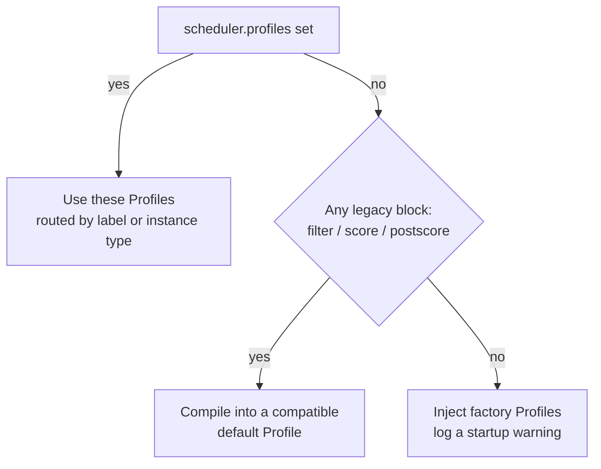

# CubeMaster Scheduler Configuration

Configuring the CubeMaster scheduler means answering three questions: where the configuration lives, which configuration is actually active, and what to set. This page covers them in that order, with troubleshooting at the end.

If you only want basic scoring for a multi-node deployment, [Multi-Node Cluster Deployment](./multi-node-deploy.md#configure-cubemaster-scheduler-scoring) is all you need.

## Where configuration lives

Scheduler configuration lives in CubeMaster's `conf.yaml`. Location per deployment type:

| Deployment | Location |
|------------|----------|
| one-click / systemd | `/usr/local/services/cubetoolbox/CubeMaster/conf.yaml` |
| source config template | `configs/single-node/cubemaster.yaml` |
| Terraform / TKE | `kubernetes_secret.cubemaster_conf` in `tke-addons.tf` |
| Helm chart | `chart/files/cube-master/conf.yaml` (rendered into a Secret) |

Restart or roll cube-master after editing.

Node quota and labels are not in this file — each Cubelet reports them itself. In one-click deployments, Cubelet config lives under `/usr/local/services/cubetoolbox/Cubelet/`: the static `config/config.toml` (report interval) and the dynamic `dynamicconf/conf.yaml` (labels and quota). Restart Cubelet after editing. The dynamic config looks like:

```yaml
host:
  scheduler_label: "default-cluster"
  quota:
    mcpu_limit: 0
    mem_limit: ""
    mvm_limit: 0
    creation_concurrent_num: 0
```

A quota of `0` means Cubelet derives a default from host resources — it does not mean unlimited. Set these explicitly for load tests or high-density scenarios.

Terraform environment variables are in [Tencent Cloud Cluster Deployment](./tencentcloud-terraform-deploy.md); compute-node environment variables are in [Multi-Node Cluster Deployment](./multi-node-deploy.md).

## Which configuration is active

CubeMaster picks its scheduling strategy by priority:



The three branches:

- **`profiles` set**: routes are evaluated in order; the first Profile matching the request's label or instance type wins, and unmatched requests fall to the Profile marked `default: true`.
- **Legacy blocks only**: they compile into one compatible `default` Profile. The old tolerance semantics, and the behavior of `priority_select_num` and `least_select_name`, are unchanged.
- **Nothing set**: factory Profiles (`burst_balance`, `template_reuse`, `mixed_binpack`) are injected so even zero-config deployments schedule with real strategies. Placement differs from the old random pick, so injection logs a warning; set `scheduler.disable_factory_profiles: true` to keep the old behavior.

One trap worth knowing: the built-in scorers (`real_time_weighted_average`, `image_score`, `multi_factor_weighted_average`) read their factor switches from the global `scheduler.score` tree, not from the Profile. A Profile referencing them without that block fails to compile at startup or hot reload. Factory Profiles ship with the block, so zero-config deployments are unaffected — just remember to keep it when writing your own.

## Recommended configurations

### Small clusters

For POC, functional validation, and low concurrency. Use as-is on a new cluster; merge selectively on an existing one:

```yaml
scheduler:
  priority_select_num: 3
  metric_update_timeout: 300s
  local_metric_update_timeout: 300s
  filter:
    enable_filters:
      - cpu
      - mem
      - template_locality
      - realtime_create_num
  score:
    enable_scorers:
      - real_time_weighted_average
    resource_weights:
      mvm_num: 2
      local_create_num: 3
      quota_cpu_usage: 1
      quota_mem_usage: 1
    plugin_conf:
      real_time_weighted_average:
        weight: 1.0
        enable_weight_factors:
          - mvm_num
          - local_create_num
          - quota_cpu_usage
          - quota_mem_usage
```

Key points: at least 2 compute nodes; start `priority_select_num` at 3 (or the node count if fewer); keep the default report interval and timeouts; derived quota is fine until load testing.

### Production clusters

On top of the starting config, for larger scale:

- Split nodes into pools with `host.scheduler_label` (general, memory-heavy, load-test, ...) so workloads don't crowd each other out.
- When mixing node sizes, set `node_max_mvm_num_conf` per `instance_type` instead of sharing one limit.
- Raise `priority_select_num` to a small fraction of healthy nodes — near the full count it degenerates into fully random selection.
- Keep the `template_locality` filter on.
- Set an explicit `host.quota.creation_concurrent_num` so a burst of creates can't saturate a single node.
- Scale the control plane too (TKE nodes, control-plane replicas) so CubeMaster or cube-api isn't the bottleneck.

## Scheduling flow

For each create request, CubeMaster runs four steps:


Filtering removes unhealthy nodes, stale metrics, nodes over the MVM cap, nodes missing template replicas, nodes at their create-concurrency limit, and nodes failing affinity. Scoring weights MVM count, live create counts, and CPU/memory quota usage. Final selection picks from the top-scored candidates: legacy config uses `priority_select_num` for the candidate window; Profiles use `selection.method` and `selection.top_n` (see [scheduler plugins](./scheduler-plugin.md#configuring-a-profile)).

Without scoring, filtering still runs, but selection leans toward the front of the candidate list — new sandboxes concentrate on a few nodes until resource filters push traffic away.

::: details Field reference

| Field | Purpose |
|-------|---------|
| `priority_select_num` | Final selection from the top N scored nodes. Use > 1 for multi-node; start at 3. |
| `metric_update_timeout` | Metrics older than this mark a node unschedulable. Keep well above the report interval. |
| `local_metric_update_timeout` | Local-metric timeout field. Current prefilter gates both metric types with `metric_update_timeout`. |
| `filter.enable_filters` | Enabled filters: CPU, memory, template locality, real-time create concurrency. |
| `score.enable_scorers` | Enabled scorers. Multi-node deployments usually enable `real_time_weighted_average` with its matching `plugin_conf`; without it the scorer is a no-op (Warn logged). |
| `score.resource_weights` | Weight per scoring factor; each factor must also appear in `enable_weight_factors`. |
| `node_max_mvm_num` / `node_max_mvm_num_conf` | Global or per-instance-type single-node MVM cap, combined with the Cubelet-reported value. |
| `disk_usage_max_percent` | Disk watermark; nodes past it are excluded. |
| `affinityconf` / `node_affinity_selector_allowed_keys` | Affinity constraints by label, zone, instance type, and other selector keys. |

:::

## Node metadata

Cubelet registers and reports status through CubeOps's `/internal/v1/node-agent` API; the data lands in MySQL/Redis. CubeMaster syncs the node view every few seconds and schedules from its local cache snapshot.

::: details What Cubelet reports

| Reported field | Source | Used for |
|----------------|--------|----------|
| `instance_type` | Node identity | Request matching, template replica selection, per-type limits |
| `cluster_label` | `host.scheduler_label` | Pool affinity and isolation |
| `quota_cpu` / `quota_mem_mb` | `host.quota` or host-derived | Schedulable capacity for filtering and scoring |
| `max_mvm_num` | `host.quota.mvm_limit` or memory-derived | Single-node MVM cap |
| `create_concurrent_num` | `host.quota.creation_concurrent_num` | Create concurrency; 0 falls back to CubeMaster's own limit |
| usage / disk / cgroup metrics | Periodic reports | Utilization, disk watermark, scoring factors |

These are configured per node — heterogeneous clusters can run different labels, quota, and limits on different nodes.
:::

## Template redo after scale-out

A newly registered node does not have templates yet — the `template_locality` filter requires a local replica on the target node, so creates fail or keep landing on older nodes until sync. Image-built templates need a redo after scale-out:

```bash
cubemastercli tpl redo --template-id <tpl-id> --node <node-ip>
```

`--node` accepts a node ID or host IP and can be repeated; `redo` waits for completion by default, `--detach` submits without waiting, and `--failed-only` retries only failed nodes. Open traffic on the node after the redo job succeeds.

Standard scale-out order: install node → confirm health and fresh reports → redo needed templates → wait for jobs → open traffic.

## Troubleshooting

### Creates fail with no more resource

Check in order: whether quota is below the requested resources (especially with derived defaults still in place); whether `mvm_num` hit the cap; whether create concurrency is saturated. Note that `create_concurrent_num: 0` still falls back to CubeMaster's limit at the scheduler layer — it does not mean unlimited.

```bash
curl http://127.0.0.1:3010/internal/v1/nodes
sudo tail -F /data/log/CubeMaster/cubemaster-req.log
sudo tail -F /data/log/Cubelet/Cubelet-req.log
```

### Stale node metrics

When logs mention metric update timeouts: confirm `cube-sandbox-cubelet.service` is running on the compute node; confirm the CubeOps address is reachable from it; check whether `node_status_update_frequency` was accidentally raised; keep `metric_update_timeout` well above the report interval.

### Template unavailable

New sandboxes still land on old nodes after scale-out, or logs mention missing local template replicas. Confirm the request's `template_id`, run redo on the new node, and check the template job status. Don't work around this by disabling `template_locality`.

### Node label mismatch

A request with affinity or cluster labels finds no candidates: compare Cubelet's `host.scheduler_label` against the request; check that `node_affinity_selector_allowed_keys` allows the selector key; for heterogeneous pools, confirm templates were redone onto the right instance type.

### Creates concentrate on a few nodes

Confirm `score.enable_scorers` is on, `enable_weight_factors` includes the expected factors, and `priority_select_num` is above 1. Also check that every node has usable template replicas — `template_locality` shrinks the candidate set otherwise.

## See also

- [Multi-Node Cluster Deployment](./multi-node-deploy.md)
- [Tencent Cloud Cluster Deployment (Terraform)](./tencentcloud-terraform-deploy.md)
- [Service Management & Logs](./service-management.md)
- [Templates Troubleshooting](./troubleshooting/templates.md)
