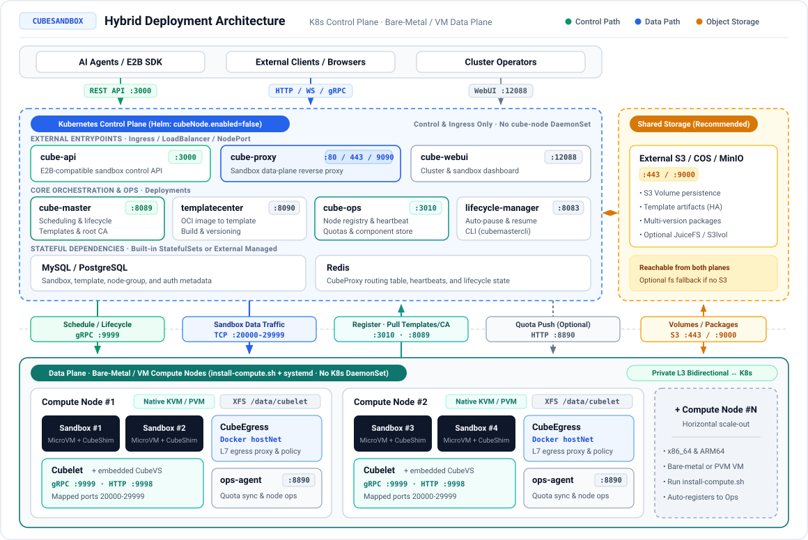

# Hybrid Deployment (K8s Control Plane + Bare-Metal / VM Data Plane)

This guide explains how to deploy CubeSandbox in a **hybrid topology**: the **control plane** runs in Kubernetes via the official Helm Chart, while the **data plane (compute nodes)** runs directly on physical machines, bare-metal servers, or standard VMs (using native KVM or PVM) and registers to the Kubernetes control plane.

::: tip Why Choose Hybrid Deployment?
- **Cloud-native control plane operations**: `cube-master`, `cube-templatecenter`, `cube-api`, `cube-ops`, `cube-proxy`, `cube-lifecycle-manager`, and `cube-webui` run on Kubernetes, giving you multi-replica high availability, rolling upgrades, self-healing, observability, and standard Ingress / LoadBalancer integration out of the box.
- **Zero Kubernetes coupling on the data plane**: Compute nodes run directly on physical machines or VMs without deploying privileged `cube-node` DaemonSets into Kubernetes. This avoids `hostNetwork` conflicts with CNI plugins (such as Cilium eBPF) or Pod Security Admission policies, and protects running sandboxes from kubelet eviction or Pod recreation.
:::

::: warning Production Security Notice
Before exposing your cluster to untrusted networks, read [Network Hardening](./network-hardening.md) and [Authentication](./authentication.md). `CubeMaster` (`8089`), `CubeOps` (`3010`), `Cubelet` gRPC (`9999`), and `ops-agent` (`8890`) are internal control links — **never expose them to the public internet**; restrict them to private cluster networks only.
:::

## 1. Architecture Overview



### Component Responsibilities

| Layer | Deployment Runtime | Components | Responsibilities |
| --- | --- | --- | --- |
| **Control Plane & Entrypoints** | Kubernetes (Helm Chart, `cubeNode.enabled=false`) | `cube-master`, `cube-templatecenter`, `cube-api`, `cube-ops`, `cube-proxy`, `cube-lifecycle-manager`, `cube-webui`, `cubemastercli`; optional built-in observability (`prometheus`, `loki`/`elasticsearch`, `grafana`, `component-otelcol`) | Scheduling, template build & distribution, E2B API, node management, sandbox traffic proxying, auto-pause/resume, WebUI console, optional centralized monitoring & dashboards |
| **Stateful Dependencies** | K8s built-in StatefulSets or external managed services | MySQL / PostgreSQL, Redis, S3 / COS / MinIO | Metadata persistence, routing & lifecycle state, Volumes / template artifacts / component warehouse |
| **Data Plane (Compute Nodes)** | Physical machines / bare metal / VMs (`install-compute.sh` + systemd) | `Cubelet` (with embedded network runtime / CubeVS), `CubeShim`, `CubeEgress`, `ops-agent`; optional `cube-sandbox-otelcol` | MicroVM sandbox runtime, node status reporting, transparent L7 egress proxy & policy enforcement, dynamic quota sync, optional sandbox metrics & log collection |

## 2. Prerequisites

### 2.1 Control Plane Requirements (Kubernetes Cluster)

| Item | Requirement | Notes |
| --- | --- | --- |
| Kubernetes | **>= v1.24** | Managed (TKE, EKS, GKE, AKS, etc.) or self-hosted Kubernetes |
| CLI tools | `kubectl`, **Helm >= v3.10** | With permissions to run `helm upgrade --install` in the target namespace |
| Control-plane nodes | >= 1 node (3+ recommended for production); >= 4 vCPU, 8 GiB RAM each | Label control-plane nodes with `cube.tencent.com/cube-control=true`; **do not** add `cube-node=true` |
| Persistent storage & stateful services | **External HA MySQL (or PostgreSQL), HA Redis, and external S3 recommended** | Combined with `controlPlane.artifactStore.s3Backed: true`, the K8s control plane stays stateless and does not require K8s PVCs / `StorageClass`. An available `StorageClass` (configurable via `persistence.storageClassName`) is only needed for non-production setups using the chart's built-in MySQL / Redis or `fs` artifact mode |
| Service exposure | Internal `LoadBalancer` (recommended) or `NodePort` | Out-of-cluster compute nodes must reach `cube-master` (`8089`) and `cube-ops` (`3010`); clients must reach `cube-api`, `cube-proxy`, and `cube-webui` |
| Container images | Connectivity to official registries, or import images into a private registry | Default global registry: `cube-sandbox-int.tencentcloudcr.com` (in mainland China, add `-f deploy/kubernetes/chart/values-cn.yaml` to use `cube-sandbox-cn.tencentcloudcr.com`). For air-gapped or private registry deployments, see [Section 5: Offline & Private Registry Deployment](#offline-deployment) |

### 2.2 Data Plane Requirements (Bare-Metal / VM)

Each physical machine or VM serving as a compute node must satisfy:

- **Virtualization capability (choose one)**:
  - **Physical machine / bare-metal server / VM with nested virtualization**: `x86_64` or `aarch64` (ARM64) Linux host with native `/dev/kvm` available (`ls -la /dev/kvm`).
  - **Standard cloud VM without `/dev/kvm`**: `x86_64` only. Install the **PVM host kernel** first and reboot (recommended OS: **OpenCloudOS 9**; Ubuntu, Debian, RHEL, and CentOS are also supported), then deploy with `CUBE_PVM_ENABLE=1`.
- **Hardware specs**: Minimum **4 vCPU, 8 GiB RAM**, >= 50 GB system disk; for production, **16 vCPU, 32 GiB+ RAM** with a dedicated data disk is recommended.
- **Filesystem (mandatory)**: `/data/cubelet` **must** be on an **XFS** filesystem (`df -T /data/cubelet` reports `xfs`). Otherwise `install-compute.sh` fails fast during preflight. For production, format and mount a dedicated data disk as XFS at `/data/cubelet`.
- **Container runtime (mandatory)**: **Docker** installed and running (**Snap Docker is not supported** and rejected by preflight). Even though compute nodes run MicroVMs rather than Docker containers for sandboxes, `cube-egress` runs as a host-network Docker container.
- **Kernel, cgroup & privileges**: Linux kernel **>= 5.4** (`uname -r`), cgroup v2 must have the `cpu` controller enabled (or use cgroup v1), and installation requires **root** privileges.
- **Version parity**: Use the **same release version** of the one-click bundle (`cube-sandbox-one-click-<version>.tar.gz`) as the Helm Chart component images.

### 2.3 Network Connectivity & Port Matrix

The most important requirement for hybrid deployment is **bidirectional L3 reachability between Kubernetes control-plane Pods and bare-metal / VM compute nodes**:

1. **K8s Pods -> Compute Nodes directly routable**: `cube-master`, `cube-ops`, and `cube-proxy` Pods must be able to route directly to each compute node's `CUBE_SANDBOX_NODE_IP`. Place the K8s cluster and compute nodes in the same VPC / routable private network, and allow traffic from the K8s Pod CIDR and Node CIDR in compute-node security groups / firewalls.
2. **Compute Nodes -> K8s Control Plane reachable**: Compute nodes must be able to reach the exposed `cube-master` (`8089` or NodePort) and `cube-ops` (`3010` or NodePort) addresses.
3. **Non-overlapping CIDRs**: The compute-node CubeVS sandbox CIDR `CUBE_SANDBOX_NETWORK_CIDR` (default `192.168.0.0/18`, prefix `/16`–`/24`) **must not** overlap with host interface subnets, VPC CIDR, Kubernetes Pod CIDR, or Kubernetes Service CIDR.

| Direction | Source | Destination | Port / Protocol | Purpose | Exposure Guidance |
| --- | --- | --- | --- | --- | --- |
| Data Plane -> Control Plane | Compute Node (Cubelet / ops-agent) | K8s `cube-ops` Service | `3010/tcp` (or NodePort) | Node registration, heartbeat, ops-agent quota pull, `fs`-backend warehouse blobs | **Private network only** |
| Data Plane -> Control Plane | Compute Node (Cubelet / CubeEgress) | K8s `cube-master` Service | `8089/tcp` (or NodePort) | Pull CubeEgress MITM root CA (`/cube/ca/*`), download template rootfs artifacts, health check | **Private network only** |
| Data Plane -> Object Store | Compute Node (Cubelet / s3fs) | External S3 / COS / MinIO | `443/tcp` or `9000/tcp` | S3 Volume mounts, S3 warehouse presigned GET (optional JuiceFS / CubeS3lvol) | **Private network / object-store endpoint** |
| Control Plane -> Data Plane | K8s `cube-master` Pod | Compute Node (Cubelet gRPC) | `9999/tcp` | Sandbox create/destroy/pause/resume, template distribution, snapshots | **K8s Pod/Node CIDR only** |
| Control Plane -> Data Plane | K8s `cube-proxy` Pod | Compute Node (CubeVS port mappings) | `20000-29999/tcp` | Forward sandbox HTTP / HTTPS / WebSocket / gRPC traffic | **K8s Pod/Node CIDR only** |
| Control Plane -> Data Plane | K8s `cube-ops` Pod | Compute Node (`ops-agent`) | `8890/tcp` | Real-time quota config push (falls back to 300s pull reconcile if blocked) | **K8s Pod/Node CIDR only** |
| Client -> Entrypoint | SDKs / Backend Services | K8s `cube-api` Service | `3000/tcp` (or LB/NodePort) | E2B-compatible sandbox management API | Private or public (enable [Auth](./authentication.md) if public) |
| Client -> Entrypoint | SDKs / Browsers | K8s `cube-proxy` Service / Ingress | `80/tcp`, `443/tcp`, `9090/tcp` | Sandbox data-plane gateway (`*.domain` / `/sandbox/...`) | Private or public as needed |
| Operator -> Entrypoint | Admin Browser | K8s `cube-webui` Service | `12088/tcp` (or `port-forward`) | WebUI dashboard | **Private network / IP allowlist only** |
| Data Plane -> Observability (Optional) | Compute Node (`cube-sandbox-otelcol`) | External or K8s-exposed Prometheus | `9092/tcp` (or external metrics port) | OTLP/HTTP (`/api/v1/otlp`) or Remote Write sandbox metrics ingestion | **Private network only** |
| Data Plane -> Observability (Optional) | Compute Node (`cube-sandbox-otelcol`) | External or K8s-exposed Loki / Elasticsearch | `3100/tcp` (Loki) or `9200/tcp` (ES) | OTLP/HTTP (`/otlp`) or ES bulk sandbox log ingestion | **Private network only** |
| Operator -> Observability (Optional) | Admin Browser | External or K8s `cube-grafana` Service | `3001/tcp` (or `port-forward`) | Pre-provisioned cluster, node, sandbox, and log dashboards | **Private network / IP allowlist only** |

### 2.4 Time Synchronization (Mandatory)

Enable consistent time synchronization (`chrony`, `ntpd`, `systemd-timesyncd`, or PTP) on **all Kubernetes control-plane nodes and all bare-metal / VM compute nodes**.

::: warning Keep clock skew well below 15 seconds
If a compute node's clock lags behind the control plane, its heartbeats can appear older than the 15-second expiry window, causing `CubeOps` / `CubeMaster` to mark the node unhealthy and skip it for scheduling and template distribution.
:::

### 2.5 Persistent Storage, External Dependencies & Observability Planning

For production, **using external HA MySQL (or PostgreSQL), external HA Redis (managed primary/replica, Sentinel, or Redis Cluster), and external shared S3 / COS / MinIO is strongly recommended** so the Kubernetes control plane remains stateless and easy to scale horizontally:

- **External Database (MySQL / PostgreSQL)**: Setting `mysql.host` (or `database.driver: postgres` with `postgres.host`) automatically skips the chart's built-in MySQL StatefulSet.
- **External HA Redis**: Supports single-endpoint managed HA (`redis.host`), Redis Sentinel (`redis.masterName` + `redis.sentinelNodes`), and native Redis Cluster (`redis.clusterNodes`). Configuring any external mode automatically skips the built-in Redis StatefulSet.
- **Object Storage (avoid the in-cluster MinIO Headless Service)**: The chart's built-in MinIO uses a **Headless Service (`clusterIP: None`)**, which is only reachable via in-cluster DNS and **cannot be dialed directly by out-of-cluster bare-metal / VM compute nodes**. Choose one of the following options before installing:
  - **Option A: External HA shared S3 / COS / MinIO (Recommended — full features & multi-replica HA)**
    - Provision an S3-compatible object store (such as AWS S3, Tencent Cloud COS, or standalone HA MinIO) reachable from **both** Kubernetes Pods and bare-metal / VM compute nodes.
    - Disable built-in MinIO (`minio.enabled: false`), configure `volumeS3.*`, and enable `controlPlane.artifactStore.s3Backed: true` (`cubeOps` warehouse, S3 Volumes, and template artifacts all reuse it; for multi-replica HA control planes, also set `controlPlane.master.persistence.enabled: false` and `controlPlane.templateCenter.colocateWithMaster: false` to remove K8s PVC coupling completely).
    - Configure the matching `CUBE_S3_*` variables in `.env` on each compute node so S3 Volumes and the component warehouse work end-to-end.
  - **Option B: No external S3 (Filesystem / PVC mode — minimal setup)**
    - Disable built-in MinIO (`minio.enabled: false`) and S3 artifact storage (`controlPlane.artifactStore.s3Backed: false`), switch both template artifacts and the component warehouse to filesystem storage (`controlPlane.artifactStore.backend: fs`, `cubeOps.store.backend: fs`), enable `controlPlane.master.persistence.enabled: true` with `controlPlane.templateCenter.colocateWithMaster: true`, and set `cubeOps.store.fs.publicURL` to the node-reachable `http://<K8s-CubeOps-Reachable-Addr>` (requires an available `StorageClass`). With the default `ReadWriteOnce` PVC, set `replicas: 1` for `master`, `templateCenter`, and `cubeOps` (multi-replica `fs` mode requires a `ReadWriteMany` shared PVC such as CFS/NFS).
    - Template builds, template distribution, and component warehouse downloads work over HTTP without S3; the S3 Volume plugin remains disabled (compute-node install logs a warning and continues).
- **Observability Planning (Optional: Metrics, Logs & Dashboards)**: Because sandboxes run on bare-metal / VM hosts outside Kubernetes (`cube-node-otelcol` schedules `DESIRED=0` Pods in hybrid mode, which is expected), sandbox resource metrics and `stdout`/`stderr` logs are collected by the local systemd service `cube-sandbox-otelcol.service` on each compute node. To enable observability, choose one of two backend options (for full metric semantics and PromQL/LogQL queries, see [Sandbox Observability Deployment](./observability.md); for request tracing, see [Distributed Tracing](./tracing.md)):
  - **External Observability Platform (Recommended for Production)**: Push directly from compute nodes to your existing Prometheus (or VictoriaMetrics) + Loki / Elasticsearch + Grafana stack. No built-in observability components are needed in Kubernetes (you can still optionally enable `observability.logs.components.enabled: true` to ship K8s control-plane container logs).
  - **Built-in Observability Stack on Kubernetes (Turnkey)**: Enable `observability.enabled: true` in Helm to deploy Prometheus (`9092`) + Loki (`3100`) or Elasticsearch (`9200`) + Grafana (`3001`, with 4 pre-provisioned dashboards; requires a `StorageClass`). Because the chart creates `ClusterIP` Services by default, apply companion internal `LoadBalancer` / `NodePort` Services so out-of-cluster compute nodes can ingest metrics and logs.

## 3. Deployment Steps

High-level installation workflow:

```text
1. Label Kubernetes control-plane nodes (and optional taint)
    ↓
2. Prepare control-plane Helm values (cubeNode.enabled=false + Service exposure + storage + optional observability)
    ↓
3. Install the control plane with Helm and record the CubeMaster / CubeOps (and optional Prometheus / Loki) endpoints
    ↓
4. Prepare bare-metal / VM compute nodes (KVM or PVM kernel, XFS disk, Docker, NTP)
    ↓
5. Configure .env (including optional observability Collector) on each compute node and run install-compute.sh
    ↓
6. Configure multi-node scheduler scoring and client access
```

### Step 1: Deploy the Kubernetes Control Plane

#### 1.1 Verify the cluster and label control-plane nodes

```bash
kubectl get nodes -o wide
kubectl get storageclass
helm version --short
```

Label the Kubernetes node(s) that will host the CubeSandbox control plane with `cube-control=true`:

```bash
kubectl label nodes <control-node-1> cube.tencent.com/cube-control=true --overwrite

# Optional: taint control-plane nodes to keep unrelated workloads off them
# kubectl taint nodes <control-node-1> cube.tencent.com/control=true:NoSchedule --overwrite
```

::: tip Do not label K8s nodes as compute nodes
Because the data plane runs on external physical machines / VMs, **do not** add `cube.tencent.com/cube-node=true` or `cube.tencent.com/allow-pvm-bootstrap=true` to Kubernetes nodes.
:::

#### 1.2 Prepare the Helm values file

Create `hybrid-control-plane-values.yaml` in a dedicated local deployment directory (for example, `~/cube-deploy/`, kept separate from the source repository to protect database, Redis, and S3 credentials). The example below uses the recommended production setup with **external HA MySQL + external HA Redis + external S3** (if using a private registry, merge the private-registry fields from [Section 5: Offline & Private Registry Deployment](#offline-deployment) into this file):

```yaml
# Key switch: disable all in-cluster compute DaemonSets (cube-node / installer / bootstrap / pvm)
cubeNode:
  enabled: false

# --- External HA Database (Recommended; setting host skips built-in MySQL StatefulSet) ---
database:
  driver: mysql              # Set to postgres and configure postgres.* below for external PostgreSQL
mysql:
  host: "<ha-mysql-host>"
  port: 3306
  database: "cube_mvp"
  user: "cube"
  password: "<mysql-password>"

# For external PostgreSQL:
# postgres:
#   host: "<ha-postgres-host>"
#   port: 5432
#   database: "cube_mvp"
#   user: "cube"
#   password: "<postgres-password>"

# --- External HA Redis (Recommended; automatically skips built-in Redis StatefulSet) ---
# Mode 1: Managed HA Redis single endpoint (use FQDN or IP literal)
redis:
  host: "<ha-redis-host>"
  port: 6379
  password: "<redis-password>"
  db: 0
# Mode 2: Redis Sentinel (leave redis.host empty)
#   masterName: "mymaster"
#   sentinelNodes: "10.0.0.11:26379,10.0.0.12:26379,10.0.0.13:26379"
#   sentinelPassword: ""
# Mode 3: Redis Cluster (leave redis.host and masterName empty; db must be 0)
#   clusterNodes: "10.0.0.21:6379,10.0.0.22:6379,10.0.0.23:6379"

# --- Expose control-plane Services for external bare-metal / VM compute nodes ---
controlPlane:
  artifactStore:
    s3Backed: true           # Store template artifacts in S3 for stateless multi-replica HA
  master:
    replicas: 2              # Recommended >= 2 for production; set 1 for single-replica trials
    persistence:
      enabled: false         # No RWO PVC needed when s3Backed=true
    service:
      # Prefer an internal LoadBalancer (cloud internal LB / MetalLB),
      # or use NodePort and inspect the allocated port with kubectl get svc
      type: LoadBalancer
      port: 8089
  templateCenter:
    replicas: 2              # Supports multiple replicas with s3Backed=true; set 1 for trials
    colocateWithMaster: false
  api:
    replicas: 2
    sandboxDomain: "cube.app"
    service:
      type: LoadBalancer     # Or NodePort (optionally set nodePort: 30030)
      port: 3000

cubeOps:
  enabled: true
  replicas: 2
  service:
    type: LoadBalancer       # Or NodePort
    port: 3010

# --- Data-plane proxy and WebUI ---
cubeProxy:
  enabled: true
  domain: "cube.app"
  advertiseIP: ""            # Optional external IP hint
  # Set to false if modifying kube-system/coredns is restricted in your cluster
  configureClusterDNS: true
  service:
    type: LoadBalancer       # Or NodePort with service.nodePorts.{http,https,grpc}
  ingress:
    enabled: false           # Set true (with service.type: ClusterIP) if exposing via Ingress
  tls:
    mode: selfSigned         # Trial only; use existingSecret or certManager in production

webui:
  enabled: true
  service:
    type: ClusterIP          # Recommended with port-forward or an internal LB

# --- External HA Shared S3 / COS / MinIO (Recommended) ---
minio:
  enabled: false

volumeS3:
  endpoint: "https://<s3-endpoint>"         # Must be reachable by both K8s Pods and compute nodes (MinIO example: http://<s3-endpoint>:9000)
  accessKeyId: "<s3-access-key>"
  secretAccessKey: "<s3-secret-key>"
  bucket: "cube-volumes"
  region: "us-east-1"
  pathStyle: false                          # Set true for MinIO / path-style S3 endpoints
  extraOpts: ""                             # Set "-ouse_path_request_style" for MinIO / path-style S3
```

::: details Test / PoC only: Using built-in MySQL / Redis StatefulSets (requires StorageClass)
For quick trials without external database or Redis services, leave `host` empty in `mysql` and `redis` (the chart deploys single-replica StatefulSets with PVCs; you must still replace the default `CHANGE_ME_*` passwords):

```yaml
mysql:
  host: ""
  password: "replace-me-mysql-password"
  rootPassword: "replace-me-mysql-root-password"

redis:
  host: ""
  password: "replace-me-redis-password"
```
:::

::: details Option B: Values snippet without external S3
If you do not have an external S3 / COS store, remove (or leave empty) the `volumeS3` block above and update `minio`, `controlPlane`, and `cubeOps` as shown below so Helm chart validation passes (`cubeOps.store.fs.publicURL` must be reachable from compute nodes; if using NodePort, you can fill it in and re-run `helm upgrade` once the port is allocated):

```yaml
minio:
  enabled: false

controlPlane:
  artifactStore:
    backend: fs
    s3Backed: false            # Required: fs cannot be combined with s3Backed=true
  master:
    replicas: 1                # Single replica with default RWO PVC; multi-replica requires a ReadWriteMany PVC (e.g. CFS/NFS)
    persistence:
      enabled: true            # Required: fs backend requires master.persistence.enabled=true
  templateCenter:
    replicas: 1
    colocateWithMaster: true   # Required to share the default RWO artifact PVC with master

cubeOps:
  replicas: 1                  # Multi-replica fs mode requires cubeOps.store.fs.persistence with ReadWriteMany
  store:
    backend: fs
    fs:
      publicURL: "http://<K8s-CubeOps-Reachable-IP>:<port>"
```
:::

::: details Managed K8s (TKE / EKS / GKE / ACK): Need internal-LB annotations or fixed NodePorts?
In the current chart templates, `controlPlane.master.service` and `cubeOps.service` expose `type` and `port` without custom `annotations`. If your cloud controller provisions **public** LoadBalancers by default, keep both set to `type: ClusterIP` and apply a companion `Service` manifest with your provider's internal-LB annotations (or fixed NodePorts) targeting the same Pod selectors so `8089` and `3010` stay strictly internal:

```yaml
apiVersion: v1
kind: Service
metadata:
  name: cube-master-internal
  namespace: cube-system
  annotations:
    # Add your cloud provider's internal LoadBalancer annotations here
spec:
  type: LoadBalancer
  selector:
    app.kubernetes.io/name: cube
    app.kubernetes.io/instance: cube
    app.kubernetes.io/component: master
  ports:
    - name: cubemaster
      port: 8089
      targetPort: cubemaster
---
apiVersion: v1
kind: Service
metadata:
  name: cube-ops-internal
  namespace: cube-system
  annotations:
    # Add your cloud provider's internal LoadBalancer annotations here
spec:
  type: LoadBalancer
  selector:
    app.kubernetes.io/name: cube
    app.kubernetes.io/instance: cube
    app.kubernetes.io/component: ops
  ports:
    - name: http
      port: 3010
      targetPort: http
```
:::

::: details Optional: Enable the chart's built-in observability stack on Kubernetes (Prometheus + Loki / ES + Grafana)
If you do not have an external observability platform and want to deploy the built-in stack on the Kubernetes control plane (requires an available `StorageClass`), append the block below to `hybrid-control-plane-values.yaml` (or save it as `observability-values.yaml` and pass an additional `-f`):

```yaml
observability:
  enabled: true
  # Cluster label attached to metrics and logs; match CUBE_OBSERVABILITY_CLUSTER_ID on compute nodes
  clusterId: "cube-hybrid-prod"
  backend:
    enabled: true
    grafana:
      serviceType: ClusterIP        # Access via port-forward, or switch to an internal LB
      # For production, manage admin credentials via an external Secret:
      # existingSecret: "cube-grafana-admin-custom"
  logs:
    enabled: true
    backend: loki                   # Default: loki; set elasticsearch if preferred
    components:
      enabled: true                 # Optional: also collect K8s control-plane container logs
```

**Required step (expose ingestion endpoints to out-of-cluster compute nodes)**: The chart creates `cube-prometheus` (`9092`) and either `cube-loki` (`3100`) or `cube-elasticsearch` (`9200`) (depending on `observability.logs.backend`) as `ClusterIP` Services, which external bare-metal / VM compute nodes cannot reach directly. After installing the chart, apply companion internal `LoadBalancer` (or `NodePort`) Services to expose the ingestion ports on your private network:

```yaml
apiVersion: v1
kind: Service
metadata:
  name: cube-prometheus-internal
  namespace: cube-system
  annotations:
    # Add your cloud provider's internal LoadBalancer annotations; never expose publicly
spec:
  type: LoadBalancer                # Or NodePort when no internal LB is available
  selector:
    app.kubernetes.io/name: cube
    app.kubernetes.io/instance: cube
    app.kubernetes.io/component: prometheus
  ports:
    - name: http
      port: 9092
      targetPort: 9092
---
apiVersion: v1
kind: Service
metadata:
  name: cube-loki-internal
  namespace: cube-system
  annotations:
    # Add your cloud provider's internal LoadBalancer annotations; never expose publicly
spec:
  type: LoadBalancer                # Or NodePort when no internal LB is available
  selector:
    app.kubernetes.io/name: cube
    app.kubernetes.io/instance: cube
    app.kubernetes.io/component: loki
    # If using Elasticsearch, change component to elasticsearch and port/targetPort to 9200
  ports:
    - name: http
      port: 3100
      targetPort: 3100
```
:::

::: details Optional: Ship K8s control-plane container logs to an external observability platform
If you already run an external Prometheus + Loki / Elasticsearch + Grafana stack and only need sandbox telemetry from compute nodes, **leave `observability.enabled: false` in Helm** and jump directly to Step 3.2 (to import the 4 pre-built Grafana dashboards into an existing Grafana instance, run `./observability/install.sh dashboards` as described in [Sandbox Observability Deployment](./observability.md)).

If you also want to forward Kubernetes control-plane container logs (`cube-master`, `cube-api`, `cube-ops`, `cube-templatecenter`, `cube-proxy`, `cube-lifecycle-manager`) into your external backend, append the snippet below (note: when `observability.backend.enabled: false`, chart validation requires setting `observability.metrics.otlpEndpoint` or `remoteWriteUrl` as well):

```yaml
observability:
  enabled: true
  clusterId: "cube-hybrid-prod"
  backend:
    enabled: false
  metrics:
    otlpEndpoint: "https://prometheus.example.com/api/v1/otlp"
    # If your external backend requires authentication, create a Secret in cube-system and reference it:
    # auth:
    #   existingSecret: cube-observability-auth
    #   authorizationKey: metrics-authorization
    #   tenantIdKey: metrics-tenant-id
  logs:
    enabled: true
    backend: loki                                # Or elasticsearch
    otlpEndpoint: "https://loki.example.com/otlp"
    # esEndpoint: "https://es.example.com:9200"  # Used when backend=elasticsearch
    # auth:
    #   existingSecret: cube-observability-auth
    #   authorizationKey: logs-authorization
    #   tenantIdKey: logs-tenant-id
    components:
      enabled: true
```
:::

#### 1.3 Install the control plane with Helm

::: tip Mainland China Users
Add `-f <chart-dir>/values-cn.yaml` to the command below to pull images from the China-region registry.
:::

Replace `<chart-dir>` with your local Helm chart directory (for example, `CubeSandbox/deploy/kubernetes/chart`) or a packaged `.tgz` chart archive, and pass the values file created in Step 1.2:

```bash
helm upgrade --install cube <chart-dir> \
  -n cube-system \
  --create-namespace \
  -f ~/cube-deploy/hybrid-control-plane-values.yaml \
  --wait \
  --timeout 30m
```

#### 1.4 Record the exposed control-plane endpoints

```bash
kubectl get svc -n cube-system -o wide
```

Record the addresses that compute nodes will connect to:

- **`MASTER_ADDR`**: Reachable `<internal-lb-ip>:8089` or `<k8s-node-ip>:<master-nodeport>` for `cube-master`
- **`OPS_ADDR`**: Reachable `<internal-lb-ip>:3010` or `<k8s-node-ip>:<ops-nodeport>` for `cube-ops`
- **(Optional, when K8s built-in observability is enabled) `PROM_ADDR` and `LOKI_ADDR` / `ES_ADDR`**: Reachable internal LB or NodePort addresses for `cube-prometheus-internal` (`9092`) and `cube-loki-internal` (`3100`, or `9200` for Elasticsearch). Also retrieve the generated Grafana admin password (username: `admin`):

```bash
kubectl get secret -n cube-system \
  -l app.kubernetes.io/component=grafana-admin \
  -o jsonpath='{.items[0].data.admin-password}' | base64 --decode; echo
```

Also note the `cube-api` (`3000`) and `cube-proxy` (`80`/`443`/`9090`) entrypoints for verification and client access.

---

### Step 2: Prepare Bare-Metal / VM Compute Nodes

Run all commands below as **root** (`sudo su root`) on each compute node.

#### 2.1 Prepare virtualization (Native KVM or PVM)

- **Case A: Bare-metal server / physical machine / VM with nested virtualization (`x86_64` or `aarch64`)**

  Verify `/dev/kvm` is present and accessible:

  ```bash
  ls -la /dev/kvm
  lsmod | grep kvm
  ```

- **Case B: Standard cloud VM without `/dev/kvm` (`x86_64` only)**

  Follow [PVM Deployment — Step 1: Install the PVM Host Kernel](./pvm-deploy.md#step-1-install-the-pvm-host-kernel) to install the PVM host kernel and reboot:

  1. Download the matching RPM or DEB kernel package from a `kernel-release-*` release on [GitHub Releases](https://github.com/TencentCloud/CubeSandbox/releases) (or [CNB Releases](https://cnb.cool/CubeSandbox/CubeSandbox/-/releases)).
  2. Install the package, set it as the default GRUB entry, apply boot parameters with `host_grub_config.sh`, and run `reboot`.
  3. After rebooting, load and persist `kvm_pvm`:

  ```bash
  uname -r               # Expected to include opencloudos9.cubesandbox.pvm.host
  modprobe kvm_pvm
  echo 'kvm_pvm' > /etc/modules-load.d/kvm-pvm.conf
  ls -la /dev/kvm
  lsmod | grep kvm_pvm
  ```

#### 2.2 Prepare an XFS filesystem for `/data/cubelet`

Check the filesystem type hosting `/data/cubelet`:

```bash
mkdir -p /data/cubelet
df -T /data/cubelet
```

If the type is **not `xfs`**, format and mount a dedicated data disk or partition as XFS (replace `/dev/vdb` with your unused block device):

```bash
mkfs.xfs /dev/vdb
mkdir -p /data/cubelet
mount /dev/vdb /data/cubelet

# Persist the mount across reboots
UUID="$(blkid -s UUID -o value /dev/vdb)"
echo "UUID=${UUID} /data/cubelet xfs defaults 0 0" >> /etc/fstab

df -T /data/cubelet
```

#### 2.3 Verify Docker, time sync, and connectivity to the K8s control plane

```bash
# 1) Verify standard (non-Snap) Docker is running
docker info >/dev/null && which docker

# 2) Verify time synchronization
timedatectl status || chronyc tracking

# 3) Verify reachability to K8s control-plane endpoints recorded in Step 1.4
curl -fsS "http://<MASTER_ADDR>/notify/health"
curl -fsS "http://<OPS_ADDR>/health"
```

Proceed only after both health checks succeed.

---

### Step 3: Deploy the Data Plane on Bare-Metal / VM

#### 3.1 Download and extract the release bundle

Download the release bundle (`cube-sandbox-one-click-<version>.tar.gz`, or `*-arm64.tar.gz` for ARM64 bare metal) matching the version deployed in Kubernetes from [GitHub Releases](https://github.com/TencentCloud/CubeSandbox/releases) or [CNB Releases](https://cnb.cool/CubeSandbox/CubeSandbox/-/releases):

```bash
tar -xzf cube-sandbox-one-click-<version>.tar.gz
cd cube-sandbox-one-click-<version>
```

#### 3.2 Configure `.env`

```bash
cp env.example .env
```

Edit `.env` and configure the following fields:

```bash
# Compute-only role
ONE_CLICK_DEPLOY_ROLE=compute

# Private IP of this physical machine / VM (must be directly routable from K8s control-plane Pods)
CUBE_SANDBOX_NODE_IP=<this-compute-node-ip>

# IMPORTANT: In K8s hybrid deployments, cube-master and cube-ops typically have
# different LoadBalancer IPs or NodePorts. Leave ONE_CLICK_CONTROL_PLANE_IP empty
# and explicitly configure both addresses below.
ONE_CLICK_CONTROL_PLANE_IP=
ONE_CLICK_CONTROL_PLANE_CUBEMASTER_ADDR=<MASTER_ADDR>   # e.g. 10.0.1.20:8089 or 10.0.1.10:31889
ONE_CLICK_CONTROL_PLANE_CUBEOPS_ADDR=<OPS_ADDR>         # e.g. 10.0.1.21:3010 or 10.0.1.10:31010

# Virtualization profile: 0 for bare metal / native KVM; 1 for PVM VMs
CUBE_PVM_ENABLE=0

# Override if the default 192.168.0.0/18 overlaps your VPC or K8s Pod/Service CIDRs (/16 to /24)
# CUBE_SANDBOX_NETWORK_CIDR=10.100.0.0/18

# Optional (mainland China): pull cube-egress image from the China-region registry
# MIRROR=cn
# Or point cube-egress directly at your private registry:
# CUBE_SANDBOX_CUBE_EGRESS_IMAGE=registry.internal.example.com/cube-sandbox/cube-egress:<version>

# If using Storage Option A (external S3), mirror the exact same S3 settings from Helm
# (scheme http/https, port, and path-style options must match Helm volumeS3)
CUBE_S3_ENDPOINT=https://<s3-endpoint>      # MinIO example: http://<s3-endpoint>:9000
CUBE_S3_ACCESS_KEY_ID=<s3-access-key>
CUBE_S3_SECRET_ACCESS_KEY=<s3-secret-key>
CUBE_S3_BUCKET=cube-volumes
CUBE_S3_REGION=us-east-1
CUBE_S3_S3FS_EXTRA_OPTS=                    # Set -ouse_path_request_style for MinIO / path-style S3

# --- Optional: Enable the node observability Collector (Cubelet metrics & sandbox logs) ---
# When endpoints are left unset in hybrid mode, auto-derivation falls back to the CubeMaster /
# CubeOps host (:9092 / :3100), which typically does not expose ingestion ports, so set them
# explicitly. Provide OTLP base URLs without trailing /v1/metrics or /v1/logs, and keep
# clusterId aligned with Helm observability.clusterId.
# ONE_CLICK_ENABLE_OBSERVABILITY=1
# ONE_CLICK_OBSERVABILITY_ROLE=cvm
# CUBE_OBSERVABILITY_CLUSTER_ID=cube-hybrid-prod
# CUBE_LOGS_BACKEND=loki                                      # Set elasticsearch if using ES
# CUBE_METRICS_OTLP_HTTP_ENDPOINT=http://<PROM_ADDR>/api/v1/otlp
# # Use Remote Write instead if your external Prometheus does not enable OTLP (mutually exclusive):
# # CUBE_METRICS_REMOTE_WRITE_URL=https://prometheus.example.com/api/v1/write
# CUBE_LOGS_OTLP_HTTP_ENDPOINT=http://<LOKI_ADDR>/otlp
# # Use Elasticsearch endpoint instead when CUBE_LOGS_BACKEND=elasticsearch (mutually exclusive):
# # CUBE_LOGS_ES_ENDPOINT=http://<ES_ADDR>
# # Optional authentication for external backends:
# # CUBE_METRICS_AUTHORIZATION='Bearer <metrics-token>'
# # CUBE_METRICS_TENANT_ID=cube-hybrid-prod
# # CUBE_LOGS_AUTHORIZATION='Bearer <logs-token>'
# # CUBE_LOGS_TENANT_ID=cube-hybrid-prod
# # For Elasticsearch auth, use CUBE_LOGS_ES_API_KEY or CUBE_LOGS_ES_USER + CUBE_LOGS_ES_PASSWORD
```

::: warning Three common configuration pitfalls
1. **Do not set both `ONE_CLICK_CONTROL_PLANE_IP` and a non-matching `ONE_CLICK_CONTROL_PLANE_CUBEMASTER_ADDR`**: Preflight explicitly rejects conflicting values. In hybrid deployments, always **leave `ONE_CLICK_CONTROL_PLANE_IP` empty** and set `ONE_CLICK_CONTROL_PLANE_CUBEMASTER_ADDR` and `ONE_CLICK_CONTROL_PLANE_CUBEOPS_ADDR` explicitly.
2. **Set `CUBE_PVM_ENABLE=1` inside `.env` for PVM VMs**: The installer sources `.env`, which overrides shell-level environment variables if `CUBE_PVM_ENABLE=0` remains in `.env`.
3. **Set explicit metrics and log endpoints when enabling observability**: With `ONE_CLICK_CONTROL_PLANE_IP` empty and endpoints unset, the installer falls back to the `ONE_CLICK_CONTROL_PLANE_CUBEMASTER_ADDR` / `CUBEOPS_ADDR` host (`:9092` / `:3100`), which typically does not expose the observability ingestion ports and causes exports to fail silently. Always set explicit endpoints, passing OTLP **base URLs** (such as `.../api/v1/otlp` and `.../otlp`) without trailing `/v1/metrics` or `/v1/logs`.
:::

#### 3.3 Run the compute-node installer

```bash
sudo ./install-compute.sh
```

In hybrid mode, `install-compute.sh` automatically:

1. Installs `Cubelet` (with embedded network runtime / CubeVS), `CubeShim`, the guest kernel (standard or PVM based on `CUBE_PVM_ENABLE`), guest rootfs image, `cube-agent.ext4`, `ops-agent`, and `CubeEgress` runtime units.
2. Writes `meta_server_endpoint` (`OPS_ADDR`) and `cubemaster_http_addr` (`MASTER_ADDR`) into `Cubelet/dynamicconf/conf.yaml` — when `CubeMaster` distributes template artifacts, `Cubelet` automatically rewrites download URLs to `cubemaster_http_addr`, so compute nodes never need to resolve in-cluster Kubernetes DNS names.
3. Configures `ops-agent` against K8s `CubeOps` and starts listening on `0.0.0.0:8890`.
4. Pulls the cluster CubeEgress MITM root CA (`cube-root-ca.crt` and `cube-root-ca.key`) from K8s `CubeMaster` via `http://<MASTER_ADDR>/cube/ca/...`, keeping template-baked CA certificates and compute-node `CubeEgress` signing keys in sync.
5. If `ONE_CLICK_ENABLE_OBSERVABILITY=1` is set in `.env`, installs and starts the local OpenTelemetry Collector (`cube-sandbox-otelcol.service`) to scrape Cubelet metrics and export sandbox `stdout`/`stderr` logs to the configured backend.
6. Enables and starts `cube-sandbox-compute.target` and runs `quickcheck.sh`.

::: details Optional: Enable observability on already-running compute nodes (zero impact on existing sandboxes)
If a compute node is already running and you want to add the observability Collector later without re-running `install-compute.sh`, run the standalone script as root (for air-gapped nodes, also pass `CUBE_OTELCOL_BIN=/path/to/otelcol-contrib` to avoid downloading from the internet):

```bash
# Example: Loki + Prometheus OTLP (pass *_AUTHORIZATION / *_TENANT_ID if your backend requires auth)
sudo env \
  CUBE_OBSERVABILITY_CLUSTER_ID=cube-hybrid-prod \
  CUBE_LOGS_BACKEND=loki \
  CUBE_METRICS_OTLP_HTTP_ENDPOINT="http://<PROM_ADDR>/api/v1/otlp" \
  CUBE_LOGS_OTLP_HTTP_ENDPOINT="http://<LOKI_ADDR>/otlp" \
  /usr/local/services/cubetoolbox/observability/install.sh cvm

# For Elasticsearch, replace the two log variables above with:
#   CUBE_LOGS_BACKEND=elasticsearch \
#   CUBE_LOGS_ES_ENDPOINT="http://<ES_ADDR>"
```

**Upgrade persistence note**: This standalone path does not record `ONE_CLICK_ENABLE_OBSERVABILITY=1` in `.one-click.env`. A later `install-compute.sh` upgrade run with the default `ONE_CLICK_ENABLE_OBSERVABILITY=0` in `.env` will run `observability/install.sh uninstall all` and remove the Collector. Also add `ONE_CLICK_ENABLE_OBSERVABILITY=1` and the endpoint variables to `.env` (Step 3.2) so future upgrades keep the Collector installed.
:::

#### 3.4 Scale compute nodes and connect clients

- **Add more compute nodes**: Repeat **Step 2** and **Step 3** on each additional physical machine or VM. For multi-node clusters, configure CubeMaster scheduler scoring and run `template redo` as needed — see [CubeMaster Scheduler Configuration](./cubemaster-scheduler-config.md).
- **Connect clients**: Point SDKs or HTTP clients at the Kubernetes `cube-api` and `cube-proxy` endpoints (via wildcard DNS, CubeSandbox SDK direct proxy mode, path mode, or E2B header mode) — see [Connect Clients to the Cluster](./multi-node-deploy.md#connect-clients-to-the-cluster) and [HTTPS & Domain Resolution](./https-and-domain.md).

---

## 4. Post-Deployment Verification

Validate the hybrid cluster across four layers: **Control Plane -> Data Plane -> Cross-Plane Registration & Connectivity -> End-to-End Workload**.

### 4.1 Control Plane Checks (Kubernetes)

1. **Verify all control-plane Pods are Ready and no in-cluster compute DaemonSets exist**:

```bash
kubectl get pods -n cube-system -o wide
kubectl get ds -n cube-system
```

Expected:
- `cube-master`, `cube-templatecenter`, `cube-api`, `cube-ops`, `cube-proxy`, `cube-lifecycle-manager`, `cube-webui`, `cube-cubemastercli` (plus built-in MySQL / Redis and optional Prometheus / Loki or ES / Grafana / `component-otelcol` if enabled) are all `Running` and `Ready`.
- `kubectl get ds -n cube-system` shows no `cube-node`, `cube-node-installer`, `cube-node-bootstrap`, or `cube-node-pvm` DaemonSets (if `observability.enabled=true`, `cube-node-otelcol` having `DESIRED=0` is expected because bare-metal / VM nodes run the systemd Collector locally).

2. **Verify Service endpoints**:

```bash
kubectl get svc -n cube-system
```

3. **Run built-in Helm tests**:

```bash
helm test cube -n cube-system --timeout 10m --logs
```

Expected: All test Pods pass (with `cubeNode.enabled=false`, `health-test` validates CubeMaster, CubeOps, CubeAPI, WebUI, CubeProxy, and built-in MySQL / Redis / DNS while automatically skipping in-cluster `cube-node` checks).

### 4.2 Data Plane Checks (Each Bare-Metal / VM Node)

1. **Run the compute-node smoke test (`smoke.sh`)**:

```bash
cd cube-sandbox-one-click-<version>
sudo ./smoke.sh
```

`smoke.sh` runs `quickcheck.sh` and verifies:
- `cube-sandbox-cubelet.service`, `cube-sandbox-cube-egress-net.service`, and `cube-sandbox-ops-agent.service` are `active`
- Local `ops-agent` (`http://127.0.0.1:8890/health`) is healthy
- Local `Cubelet` embedded network runtime (`http://127.0.0.1:9998/v1/policies/dump`) is healthy
- Remote K8s `CubeMaster` (`/notify/health`) is reachable
- The node is registered in remote K8s `CubeOps` (`/internal/v1/nodes/<node_id>` returns this node's IP)
- `/data/cubelet/cubelet.sock` and required runtime assets exist

2. **Check systemd units and CubeEgress health**:

```bash
systemctl status \
  cube-sandbox-cubelet \
  cube-sandbox-cube-egress-net \
  cube-sandbox-cube-egress \
  cube-sandbox-ops-agent \
  --no-pager

# Verify CubeEgress admin health endpoint
curl -fsS http://127.0.0.1:9091/admin/v1/health
```

3. **Verify CubeEgress CA consistency between compute nodes and Kubernetes**:

```bash
# On the compute node
sha256sum /etc/cube/ca/cube-root-ca.crt

# On Kubernetes (hashes must match identically)
kubectl get secret -n cube-system cube-egress-ca \
  -o jsonpath='{.data.cube-root-ca\.crt}' | base64 -d | sha256sum
```

4. **Verify virtualization and XFS mount (plus PVM checks on VMs)**:

```bash
df -T /data/cubelet            # Expected: xfs
ls -la /dev/kvm                # Expected: present and readable/writable

# PVM VMs only:
uname -r                       # Expected: includes opencloudos9.cubesandbox.pvm.host
lsmod | grep kvm_pvm           # Expected: kvm_pvm loaded
grep CUBE_PVM_ENABLE /usr/local/services/cubetoolbox/.one-click.env   # Expected: =1
```

5. **Verify the observability Collector (if enabled)**:

```bash
# Confirm the Collector service, local health endpoint, and Cubelet metrics endpoint are healthy
sudo systemctl --no-pager --full status cube-sandbox-otelcol.service
curl -fsS http://127.0.0.1:13133/
curl -fsS http://127.0.0.1:9998/v1/metrics/resource | head -n 20

# Inspect recent logs to confirm there are no export errors (connection refused, 401/403, bad path)
sudo journalctl -u cube-sandbox-otelcol.service -n 50 --no-pager
```

### 4.3 Cross-Plane Registration & Connectivity Checks

1. **Verify all bare-metal / VM compute nodes are registered and healthy from K8s**:

```bash
kubectl exec -n cube-system deploy/cube-cubemastercli -- \
  sh -lc 'cubeopscli --address "$CUBEOPSCLI_ADDRESS" --port "$CUBEOPSCLI_PORT" node list'

kubectl exec -n cube-system deploy/cube-cubemastercli -- \
  sh -lc 'cubeopscli --address "$CUBEOPSCLI_ADDRESS" --port "$CUBEOPSCLI_PORT" node groups'
```

Expected: Every compute node appears with its `CUBE_SANDBOX_NODE_IP` and healthy status (no `(down)` marker).

2. **Verify K8s control-plane Pods can dial compute-node ports**:

```bash
# Probe compute-node Cubelet gRPC (9999) and ops-agent (8890) from cubemastercli
# (cubemastercli does not ship nc; use bash built-in /dev/tcp with timeout)
kubectl exec -n cube-system deploy/cube-cubemastercli -- \
  bash -c 'timeout 3 bash -c "exec 3<>/dev/tcp/<compute-node-ip>/9999" && timeout 3 bash -c "exec 3<>/dev/tcp/<compute-node-ip>/8890" && echo "OK"'
```

3. **Verify nodes in the WebUI dashboard**:

```bash
kubectl -n cube-system port-forward svc/cube-webui 12088:12088
# Open http://127.0.0.1:12088 and check the Nodes page and component version matrix
```

### 4.4 End-to-End Functional Verification

Verify the complete cross-plane path: **Template build (K8s) -> Artifact distribution (K8s -> Bare-Metal/VM) -> Sandbox boot (Bare-Metal/VM) -> Data-plane routing (K8s CubeProxy -> Bare-Metal/VM)**.

1. **Build and distribute a test template**:

```bash
# Use cube-sandbox-int.tencentcloudcr.com globally, or cube-sandbox-cn.tencentcloudcr.com in mainland China
kubectl exec -n cube-system deploy/cube-cubemastercli -- \
  sh -lc 'cubemastercli --address "$CUBEMASTERCLI_ADDRESS" --port "$CUBEMASTERCLI_PORT" \
    tpl create-from-image \
    --image cube-sandbox-int.tencentcloudcr.com/cube-sandbox/sandbox-code:latest \
    --writable-layer-size 1G \
    --expose-port 49999 \
    --expose-port 49983 \
    --probe 49999'
```

Watch the build and distribution job until status becomes `READY` (record `<template_id>`):

```bash
kubectl exec -n cube-system deploy/cube-cubemastercli -- \
  sh -lc 'cubemastercli --address "$CUBEMASTERCLI_ADDRESS" --port "$CUBEMASTERCLI_PORT" \
    tpl watch --job-id <job_id>'
```

2. **Create a sandbox and access it through CubeProxy**:

Use `CubeAPI` to create a sandbox and `CubeProxy` path mode (requires no wildcard DNS setup) to validate end-to-end data-plane traffic:

```bash
# Replace <API_ADDR> with K8s cube-api address and <PROXY_HTTP_ADDR> with K8s cube-proxy HTTP address
SANDBOX_ID="$(curl -fsS -X POST "http://<API_ADDR>/sandboxes" \
  -H 'Content-Type: application/json' \
  -d '{"templateID":"<template_id>"}' | jq -r '.sandboxID')"
echo "Created sandbox: ${SANDBOX_ID}"

# Reach port 49999 inside the sandbox running on the bare-metal / VM node via K8s CubeProxy
curl -fsS "http://<PROXY_HTTP_ADDR>/sandbox/${SANDBOX_ID}/49999/health"

# Clean up the test sandbox
curl -fsS -X DELETE "http://<API_ADDR>/sandboxes/${SANDBOX_ID}"
```

3. **(Optional) Verify observability dashboards**:

If you enabled the Kubernetes built-in observability stack, open Grafana via `port-forward` before (or shortly after) cleaning up the test sandbox to verify end-to-end metrics and log ingestion:

```bash
kubectl -n cube-system port-forward svc/cube-grafana 3001:3001
```

Open `http://127.0.0.1:3001` (username `admin`, password from Step 1.4) and confirm your cluster (`cluster`), bare-metal / VM nodes (`node`), and sandboxes appear across the 4 pre-provisioned dashboards: `cubesandbox-cluster` (cluster overview), `cubesandbox-node` (per-node overview), `cubesandbox-sandbox` (per-sandbox detail), and `cubesandbox-logs` (sandbox `stdout`/`stderr` logs, plus a collapsed **Component logs** section when control-plane log collection is enabled).

When all steps above succeed, your hybrid cluster is fully operational across control and data planes.

---

## 5. Offline & Private Registry Deployment {#offline-deployment}

When deploying in an air-gapped environment (no public internet access) or when all container images must be pulled from an internal private registry (such as Harbor), prepare offline artifacts and image overrides for **both** the Kubernetes control plane and the bare-metal / VM compute nodes. The rest of the installation and verification steps remain identical to Sections 3 and 4.

### 5.1 Kubernetes Control Plane (Private Registry & Helm Overrides)

1. **Mirror control-plane images and transfer the Helm chart**:
   - From a connected workstation, pull the target-version control-plane images and push them to your private registry (keeping the `/cube-sandbox/<image>:<tag>` path layout is simplest). Copy `deploy/kubernetes/chart` (or a `helm package` `.tgz` archive) to your internal deployment host.
   - If your private registry requires authentication, create a `docker-registry` Secret in `cube-system` first:

   ```bash
   kubectl create namespace cube-system --dry-run=client -o yaml | kubectl apply -f -
   kubectl create secret docker-registry regcred -n cube-system \
     --docker-server=registry.internal.example.com \
     --docker-username=<user> \
     --docker-password=<password>
   ```

2. **Helm values to override**:

| Image / Config Category | Helm Values to Override | Details |
| --- | --- | --- |
| **Cube-owned control-plane images** (keeping `/cube-sandbox/<image>` path) | `global.imageRegistry` | **Host (and optional port) only**, e.g. `registry.internal.example.com` (no path or trailing `/`). Automatically rewrites the official registry host for `cube-master`, `cube-templatecenter`, `cube-api`, `cube-ops`, `cube-proxy`, `cube-lifecycle-manager`, `cube-webui`, and `cubemastercli` |
| **Cube-owned control-plane images** (custom project path) | `images.<component>.repository` (and `tag`) | If your private registry does not use `/cube-sandbox/`, override each component explicitly: `images.master`, `images.templateCenter`, `images.api`, `images.ops`, `images.proxy`, `images.lifecycleManager`, `images.webui`, `images.cubemastercli` |
| **Non-Cube helper images** (**not** rewritten by `global.imageRegistry`; must override explicitly) | `images.kubectl.repository`<br/>`helmTest.image.repository`<br/>`helmTest.dnsImage.repository` | `images.kubectl` is used by the CoreDNS patch Job when `cubeProxy.configureClusterDNS: true`; `helmTest.*` are used by `helm test`. If you use the chart's built-in StatefulSets in a test setup instead of external DB/Redis, also override `mysql.image.repository` and `redis.image.repository`. If you enable built-in observability on Kubernetes, also override `observability.otelCollector.image` and `observability.backend.{prometheus,loki,elasticsearch,grafana}.image` |
| **Registry pull credentials** | `imagePullSecrets` | Top-level key (not under `global`). References the `docker-registry` Secret created in `cube-system`, e.g. `imagePullSecrets: [{ name: regcred }]` |
| **Private / self-signed CA** (optional) | `trustedCACerts.enabled`<br/>`trustedCACerts.certs` or `existingConfigMap` | Enable when `cube-templatecenter` pulls OCI images from a private registry backed by an internal or self-signed CA |

3. **Private registry Helm values example** (save as `private-registry-values.yaml` and pass alongside `-f hybrid-control-plane-values.yaml`):

```yaml
# 1. Rewrite the registry host for all Cube-owned images (preserves /cube-sandbox/<name>:<tag>)
global:
  imageRegistry: "registry.internal.example.com"

# 2. Private registry credentials (create this docker-registry Secret in cube-system first)
imagePullSecrets:
  - name: regcred

# 3. Explicitly override helper images not rewritten by global.imageRegistry
images:
  kubectl:
    repository: "registry.internal.example.com/cube-sandbox/alpine-k8s"
    tag: "1.28.15"
  # If your private path is not /cube-sandbox/, also override repository for:
  # master / templateCenter / api / ops / proxy / lifecycleManager / webui / cubemastercli

helmTest:
  image:
    repository: "registry.internal.example.com/cube-sandbox/curl"
    tag: "8.10.1"
  dnsImage:
    repository: "registry.internal.example.com/cube-sandbox/busybox"
    tag: "1.36"

# Only needed for test/PoC setups using built-in MySQL / Redis StatefulSets:
# mysql:
#   image:
#     repository: "registry.internal.example.com/cube-sandbox/mysql"
#     tag: "8.0"
# redis:
#   image:
#     repository: "registry.internal.example.com/cube-sandbox/redis"
#     tag: "7-alpine"

# Only needed if enabling built-in Kubernetes observability:
# observability:
#   otelCollector:
#     image: "registry.internal.example.com/cube-sandbox/opentelemetry-collector-contrib:0.162.0"
#   backend:
#     prometheus:
#       image: "registry.internal.example.com/cube-sandbox/prometheus:v3.2.1"
#     loki:
#       image: "registry.internal.example.com/cube-sandbox/loki:3.7.9"
#     grafana:
#       image: "registry.internal.example.com/cube-sandbox/grafana-oss:10.4.18"

# Optional: trust a private / enterprise CA for cube-templatecenter OCI image pulls:
# trustedCACerts:
#   enabled: true
#   existingConfigMap: "private-registry-ca"
```

### 5.2 Bare-Metal / VM Data Plane (Offline Compute-Node Deployment)

The one-click release tarball (`cube-sandbox-one-click-<version>-<arch>.tar.gz`) already bundles all version-locked compute-node binaries and guest assets (`Cubelet`, `CubeShim`, `vmlinux`, guest image, `cube-agent.ext4`, `ops-agent`, `mkcert`, etc.). For offline compute nodes, prepare three items in advance (if also enabling the observability Collector, pre-stage the matching-architecture `otelcol-contrib` binary and set `CUBE_OTELCOL_BIN` in `.env`):

1. **Offline release bundle (matching the control-plane version)**:
   - Download `cube-sandbox-one-click-<version>-<arch>.tar.gz` matching your node architecture (`amd64` / `arm64`) on a connected machine and transfer it to each compute node.
   - For `x86_64` cloud VMs without `/dev/kvm`, also download the PVM host kernel RPM/DEB packages for your OS, install them offline, and reboot (see [PVM Deployment](./pvm-deploy.md#step-1-install-the-pvm-host-kernel)).

2. **Host OS packages (only when no internal apt/dnf mirror is available)**:
   - Skip this if your internal OS repository already provides standard **Docker Engine** (non-Snap).
   - Otherwise, pre-install **Docker Engine (non-Snap)**, `e2fsprogs`, `util-linux`, `s3fs`, `jq`, and `dnsmasq` (if the host does not use `systemd-resolved`). See [Offline Deployment — 1.3 Pre-install Host OS Packages](./offline-deploy.md#preinstall-os-packages) for the complete package checklist.

3. **Compute-node container image (`cube-egress` required)**:

| Image | Default Reference | `.env` Override Variable | Notes |
| --- | --- | --- | --- |
| `cube-egress` | `cube-sandbox-int.tencentcloudcr.com/cube-sandbox/cube-egress:<tag>` | `CUBE_SANDBOX_CUBE_EGRESS_IMAGE` | **Required** on every compute node (transparent L7 egress proxy). Run `grep -rhE 'CUBE_EGRESS_IMAGE.*_DEFAULT="' scripts/` inside the extracted bundle to inspect the exact `<tag>` |
| `juicefs` | `cube-sandbox-int.tencentcloudcr.com/cube-sandbox/juicefs:ce-v1.4.1` | Only needed when `ONE_CLICK_ENABLE_JFS=1` | Required only if cross-node JuiceFS snapshots are enabled |

Supply the compute-node image using either approach:

- **Approach A: Internal private registry (recommended for multiple compute nodes)**
  - Push `cube-egress` to your private registry; if authentication is required, run `docker login registry.internal.example.com` on each compute node.
  - Set the override in `.env`:

  ```bash
  CUBE_SANDBOX_CUBE_EGRESS_IMAGE=registry.internal.example.com/cube-sandbox/cube-egress:<version>
  ```

- **Approach B: Air-gapped `docker save` / `docker load` (no internal registry)**
  - Pull and save on a connected host with the **same CPU architecture** (`amd64` / `arm64`):

  ```bash
  # On a connected machine (replace <tag> with the exact bundle tag)
  docker pull cube-sandbox-int.tencentcloudcr.com/cube-sandbox/cube-egress:<tag>
  docker save -o cube-egress.tar cube-sandbox-int.tencentcloudcr.com/cube-sandbox/cube-egress:<tag>
  ```

  - Transfer `cube-egress.tar` to each compute node and load it into local Docker:

  ```bash
  docker load -i cube-egress.tar
  docker images   # Verify the repository and tag match the expected reference exactly
  ```

  - The `cube-egress` startup script checks local Docker first; as long as the loaded image name and tag match the expected reference (`-int` by default, `-cn` when `MIRROR=cn`, or the value of `CUBE_SANDBOX_CUBE_EGRESS_IMAGE`), `sudo ./install-compute.sh` reuses the local image without attempting any network pull.

For additional offline host preparation details, see the [Offline Deployment Guide](./offline-deploy.md).

### 5.3 Offline Template Base Images

To build sandbox templates without public internet access, mirror your base OCI images (such as `sandbox-code:latest`) into your private registry and pass the private reference to `cubemastercli`:

```bash
kubectl exec -n cube-system deploy/cube-cubemastercli -- \
  sh -lc 'cubemastercli --address "$CUBEMASTERCLI_ADDRESS" --port "$CUBEMASTERCLI_PORT" \
    tpl create-from-image \
    --image registry.internal.example.com/cube-sandbox/sandbox-code:latest \
    --writable-layer-size 1G \
    --expose-port 49999 \
    --expose-port 49983 \
    --probe 49999'
```

If your private registry uses a self-signed or internal CA, make sure `trustedCACerts` (Section 5.1) is configured in your control-plane Helm values so `cube-templatecenter` can verify TLS when pulling images.

---

## 6. Troubleshooting

| Symptom | Likely Cause | Resolution |
| --- | --- | --- |
| `install-compute.sh` fails with `ONE_CLICK_CONTROL_PLANE_IP ... conflict` | Both `ONE_CLICK_CONTROL_PLANE_IP` and a differing `ONE_CLICK_CONTROL_PLANE_CUBEMASTER_ADDR` are set | Leave `ONE_CLICK_CONTROL_PLANE_IP=` empty in `.env` and specify both `ONE_CLICK_CONTROL_PLANE_CUBEMASTER_ADDR` and `ONE_CLICK_CONTROL_PLANE_CUBEOPS_ADDR` |
| Node shows up in `cubeopscli node list`, but template distribution or sandbox creation times out | K8s `cube-master` Pod cannot reach `<compute-node-ip>:9999` | Check routing from K8s Pod CIDR to compute nodes and open TCP `9999` in compute-node security groups / firewalls |
| Sandbox starts, but requests via `CubeProxy` return `502` / `504` | K8s `cube-proxy` Pod cannot reach mapped sandbox ports `20000-29999` on the compute node | Allow TCP `20000-29999` from the K8s Pod CIDR / Node CIDR to compute nodes |
| `cube-sandbox-cube-egress` fails to start (`fetch .../cube/ca/cube-root-ca.crt failed`) | Compute node cannot reach `ONE_CLICK_CONTROL_PLANE_CUBEMASTER_ADDR` or `cube-master` is not ready | Test `curl -fsS http://<MASTER_ADDR>/cube/ca/cube-root-ca.crt` from the compute node and check `kubectl logs -n cube-system deploy/cube-master` |
| Node alternates between healthy and `(down)` | Clock skew between K8s control-plane nodes and compute nodes exceeds the 15-second heartbeat window | Fix `chrony` / NTP synchronization on both sides; trigger `template redo` afterwards if needed |
| S3 Volume mount or component warehouse download fails | Compute nodes cannot reach the S3 endpoint (for example, pointing at K8s built-in MinIO's Headless Service), or `cubeOps.store.fs.publicURL` is unset/unreachable in `fs` mode | Ensure the external S3 endpoint is reachable from both K8s Pods and compute nodes with matching credentials, or set a node-reachable `cubeOps.store.fs.publicURL` in `fs` mode |
| Preflight fails with `/data/cubelet ... is not XFS` or rejects Snap Docker | `/data/cubelet` is not on XFS, or Docker was installed via Snap | Mount an XFS partition at `/data/cubelet` (Step 2.2) and install standard Docker from official OS/Docker packages |
| Compute-node Collector exports to the CubeMaster IP, or install rejects `/v1/metrics` / `/v1/logs` suffix | With endpoints unset in hybrid mode, auto-derivation falls back to the `ONE_CLICK_CONTROL_PLANE_CUBEMASTER_ADDR` / `CUBEOPS_ADDR` host (which typically does not expose `9092`/`3100`), or an OTLP URL includes the trailing path suffix | Explicitly set `CUBE_METRICS_OTLP_HTTP_ENDPOINT` (or `CUBE_METRICS_REMOTE_WRITE_URL`) and `CUBE_LOGS_OTLP_HTTP_ENDPOINT` (or `CUBE_LOGS_ES_ENDPOINT`) in `.env` using base OTLP URLs only |
| Grafana shows no data for bare-metal / VM nodes, or `cube-sandbox-otelcol` logs connection refused / timeout | Built-in K8s Prometheus (`9092`), Loki (`3100`), or ES (`9200`) Services are still `ClusterIP` only, firewall blocks the ports, or `clusterId` differs | Expose the K8s observability ingestion Services via internal LB / NodePort (Step 1.2 built-in observability details), verify firewall rules, and match `CUBE_OBSERVABILITY_CLUSTER_ID` with Helm `observability.clusterId` |

For log locations and general troubleshooting, see [Component Log Locations](./troubleshooting/component-log-locations.md) and [Deployment Troubleshooting](./troubleshooting/deployment.md).

---

## 7. Operations & Uninstallation

### Removing a Compute Node

1. Cordon and drain existing sandboxes on the node via `cubeopscli` (see [Node Operations](./node-operations.md)).
2. Run the uninstall script on the physical machine / VM (and remove the observability Collector if enabled):

```bash
# If observability Collector was installed on this node, uninstall it first
sudo /usr/local/services/cubetoolbox/observability/install.sh uninstall cvm || true

sudo /usr/local/services/cubetoolbox/scripts/one-click/uninstall.sh
sudo /usr/local/services/cubetoolbox/scripts/one-click/uninstall.sh check
# After verifying no leftovers remain, remove the toolbox directory
sudo rm -rf /usr/local/services/cubetoolbox
```

### Uninstalling the Kubernetes Control Plane

After all compute nodes are removed and data backup is complete:

```bash
helm uninstall cube -n cube-system
kubectl delete namespace cube-system
```

## Next Steps

- [Network Hardening](./network-hardening.md) — tighten control-plane and compute-node network boundaries
- [CubeMaster Scheduler Configuration](./cubemaster-scheduler-config.md) — configure multi-node scoring and `template redo`
- [Node Operations](./node-operations.md) — cordon, group, bind machine types, and operate compute nodes
- [Connect Clients to the Cluster](./multi-node-deploy.md#connect-clients-to-the-cluster) — direct proxy, path mode, header mode, and wildcard DNS
- [HTTPS & Domain Resolution](./https-and-domain.md) — production TLS certificates and wildcard DNS setup
- [Authentication](./authentication.md) — protect CubeAPI with `AUTH_CALLBACK_URL`
- [Sandbox Observability Deployment](./observability.md) — metric semantics, PromQL/LogQL queries, and retention tuning
- [Distributed Tracing](./tracing.md) — enable `OTEL_EXPORTER_OTLP_ENDPOINT` end-to-end request tracing
