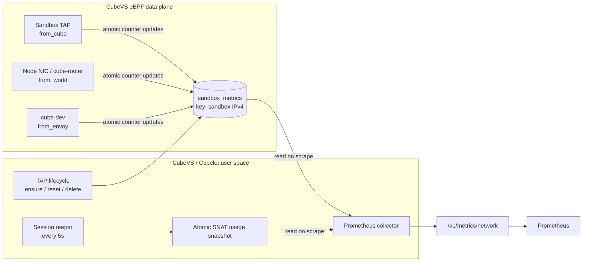

# Sandbox Network Metrics

## Background

CubeVS is the node-local datapath for CubeSandbox sandbox networking. Existing
CPU, memory, and node-resource metrics show how much compute capacity a sandbox
uses, but they cannot answer these network questions:

- whether a sandbox is producing ingress or egress traffic, and at what packet
  rate or throughput;
- whether CubeVS forwarded the traffic or dropped it because of policy, NAT, or
  packet-rewrite processing;
- whether ordinary SNAT session count is growing on a high-density node;
- whether the SNAT IP source-port range `30000-65535` is under pressure;
- whether real SNAT source-port allocation failures have started.

The network-metrics capability therefore has two direct goals:

1. **Expose sandbox network activity**: per-`sandbox_ip` ingress and egress
   packet, byte, drop, and SNAT-allocation-failure counters show the activity
   and CubeVS datapath outcome of an individual sandbox.
2. **Expose SNAT port pressure**: per-`snat_ip` live ordinary-SNAT session,
   physical source-port occupancy, and capacity gauges show whether a node
   egress address is approaching a pressure range.

SNAT source ports can be reused across different destination/protocol tuples.
Consequently, `port capacity - session count` is not remaining port capacity,
and globally unused source-port numbers are not the exact number of connections
that can still be opened toward one destination. Use `snat_ports_unused` for
the overall physical-port occupancy trend and
`snat_alloc_failures_total` as the direct allocation-failure signal.

In a multi-node cluster, each Cubelet exports only its node-local CubeVS state.
Prometheus must scrape every compute node and use `instance`, `sandbox_ip`, and
`snat_ip` to distinguish nodes, sandboxes, and egress addresses.

The design has three parts:

1. CubeVS eBPF programs update per-sandbox counters while forwarding packets.
2. CubeVS user space owns counter-entry lifecycles and publishes periodic SNAT
   usage snapshots.
3. Cubelet converts both sources into Prometheus series when the endpoint is
   scraped.

## Design goals

- Attribute datapath traffic and drops to a sandbox without guest cooperation.
- Keep map-entry ownership in user space so metric identity follows TAP and IP
  ownership exactly.
- Keep Prometheus scraping off packet-processing and guest-RPC paths.
- Bound label cardinality by sandbox IP and SNAT IP rather than destination,
  port, protocol, session, or policy rule.
- Reuse the existing session-reaper scan for SNAT occupancy instead of adding a
  second full session-map scan.
- Preserve partial observability when either sandbox counters or SNAT state is
  temporarily unavailable.

## Scope

Network metrics describe traffic handled by CubeVS on one compute node. They
are datapath accounting metrics, not application-level billing records.

| Source | Identity | Data | Update model |
| --- | --- | --- | --- |
| Sandbox traffic | `sandbox_ip` | Forwarded and dropped packet/frame counters, plus SNAT allocation failures | Updated in the eBPF packet path |
| SNAT allocation | `snat_ip` | Live ordinary-SNAT sessions and distinct source-port occupancy | Refreshed by the userspace session reaper |
| Exporter health | `source` | Readability of the two sources above | Evaluated independently on each scrape |

### Included traffic

The per-sandbox counters cover attributable IPv4 traffic at the three CubeVS
boundaries:

- `from_cube` on TAP ingress: sandbox egress through normal SNAT, port mapping,
  DNS handling, ICMP, or redirection to CubeEgress;
- `from_world` on node-NIC ingress or cube-router egress: reverse NAT and
  port-mapped traffic delivered toward a sandbox;
- `from_envoy` on `cube-dev` egress: host or CubeEgress traffic delivered
  toward a sandbox. The program name is retained for compatibility; CubeEgress
  is implemented with OpenResty rather than Envoy.

Directions are always from the sandbox's point of view:

- **egress** means a packet emitted by the sandbox and processed on its TAP;
- **ingress** means a packet attributed to the sandbox and delivered toward its
  TAP.

Forwarded means CubeVS completed its processing and issued the relevant
redirect. It does not prove that a remote peer or the guest application
eventually consumed the packet.

### Explicit exclusions

The metrics do not provide:

- application payload bytes, HTTP request counts, methods, status codes, or L7
  policy decisions;
- destination-, protocol-, port-, session-, or policy-rule-level breakdowns;
- ARP accounting or general non-IPv4 accounting;
- packets dropped before reaching a CubeVS hook;
- loss after CubeVS redirected an egress packet, including host routing, NIC,
  underlay, or remote-peer loss;
- CubeEgress application-layer deny counts. A packet successfully redirected
  from CubeVS to CubeEgress is an egress forward even if CubeEgress later denies
  the request;
- traffic that cannot be attributed to a registered sandbox. For example,
  unrelated host-NIC traffic and reverse-NAT misses do not create sandbox
  series;
- per-sandbox SNAT gauges. SNAT gauges are intentionally aggregated by SNAT IP.

Byte counters use `skb->len` at the accounting point. They represent the frame
length seen by the TC program, not TCP/UDP payload bytes. Retransmissions are
counted again.

## Architecture



### Data-plane counters

`sandbox_metrics` is a pinned `BPF_MAP_TYPE_HASH` map:

- key: sandbox IPv4 address in network byte order;
- value: nine `uint64` counters;
- maximum entries: `8192`;
- allocation: `BPF_F_NO_PREALLOC`.

The eBPF helper performs a lookup and returns immediately when the key does not
exist. It never creates an entry. Existing values are updated with atomic
`__sync_fetch_and_add` operations so packets processed concurrently on
different CPUs do not lose increments.

This deliberately keeps ownership in user space. Allowing stale packets to
create map entries in the data plane could recreate a deleted sandbox's series,
race with IP reuse, and retain keys that no active sandbox owns.

The trade-off is a bounded lookup plus atomic increments on accounted packets.
All counters for one sandbox share one map value, favoring lifecycle clarity
and low series cardinality over per-CPU aggregation.

### User-space entry lifecycle

The Cubelet embedded network runtime and the CubeVS Go control plane own
`sandbox_metrics` entries. The guest does not create, delete, or publish them,
and the eBPF datapath never creates an entry after a key miss.

#### Creation conditions

| Situation | User-space action | Counter result |
| --- | --- | --- |
| New sandbox or IP assignment | `AddTAPDevice` attempts to delete any residual entry for the IP, then `UpsertTAPDeviceMetadata` attempts to ensure an entry | Reset and ensure failures are logged without blocking registration; a failed reset may leave stale counters on IP reuse |
| Metadata repair, idempotent upsert, or legacy TAP replacement | `UpsertTAPDeviceMetadata` attempts to ensure an entry before writing metadata | Existing counters are preserved; successful creation starts at zero; failure leaves metrics absent |
| Network-policy update | Only policy maps are changed | Counters continue |
| Sandbox rollback with the same TAP/IP | Only TAP/session generations are changed | Counters do not roll back or reset |
| CubeVS initialization recreates `sandbox_metrics` | Every entry is removed; startup recovery independently ensures an entry for each active TAP after validating its metadata | Successful entries restart at zero; an ensure failure leaves that `sandbox_ip` series unavailable |

The ensure operation inserts a zero value with `UpdateNoExist`.
`ebpf.ErrKeyExist`, the package sentinel for an `EEXIST` conflict, is accepted,
so metadata refresh does not overwrite counters already accumulated by a
running sandbox. User space attempts the map update before publishing TAP
metadata. An ensure failure is logged and does not prevent subsequent TAP
metadata or policy programming. The registration reset is also best-effort:
failure is logged but does not block TAP metadata or policy programming.
Continuing after a reset failure prioritizes sandbox forwarding over exact
counter attribution and may expose the previous IP owner's counters under the
new owner.

Startup recovery performs the same ensure independently of metadata repair.
This repopulates a recreated map even when the pinned TAP metadata already
matches the recovered sandbox and does not need an upsert.

A new TAP registration proceeds in this order:

1. `AddTAPDevice` calls `DeleteSandboxTrafficMetrics` to remove counters left
   by an earlier lifecycle of the IP.
2. `UpsertTAPDeviceMetadata` calls `EnsureSandboxTrafficMetrics` to insert a
   zero entry with `UpdateNoExist`.
3. User space writes `ifindex_to_mvmmeta` and `mvmip_to_ifindex`.
4. User space applies the sandbox network policy.
5. Reset and ensure failures are logged and ignored. Metadata and policy
   failures return errors; a policy failure also cleans up state already
   written.

Resetting first, ensuring second, and publishing metadata last normally
prevents a new sandbox from inheriting the previous IP owner's counters. On
ensure failure, the system prioritizes TAP availability and omits the
`sandbox_ip` series. On reset failure, it likewise prioritizes TAP availability;
if the old entry remains accessible, its counters may be attributed to the new
IP owner until a later successful deletion, reset, or CubeVS restart.

#### Creation failures and missing keys

- **Reset fails**: user space cannot prove that old counters were removed. It
  logs a warning containing `sandbox_id`, `ifindex`, `sandbox_ip`, and the cause,
  then continues TAP registration. Forwarding remains available, but counters
  may include traffic from the previous IP owner.
- **Ensure fails**: if `sandbox_metrics` cannot be opened, the map is full, or
  `UpdateNoExist` returns an error that does not match `ebpf.ErrKeyExist`, user
  space logs a warning containing `sandbox_id`, `ifindex`, `sandbox_ip`, and the
  cause, then continues TAP registration. The failure does not affect sandbox
  forwarding.
- **The key is missing at runtime**: `update_metrics` returns immediately after
  the lookup miss. It neither creates an entry nor changes subsequent packet
  processing. None of the sandbox's counters increase, and its `sandbox_ip`
  does not appear in the Prometheus response, so network metrics for that
  sandbox are unavailable.

::: info Empty data after restart
CubeVS initialization intentionally recreates `sandbox_metrics`; counters are
not persistent. Startup recovery independently ensures an entry for every
active TAP, so successful entries resume exporting from zero even when their
metadata was already intact. If that ensure fails, the sandbox exports no
counter series until a later recovery, metadata upsert, TAP re-registration, or
new sandbox lifecycle succeeds. An absent series means missing data, not a zero
counter or no network traffic.
:::

`cubesandbox_network_exporter_up{source="sandbox"} == 1` means only that the
collector opened and iterated the map successfully. It does not guarantee that
every active sandbox has an entry. To validate complete coverage, compare the
active TAP/IP inventory with the set of `sandbox_ip` labels in Prometheus.

#### Deletion conditions

| Situation | User-space action |
| --- | --- |
| Sandbox deletion, TAP release, or stale-TAP cleanup | Remove policy and metadata first, then call `DeleteSandboxTrafficMetrics` for the IP |
| Deleting an entry that does not exist | Treat as idempotent success |
| Metrics-entry deletion fails | Log a warning without blocking TAP, IP, or port reclamation |
| A later sandbox reuses the IP | `AddTAPDevice` retries the reset before registration; another failure is logged and registration continues with potentially stale counters |
| CubeVS initialization | Recreate the complete `sandbox_metrics` map; all old counters disappear and omitted sandboxes have empty data |

Network-policy updates, metadata refresh, and rollback under the same network
assignment do not delete an entry. Deletion follows TAP/IP ownership release,
not an individual connection or policy change.

### SNAT userspace snapshot

The SNAT gauges reuse the existing session-reaper scan instead of traversing
the session map during every Prometheus scrape:

1. The reaper scans `egress_sessions` every 5 seconds.
2. Expired sessions are removed using the existing safe delayed-delete
   iteration.
3. Only surviving ordinary-SNAT sessions (`SNAT_PACKET`) with a non-zero SNAT
   IP are included. L7 proxy and port-mapping sessions are excluded.
4. Sessions are counted by SNAT IP.
5. Distinct source ports are deduplicated by `(snat_ip, source_port)`.
6. A complete immutable snapshot is atomically published for scrapes.

If any 5-second scan fails, the previous snapshot is invalidated immediately.
The next scrape omits all SNAT gauges and reports
`exporter_up{source="snat"} == 0` instead of presenting old occupancy as
current. A snapshot older than 10 seconds is also rejected as stale, covering a
reaper that stops making progress without returning an error. A later
successful scan publishes a new snapshot and restores the gauges.

The source-port range is `30000` through `65535`, inclusive, for a capacity of
`35536`. A source port may be reused across different destination/protocol
tuples, so session count and distinct physical source-port count are different
quantities.

### Scrape path and partial failure

The Cubelet handler uses a dedicated Prometheus registry. On each scrape the
collector:

1. iterates and sorts `sandbox_metrics`;
2. reads the latest SNAT usage snapshot and the configured `snat_iplist`;
3. deduplicates repeated allocator shards for the same SNAT IP;
4. emits constant Prometheus samples;
5. emits one health series for each source.

The two sources fail independently. If the sandbox map cannot be read but the
SNAT snapshot is healthy, SNAT metrics remain available and only
`exporter_up{source="sandbox"}` becomes `0`.

Scraping never scans running sandboxes, contacts CubeShim, calls a guest, or
adds traffic to the datapath. Sandbox-map iteration is proportional to active
entries; SNAT session-map scanning remains in the background reaper.

## Lifecycle semantics

| Event | Sandbox traffic counters | SNAT gauges |
| --- | --- | --- |
| New sandbox / new IP assignment | Reset and ensure failures do not stop registration; reset failure may retain stale counters, while ensure failure may leave the IP series absent | Reflected by the next reaper snapshot after sessions are created |
| Metadata upsert or repair is executed | A successful ensure preserves the entry or creates it at zero; failure leaves metrics absent | Unchanged until the next snapshot |
| Network-policy update | Counters continue; packets rejected by the new policy increment drop counters | Retired sessions disappear on a later snapshot |
| Sandbox rollback with the same network assignment | Counters continue; they are not snapshot-aware | Stale sessions are removed and the next snapshot converges |
| Sandbox deletion | Series is removed after TAP cleanup | Sessions disappear after removal/reaping |
| Sandbox IP reuse | Reset is attempted before registration; failure is logged and may carry residual counters into the new lifecycle | Sessions follow their own lifecycle |
| CubeVS/Cubelet network initialization | Recreate `sandbox_metrics`; recovery independently ensures each active sandbox at zero, while ensure failures remain absent | Cached SNAT usage is cleared and republished by the reaper |

These counters are scoped to the current CubeVS runtime and sandbox IP
assignment. Prometheus should treat a CubeVS restart or IP reassignment as a
counter-reset boundary. A reset warning means that boundary is unreliable and
the series may still contain values from the previous IP owner.

The label is `sandbox_ip`, not `sandbox_id`, because the datapath's stable,
available ownership key is the assigned IPv4 address. Join it with control-plane
inventory outside this endpoint when a sandbox ID is required.

## Metric reference

### Sandbox traffic counters

Each active `sandbox_ip` entry exports nine time series.

| Metric | Type | Unit and meaning |
| --- | --- | --- |
| `cubesandbox_network_sandbox_ingress_packets_total` | Counter | IPv4 packets CubeVS forwarded toward the sandbox. |
| `cubesandbox_network_sandbox_ingress_bytes_total` | Counter | `skb->len` bytes for those forwarded ingress packets. |
| `cubesandbox_network_sandbox_ingress_drop_packets_total` | Counter | Attributable ingress packets CubeVS rejected or failed to rewrite. |
| `cubesandbox_network_sandbox_ingress_drop_bytes_total` | Counter | `skb->len` bytes for those dropped ingress packets. |
| `cubesandbox_network_sandbox_egress_packets_total` | Counter | IPv4 packets CubeVS forwarded from the sandbox. |
| `cubesandbox_network_sandbox_egress_bytes_total` | Counter | `skb->len` bytes for those forwarded egress packets. |
| `cubesandbox_network_sandbox_egress_drop_packets_total` | Counter | Sandbox egress packets CubeVS rejected or failed to process. |
| `cubesandbox_network_sandbox_egress_drop_bytes_total` | Counter | `skb->len` bytes for those dropped egress packets. |
| `cubesandbox_network_sandbox_snat_alloc_failures_total` | Counter | Ordinary SNAT source-port allocation failures for the sandbox. |

An SNAT allocation failure also leads to an egress drop. The failure counter is
a reason-specific subset of egress drops and must not be added to the drop
counter.

### SNAT gauges

Each configured logical `snat_ip` exports three time series.

| Metric | Type | Unit and meaning |
| --- | --- | --- |
| `cubesandbox_network_snat_sessions_in_use` | Gauge | Surviving ordinary-SNAT sessions using this SNAT IP. |
| `cubesandbox_network_snat_ports_capacity` | Gauge | Source-port range size (`35536`) available per destination/protocol tuple. |
| `cubesandbox_network_snat_ports_unused` | Gauge | Source-port numbers not used by any surviving ordinary-SNAT session on this SNAT IP. |

`snat_ports_unused` is a node-IP-wide occupancy view. It is not exact
destination-specific allocation headroom because one source-port number can be
reused for different destination/protocol tuples. Use a positive rate of
`cubesandbox_network_sandbox_snat_alloc_failures_total` as the direct
exhaustion signal.

### Exporter health

| Series | Meaning |
| --- | --- |
| `cubesandbox_network_exporter_up{source="sandbox"}` | `1` when the pinned sandbox counter map was read successfully during this scrape. |
| `cubesandbox_network_exporter_up{source="snat"}` | `1` when a fresh SNAT snapshot and SNAT IP configuration were read successfully. |

A value of `0` affects only that source. Other readable metric families remain
available.

## Cardinality and performance

Each sandbox map entry exports nine series. The hard map limit of 8192 therefore
bounds sandbox traffic series at 73728 per node. Up to four logical SNAT IPs add
at most 12 gauge series, plus two exporter-health series.

Actual deployments usually have a lower sandbox limit. Prometheus still pays
for every exported family, so use `metric_relabel_configs` to drop packet,
byte, or drop families that are not required.

The endpoint accepts at most two concurrent scrapes. Additional concurrent
requests receive HTTP 503, preventing multiple large responses from consuming
unbounded Cubelet CPU and memory.

## Prometheus configuration

Cubelet exposes Prometheus metrics for the CubeVS network datapath at:

```text
http://<cubelet-node>:9998/v1/metrics/network
```

This endpoint is separate from Cubelet's generic `/v1/metrics` endpoint and the
sandbox resource endpoint at `/v1/metrics/resource`. Network metrics require no
guest agent and no guest RPC. They are derived entirely from node-local CubeVS
state.

```yaml
scrape_configs:
  - job_name: cubesandbox-network
    scrape_interval: 30s
    scrape_timeout: 10s
    metrics_path: /v1/metrics/network
    static_configs:
      - targets:
          - <compute-node-ip>:9998
```

Replace the target with each Cubelet node's management-network address.

::: warning Network access
Cubelet's HTTP service has no built-in authentication or TLS. Expose port
`9998` only on a trusted management network, or restrict it with firewall or
security-group rules. See [Network Hardening](./network-hardening.md).
:::

Verify the endpoint on a Cubelet node:

```bash
curl -fsS http://127.0.0.1:9998/v1/metrics/network | \
  grep '^cubesandbox_network_'
```

## PromQL examples

Sandbox egress throughput in bits per second:

```promql
8 * rate(cubesandbox_network_sandbox_egress_bytes_total[5m])
```

Sandbox egress packet-drop ratio:

```promql
rate(cubesandbox_network_sandbox_egress_drop_packets_total[5m])
/
clamp_min(
  rate(cubesandbox_network_sandbox_egress_packets_total[5m])
  +
  rate(cubesandbox_network_sandbox_egress_drop_packets_total[5m]),
  1e-9
)
```

Actual SNAT allocation failures:

```promql
sum by (instance, sandbox_ip) (
  rate(cubesandbox_network_sandbox_snat_alloc_failures_total[5m])
) > 0
```

SNAT source-port occupancy:

```promql
1 -
cubesandbox_network_snat_ports_unused
/
cubesandbox_network_snat_ports_capacity
```

Treat this ratio as node-IP-wide physical-port occupancy, not
destination-specific allocation headroom.

## Troubleshooting

| Symptom | Common cause and action |
| --- | --- |
| Cannot connect to port `9998` | Check `cube-sandbox-cubelet.service`, the listener address, firewall, and security-group rules. |
| HTTP 503 | Two network-metric scrapes are already running. Check for duplicate Prometheus jobs or concurrent manual requests. |
| `exporter_up{source="sandbox"}` is `0` | Check Cubelet logs for pinned `sandbox_metrics` map open or iteration errors. |
| `exporter_up{source="snat"}` is `0` | Confirm the CubeVS session reaper is running. A missing or older-than-10-second snapshot is rejected. |
| Both health series are `1`, but there are no sandbox series | The map is readable but empty, commonly after CubeVS restart without repopulation or after ensure failure. Empty means missing data, not zero traffic. |
| A running sandbox has a zero-valued series | Confirm traffic crosses CubeVS and inspect the pinned map. ARP, unrelated host traffic, and loss outside CubeVS do not increment the counters. |
| A running sandbox has no traffic series | Network metrics are unavailable for that sandbox. Check reset/ensure warnings; the eBPF datapath intentionally does not create missing entries. |
| A deleted sandbox still appears | Inspect Cubelet cleanup warnings. Cleanup and registration reset are best-effort; successful deletion, reset, or CubeVS restart removes the stale entry. |
| SNAT occupancy looks high but there are no failures | This can be valid because source ports are reusable across different destination/protocol tuples. Alert on allocation failures. |

On a default installation, inspect the map and Cubelet logs with:

```bash
sudo bpftool map dump pinned /sys/fs/bpf/sandbox_metrics
sudo tail -200 /data/log/Cubelet/Cubelet-req.log
```

## Related documentation

- [CubeVS Network Model](../architecture/network.md)
- [Network Policy](./network-policy.md)
- [Sandbox Resource Metrics](./resource-metrics.md)
- [Network Hardening](./network-hardening.md)
