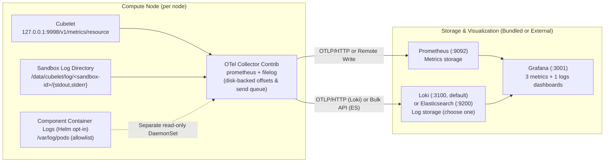

# Sandbox Observability Deployment (CubeObservability)

CubeObservability provides an out-of-the-box **sandbox resource metrics** and **sandbox logs** observability stack for CubeSandbox. It is **opt-in (disabled by default)** in both one-click (CVM / bare-metal) and Kubernetes Helm installations. With a single environment variable or Helm value, you can either deploy the bundled Prometheus + Loki (or Elasticsearch) + Grafana stack, or forward telemetry directly to your existing external observability platform.

::: tip Scope & Related Guides
This guide focuses on collecting, storing, and visualizing **metrics and logs**:
- Metric definitions and semantics: [Sandbox Resource Metrics](./resource-metrics.md)
- Node-local sandbox log CLI: [Sandbox Logs](./sandbox-logs.md)
- End-to-end request latency analysis: [Distributed Tracing](./tracing.md)
:::

---

## Overall Architecture

CubeObservability follows a three-layer architecture—**lightweight per-node collection** feeding **centralized storage and visualization**—without modifying Cubelet's core logic and while keeping backends pluggable:



### Collected Data and Pipelines

| Data Type | Source | Collection Method | Key Characteristics |
| --- | --- | --- | --- |
| **Sandbox resource metrics** | Local Cubelet `127.0.0.1:9998/v1/metrics/resource` | `prometheus` receiver periodic scrape | Covers all 24 exported metric families (CPU, memory, node sandbox counts) with `cluster` and `node` labels |
| **Sandbox stdio logs** | `/data/cubelet/log/<sandbox-id>/{stdout,stderr}` | `filelog` receiver continuous tail | Parses `sandbox_id` and `stdout`/`stderr` from path; continuous export is required because sandbox removal deletes local log files |
| **Component container logs** (Helm opt-in) | Allowlisted CubeSandbox containers under `/var/log/pods` | Separate read-only `component-otelcol` DaemonSet | Disabled by default; tails from file end without replaying history; not supported in one-click |

Each node's OTel Collector exports metrics and logs through independent pipelines and persists file offsets and OTLP sending queues to local disk (`/var/lib/cube-sandbox/otelcol/storage` for systemd; `/var/lib/cube-sandbox/otelcol-k8s` for Helm), surviving restarts and transient backend outages.

### Deployment Topologies

| Deployment Mode | Node Collector | Backend (Prometheus + Log Backend + Grafana) | Notes |
| --- | --- | --- | --- |
| **one-click first node** (default all-in-one) | Local systemd service | Installed on the same host (no separate monitoring control plane needed) | Set `ONE_CLICK_ENABLE_OBSERVABILITY=1` to install the full stack |
| **one-click additional compute nodes** | Local systemd service | Pushes automatically to the first node | Provide the first node's private IP; installs Collector only |
| **Kubernetes Helm** | Compute-node DaemonSet | In-cluster backend on control-plane nodes (default) or external backend | Enable via `--set observability.enabled=true` |
| **Standalone install** (independent of one-click/Helm) | Local systemd service | Supports full stack (`all`), backend-only (`backend`), or Collector-only (`cvm`) | Managed directly via `deploy/one-click/observability/install.sh` |

::: info Notes
- Terraform deployment does not include observability installation.
- Repository ownership: Grafana image and dashboards live in `CubeObservability/`; one-click/systemd scripts in `deploy/one-click/observability/`; Helm chart templates and values in `deploy/kubernetes/chart/`.
:::

---

## Dependencies and Prerequisites

Verify the required versions, host/cluster environment, and network rules before enabling observability.

### Component Versions and Backend Choice

#### Bundled Versions & External Compatibility Baselines

The installers pin validated component versions for reproducible deployments. If you connect to self-managed or hosted external backends, meet the compatibility baseline below:

| Component | Bundled Pinned Version | External Compatibility Baseline | Default Port | Role |
| --- | --- | --- | --- | --- |
| **OTel Collector Contrib** | `0.162.0` | Prefer `0.162.x` (rerun `otelcol validate` after any upgrade) | `127.0.0.1:13133` | Per-node collector (health endpoint) |
| **Prometheus** | one-click `3.13.4`; Helm `v3.2.1` | `3.x` (with `--web.enable-otlp-receiver` and `--web.enable-remote-write-receiver`) | `9092` | Metrics backend (`9090` is reserved by `cube-proxy`) |
| **Loki** (default log backend) | `3.7.9` | `3.x` (with native OTLP `/otlp` and structured metadata enabled) | `3100` | Default log backend, queried via LogQL |
| **Elasticsearch** (optional log backend) | `8.17.3` | `8.x` | `9200` | Optional log backend using `raw` mapping and Bulk API |
| **Grafana OSS** | `10.4.18` | `>= 10.4` (supporting dashboard schema `39`) | `3001` | Metrics and logs UI |

#### Choosing a Log Backend: Loki vs. Elasticsearch

Only **one** log backend is enabled per deployment (logs are not dual-written):

- **Loki (default, recommended):** lightweight with low resource overhead; ideal for fast adoption and filtering by cluster, node, sandbox ID, and regex.
- **Elasticsearch (optional):** best suited for teams with existing ES operations or full-text search needs (Lucene / Query DSL).
- For production, prefer forwarding telemetry to an existing team-managed or hosted observability platform.

### System and Platform Prerequisites

| Dimension | one-click / systemd (CVM / Bare-Metal) | Kubernetes / Helm |
| --- | --- | --- |
| **Host OS** | 64-bit Linux (`amd64` / `arm64`), `systemd` | No extra host binaries required |
| **CLI tools** | `curl`, `tar`, `python3` (used to safely unpack and verify the Loki release archive) | `helm`, `kubectl` |
| **Cubelet requirement** | Cubelet running and exposing `127.0.0.1:9998/v1/metrics/resource` | Requires default `cubeNode.hostNetwork=true` so the node Collector can scrape `127.0.0.1:9998` |
| **Persistent storage** | Local host disk (`/var/lib/cube-sandbox/*`) | Bundled backends use PVCs by default; requires an available `StorageClass` (set `persistence.enabled=false` only for disposable validation) |
| **Grafana password** | Must set `CUBE_GRAFANA_ADMIN_PASSWORD` with **at least 16 characters** and no leading/trailing whitespace | Empty generates a release-scoped random Secret; inline `adminPassword` also requires at least 16 characters |

### Network and Port Matrix

| Traffic Direction | Port (TCP) | Purpose |
| --- | --- | --- |
| Compute nodes → Backend node | `9092` | Collector metrics ingestion to Prometheus |
| Compute nodes → Backend node | `3100` (Loki) or `9200` (Elasticsearch) | Collector logs ingestion to selected log backend |
| Administrators → Backend node | `3001` | Grafana Web UI |
| Node loopback (`127.0.0.1`) | `9998`, `13133` | Collector scraping local Cubelet metrics; local health check |

::: warning Security Notice
Bundled Prometheus, Loki, and Elasticsearch **do not enable server-side authentication**. Restrict `9092`, `3100`, and `9200` to private compute-node networks in your firewall or security group, and **never expose them directly to the public Internet**. For cross-network or public access, place an authentication proxy in front or use a managed backend.
:::

### Preflight Check (Existing Cubelet Nodes)

On nodes where Cubelet is already installed, verify the metrics endpoint and log path before enabling observability (for fresh one-click installs, proceed directly to [Installation and Deployment](#installation-and-deployment)):

```bash
# 1. Check Cubelet version and service status
/usr/local/services/cubetoolbox/Cubelet/bin/cubecli version
sudo systemctl is-active cube-sandbox-cubelet.service

# 2. Check the sandbox resource metrics endpoint
curl -fsS http://127.0.0.1:9998/v1/metrics/resource | \
  grep -E '^cubesandbox_(host_sandbox|guest_workload|node_sandbox_)'

# 3. If a sandbox is running, check its stdout/stderr log path
SANDBOX_ID=<replace-with-active-sandbox-id>
ls -l "/data/cubelet/log/${SANDBOX_ID}"/{stdout,stderr}
```

> When no sandbox is active, per-sandbox series and logs may be empty, while `cubesandbox_node_sandbox_count` and `cubesandbox_node_sandbox_available_count` should still return `0`.

---

## Installation and Deployment

Pick the deployment path matching your environment—no extra installer CLI flags are required:

| Scenario | Entrypoint | How to Enable |
| --- | --- | --- |
| **one-click fresh / existing cluster** | `deploy/one-click/install.sh` / `install-compute.sh` | Set `ONE_CLICK_ENABLE_OBSERVABILITY=1` in `.env` |
| **Kubernetes Helm** | `deploy/kubernetes/chart` | Pass `--set observability.enabled=true` |
| **External monitoring/log platform** | one-click or Helm | Configure external Prometheus / Loki / ES endpoints and credentials |
| **Standalone (without one-click/Helm)** | `deploy/one-click/observability/install.sh` | Run the `all`, `backend`, or `cvm` subcommand |

### one-click Deployment (CVM / Bare-Metal)

one-click reuses its existing `.env` file and installer scripts. The first node defaults to all-in-one (control plane + compute + observability backend + Collector), and additional compute nodes point to the first node's private IP.

#### Step 1: Install the first all-in-one node

1. Enter `deploy/one-click` (or the root of an extracted release bundle) and create `.env` on a fresh install:

```bash
cd deploy/one-click
[[ -f .env ]] || cp env.example .env
chmod 600 .env
```

2. Set a private IP reachable from compute nodes along with the observability variables (change `CUBE_LOGS_BACKEND` to `elasticsearch` if desired):

```dotenv
CUBE_SANDBOX_NODE_IP=10.0.0.10
ONE_CLICK_ENABLE_OBSERVABILITY=1
CUBE_OBSERVABILITY_CLUSTER_ID=cube-prod
CUBE_LOGS_BACKEND=loki
CUBE_GRAFANA_ADMIN_PASSWORD='<random-password-at-least-16-chars>'
```

3. Run the normal installer and confirm the final first-node IP for subsequent compute nodes:

```bash
sudo ./install.sh
grep '^CUBE_SANDBOX_NODE_IP=' /usr/local/services/cubetoolbox/.one-click.env
```

#### Step 2: Install additional compute nodes

Prepare the same release bundle and `.env` on each compute node, set the first node's private IP (keeping the cluster ID and log backend identical), and run `install-compute.sh`:

```dotenv
# .env
ONE_CLICK_CONTROL_PLANE_IP=10.0.0.10
ONE_CLICK_ENABLE_OBSERVABILITY=1
CUBE_OBSERVABILITY_CLUSTER_ID=cube-prod
CUBE_LOGS_BACKEND=loki
```

```bash
sudo ./install-compute.sh
```

`install-compute.sh` automatically sets the compute role, **installs only the local OTel Collector**, and derives the Prometheus (`:9092`) and selected log-backend (`:3100` or `:9200`) endpoints from `ONE_CLICK_CONTROL_PLANE_IP`.

#### Step 3: Enable or disable in an existing one-click deployment

Keep maintaining the original `.env` in your installation directory (**do not** overwrite it with `env.example` or edit `/usr/local/services/cubetoolbox/.one-click.env` directly):

1. Add the observability variables to `.env` on the first node and run upgrade:

```bash
sudo ./install.sh --mode=upgrade --yes
```

2. After verifying the first node, update `.env` on each compute node and run upgrade:

```bash
sudo ./install-compute.sh --mode=upgrade --yes
```

> On upgrade, a default `ONE_CLICK_ENABLE_OBSERVABILITY=0` copied from `env.example` will not turn off an already-enabled stack. To explicitly disable observability, run `sudo env ONE_CLICK_ENABLE_OBSERVABILITY=0 ./install.sh --mode=upgrade --yes` (or `./install-compute.sh` on compute nodes).

#### Optional: Online installation (`online-install.sh`)

You can forward the same environment variables to `online-install.sh` (for external auth tokens or other secrets, prefer downloading the release and storing values in a mode-`0600` `.env` instead of shell history):

```bash
# First all-in-one node
GRAFANA_ADMIN_PASSWORD="$(openssl rand -hex 16)"
echo "Grafana admin password: ${GRAFANA_ADMIN_PASSWORD}"
curl -fsSL https://raw.githubusercontent.com/tencentcloud/CubeSandbox/master/deploy/one-click/online-install.sh \
  | sudo env ONE_CLICK_ENABLE_OBSERVABILITY=1 \
      CUBE_OBSERVABILITY_CLUSTER_ID=cube-prod \
      CUBE_LOGS_BACKEND=loki \
      CUBE_GRAFANA_ADMIN_PASSWORD="${GRAFANA_ADMIN_PASSWORD}" \
      bash

# Additional compute node
curl -fsSL https://raw.githubusercontent.com/tencentcloud/CubeSandbox/master/deploy/one-click/online-install.sh \
  | sudo env ONE_CLICK_DEPLOY_ROLE=compute \
      ONE_CLICK_CONTROL_PLANE_IP=10.0.0.10 \
      ONE_CLICK_ENABLE_OBSERVABILITY=1 \
      CUBE_OBSERVABILITY_CLUSTER_ID=cube-prod \
      CUBE_LOGS_BACKEND=loki \
      bash
```

---

### Kubernetes Helm Deployment

Append `observability.*` values to your normal Helm install command (using your existing `runtime-values.yaml` containing database/Redis credentials and node placement).

#### Bundled in-cluster backend (quick start)

```bash
helm upgrade --install cube ./deploy/kubernetes/chart \
  -n cube-system --create-namespace \
  -f /path/to/runtime-values.yaml \
  --set observability.enabled=true \
  --set observability.clusterId=k8s-prod \
  --set observability.logs.backend=loki
```

- **Retrieve the Grafana password:** the chart generates a release-scoped random Secret and reuses it across upgrades (in production, prefer `observability.backend.grafana.existingSecret`):

```bash
kubectl get secret -n cube-system \
  -l app.kubernetes.io/component=grafana-admin \
  -o jsonpath='{.items[0].data.admin-password}' | base64 --decode; echo
```

- **Use Elasticsearch instead of Loki:** change `--set observability.logs.backend=loki` to `--set observability.logs.backend=elasticsearch`.
- **Collect component container logs (optional):** add `--set observability.logs.components.enabled=true`. This deploys a second read-only DaemonSet that tails only allowlisted containers (`cube-master`, `cube-api`, `cube-ops`, `cube-templatecenter`, `cubelet`, `cube-proxy`, `cube-lifecycle-manager`) under `/var/log/pods` in the release namespace starting from file end. Verify component logs do not contain plaintext secrets before enabling.
- All bundled monitoring Pods include readiness and liveness probes (no Alertmanager rules are installed).

#### Common Helm Values

| Value | Default | Meaning |
| --- | --- | --- |
| `observability.enabled` | `false` | Observability master switch |
| `observability.clusterId` | `cubesandbox` | Cluster label written to metrics and logs |
| `observability.backend.enabled` | `true` | Deploy in-cluster Prometheus, selected log backend, and Grafana |
| `observability.otelCollector.scrapeInterval` | `15s` | Cubelet scrape interval (must not be shorter than the fixed `10s` timeout) |
| `observability.otelCollector.cubeletMetricsTarget` | `127.0.0.1:9998` | Node-local Cubelet endpoint (requires `cubeNode.hostNetwork=true`) |
| `observability.otelCollector.stateHostPath` | `/var/lib/cube-sandbox/otelcol-k8s` | Per-node persistent directory for offsets, queues, and WAL |
| `observability.metrics.otlpEndpoint` / `remoteWriteUrl` | `""` | External metrics OTLP/HTTP or Remote Write URL (choose one) |
| `observability.logs.backend` | `loki` | Log backend: `loki` or `elasticsearch` |
| `observability.logs.otlpEndpoint` / `esEndpoint` | `""` | External Loki OTLP or Elasticsearch URL (choose one) |
| `observability.logs.components.enabled` | `false` | Enable the separate read-only DaemonSet for component CRI logs |
| `observability.metrics.auth.existingSecret` / `observability.logs.auth.existingSecret` | `""` | Secret holding external backend Authorization and tenant headers |
| `observability.backend.<component>.persistence.*` | `enabled: true` | PVC settings (`storageClassName`, `existingClaim`, `size`) for bundled backends |
| `observability.backend.grafana.existingSecret` | `""` | Externally managed Grafana admin Secret (`admin-user` / `admin-password`) |

---

### Connecting to External Backends (with Authentication)

If you already operate Prometheus / VictoriaMetrics / Loki / Elasticsearch or a managed observability platform, **deploy only the node Collector** and forward telemetry externally.

::: warning Mutual Exclusivity & Security
- Configure at most one metrics destination (OTLP/HTTP **or** Remote Write) and one log destination (Loki OTLP **or** Elasticsearch).
- Auth variables configure Collector/Grafana client headers only; they do not enable server-side auth on bundled backends.
- HTTPS endpoints validate certificates against the system/container CA. Mount a trusted CA for private CAs rather than disabling TLS verification.
:::

#### Option A: one-click / systemd with external backends

Setting explicit external endpoints causes `ONE_CLICK_OBSERVABILITY_ROLE=auto` to skip local backends and install only the node Collector:

```dotenv
ONE_CLICK_ENABLE_OBSERVABILITY=1
ONE_CLICK_OBSERVABILITY_ROLE=auto
CUBE_OBSERVABILITY_CLUSTER_ID=cube-prod
CUBE_LOGS_BACKEND=loki

# External endpoints (OTLP base URLs without /v1/metrics or /v1/logs)
CUBE_METRICS_OTLP_HTTP_ENDPOINT=https://prometheus.example.com/api/v1/otlp
CUBE_LOGS_OTLP_HTTP_ENDPOINT=https://loki.example.com/otlp

# Optional auth (*_AUTHORIZATION = full header, *_TOKEN = bare token; do not set both)
CUBE_METRICS_AUTHORIZATION='Bearer <metrics-token>'
CUBE_METRICS_TENANT_ID=cube-prod
CUBE_LOGS_AUTHORIZATION='Bearer <logs-token>'
CUBE_LOGS_TENANT_ID=cube-prod
```

- For external **Elasticsearch**, set `CUBE_LOGS_BACKEND=elasticsearch`, `CUBE_LOGS_ES_ENDPOINT=https://es.example.com:9200` (optionally `CUBE_LOGS_ES_INDEX`), and either `CUBE_LOGS_ES_API_KEY` or paired `CUBE_LOGS_ES_USER` / `CUBE_LOGS_ES_PASSWORD`.
- For Prometheus **Remote Write**, replace `CUBE_METRICS_OTLP_HTTP_ENDPOINT` with `CUBE_METRICS_REMOTE_WRITE_URL`.

#### Option B: Kubernetes Helm with external backends

1. Disable the in-cluster backend and pass external endpoints:

```bash
helm upgrade --install cube ./deploy/kubernetes/chart \
  -n cube-system --create-namespace \
  -f /path/to/runtime-values.yaml \
  --set observability.enabled=true \
  --set observability.backend.enabled=false \
  --set observability.clusterId=k8s-prod \
  --set observability.metrics.otlpEndpoint="https://prometheus.example.com/api/v1/otlp" \
  --set observability.logs.backend=loki \
  --set observability.logs.otlpEndpoint="https://loki.example.com/otlp"
```

2. For authenticated external backends, create a Secret via your cluster's secret-management workflow (storing the complete `Authorization` header such as `Bearer ...` or `ApiKey ...`; avoid passing secrets via `--set`):

```yaml
apiVersion: v1
kind: Secret
metadata:
  name: cube-observability-auth
  namespace: cube-system
type: Opaque
stringData:
  metrics-authorization: "Bearer <metrics-token>"
  metrics-tenant-id: "cube-prod"
  logs-authorization: "Bearer <logs-token>"
  logs-tenant-id: "cube-prod"
```

Reference it in `runtime-values.yaml` (set `tenantIdKey` to `""` or omit it if `X-Scope-OrgID` is not required):

```yaml
observability:
  metrics:
    auth:
      existingSecret: cube-observability-auth
      authorizationKey: metrics-authorization
      tenantIdKey: metrics-tenant-id
  logs:
    auth:
      existingSecret: cube-observability-auth
      authorizationKey: logs-authorization
      tenantIdKey: logs-tenant-id
```

---

### Standalone Installation (Optional)

To install observability without touching CubeMaster or Cubelet services, invoke the standalone script directly:

```bash
# 1. Full-stack node (backend + local Collector); use 'backend' instead of 'all' for a backend-only host
sudo env \
  CUBE_OBSERVABILITY_CLUSTER_ID=cube-prod \
  CUBE_LOGS_BACKEND=loki \
  CUBE_GRAFANA_ADMIN_PASSWORD='<random-password-at-least-16-chars>' \
  ./deploy/one-click/observability/install.sh all

# 2. Additional CVM / bare-metal compute nodes (Collector only, Loki example)
sudo env \
  CUBE_OBSERVABILITY_CLUSTER_ID=cube-prod \
  CUBE_METRICS_OTLP_HTTP_ENDPOINT=http://10.0.0.10:9092/api/v1/otlp \
  CUBE_LOGS_OTLP_HTTP_ENDPOINT=http://10.0.0.10:3100/otlp \
  ./deploy/one-click/observability/install.sh cvm

#    For Elasticsearch, replace the logs env var above with:
#    CUBE_LOGS_BACKEND=elasticsearch CUBE_LOGS_ES_ENDPOINT=http://10.0.0.10:9200

# 3. Uninstall standalone components (data directories are retained)
sudo ./deploy/one-click/observability/install.sh uninstall all
```

---

## Verification and Grafana Dashboards

### Health Checks

#### one-click / systemd

```bash
# Check full-stack / backend node
sudo /usr/local/services/cubetoolbox/observability/install.sh status

# Check Collector on a compute node
sudo systemctl --no-pager --full status cube-sandbox-otelcol.service
sudo journalctl -u cube-sandbox-otelcol.service -n 100 --no-pager

# Probe backend health endpoints
curl -fsS http://127.0.0.1:9092/-/ready
curl -fsS http://127.0.0.1:3100/ready
# For Elasticsearch:
# curl -fsS 'http://127.0.0.1:9200/cubesandbox-logs*/_count'
```

#### Kubernetes Helm

```bash
kubectl -n cube-system rollout status daemonset/cube-node-otelcol
# Only present when observability.logs.components.enabled=true
kubectl -n cube-system rollout status daemonset/cube-component-otelcol
```

### Pre-Provisioned Grafana Dashboards

Open `http://<backend-node-ip>:3001` (or access Grafana via Kubernetes Service / port-forward). Bundled Grafana automatically loads **three metrics dashboards and one logs dashboard**:

| Dashboard File | Purpose | Primary Scope |
| --- | --- | --- |
| `cubesandbox-cluster.json` | Cluster-wide sandbox resource totals | `cluster` |
| `cubesandbox-node.json` | Single-node sandbox resource totals | `cluster` → `node` |
| `cubesandbox-sandbox.json` | Single-sandbox Host Sandbox & Guest Workload details | `cluster` → `node` → `sandbox_id` → `container_id` |
| `cubesandbox-logs.json` (Loki) or `cubesandbox-logs-elasticsearch.json` (ES) | Sandbox stdout/stderr volume & log explorer, plus a collapsed **Component logs** row | Unified UID `cubesandbox-logs` |

::: tip Reading the Dashboards
- Metrics selectors cascade from `cluster → node → sandbox_id → container_id` and cover all 24 exported metric families.
- CPU rates are expressed in cores; memory limits are sums of exported finite limits, not physical host capacity.
- Host Sandbox and Guest Workload use different accounting boundaries and **must not be added together**; missing data is not zero.
- Loki indexes only low-cardinality labels (`service_name`, `cubesandbox_cluster_id`, `host_name`) and keeps `cubesandbox_sandbox_id` and `log_iostream` as structured metadata to avoid high-cardinality streams.
:::

### Common Queries and Alert Expressions

#### Log Query Examples

- **Loki (LogQL):**

```text
# All sandbox stderr
{service_name="cubesandbox-sandbox"} | log_iostream="stderr"

# Error-like lines from a specific sandbox
{service_name="cubesandbox-sandbox"}
  | cubesandbox_sandbox_id="<sandbox-id>"
  |~ "(?i)error|fatal|panic"
```

- **Elasticsearch (Lucene):**

```text
# All sandbox stderr
service_name:"cubesandbox-sandbox" AND log_iostream:"stderr"

# Specific sandbox
cubesandbox_sandbox_id:"<sandbox-id>"
```

#### Suggested Alert Expressions (PromQL)

The installer does not deploy Alertmanager or alerting rules. Use these PromQL expressions as starting points (use `for: 5m` for CPU, throttling, memory ratio, and missing-sample checks; alert immediately on memory-limit failures; ratio queries apply only to sandboxes with finite limits):

```promql
# Sandbox CPU usage above 80% of a finite limit
100 * rate(cubesandbox_host_sandbox_cpu_usage_seconds_total[5m])
  / clamp_min(cubesandbox_host_sandbox_cpu_limit_cores, 0.001) > 80

# CPU throttled periods above 20%
100 * rate(cubesandbox_host_sandbox_cpu_throttled_periods_total[5m])
  / clamp_min(rate(cubesandbox_host_sandbox_cpu_periods_total[5m]), 0.001) > 20

# Sandbox memory usage above 85% of a finite limit
100 * cubesandbox_host_sandbox_memory_current_bytes
  / clamp_min(cubesandbox_host_sandbox_memory_limit_bytes, 1) > 85

# Any memory-limit failure in the last 5 minutes
increase(cubesandbox_host_sandbox_memory_failures_total[5m]) > 0

# Active sandbox exists without a fresh resource sample
cubesandbox_node_sandbox_count - cubesandbox_node_sandbox_available_count > 0
```

---

## Advanced Configuration and Operations Reference

### Core Environment Variables (one-click / systemd)

one-click users can uncomment settings in the `Observability` section of `deploy/one-click/env.example` (Helm uses `observability.*` values and does not read these variables):

| Category | Variable | Default | Meaning |
| --- | --- | --- | --- |
| **Core** | `ONE_CLICK_ENABLE_OBSERVABILITY` | `0` | Set to `1` to enable observability during one-click install/upgrade |
| | `ONE_CLICK_OBSERVABILITY_ROLE` | `auto` | Role override: `auto`, `all`, `backend`, or `cvm` |
| | `CUBE_OBSERVABILITY_CLUSTER_ID` | `cubesandbox` | Cluster label written to metrics and logs |
| | `CUBE_SANDBOX_NODE_IP` | auto-detected | Node label and first-node IP |
| | `CUBE_LOGS_BACKEND` | `loki` | Log backend: `loki` or `elasticsearch` |
| **Metrics export** | `CUBE_METRICS_OTLP_HTTP_ENDPOINT` | auto-derived | External Prometheus OTLP/HTTP base URL (omit `/v1/metrics`) |
| | `CUBE_METRICS_REMOTE_WRITE_URL` | empty | External Prometheus Remote Write URL (alternative to OTLP) |
| | `CUBE_METRICS_AUTHORIZATION` / `CUBE_METRICS_REMOTE_WRITE_TOKEN` | empty | Metrics auth (complete header or bare token; choose one) |
| | `CUBE_METRICS_TENANT_ID` | empty | Metrics `X-Scope-OrgID` header |
| **Logs export** | `CUBE_LOGS_OTLP_HTTP_ENDPOINT` | auto-derived | External Loki OTLP/HTTP base URL (omit `/v1/logs`) |
| | `CUBE_LOGS_ES_ENDPOINT` / `CUBE_LOGS_ES_INDEX` | auto-derived / `cubesandbox-logs` | Elasticsearch endpoint and index name (alternative to OTLP) |
| | `CUBE_LOGS_AUTHORIZATION` / `CUBE_LOGS_TOKEN` | empty | Loki auth (complete header or bare token; choose one) |
| | `CUBE_LOGS_TENANT_ID` | empty | Logs `X-Scope-OrgID` header |
| | `CUBE_LOGS_ES_API_KEY` | empty | ES API key (alternative to Basic Auth) |
| | `CUBE_LOGS_ES_USER` / `CUBE_LOGS_ES_PASSWORD` | empty | ES Basic Auth credentials (both required) |
| | `CUBE_LOGS_ES_TLS_INSECURE_SKIP_VERIFY` | `false` | Skip ES TLS verification (temporary diagnostics only) |
| **Collection tuning** | `CUBE_LOGS_SANDBOX_ID` | `*` | systemd only: restrict log collection to a single sandbox ID |
| | `CUBE_LOGS_FILE_START_AT` | `beginning` | systemd only: initial file read position (`beginning` or `end`) |
| **Storage & sizing** | `CUBE_PROMETHEUS_RETENTION_TIME` / `CUBE_PROMETHEUS_RETENTION_SIZE` | `15d` / `40GB` | Bundled Prometheus retention duration and size cap |
| | `CUBE_LOKI_RETENTION_PERIOD` | `15d` | Bundled Loki retention duration |
| | `CUBE_ES_HEAP_SIZE` | `1g` | Bundled Elasticsearch JVM heap size (keep below 50% of available RAM) |
| | `CUBE_GRAFANA_ADMIN_PASSWORD` | required (16+ chars) | Bundled Grafana admin password |

> Bundled Grafana provisioning reuses these metrics/log credentials automatically. Running `grafana/install.sh dashboards` imports or updates datasources and dashboards by UID in an existing Grafana instance.

### Previewing Rendered Collector Configuration

**Never hand-edit** the installed `/etc/cube-sandbox/otelcol/otelcol.yaml` or Kubernetes ConfigMap—reinstalling regenerates them. To inspect the full configuration generated from your current settings without installing:

```bash
# systemd: render Collector YAML using current environment variables
./deploy/one-click/observability/install.sh render cvm

# Kubernetes Helm: preview rendered manifests (render-only placeholders are for local rendering only)
helm template cube ./deploy/kubernetes/chart \
  --set observability.enabled=true \
  --set-string mysql.password=render-only \
  --set-string mysql.rootPassword=render-only \
  --set-string redis.password=render-only \
  -s templates/observability.yaml
```

### Default Runtime Settings and Semantic Fields

| Setting | Built-in Defaults & Guidance |
| --- | --- |
| **Scrape interval / timeout** | systemd: `5s / 3s`; Helm: `15s / 10s` (Helm interval must not be shorter than the fixed `10s` timeout; keep `15s` for larger clusters) |
| **Memory limiter & batching** | Collector `memory_limiter` fixed at `256MiB` (Helm Pod request/limit `128Mi / 512Mi`); batch size `1024`, timeout `2s` (systemd) / `5s` (Helm) |
| **Queues & reliability** | OTLP uses a disk-backed queue (`1000`, `file_storage`) with continuous retry; Remote Write uses a WAL; Elasticsearch uses an in-memory queue (`1000`, `10` consumers, up to `5` retries—sustained outages can drop logs) |
| **Retention** | Bundled Prometheus and Loki default to `15d`; configure Elasticsearch ILM separately when using Elasticsearch |
| **Semantic log fields** | Sandbox logs include `service_name=cubesandbox-sandbox`, `cubesandbox_log_source=sandbox-init`, `cubesandbox_cluster_id`, `host_name`, `cubesandbox_sandbox_id`, `log_iostream` (`stdout`/`stderr`), and `log_file_path`; Helm component logs use `service_name=cubesandbox-<container>`, `cubesandbox_log_source=component`, and `cubesandbox_component_name=<container>` |

### Extending Collection to Component Logs

Helm already supports allowlisted component container logs (see [Kubernetes Helm Deployment](#kubernetes-helm-deployment)) in `deploy/kubernetes/chart/templates/observability.yaml`; the one-click/systemd installer currently collects sandbox logs only.

To add new component log sources, update the generators rather than runtime files:
- systemd: `write_otel_config()` in `deploy/one-click/observability/otelcol/install.sh`;
- Helm: Collector ConfigMap and volumes in `deploy/kubernetes/chart/templates/observability.yaml`, gated by an opt-in `values.yaml` flag.

Extension requirements:
- Dedicate one receiver and pipeline per component (e.g., `filelog/component_cubelet`, `logs/component_cubelet`), start at `end`, and preserve the original `Body` on parse errors without blocking other pipelines;
- Populate both OTel resource attributes and flat Elasticsearch fields (`service.name`/`service_name`, `cubesandbox.log.source`/`cubesandbox_log_source=component`, `cubesandbox.component.name`/`cubesandbox_component_name`), indexing only stable low-cardinality labels while keeping IDs in structured metadata;
- Mount only required host directories read-only (never the host root), and apply `redaction`/`transform` processors to strip credentials or sensitive headers;
- Keep generators, bilingual docs, dashboards, and `otelcol validate` tests in sync.

For deep-dive Collector pipeline internals and data contracts, see [CubeObservability and OTel Collector Design](../dev/sandbox-otel-recommendation.md).
