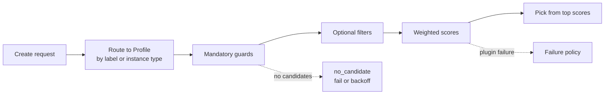

# Extensible scheduler plugins

CubeMaster routes every create request to a **scheduling Profile** and runs it through that Profile's guards, filters, scores, and selection method. Each request walks the full pipeline:



Which Profile serves a request is decided by the [strategy selection rules](./cubemaster-scheduler-config.md#which-scheduling-strategy-is-active); this page covers how to configure and extend Profiles.

## Upgrade behavior changes

Clusters upgrading from **v0.7.3 or earlier** without touching their scheduler config are affected by two changes:

**Empty scheduler config now activates the factory Profiles.** Clusters with no scheduler policy at all move from "random pick among pre-filtered candidates" to "mandatory guards + factory scorers with spread selection"; placement will differ (injection logs a warning). To keep the old behavior, set `scheduler.disable_factory_profiles: true` or configure any legacy block; clusters that already configure a policy are unaffected.

**Template affinity now scores 100 for holders, 0 for the rest.** Only deployments that explicitly enable `image_score` are affected (the factory `template_reuse` Profile, and legacy clusters with `enable_scorers: [image_score]`) — the default config, the recommended config, and one-click deployments do not enable it and notice nothing. If the new placement doesn't suit you:

- To fully restore pre-upgrade placement: remove `template_id` from `score.plugin_conf.image_score.enable_weight_factors`, or set `score.resource_weights.template_id` to 0.
- To keep template affinity but let load override it: lower the `image_score` weight.
- Do not enable template affinity for shared-storage backends such as JFS — every node reads those templates directly, so there is no pull to avoid.

::: details Why this change
The `template_id` factor used to score linearly by local replica size, but replicas are registered with a placeholder size, so the linear score was always 0 — template affinity never took effect in scoring before this change. Even with real sizes, the linear score of a GiB-scale template would be numerically crushed by resource factors; making it boolean aligns it with the `template_local` fact exposed to plugins, so the behavior is predictable.
:::

## Factory Profiles

Three Profiles ship inside the binary (`scheduler_factory.yaml`):

| Profile | Route | Behavior |
|---------|-------|----------|
| `burst_balance` | label `workload=burst_balance` | Spreads high-rate, similarly sized requests by resource watermark and in-flight creates |
| `template_reuse` | label `workload=template_reuse` | Prefers nodes already holding a local template replica |
| `mixed_binpack` | default | Tight placement that preserves entirely free nodes |

The set is injected only when no scheduling config exists at all; any explicit `profiles` or legacy block replaces it entirely (legacy blocks compile into a compatible `default` Profile with unchanged behavior).

## Configuring a Profile

```yaml
scheduler:
  profile_route_label_keys: [workload]
  profiles:
    - name: burst
      route:
        labels: {workload: burst}
      filters:
        - name: skip-high-create
          type: expr
          expr: "node.creating < 8"
      scores:
        - name: prefer-idle
          type: expr
          expr: "node.cpu_util < 60.0 ? 80.0 : 20.0"
          weight: 2
      selection: {top_n: 5, method: spread}
      failure:
        filter: fail-closed
        score: default-score
        no_candidate: fail
```

The rules:

- Only request labels listed in `profile_route_label_keys` participate in routing and are passed to external plugins.
- Routes are evaluated in order; the first match wins. Non-default Profiles must carry an instance-type or label condition (all `instance_type` values are currently `cubebox`; use labels to distinguish traffic).
- `selection.method` picks the final node from the scored candidates: `highest` takes the top scorer; `spread` picks the node with the fewest running sandboxes among the top `top_n` (spreading placement); `random` (the default) draws score-weighted among the top `top_n`. `top_n: -1` widens the window to every node that passed filtering.
- Every Profile runs the `node_safety`, `cpu`, `mem`, `disk`, `template_locality`, and `realtime_create_num` guards — they cannot be turned off.

The built-in scorers read their factor switches from the global `scheduler.score` tree, not from the Profile — see [Scheduler Configuration](./cubemaster-scheduler-config.md#which-configuration-is-active).

## Failure semantics

Guards are always fail-closed. Filters default to fail-closed; an explicit fail-open emits a risk warning. Scores default to default-score, which substitutes the plugin's `default_score` after a failure; fail-closed is also available. `no_candidate` supports fail and backoff — a backoff reruns the whole pipeline.

Configuration compiles as one unit at startup or hot reload. Anything invalid — plugin name, route, expression, weight, selection method, failure policy — and the new set is not activated; the scheduler keeps running the previous pipeline.

## Verifying

Every scheduler metric carries a `profile` label. The three most useful:

- `scheduler_attempts_total{profile=...}` — which Profile is taking traffic;
- `scheduler_plugin_duration_seconds{profile,kind,plugin}` — per-plugin latency, useful when tuning weights;
- `sandbox_create_duration_seconds{profile,result}` — end-to-end create latency per Profile.

## Admission and reservations

Cross-replica admission is advisory: each replica admits against its local node snapshot while metrics propagate independently per reporting window, so during a window several Masters can admit against the same apparent capacity and briefly over-dispatch. A node that can't actually fit the request fails the create on the first attempt — no failover. Keep quotas close to real node capacity and handle create failures on the client.

Redis is a required dependency (node metric reads and the post-create routing metadata write both go through it), so a Redis outage breaks the create chain. During rolling upgrades a mixed-version cluster has no full cross-replica coordination; don't delete old reservation keys while old Masters still serve traffic — after everyone is upgraded, the keys go unused.

::: details The rest of this page is for plugin developers

Everything above targets operators configuring scheduling policies. From here on it's about writing CubeMaster scheduler plugins — if you only use built-in Profiles or CEL expressions, you can stop reading.

### Plugin types

Three plugin types:

- **go** (default): compiled into CubeMaster. Implement `filter.Selector` or `score.Selector`, register via `plugin.RegisterGoFilter` / `plugin.RegisterGoScore` at package init. The binary must import the package, so new plugins require a rebuild; duplicate names are rejected at startup.
- **expr**: CEL compiled at startup. Filters return `bool`; scores return 0–100. CEL gets strongly typed read-only `node` and `request` objects — unknown fields, type errors, and wrong return types are rejected when the Profile activates; a score outside 0–100 is caught per request and triggers the score failure policy. Common node fields include `cpu_util`, `quota_cpu`, `allocated_cpu`, `creating`, `mvm_num`, `labels`, `template_local`, `snapshot_storage_writable`; request fields include `instance_type`, `cpu_millis`, `memory_bytes`, `template_id`, `labels`.
- **grpc**: an independent process. One handshake at startup, then batched `Filter`/`Score` calls; CubeMaster validates timeouts, circuit breaking, snapshot versions, and returned values.

A gRPC plugin configured as a filter:

```yaml
      filters:
        - name: company-policy
          type: grpc
          socket_path: /run/cube/company-scheduler.sock
          timeout: 100ms
          circuit_breaker_failures: 3
          circuit_breaker_cooldown: 30s
```

The protocol lives in `pkgs/proto/services/schedulerplugin/v1/plugin.proto`. Every request carries the full frozen snapshot, so plugin servers can be stateless and concurrent attempts share one connection. Unix Domain Socket is recommended in production. A runnable example is in `examples/scheduler-plugin`:

```bash
cd examples/scheduler-plugin
SOCKET=/tmp/cube-scheduler-example.sock go run .
```

### Score plugin contract

Two points:

- When a scoring dimension doesn't apply to a request, return `score.ErrNotApplicable` to skip explicitly — no score, no weight, and not a failure (even under fail-closed).
- Returning an empty score list with a nil error violates the contract and triggers the configured failure policy. Built-in scorers also return `ErrNotApplicable` when their legacy factor config is missing, disabled, or has no non-zero-weighted factor.
:::
