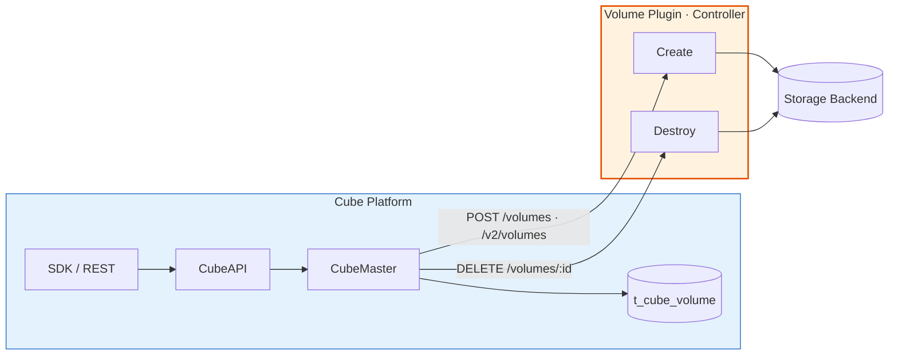
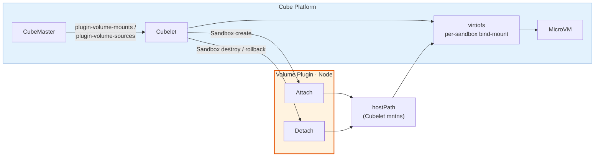
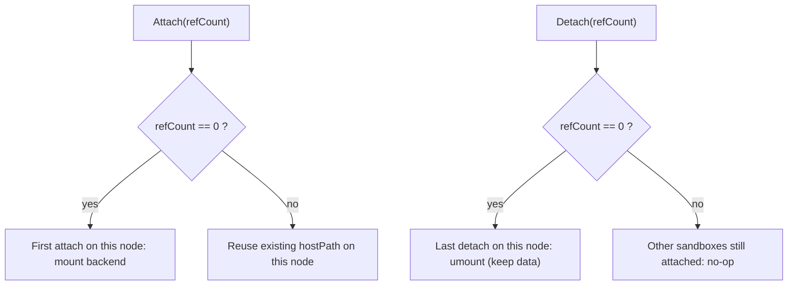
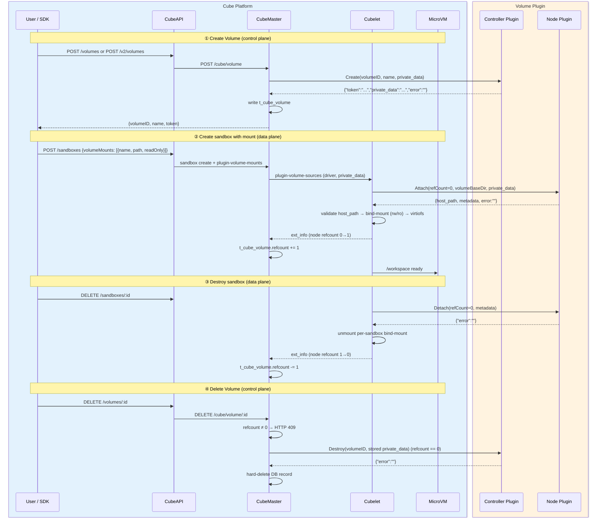

# Volume Plugin Development

If you need to connect a custom distributed filesystem, internal object store, block storage service, or other proprietary storage backend to CubeSandbox, you can extend the platform by building a **Volume Plugin**.

> If you only want to deploy and use the ready-made S3, JuiceFS, NFS, or COS plugins, see [Using Volumes](./volume.md).

This guide is organized into two parts: first, **how the Volume framework works under the hood** (architecture, mount chain, reference counting, and hook protocol); second, **a hands-on walkthrough to build, test, and deploy your first Volume plugin**.

---

## 1. How Volume Works Under the Hood

> **Diagram legend:** blue fill = Cube platform components; orange fill = Volume Plugin (implemented by you).

### 1.1 Dual-Role Model: Controller vs. Node

Inspired by Kubernetes CSI, CubeSandbox splits Volume plugin responsibilities into **Control Plane (Controller)** and **Data Plane (Node)** hooks invoked by separate components:

| Role | Invoked By | Hooks | Responsibility |
|------|------------|-------|----------------|
| **Controller** | CubeMaster | `Create` / `Destroy` | Provision or delete backend resources; optionally issue `token` and persist opaque `private_data` |
| **Node** | Cubelet | `Attach` / `Detach` | Mount or unmount backend storage on the compute node, returning a `hostPath` inside `volumeBaseDir` |

The same Hook contract can be implemented as a **binary** (executable invoked per call) or **rpc** (long-running gRPC service) plugin. All four hooks can live in a single executable/service or be split by role.

#### Control Plane (Controller)



#### Data Plane (Node)



### 1.2 Data-Plane Mount Chain & Mount Namespace

Understanding how your plugin's `hostPath` reaches the MicroVM is essential for writing reliable Node hooks. Inside Cubelet (`Cubelet/storage/pluginvolume.go`), the pipeline executes as follows:

1. **Metadata injection**: On sandbox creation, CubeAPI forwards `volumeMounts` to CubeMaster. CubeMaster looks up each Volume in `t_cube_volume` to resolve `driver` and `private_data`, and injects `plugin-volume-mounts` and `plugin-volume-sources` annotations into the Cubelet create request.
2. **Driver routing & serialization**: Cubelet's `volume.Manager` routes by exact `driver` name and acquires a per-`volumeID` mutex (`volMu`) to serialize concurrent `Attach` / `Detach` calls on the same volume. This prevents two concurrent first-attaches from both seeing `refCount == 0` or an attach/detach race on the shared host mount.
3. **Host path enforcement**: After `Attach` returns, Cubelet validates `hostPath` via `validateHostPathUnderBase`: it must be an absolute path strictly inside `volume_plugin_base_dir` (default `/data/cube-shared/volume`). If invalid, Cubelet immediately calls `Detach` to roll back and fails sandbox creation.
4. **Per-sandbox bind mount → virtiofs**: Cubelet bind-mounts `hostPath` (`MS_BIND | MS_REC`) into the sandbox's virtiofs share directory `/data/cubelet/hostdir/<sandboxID>/<rw|ro>/<volumeName>`. When the sandbox requests `readOnly: true`, Cubelet performs an additional `MS_BIND | MS_REMOUNT | MS_RDONLY` remount — so **plugins do not need to enforce per-sandbox read-only mode themselves**.
5. **Teardown**: When a sandbox is destroyed, Cubelet calls `Detach` (the plugin unmounts the shared backend only if `refCount == 0`), then calls `umount(MNT_DETACH)` on the per-sandbox bind mount.

#### Mount Namespace Isolation

Cubelet runs inside an **isolated mount namespace** created via `unshare(CLONE_NEWNS)`:

- Any mount created by `Attach` (FUSE, NFS, bind mount, etc.) must be visible inside **Cubelet's mount namespace**; host root mntns `/proc/mounts` usually will not show it.
- **`binary` plugins** are forked directly by Cubelet and **inherit Cubelet's mount namespace automatically** — no extra setup needed.
- **`rpc` plugins** run as separate long-lived daemons in their own mount namespace; Node-side RPC plugins must ensure mounts appear inside Cubelet's mount namespace (e.g., via mount propagation or entering Cubelet's mntns).

### 1.3 Two-Level RefCount & End-to-End Lifecycle

A Volume may be shared concurrently by multiple sandboxes on the same node or across multiple nodes. CubeSandbox coordinates mounts and delete safety with two levels of reference counting:

- **Node-local RefCount (managed by Cubelet)**: Cubelet persists a per-`(namespace, volumeID)` sandbox count in `refcount.Store`:
  - Before calling `Attach`, Cubelet calls `Acquire` and passes the **pre-attach count** in `refCount`: `0` means first sandbox on this node (perform backend mount); `> 0` means already mounted (return the existing `hostPath`). If the plugin fails, Cubelet rolls back the local count.
  - Before calling `Detach`, Cubelet calls `Release` and passes the **post-detach count** in `refCount`: `0` means last sandbox on this node (tear down host mount while **keeping persistent data**); `> 0` is a no-op. If the plugin fails, Cubelet rolls back the local count.
- **Cluster-wide RefCount (managed by CubeMaster)**: Only when a node's local count transitions **`0 → 1`** or **`1 → 0`** does Cubelet emit an event in the create/destroy response `ext_info["cube-volume-refcount-events"]` (`referenced=1` or `referenced=0`; create-failure rollbacks never emit events). CubeMaster applies `+1` / `-1` (clamped at 0) to `t_cube_volume.refcount`. While `refcount ≠ 0`, `DELETE /volumes/:id` is rejected with HTTP **409**.



#### End-to-End Sequence



### 1.4 Plugin Types: `binary` vs. `rpc`

| Aspect | `binary` (recommended first) | `rpc` (long-running gRPC) |
|--------|------------------------------|---------------------------|
| Invocation | Fork subprocess per hook; CLI flags in, single JSON object on stdout | gRPC calls over `socket_path` (Unix socket or TCP) |
| Language | Any (Go, Shell, Python, Rust, …) | Any language with gRPC support |
| Mount namespace | Forked by Cubelet — **inherits Cubelet mntns automatically** | Separate process — must coordinate with Cubelet mntns |
| Operations | Zero daemon management | Requires process supervision (systemd / DaemonSet) |
| Best for | Most backends (S3, JuiceFS, NFS, COS default all use binary) | Connection pools, in-memory caches, high-frequency low-latency calls |

In both modes, CubeMaster and Cubelet select the plugin by configured `name` (`driver`) **before** invoking a hook — **`driver` is not a hook argument**.

> **Error reporting**: `binary` plugins signal failure via non-zero exit code and/or a non-empty `"error"` field in stdout JSON; `rpc` plugins return a gRPC error status (protobuf responses have no `error` field).

### 1.5 Hook Protocol Specification

#### Create

| Direction | Field | Type | Description |
|-----------|-------|------|-------------|
| Input | `volumeID` | string | Stable ID (caller-supplied `name` or server-generated UUID) |
| Input | `name` | string | Display name |
| Input | `private_data` | string | Optional opaque caller input forwarded unchanged by CubeMaster (max **1024** UTF-8 bytes). binary: `--private-data`, omitted when empty |
| Output | `token` | string | Optional auth token returned to SDK |
| Output | `private_data` | string | Opaque plugin state (max **1024** bytes) persisted in `t_cube_volume` and forwarded to **Attach** and **Destroy**; omitted from Volume API/SDK responses. May be empty |
| Output | `error` | string | `""` on success (binary stdout JSON only) |
| Output | `error_kind` | string | Optional closed-set error classification for binary Create failures; **must be omitted** on success |

**binary example:**

```bash
# Input (--private-data is omitted when caller input is empty)
/opt/cube-plugins/my-plugin --op create --volume-id my-vol --name my-vol \
  --private-data '{"bucket":"bucket-a","prefix":"workspaces/a/","cred_ref":"user-a"}'

# Success output (stdout JSON, exit 0)
{"token":"","private_data":"{\"v\":1,\"bucket\":\"bucket-a\",\"prefix\":\"workspaces/a/\",\"cred_ref\":\"user-a\"}","error":""}
```

**Typed binary Create errors (`error_kind`):**

Plugins return an error kind rather than an HTTP status or CubeMaster `ret_code`:

```json
{"error":"cred_ref is required","error_kind":"invalid_argument"}
```

`error_kind` is a closed set containing only `invalid_argument`; all other values are treated as unknown:

| `error_kind` | CubeMaster `ret_code` | CubeAPI HTTP Status | Behavior |
| --- | --- | --- | --- |
| `invalid_argument` | `130400` | `400` | Caller input error on binary Create |
| Missing, unknown, or malformed | `130593` | `500` | Generic plugin failure |

Protocol rules:
- Emit one complete JSON object with a non-empty `error`, and exit non-zero (e.g. `exit 1`) so older CubeMasters still treat it as a failure.
- A response containing `error_kind` (even `""` or `null`) without a non-empty `error` is a protocol failure.
- Process startup failures and processes interrupted by cancellation, timeouts, or signals remain execution failures regardless of stdout.
- Public `error` messages must **never** include credentials, credential-file paths, or raw `private_data`. The driver does not append stderr to typed caller errors; stderr remains a diagnostic channel.
- Destroy, RPC plugins, and Cubelet Attach/Detach retain their existing error handling.

#### Destroy

| Direction | Field | Type | Description |
|-----------|-------|------|-------------|
| Input | `volumeID` | string | Volume to delete in the backend |
| Input | `private_data` | string | Plugin-returned state from `t_cube_volume` (or Create's returned state during create-failure rollback). binary: `--private-data`, omitted when empty |
| Output | `error` | string | `""` on success (binary stdout JSON only) |

Use `volumeID` and `private_data` to delete only resources belonging to that volume. Destroy does **not** auto-Detach running sandboxes.

```bash
# Input (--private-data is omitted when stored state is empty)
/opt/cube-plugins/my-plugin --op destroy --volume-id my-vol \
  --private-data '{"v":1,"bucket":"bucket-a","prefix":"workspaces/a/","cred_ref":"user-a"}'

# Success output (stdout JSON, exit 0)
{"error":""}
```

#### Attach

| Direction | Field | Type | Description |
|-----------|-------|------|-------------|
| Input | `sandboxID` | string | Sandbox being created |
| Input | `namespace` | string | containerd namespace |
| Input | `volumeID` | string | Volume ID (matches `volumeMounts[].name`) |
| Input | `refCount` | int64 | Sandbox count **on this node before** attach; `0` = first attach on this node |
| Input | `volumeBaseDir` | string | Required parent dir; `hostPath` **must** be strictly inside it |
| Input | `private_data` | string | Persisted state returned by Create; omitted as `--private-data` when empty |
| Output | `hostPath` | string | Absolute path in Cubelet mntns (recommended `<volumeBaseDir>/<driver>-<volumeID>`) |
| Output | `metadata` | map[string]string | Opaque map persisted by Cubelet and echoed unchanged on Detach |
| Output | `error` | string | `""` on success (binary stdout JSON only) |

```bash
# Input
/opt/cube-plugins/my-plugin --op attach \
  --sandbox-id sb-001 --namespace default \
  --volume-id my-vol --ref-count 0 \
  --volume-base-dir /data/cube-shared/volume

# Success output (stdout JSON, exit 0)
{"host_path":"/data/cube-shared/volume/demo-my-vol","metadata":{"mount_dir":"/data/cube-shared/volume/demo-my-vol"},"error":""}
```

#### Detach

| Direction | Field | Type | Description |
|-----------|-------|------|-------------|
| Input | `sandboxID` | string | Same as Attach |
| Input | `namespace` | string | Same as Attach |
| Input | `volumeID` | string | Same as Attach |
| Input | `refCount` | int64 | Sandbox count **on this node after** detach; `0` = last sandbox on this node |
| Input | `metadata` | map[string]string | Exact map returned by Attach (JSON object string for binary) |
| Output | `error` | string | `""` on success (binary stdout JSON only) |

```bash
# Input
/opt/cube-plugins/my-plugin --op detach \
  --sandbox-id sb-001 --namespace default \
  --volume-id my-vol --ref-count 0 \
  --metadata '{"mount_dir":"/data/cube-shared/volume/demo-my-vol"}'

# Success output (stdout JSON, exit 0)
{"error":""}
```

### 1.6 `private_data` Contract

- Legacy `POST /volumes` keeps its existing `name` / `driver` schema; `POST /v2/volumes` accepts optional `private_data` and forwards it unchanged to CubeMaster `POST /cube/volume`.
- **Content rules**: Both caller input **A** and plugin-returned state **B** must be valid UTF-8, at most **1024 bytes** (`len`, not character count), contain no NUL bytes, and contain only BMP characters (≤ U+FFFF). CubeMaster treats the value as opaque (no JSON parsing, trimming, or normalization) and returns HTTP 400 (`ret_code = 130400`) on violation.
- **State flow**: Create receives **A** and may return normalized state **B**. CubeMaster **persists only B** and forwards B to Attach and Destroy. Returning an empty string stores empty — CubeMaster never falls back to A.
- **Create rollback**: If Create succeeds but validation of B or DB persistence fails, CubeMaster performs a best-effort rollback `Destroy(volumeID, B)` (logging only `volume_id`, `driver`, `phase`, and a fixed error class on failure — never the state or raw plugin error).
- **Security rule**: `private_data` is stored in plaintext in the DB and passed via annotations/CLI args. Carry only bucket, prefix, region, or a **credential reference (`cred_ref`)** — **never plaintext secrets**. Plugins must never log `private_data` or echo it in error messages.

### 1.7 rpc Plugin Proto Definition

RPC plugins implement the two gRPC services in [`pkgs/proto/services/volumeplugin/v1/volumeplugin.proto`](https://github.com/TencentCloud/CubeSandbox/blob/master/pkgs/proto/services/volumeplugin/v1/volumeplugin.proto), whose fields match the Hook specification above:

| Service | Caller | RPCs |
|---------|--------|------|
| `VolumeControllerService` | CubeMaster | `Create`, `Destroy` |
| `VolumePluginService` | Cubelet | `Attach`, `Detach` |

| File | Description |
|------|-------------|
| [`volumeplugin.proto`](https://github.com/TencentCloud/CubeSandbox/blob/master/pkgs/proto/services/volumeplugin/v1/volumeplugin.proto) | Protocol source |
| [`volumeplugin.pb.go`](https://github.com/TencentCloud/CubeSandbox/blob/master/pkgs/proto/services/volumeplugin/v1/volumeplugin.pb.go) | Generated Go messages |
| [`volumeplugin_grpc.pb.go`](https://github.com/TencentCloud/CubeSandbox/blob/master/pkgs/proto/services/volumeplugin/v1/volumeplugin_grpc.pb.go) | Generated gRPC stubs |

Regenerate stubs after editing the proto with `cd pkgs/proto && make proto`.

---

## 2. Build Your First Volume Plugin

In this walkthrough, you will build a complete, runnable `binary` plugin named **`cube-volume-demo`** using only the Go standard library (zero external dependencies).

It uses `/var/lib/cube-demo-volumes/<volumeID>` on the host as a simulated storage backend while demonstrating every production requirement:
- All four hooks (`create`, `destroy`, `attach`, `detach`);
- Typed caller validation errors (`error_kind: "invalid_argument"`) and `private_data` persistence in `create`;
- `refCount` handling, `--volume-base-dir` path enforcement, idempotent `mount --bind` / `umount`, and `metadata` echo-back in `attach` / `detach`;
- Strict separation of stdout (single JSON protocol object) and stderr (diagnostics).

> For a real storage backend, replace the directory create/remove calls with your storage control-plane API calls, and replace `mount --bind` / `umount` with your FUSE client, block-device mount, or network filesystem mount command.

### Step 1: Initialize the Project

```bash
mkdir -p cube-volume-demo && cd cube-volume-demo
go mod init cube-volume-demo
```

### Step 2: Implement the Plugin (`main.go`)

Create `main.go`:

```go
package main

import (
	"encoding/json"
	"flag"
	"fmt"
	"os"
	"os/exec"
	"path/filepath"
	"regexp"
	"strings"
)

var validVolumeID = regexp.MustCompile(`^[a-zA-Z0-9_-]{1,128}$`)

type createResp struct {
	Token       string `json:"token"`
	PrivateData string `json:"private_data"`
	Error       string `json:"error"`
	ErrorKind   string `json:"error_kind,omitempty"` // MUST be omitted on success
}

type attachResp struct {
	HostPath string            `json:"host_path"`
	Metadata map[string]string `json:"metadata,omitempty"`
	Error    string            `json:"error"`
}

type basicResp struct {
	Error string `json:"error"`
}

func storageRoot() string {
	if v := strings.TrimSpace(os.Getenv("CUBE_DEMO_STORAGE_ROOT")); v != "" {
		return filepath.Clean(v)
	}
	return "/var/lib/cube-demo-volumes"
}

// resolveUnderRoot verifies candidate resolves strictly inside root.
func resolveUnderRoot(root, candidate string) (string, error) {
	cleanRoot := filepath.Clean(root)
	cleanPath := filepath.Clean(candidate)
	rel, err := filepath.Rel(cleanRoot, cleanPath)
	if err != nil || rel == "." || rel == ".." || strings.HasPrefix(rel, ".."+string(os.PathSeparator)) {
		return "", fmt.Errorf("path is outside allowed root")
	}
	return cleanPath, nil
}

func writeJSON(v any) {
	_ = json.NewEncoder(os.Stdout).Encode(v)
}

func failBasic(msg string) {
	writeJSON(basicResp{Error: msg})
	os.Exit(1)
}

func failCreate(msg, kind string) {
	writeJSON(createResp{Error: msg, ErrorKind: kind})
	os.Exit(1)
}

func isMountPoint(path string) bool {
	return exec.Command("mountpoint", "-q", path).Run() == nil
}

func handleCreate(volumeID string) {
	if !validVolumeID.MatchString(volumeID) {
		failCreate("volume_id has an invalid format", "invalid_argument")
	}

	root := storageRoot()
	backingDir, err := resolveUnderRoot(root, filepath.Join(root, volumeID))
	if err != nil {
		failCreate("invalid volume_id", "invalid_argument")
	}
	if err := os.MkdirAll(backingDir, 0755); err != nil {
		fmt.Fprintf(os.Stderr, "mkdir %s: %v\n", backingDir, err)
		failCreate("failed to provision backend directory", "")
	}

	// Return resolved backend path as private_data; CubeMaster persists it
	// and forwards it to Attach and Destroy.
	writeJSON(createResp{
		Token:       "",
		PrivateData: backingDir,
		Error:       "",
	})
}

func handleDestroy(volumeID, privateData string) {
	if !validVolumeID.MatchString(volumeID) {
		failBasic("invalid volume_id")
	}

	root := storageRoot()
	candidate := privateData
	if candidate == "" {
		candidate = filepath.Join(root, volumeID)
	}
	backingDir, err := resolveUnderRoot(root, candidate)
	if err != nil {
		failBasic("invalid backing path")
	}
	if err := os.RemoveAll(backingDir); err != nil {
		fmt.Fprintf(os.Stderr, "remove %s: %v\n", backingDir, err)
		failBasic("failed to remove backend directory")
	}
	writeJSON(basicResp{Error: ""})
}

func handleAttach(volumeID, volumeBaseDir, privateData string, refCount int64) {
	if !validVolumeID.MatchString(volumeID) {
		failBasic("invalid volume_id")
	}
	if volumeBaseDir == "" || !filepath.IsAbs(volumeBaseDir) {
		failBasic("volume-base-dir must be an absolute path")
	}

	// hostPath MUST stay strictly under volumeBaseDir.
	mountDir, err := resolveUnderRoot(volumeBaseDir, filepath.Join(volumeBaseDir, "demo-"+volumeID))
	if err != nil {
		failBasic("invalid mount_dir")
	}

	// Mount only on the first attach on this node (refCount == 0); reuse when refCount > 0.
	if refCount == 0 {
		root := storageRoot()
		candidate := privateData
		if candidate == "" {
			candidate = filepath.Join(root, volumeID)
		}
		backingDir, err := resolveUnderRoot(root, candidate)
		if err != nil {
			failBasic("invalid backing path")
		}
		if _, err := os.Stat(backingDir); err != nil {
			fmt.Fprintf(os.Stderr, "stat %s: %v\n", backingDir, err)
			failBasic("backing storage does not exist")
		}
		if err := os.MkdirAll(mountDir, 0755); err != nil {
			fmt.Fprintf(os.Stderr, "mkdir %s: %v\n", mountDir, err)
			failBasic("failed to prepare mount directory")
		}
		if !isMountPoint(mountDir) {
			if out, err := exec.Command("mount", "--bind", backingDir, mountDir).CombinedOutput(); err != nil {
				fmt.Fprintf(os.Stderr, "mount --bind %s %s: %v (%s)\n", backingDir, mountDir, err, strings.TrimSpace(string(out)))
				failBasic("failed to mount volume")
			}
		}
	}

	writeJSON(attachResp{
		HostPath: mountDir,
		Metadata: map[string]string{"mount_dir": mountDir},
		Error:    "",
	})
}

func handleDetach(metadataRaw string, refCount int64) {
	// No-op while other sandboxes on this node still hold the volume.
	if refCount > 0 {
		writeJSON(basicResp{Error: ""})
		return
	}

	var meta map[string]string
	if metadataRaw != "" {
		if err := json.Unmarshal([]byte(metadataRaw), &meta); err != nil {
			fmt.Fprintf(os.Stderr, "parse metadata: %v\n", err)
			failBasic("invalid metadata json")
		}
	}

	mountDir := meta["mount_dir"]
	if mountDir != "" && isMountPoint(mountDir) {
		if out, err := exec.Command("umount", mountDir).CombinedOutput(); err != nil {
			fmt.Fprintf(os.Stderr, "umount %s: %v (%s)\n", mountDir, err, strings.TrimSpace(string(out)))
			failBasic("failed to unmount volume")
		}
		// Remove only the empty mountpoint; keep persistent data in backingDir.
		_ = os.Remove(mountDir)
	}
	writeJSON(basicResp{Error: ""})
}

func main() {
	op := flag.String("op", "", "hook operation: create | destroy | attach | detach")
	volumeID := flag.String("volume-id", "", "stable volume identifier")
	_ = flag.String("name", "", "human-readable volume name")
	_ = flag.String("sandbox-id", "", "sandbox identifier")
	_ = flag.String("namespace", "", "containerd namespace")
	refCount := flag.Int64("ref-count", 0, "pre-attach or post-detach ref count")
	volumeBaseDir := flag.String("volume-base-dir", "", "required parent directory for host_path")
	privateData := flag.String("private-data", "", "opaque plugin state")
	metadata := flag.String("metadata", "", "JSON metadata echoed back on detach")
	flag.Parse()

	switch *op {
	case "create":
		handleCreate(*volumeID)
	case "destroy":
		handleDestroy(*volumeID, *privateData)
	case "attach":
		handleAttach(*volumeID, *volumeBaseDir, *privateData, *refCount)
	case "detach":
		handleDetach(*metadata, *refCount)
	default:
		failBasic(fmt.Sprintf("unsupported op: %q", *op))
	}
}
```

### Step 3: Build & Manually Test All Hooks

Before registering the plugin with the cluster, simulate CubeMaster and Cubelet directly from the command line:

```bash
go build -o cube-volume-demo .

# Install outside the cubetoolbox tree so Cube upgrades never reset it
sudo install -d -m 0755 /opt/cube-plugins
sudo install -m 0755 cube-volume-demo /opt/cube-plugins/cube-volume-demo

P=/opt/cube-plugins/cube-volume-demo

# 1. Simulate Controller Create
sudo $P --op create --volume-id test-vol --name test-vol
# Expected: {"token":"","private_data":"/var/lib/cube-demo-volumes/test-vol","error":""}

# 2. Simulate first Attach (ref-count=0)
sudo $P --op attach \
  --sandbox-id sb-1 --namespace default \
  --volume-id test-vol --ref-count 0 \
  --volume-base-dir /data/cube-shared/volume \
  --private-data /var/lib/cube-demo-volumes/test-vol
# Expected: {"host_path":"/data/cube-shared/volume/demo-test-vol","metadata":{"mount_dir":"/data/cube-shared/volume/demo-test-vol"},"error":""}

# 3. Write a file and simulate a second sandbox reusing the mount (ref-count=1)
echo "hello plugin" | sudo tee /data/cube-shared/volume/demo-test-vol/msg.txt
sudo $P --op attach \
  --sandbox-id sb-2 --namespace default \
  --volume-id test-vol --ref-count 1 \
  --volume-base-dir /data/cube-shared/volume \
  --private-data /var/lib/cube-demo-volumes/test-vol

# 4. First sandbox detaches (ref-count=1 → must NOT unmount)
sudo $P --op detach \
  --sandbox-id sb-1 --namespace default \
  --volume-id test-vol --ref-count 1 \
  --metadata '{"mount_dir":"/data/cube-shared/volume/demo-test-vol"}'
cat /data/cube-shared/volume/demo-test-vol/msg.txt   # still reads: hello plugin

# 5. Last sandbox detaches (ref-count=0 → unmounts mountpoint, preserves backend data)
sudo $P --op detach \
  --sandbox-id sb-2 --namespace default \
  --volume-id test-vol --ref-count 0 \
  --metadata '{"mount_dir":"/data/cube-shared/volume/demo-test-vol"}'
cat /var/lib/cube-demo-volumes/test-vol/msg.txt     # backend data intact: hello plugin

# 6. Simulate Controller Destroy (cleans up backend data)
sudo $P --op destroy --volume-id test-vol \
  --private-data /var/lib/cube-demo-volumes/test-vol
# Expected: {"error":""}
```

### Step 4: Register with CubeMaster & Cubelet and Verify End-to-End

Append the driver to **CubeMaster** (`conf.yaml`), keeping your existing default driver first:

```yaml
volume_plugins:
  # ... keep existing default driver (e.g. s3) first ...
  - name: demo
    type: binary
    binary_path: /opt/cube-plugins/cube-volume-demo
```

Append the matching `name` to **Cubelet** (`config.toml`):

```toml
[[plugins."io.cubelet.internal.v1.storage".volume_plugins]]
  name        = "demo"
  type        = "binary"
  binary_path = "/opt/cube-plugins/cube-volume-demo"
```

Restart CubeMaster and Cubelet, then verify end-to-end with the Python SDK:

```python
from cubesandbox import Sandbox, Volume

vol = Volume.create("hello-demo", driver="demo")

with Sandbox.create(volume_mounts={"/workspace": vol}) as sb:
    sb.files.write("/workspace/test.txt", "my first volume plugin!")

with Sandbox.create(volume_mounts={"/workspace": vol}) as sb:
    print(sb.files.read("/workspace/test.txt"))  # → my first volume plugin!

Volume.destroy(vol.volume_id)
```

> **Note:** This demo simulates the backend with a local host directory for single-node development and protocol testing. Production multi-node plugins should back Create/Destroy and Attach/Detach with shared storage accessible from every eligible node (object storage, distributed FS, NFS, or cloud block storage).

### Step 5: When to Build an RPC Plugin Instead

If your plugin needs persistent backend connection pools, in-memory caches, or lower per-call overhead than subprocess forks, implement `type: rpc`:

1. Import `github.com/tencentcloud/CubeSandbox/pkgs/proto/services/volumeplugin/v1` and implement `VolumeControllerServiceServer` (`Create` / `Destroy`) and `VolumePluginServiceServer` (`Attach` / `Detach`).
2. Serve on a Unix socket (e.g. `/run/my-plugin.sock`) or TCP address and configure `type: rpc` with `socket_path` on both CubeMaster and Cubelet.
3. Ensure Node-side mounts are visible in Cubelet's mount namespace.

See [`examples/volume/cos/rpc/README.md`](https://github.com/TencentCloud/CubeSandbox/blob/master/examples/volume/cos/rpc/README.md) for a complete Go gRPC reference implementation.

---

## 3. Plugin Development Guidelines

| # | Guideline | Description |
|---|-----------|-------------|
| 1 | **Mount namespace** | Node hooks must mount inside **Cubelet's mntns**; binary plugins inherit it automatically via fork |
| 2 | **Idempotent Attach & RefCount** | When `refCount > 0`, return the existing `hostPath` without remounting; keep `refCount == 0` idempotent against stale mounts |
| 3 | **Keep `hostPath` under `volumeBaseDir`** | Return an absolute path strictly inside `volumeBaseDir` (recommended `<volumeBaseDir>/<driver>-<volumeID>`), or Cubelet rejects and rolls back |
| 4 | **Detach preserves data** | Node Detach tears down only the host mount (e.g. FUSE/NFS unmount) — **never delete backend data** |
| 5 | **Separate stdout & stderr** | Binary plugins must write only one valid JSON object to stdout; send all logs and child-command output to stderr |
| 6 | **Secrets & redaction** | Manage credentials via plugin-owned config/env; never place secrets in `private_data`, logs, or public `error` messages |
| 7 | **Aligned driver name & upgrade-safe path** | Register the exact same `name` on CubeMaster and every Cubelet; install third-party plugins outside `/usr/local/services/cubetoolbox` |

---

## Debugging and Troubleshooting

### Inspecting Cubelet's Mount Namespace

Because Cubelet runs in an isolated mount namespace, running `mount` or `cat /proc/mounts` on the host root namespace normally won't show plugin FUSE or bind mounts. Inspect them inside Cubelet's mntns instead:

```bash
CPID=$(pgrep -f "cubelet --config" | head -1)
nsenter -t "$CPID" -m -- mount | grep -E 'volume|fuse'
```

Likewise, manually mounting a path in the host root mntns will not make it visible inside sandboxes — trigger `Attach` through Cubelet or test inside Cubelet's mntns.

### Common Development Pitfalls

| Symptom | Likely Cause | Fix |
|---------|--------------|-----|
| `decode stdout: invalid character ...` | Binary plugin wrote logs or child stdout to stdout | Redirect all logs and child-command stdout to stderr (`>&2`) |
| `host_path "..." must be a subdirectory of required base dir` | Returned `host_path` escapes `--volume-base-dir` | Construct `<volumeBaseDir>/<driver>-<volumeID>` and validate with `filepath.Rel` |
| `invalid error_kind response` | Success JSON included `error_kind`, or `error_kind` was set with an empty `error` | Omit `error_kind` on success (use `omitempty` in Go) |
| Host mount succeeds but sandbox sees an empty directory | RPC plugin or manual test mounted in host root mntns instead of Cubelet mntns | Let Cubelet fork binary plugins; ensure RPC plugins mount inside Cubelet mntns |
| Sibling sandbox I/O fails on detach | `Detach` unmounted the shared mount when `refCount > 0` | Unmount only when `refCount == 0` |

### Rolling Upgrade Compatibility

Volumes require **both** CubeMaster and Cubelet to run a Volume-capable release:

| CubeMaster | Cubelet | Volume Create / Delete | Sandbox `volumeMounts` |
|---|---|---|---|
| New | New | Supported | Supported |
| New | Old (e.g. v0.5.x) | Supported | No-op (create does not fail; volume is not mounted) |
| Old (e.g. v0.5.x) | New / Old | Unsupported | Unsupported; do not send `volumeMounts` |

### `private_data` upgrade order

Before calling `POST /v2/volumes` or the new SDK methods (`create_with_private_data` / `CreateVolumeWithPrivateData` / `createWithPrivateData`):

1. **Upgrade Controller and Node plugins first**: ensure Create accepts caller input A, Attach and Destroy consume returned state B, and existing volumes remain compatible during the transition.
2. **Upgrade all CubeMasters serving volume operations**: complete the Master rollout before creating volumes that depend on per-volume A/B so no old Master handles those volumes.
3. **Deploy CubeAPI with `/v2/volumes` support**, then start calling the new API or SDK methods.

Important compatibility details:
- A new CubeAPI talking to an old Master can return **201** while the old Master silently drops A and omits B on Destroy. There is no automatic downstream capability probe.
- Empty Create input and empty Destroy state omit `--private-data`, preserving the legacy binary CLI invocation; however, if an older plugin returns non-empty state from Create, Destroy (including rollback) will receive `--private-data`, so verify both operations.
- CubeMaster never retries a failed Destroy without `private_data` to avoid acting on the wrong backend resource.

### Known Platform Limitations

| Item | Description |
|------|-------------|
| Delete guard | `DELETE /volumes` is rejected (409) whenever `t_cube_volume.refcount ≠ 0`; running sandboxes are never auto-detached |
| Cross-node RefCount drift | Node `0→1` / `1→0` events ride on sandbox create/destroy **responses**; node crashes or lost responses can cause temporary drift |
| FUSE POSIX semantics | Hard links, atomic rename, and locking semantics depend on the underlying backend and FUSE driver |

---

## Reference Implementations & Source Index

### Official Reference Plugins

| Plugin | Docs & Code | Key Takeaways |
|--------|-------------|---------------|
| **S3 (`s3`)** | [`examples/volume/s3/README.md`](https://github.com/TencentCloud/CubeSandbox/blob/master/examples/volume/s3/README.md) | Production Go binary plugin: built-in S3 client, dynamic `private_data`, credential refs, `error_kind`, lockfiles |
| **NFS (`nfs`)** | [`examples/volume/nfs/README.md`](https://github.com/TencentCloud/CubeSandbox/blob/master/examples/volume/nfs/README.md) | Static Go binary plugin: pre-provisioned directory claiming/binding, timeout contexts, retain-on-destroy |
| **JuiceFS (`juicefs`)** | [`examples/volume/juicefs/README.md`](https://github.com/TencentCloud/CubeSandbox/blob/master/examples/volume/juicefs/README.md) | Shell binary plugin: persistent control-plane mount + per-volume `--subdir` isolation, timeout locks |
| **Tencent Cloud COS (`cos` / `cos-rpc`)** | [`examples/volume/cos/README.md`](https://github.com/TencentCloud/CubeSandbox/blob/master/examples/volume/cos/README.md) | Both Shell binary (`cos/binary/`) and Go gRPC (`cos/rpc/`) reference implementations |

### Platform Source Index

| Module | Path | Description |
|--------|------|-------------|
| Node interface | `Cubelet/plugins/volume/interface.go` | `VolumePlugin` interface |
| Node request types | `Cubelet/plugins/volume/context.go` | `AttachRequest` / `DetachRequest` |
| Node manager & locks | `Cubelet/plugins/volume/manager.go` | Driver routing, `volMu` serialization, local RefCount |
| Node binary driver | `Cubelet/plugins/volume/binary/driver.go` | Node Hook → CLI / JSON mapping |
| Node rpc driver | `Cubelet/plugins/volume/rpc/driver.go` | Node Hook → gRPC client |
| Node mount & virtiofs | `Cubelet/storage/pluginvolume.go` | `hostPath` check, bind-mount + read-only remount, RefCount event reporting |
| Controller interface | `CubeMaster/pkg/volume/plugin/plugin.go` | `ControllerPlugin` interface & registry |
| Controller binary driver | `CubeMaster/pkg/volume/plugin/binary/driver.go` | Controller Hook → CLI / JSON / `error_kind` handling |
| Controller rpc driver | `CubeMaster/pkg/volume/plugin/rpc/driver.go` | Controller Hook → gRPC client |
| Volume HTTP handlers | `CubeMaster/pkg/service/httpservice/cube/volume.go` | Volume CRUD, `private_data` validation & rollback |
| Cross-node RefCount | `CubeMaster/pkg/volume/refcount/refcount.go` | Parse `ext_info` events and update `t_cube_volume.refcount` |
| Volume DB model | `CubeMaster/pkg/base/db/models/volume.go` | `VolumeRecord` schema |
| gRPC protocol | `pkgs/proto/services/volumeplugin/v1/volumeplugin.proto` | RPC plugin protobuf contract |
