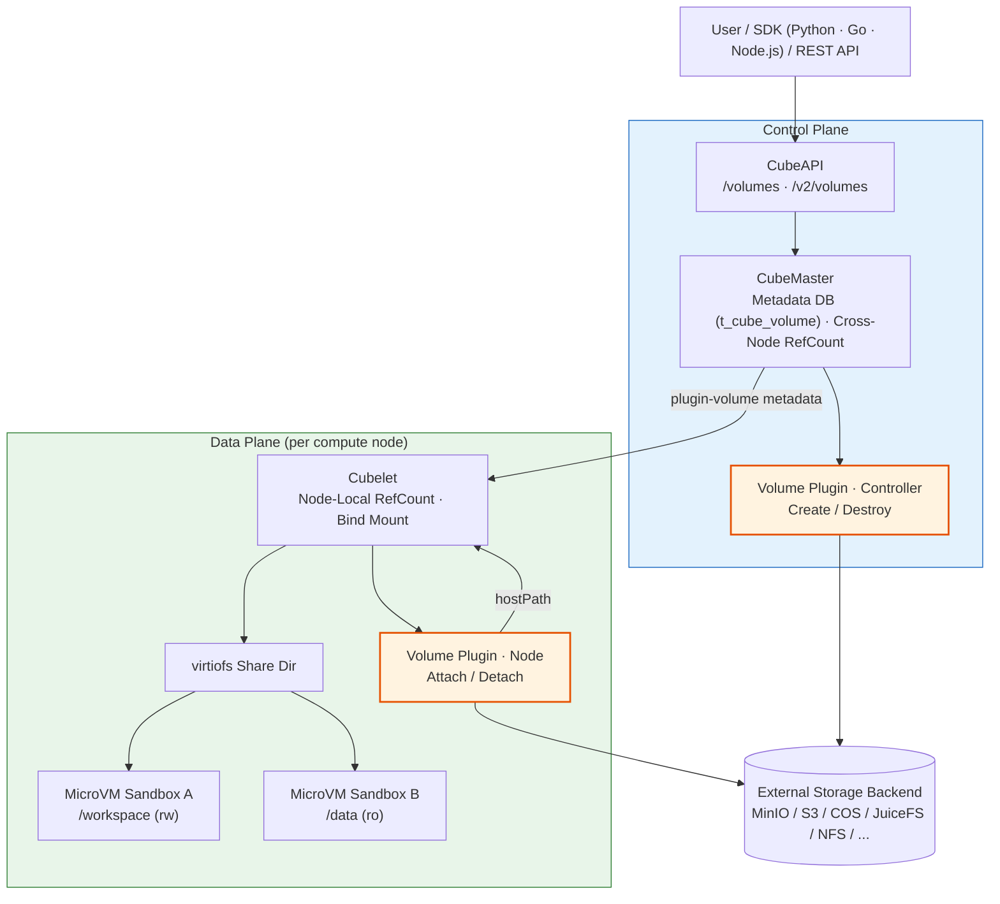

# Using Volumes

CubeSandbox runs inside lightweight MicroVMs — by default, all data written inside a sandbox is **ephemeral** and disappears when the sandbox is destroyed. **Volumes** provide persistent storage decoupled from the sandbox lifecycle: create a Volume → mount it into a sandbox for reading and writing → destroy the sandbox while the data stays intact → remount it in a new sandbox later.

CubeSandbox's Volume system is compatible with the E2B Volume protocol and uses a pluggable **Volume Plugin** architecture so you can back Volumes with object storage (S3 / Tencent Cloud COS), distributed POSIX file systems (JuiceFS), shared file storage (NFS), or any custom storage backend.

> **Version requirements**
>
> - Basic Volume features (create, list, get, delete, mount, per-sandbox read-only mount, multi-sandbox sharing): require **Cube platform ≥ 0.6.0** (CubeAPI, CubeMaster, and Cubelet must all be upgraded) and **`cubesandbox` Python SDK ≥ 0.6.0**.
> - Dynamic per-volume bindings via `private_data` (`POST /v2/volumes`): require **CubeAPI, every serving CubeMaster, and Cubelet ≥ 0.8.0**, a plugin supporting the contract, and **Python / Go / Node SDK ≥ 0.8.0**. This endpoint never falls back to `POST /volumes`.

---

## 1. Volume Architecture

Inspired by Kubernetes CSI, CubeSandbox splits Volume management into a **Control Plane** and a **Data Plane**, decoupling storage lifecycles from sandbox instances:



### Key Architectural Properties

| Property | Description |
|----------|-------------|
| **Decoupled lifecycle** | Volumes are created and destroyed independently in the control plane; destroying a sandbox only detaches the mount while persistent data stays in the backend. |
| **Credentials stay on the host** | Object-store keys, metadata DB passwords, and tokens live only on CubeMaster / Cubelet nodes — the sandbox sees a plain filesystem directory. |
| **RefCount-driven host mounts** | When multiple sandboxes on the same node share a Volume, Cubelet mounts the backend once on the first attach (`0→1`), reuses it for subsequent sandboxes, and unmounts only after the last sandbox on that node is destroyed (`1→0`). |
| **Delete protection** | CubeMaster tracks a cluster-wide reference count in `t_cube_volume`. While any node still references the Volume (`refcount ≠ 0`), `DELETE /volumes/{id}` returns **409** instead of deleting active data. |
| **Per-sandbox access mode** | Read-write vs. read-only is a **per-attachment property**, not a global Volume property. One Volume can be mounted read-write in one sandbox and read-only in several reader sandboxes simultaneously. |
| **Cross-node restore ready** | Volume storage is independent of the VM snapshot backend. With a cross-node-capable VM snapshot (`jfs` or `s3`), a sandbox can restore on another node and reattach the Volume as long as the target node has the same driver and backend access. |

### Lifecycle Overview

| Stage | Trigger | Platform & Plugin Behavior |
|-------|---------|----------------------------|
| **1. Create** | `Volume.create(...)` | CubeMaster invokes Controller `Create` to provision backend storage and persists the record in `t_cube_volume`. |
| **2. First attach** | First sandbox on a node mounts the Volume | Cubelet calls Node `Attach(refCount=0)` to mount the backend on the host, then bind-mounts it into the sandbox's virtiofs share. |
| **3. Reuse** | Additional sandboxes on the same node mount it | Cubelet calls Node `Attach(refCount>0)` and reuses the existing host mount without remounting. |
| **4. Sandbox teardown** | Other sandboxes still use the Volume | Cubelet removes that sandbox's bind mount and decrements the count; the shared backend mount stays active. |
| **5. Last detach** | Last sandbox on the node is destroyed | Cubelet calls Node `Detach(refCount=0)` to tear down the host mount; **backend data is preserved**. |
| **6. Destroy** | `Volume.destroy(...)` | Once `refcount == 0`, CubeMaster invokes Controller `Destroy` to clean up backend storage and removes the DB row. |

> Want to dive into the internal implementation, Hook protocol, mount namespace behavior, or build your own driver? See [Volume Plugin Development](./volume-plugin.md).

---

## 2. Available Volume Plugins

CubeSandbox ships four ready-to-use Volume plugins in `examples/volume/`, covering object storage, full-POSIX distributed file systems, and enterprise NFS:

| Plugin (`driver`) | Storage Backend | Plugin Type | Architecture | Highlights | Best For |
|---|---|---|---|---|---|
| **[S3 (`s3`)](https://github.com/TencentCloud/CubeSandbox/blob/master/examples/volume/s3/README.md)** | MinIO, AWS S3, Tencent Cloud COS, Cloudflare R2, or any S3-compatible store | `binary` (static Go binary with built-in S3 client + `s3fs`) | `amd64` / `arm64` | **Default built-in plugin**; supports dynamic per-volume buckets & `cred_ref` via `private_data`; no S3 CLI needed on CubeMaster | General-purpose persistence, datasets/models, task artifacts, multi-tenant dynamic buckets |
| **[JuiceFS (`juicefs`)](https://github.com/TencentCloud/CubeSandbox/blob/master/examples/volume/juicefs/README.md)** | Object storage (S3/COS/OSS/GCS) + metadata engine (PostgreSQL / Redis / MySQL / TiKV) | `binary` (Shell + `juicefs` FUSE, `--subdir` per volume) | `amd64` / `arm64` | **Full POSIX semantics**; much faster small-file I/O, directory listings, `git`, and `SQLite` than `s3fs`; instant multi-sandbox visibility | Active code workspaces, `git` repos, builds, SQLite, frequent small-file writes |
| **[NFS (`nfs`)](https://github.com/TencentCloud/CubeSandbox/blob/master/examples/volume/nfs/README.md)** | NFSv3 server / enterprise NAS / cloud file storage | `binary` (static Go binary + `mount.nfs`) | `amd64` / `arm64` | Mounts pre-provisioned `<export>/<id>/data` on demand; retains directory data on unregister; interoperates with external apps | Existing NFS / NAS shares, multi-node shared POSIX directories |
| **[Tencent Cloud COS (`cos` / `cos-rpc`)](https://github.com/TencentCloud/CubeSandbox/blob/master/examples/volume/cos/README.md)** | Tencent Cloud Object Storage (COS) | `binary` (Shell + `coscmd` + `cosfs`) and `rpc` (Go gRPC + `cosfs`) | `amd64` (`cosfs` limitation; on `arm64`, use the `s3` plugin pointed at COS) | Dedicated Tencent Cloud COS plugin providing both `binary` and `rpc` reference implementations | Native COS integration or reference template for custom RPC plugins |

### Choosing a Plugin

- **Zero-config default / artifacts / multi-tenant object storage**: start with the bundled **`s3`** plugin (pre-wired to bundled MinIO out of the box, or switchable to external S3 / COS / R2).
- **Heavy POSIX workloads (`git`, `SQLite`, frequent small files)**: use **`juicefs`**. Whereas `s3fs` issues an object request per file operation, JuiceFS accelerates metadata and locking via its metadata engine — benchmarks show an order-of-magnitude speedup for small-file writes and `git commit`, plus full SQLite support.
- **Existing NAS / NFS infrastructure**: use **`nfs`** to mount pre-provisioned directories on demand by explicit volume name.
- **Custom internal storage backend**: build a `binary` or `rpc` plugin using [Volume Plugin Development](./volume-plugin.md).

---

## 3. Deploying Volumes

### 3.1 Out-of-the-Box Default (S3 + Bundled MinIO)

If you installed CubeSandbox using **one-click** or **Helm defaults**, everything is already configured for you:

1. A bundled **MinIO** instance is started as the S3-compatible backend (default bucket `cube-volumes`).
2. The `cube-volume-s3` plugin, `s3fs` dependency, and `volume-s3.conf` credentials are installed automatically.
3. Both CubeMaster and Cubelet register `s3` as the first (default) entry in `volume_plugins`.

> If you only need the default S3 Volumes, **no manual configuration is required** — jump straight to [4. Using Volumes](#_4-using-volumes).

### 3.2 Connecting External S3 (AWS S3 / COS / R2 / Self-Hosted MinIO)

To point the default S3 plugin at an external S3-compatible store, update the configuration source for your deployment method — the installer renders `volume-s3.conf` automatically, so **do not hand-edit `volume-s3.conf`** (it will be overwritten on reinstall/upgrade).

#### one-click Deployment

In the control node's `.one-click.env` (or `.env`), disable bundled MinIO, fill in `CUBE_S3_*`, and re-run `install.sh`:

```bash
CUBE_SANDBOX_MINIO_ENABLED=0
CUBE_S3_ENDPOINT=https://s3.example.com
CUBE_S3_ACCESS_KEY_ID=<your-access-key>
CUBE_S3_SECRET_ACCESS_KEY=<your-secret-key>
CUBE_S3_BUCKET=cube-volumes
# CUBE_S3_REGION=us-east-1
# Enable path-style for MinIO or dotted bucket names:
# CUBE_S3_S3FS_EXTRA_OPTS=-ouse_path_request_style
```

Compute nodes never run MinIO; copy the `CUBE_S3_*` lines from the control node into each compute node's `.env`:

```bash
# Run on the control node and paste the output into compute nodes' .env
grep '^CUBE_S3_' /usr/local/services/cubetoolbox/.one-click.env
```

> When compute nodes use the control node's bundled MinIO, allow TCP port `9000` from compute nodes to the control node. See the [one-click README](https://github.com/TencentCloud/CubeSandbox/blob/master/deploy/one-click/README.md#bundled-minio-vs-the-s3-volume-plugin).

#### Kubernetes Helm Deployment

Disable chart-managed MinIO and configure `volumeS3.*` (or point `volumeS3.existingSecret` at an existing Secret), then run `helm upgrade`:

```yaml
minio:
  enabled: false

volumeS3:
  endpoint: https://s3.example.com
  accessKeyId: <your-access-key>
  secretAccessKey: <your-secret-key>
  bucket: cube-volumes
  # region: us-east-1
  # extraOpts: -ouse_path_request_style
```

#### Common S3-Compatible Provider Endpoints

| Provider | `ENDPOINT` | `REGION` |
|----------|-----------|----------|
| AWS S3 | `https://s3.<region>.amazonaws.com` | Bucket's region (e.g. `us-east-1`) |
| Tencent Cloud COS | `https://cos.<region>.myqcloud.com` | Bucket's region (e.g. `ap-guangzhou`) |
| Cloudflare R2 | `https://<account-id>.r2.cloudflarestorage.com` | `auto` |
| Self-hosted MinIO | `http://<minio-host>:9000` | Any non-empty value (with path-style enabled) |

### 3.3 Deploying and Registering Other Plugins (JuiceFS / NFS / COS / Custom)

Deploying any other built-in or custom plugin follows three steps:

#### Step 1: Install host dependencies and the plugin binary/service

- **CubeMaster nodes**: install the plugin executable (or start its RPC daemon) along with its credentials/config.
- **Every Cubelet compute node**: install the same plugin executable (or RPC daemon), credentials/config, and host mount tools (`s3fs`, `juicefs`, `mount.nfs`, `cosfs`, etc.). For FUSE-based plugins, verify `/dev/fuse` exists on the host.

> **Upgrade-safe paths**: install third-party or manually deployed plugins **outside** `/usr/local/services/cubetoolbox` (for example under `/opt/cube-plugins/` or `/usr/local/lib/cube-volume-plugins/`) so Cube upgrades do not overwrite or remove them.

Plugin-specific installation guides:
- S3 manual setup & dynamic credential references: [`examples/volume/s3/README.md`](https://github.com/TencentCloud/CubeSandbox/blob/master/examples/volume/s3/README.md)
- JuiceFS plugin setup: [`examples/volume/juicefs/README.md`](https://github.com/TencentCloud/CubeSandbox/blob/master/examples/volume/juicefs/README.md)
- NFS plugin setup: [`examples/volume/nfs/README.md`](https://github.com/TencentCloud/CubeSandbox/blob/master/examples/volume/nfs/README.md)
- Tencent Cloud COS plugin (binary & rpc) setup: [`examples/volume/cos/README.md`](https://github.com/TencentCloud/CubeSandbox/blob/master/examples/volume/cos/README.md)

#### Step 2: Register the driver on CubeMaster and Cubelet

**CubeMaster (`conf.yaml`)**:

```yaml
volume_plugins:
  - name: s3
    type: binary
    binary_path: /usr/local/services/cubetoolbox/CubeMaster/plugin/cube-volume-s3

  - name: juicefs
    type: binary
    binary_path: /usr/local/lib/cube-volume-plugins/juicefs/cube-volume-juicefs

  # Example RPC plugin
  - name: my-rpc-driver
    type: rpc
    socket_path: /run/my-rpc-driver.sock   # bare Unix socket path or TCP address
```

**Cubelet (`config.toml`)**:

```toml
[plugins."io.cubelet.internal.v1.storage"]
  # Every plugin's returned host_path MUST be inside this directory (default: /data/cube-shared/volume)
  volume_plugin_base_dir = "/data/cube-shared/volume"

[[plugins."io.cubelet.internal.v1.storage".volume_plugins]]
  name        = "s3"
  type        = "binary"
  binary_path = "/usr/local/services/cubetoolbox/Cubelet/plugin/cube-volume-s3"

[[plugins."io.cubelet.internal.v1.storage".volume_plugins]]
  name        = "juicefs"
  type        = "binary"
  binary_path = "/usr/local/lib/cube-volume-plugins/juicefs/cube-volume-juicefs"

[[plugins."io.cubelet.internal.v1.storage".volume_plugins]]
  name        = "my-rpc-driver"
  type        = "rpc"
  socket_path = "/run/my-rpc-driver.sock"
```

Configuration rules:
- **Consistent, unique `name`**: `volume_plugins[].name` (the `driver` identifier) must match across CubeMaster and every Cubelet node and must be unique within each process.
- **Default driver order**: omitting `driver` in `Volume.create()` selects the **first** entry in CubeMaster's `volume_plugins` list. In multi-driver clusters, passing `driver` explicitly is recommended.

#### Step 3: Restart services

Restart CubeMaster and every updated Cubelet node for the new registration to take effect.

---

## 4. Using Volumes

### 4.1 SDK Installation & Environment Setup

::: warning Use the `cubesandbox` SDK, not the official e2b Python SDK
CubeAPI exposes E2B-compatible `/volumes` REST endpoints, but the official `e2b` Python SDK hardcodes requests to `e2b.cloud` and **cannot target CubeSandbox**. Use the CubeSandbox SDK (Python / Go / Node.js) or direct REST requests against your CubeAPI endpoint.
:::

**Install the SDK:**

```bash
# Python SDK (basic Volumes ≥ 0.6.0; private_data dynamic volumes ≥ 0.8.0)
pip install 'cubesandbox>=0.8.0'

# Go SDK
go get github.com/tencentcloud/CubeSandbox/sdk/go
```

**Set environment variables:**

```bash
export CUBE_API_URL=http://<cubeapi-host>:3000
export CUBE_TEMPLATE_ID=<your-template-id>

# Required for remote sandbox file I/O (routes data plane via CubeProxy)
export CUBE_PROXY_NODE_IP=<cubeproxy-or-cubelet-node-ip>

# Optional when cluster auth is enabled (maps to X-API-Key)
# export CUBE_API_KEY=<your-api-key>
```

#### API & SDK Capabilities

| Capability | REST Endpoint | Python SDK | Go SDK | Node.js SDK |
|------------|---------------|------------|--------|-------------|
| List volumes | `GET /volumes` | `Volume.list()` | `client.ListVolumes` | `Volume.list()` |
| Create volume | `POST /volumes` | `Volume.create(...)` | `client.CreateVolume` | `Volume.create(...)` |
| Create with `private_data` (≥ 0.8.0) | `POST /v2/volumes` | `Volume.create_with_private_data(...)` | `client.CreateVolumeWithPrivateData` | `Volume.createWithPrivateData(...)` |
| Get single volume (incl. `token`) | `GET /volumes/{volumeID}` | `Volume.get_info(...)` / `Volume.connect(...)` | `client.GetVolume` | `Volume.getInfo(...)` / `Volume.connect(...)` |
| Delete volume (409 if mounted) | `DELETE /volumes/{volumeID}` | `Volume.destroy(...)` | `client.DeleteVolume` | `Volume.destroy(...)` |
| Mount into sandbox (rw / ro) | `POST /sandboxes` (`volumeMounts`) | `Sandbox.create(volume_mounts={...})` | `CreateOptions.VolumeMounts` | `Sandbox.create({ volumeMounts })` |

> `Volume.list()` never includes `token`; tokens issued by plugins are only returned on create and single-volume get.

### 4.2 Full Lifecycle Examples

#### Python SDK

```python
from cubesandbox import Sandbox, Volume

# 1. Create a Volume (omitting driver uses CubeMaster's first volume_plugins entry, s3 by default)
vol = Volume.create("my-data", driver="s3")
print("created:", vol.volume_id, vol.name)

# List and fetch info
for v in Volume.list():
    print("list:", v.volume_id, v.name)
info = Volume.get_info(vol.volume_id)

# Reconnect to an existing Volume by ID
vol = Volume.connect(vol.volume_id)

# 2. Create a sandbox with the Volume mounted (triggers Node Attach)
with Sandbox.create(volume_mounts={"/workspace": vol}) as sb:
    sb.files.write("/workspace/hello.txt", "persisted across sandboxes")
    print(sb.files.read("/workspace/hello.txt"))

# 3. Sandbox teardown triggers Node Detach, while backend data persists
with Sandbox.create(volume_mounts={"/workspace": vol}) as sb:
    print("re-mounted:", sb.files.read("/workspace/hello.txt"))

# 4. Permanently delete the Volume (triggers Controller Destroy; returns False if already gone)
Volume.destroy(vol.volume_id)
```

Parameter notes:
- `name`: optional; must match `^[a-zA-Z0-9_-]+$` and be at most 128 characters. When omitted, the server generates a UUID as `volume_id` (note: plugins such as `nfs` that bind pre-provisioned directories require an explicit `name`).
- `driver`: optional; matches `volume_plugins[].name`. Defaults to the first configured plugin when omitted.
- `volume_mounts`: `{sandbox_path: Volume | volume_id | VolumeMount}`. A sandbox can mount multiple distinct Volumes at once, but cannot mount the same Volume twice.

#### Go SDK

```go
package main

import (
	"context"
	"errors"
	"fmt"

	cubesandbox "github.com/tencentcloud/CubeSandbox/sdk/go"
)

func main() {
	client := cubesandbox.NewClient(cubesandbox.NewConfigFromEnv())
	ctx := context.Background()

	// 1. Create a Volume (omitting Driver selects the first volume_plugins entry)
	vol, err := client.CreateVolume(ctx, cubesandbox.CreateVolumeOptions{
		Name:   "my-data",
		Driver: "s3",
	})
	if err != nil {
		panic(err)
	}

	// 2. Create a sandbox with the Volume mounted (set ReadOnly: true for read-only)
	sb, err := client.Create(ctx, cubesandbox.CreateOptions{
		TemplateID: "base",
		VolumeMounts: []cubesandbox.VolumeMount{
			{Name: vol.VolumeID, Path: "/workspace"},
		},
	})
	if err != nil {
		panic(err)
	}

	// 3. Destroy the sandbox (detaches the Volume)
	if err := sb.Kill(ctx); err != nil {
		panic(err)
	}

	// 4. Delete the Volume
	if err := client.DeleteVolume(ctx, vol.VolumeID); err != nil {
		switch {
		case errors.Is(err, cubesandbox.ErrVolumeInUse):
			fmt.Println("volume is still mounted by a sandbox (HTTP 409)")
		case errors.Is(err, cubesandbox.ErrVolumeNotFound):
			fmt.Println("volume already deleted")
		default:
			panic(err)
		}
	}
}
```

#### Node.js SDK

```ts
import { Sandbox, Volume, VolumeMount } from "cubesandbox";

// 1. Create a Volume
const vol = await Volume.create({ name: "my-data", driver: "s3" });

// 2. Create a sandbox with the Volume mounted (wrap with VolumeMount for readOnly)
const sb = await Sandbox.create({
  volumeMounts: {
    "/workspace": vol,
    // Read-only example: "/dataset": new VolumeMount(datasetVol, { readOnly: true }),
  },
});
await sb.files.write("/workspace/hello.txt", "from node sdk");
await sb.kill();

// 3. Delete the Volume
await Volume.destroy(vol.volumeId);
```

### 4.3 Read-Only Mounts & Multi-Sandbox Sharing

Multiple sandboxes can mount the same Volume concurrently, and each sandbox can independently choose read-write or read-only access (per-sandbox read-only is a CubeSandbox extension; the official E2B SDK has no read-only mount option):

```python
from cubesandbox import Sandbox, Volume, VolumeMount

dataset = Volume.create("shared-dataset", driver="s3")

# Writer sandbox: read-write by default
writer = Sandbox.create(volume_mounts={"/dataset": dataset})
writer.files.write("/dataset/index.txt", "v1")

# Reader sandbox: read-only attachment — cannot mutate, sees latest writes
reader = Sandbox.create(
    volume_mounts={"/dataset": VolumeMount(dataset, read_only=True)},
)
print(reader.files.read("/dataset/index.txt"))  # → v1

# Destroy ALL sandboxes using the Volume before calling Volume.destroy
writer.kill()
reader.kill()
Volume.destroy(dataset.volume_id)
```

> Read-only is a **per-attachment property**, not an immutable snapshot: a reader cannot create, modify, or delete files, but it will observe changes written by other read-write attachments.

### 4.4 Dynamic Per-Volume Bindings with `private_data` (Cube ≥ 0.8.0)

In multi-tenant clusters, each user or workload may need to bind a Volume to its own bucket, prefix, and credentials without reconfiguring or restarting cluster components. Cube ≥ 0.8.0 adds `POST /v2/volumes` and dedicated SDK methods that forward an opaque `private_data` string (up to 1024 UTF-8 bytes) to the plugin at creation time.

With the built-in `s3` plugin, after placing a credential reference file at `/etc/cube/s3-credentials/user-a.conf` (mode `0600`) on each CubeMaster and Cubelet host, you can bind a Volume dynamically:

```python
import json
from cubesandbox import Sandbox, Volume

vol = Volume.create_with_private_data(
    name="user-a-workspace",
    driver="s3",
    private_data=json.dumps({
        "bucket": "customer-bucket",
        "prefix": "workspaces/user-a/",
        "cred_ref": "user-a",
    }),
)

with Sandbox.create(volume_mounts={"/workspace": vol}) as sb:
    sb.files.write("/workspace/result.txt", "isolated in customer-bucket")

Volume.destroy(vol.volume_id)
```

> **Security & usage notes**:
> - Put only bucket, prefix, region, and a **credential reference (such as `cred_ref`)** in `private_data` — **never pass plaintext access keys or secrets**.
> - Dynamic S3 volumes require the target bucket to already exist (never auto-created) and the prefix to be empty.
> - See [`examples/volume/s3/README.md#dynamic-buckets-and-credential-references`](https://github.com/TencentCloud/CubeSandbox/blob/master/examples/volume/s3/README.md) for complete setup details.

### 4.5 Snapshots, Rollback, Clone & Cross-Node Restore

Volumes follow **external-reference** semantics — snapshots record the Volume ID, container mount path, and read-only flag, but **do not copy Volume data**:

- **FromSnap**: you may omit `volumeMounts` and the snapshot's recorded mounts are reattached automatically. Re-sending `volumeMounts` (as E2B clients do) is also accepted as long as they match the snapshot exactly (same volumes, paths, and read-only flags); any mismatch returns HTTP 400.
- **Filesystem-only snapshots**: record no mounts; re-declare `volumeMounts` on the create request if you want Volumes attached.
- **Rollback**: restores VM memory and rootfs state while keeping the existing Volume attachment; Volume contents remain at their current state and are not rewound.
- **Clone**: clones share the same Volume; writes through a read-write mount are visible to the source sandbox and other clones.
- **Cross-node restore**: the Volume backend is independent of the VM snapshot backend. As long as the VM snapshot uses a shared backend (`--backend s3` or `jfs` with `remote_status=ready`) and every eligible target Cubelet node has the same Volume driver and backend access, the sandbox automatically reattaches the Volume on the target node. See [Cross-Node Migration Requirements](./cross-node-snapshot/requirements.md).

### 4.6 Common Errors & Troubleshooting

#### Common SDK Errors

| Scenario | SDK Exception / HTTP Status | Cause & Resolution |
|----------|-----------------------------|--------------------|
| Volume not found | `VolumeNotFoundError` (404) | Invalid or already deleted `volume_id` passed to `get_info` / `connect` |
| Unknown driver | `ApiError` (400 / `130400`) | `driver` is not registered in CubeMaster's `volume_plugins` or CubeMaster was not restarted |
| Volume still in use | `ApiError` / `VolumeInUseError` (409 / `130409`) | One or more sandboxes still mount the Volume; destroy them before deleting |
| Invalid volume name | `ValueError` | Name must match `^[a-zA-Z0-9_-]+$` and be ≤ 128 characters |
| Mount mismatch on snapshot restore | `ApiError` (400 / `130400`) | `volumeMounts` sent on FromSnap differ from the snapshot's recorded mounts |

#### Common Deployment & Runtime Issues

| Symptom | Where to Check |
|---------|----------------|
| `no plugin registered for driver "<name>"` | Target Cubelet node is missing the matching `volume_plugins` entry or was not restarted |
| S3 plugin `s3fs mount failed` | Verify `/dev/fuse` exists on the host; verify `ENDPOINT` and credentials in `volume-s3.conf` |
| `InvalidAccessKeyId` / `SignatureDoesNotMatch` | Wrong key pair, missing bucket permissions, or `REGION` mismatch with endpoint SigV4 region |
| TLS error on dotted bucket names | Use a dot-free bucket name or set `S3FS_EXTRA_OPTS=-ouse_path_request_style` (also typically needed for MinIO) |
| Omitting `driver` hits the wrong plugin | Omitting `driver` picks the first `volume_plugins` entry; pass `driver` explicitly in multi-driver clusters |
| Remote SDK file I/O fails | Verify `CUBE_PROXY_NODE_IP` is set and CubeProxy / CubeAPI are reachable |

---

## Next Steps

- Need to integrate your own storage backend or understand the Hook protocol, RefCount internals, and mount namespaces? Read [Volume Plugin Development](./volume-plugin.md).
