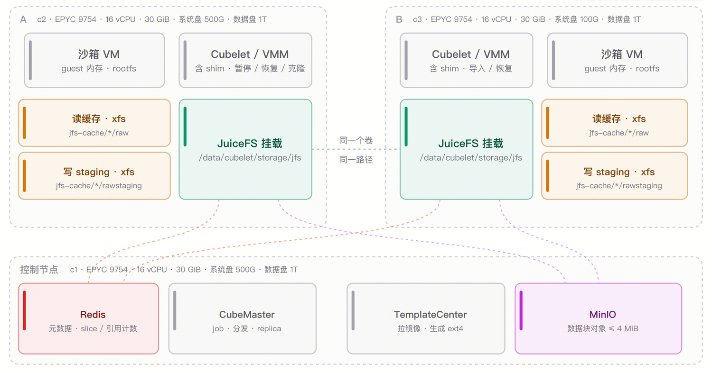
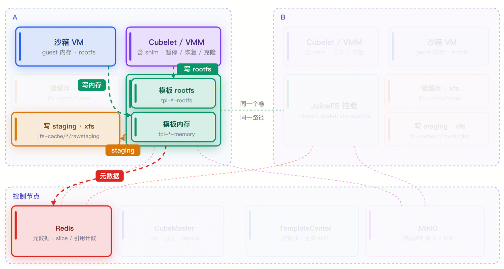
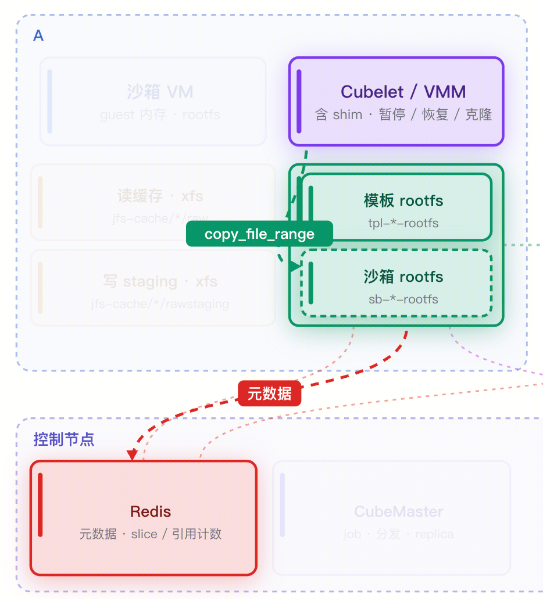
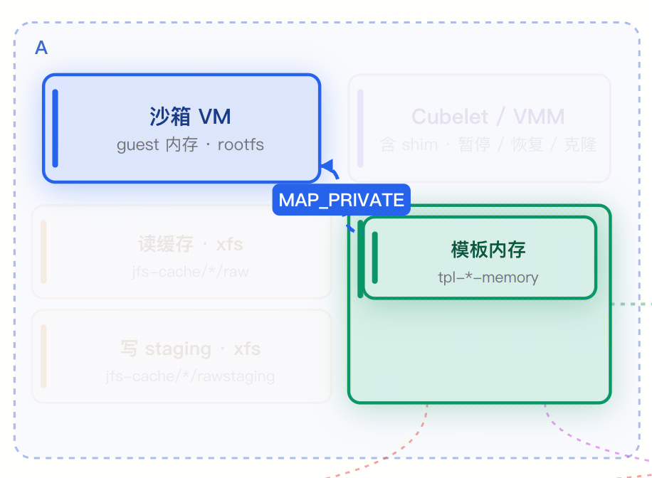
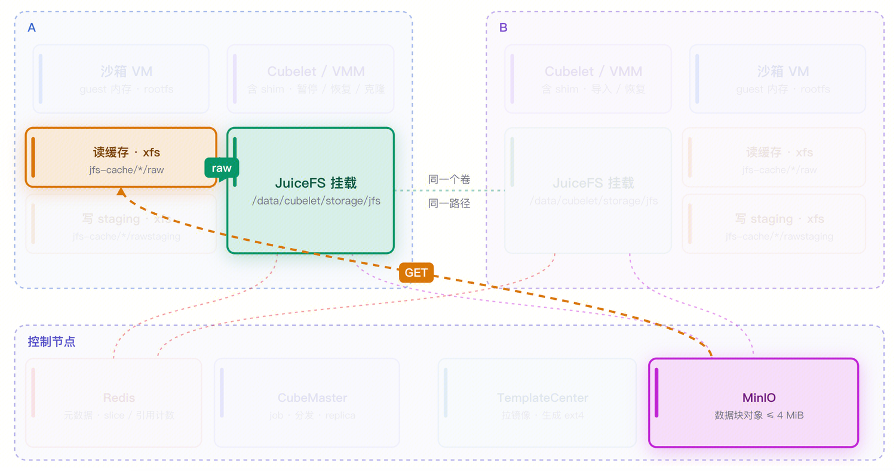
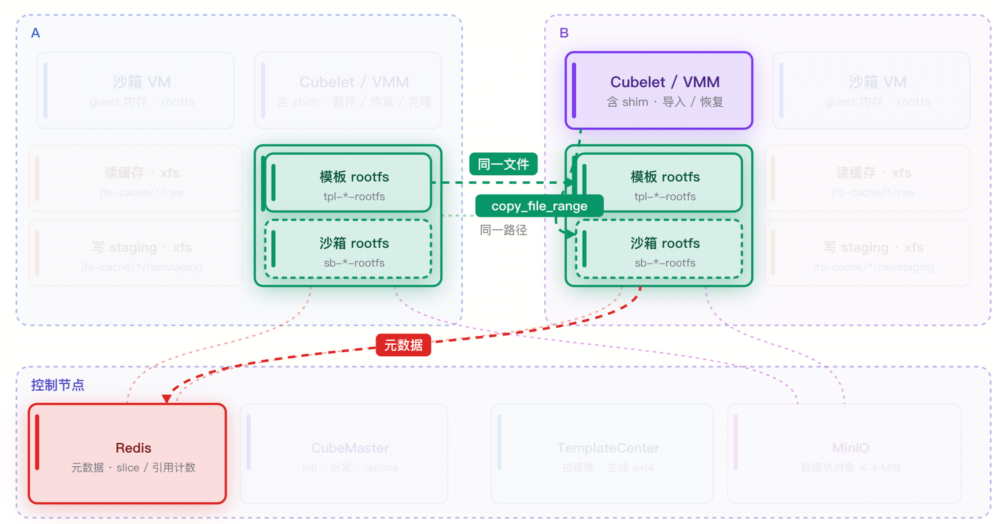
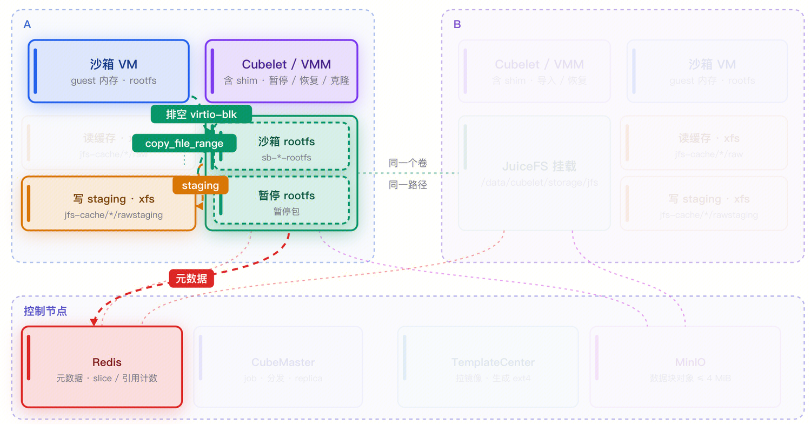
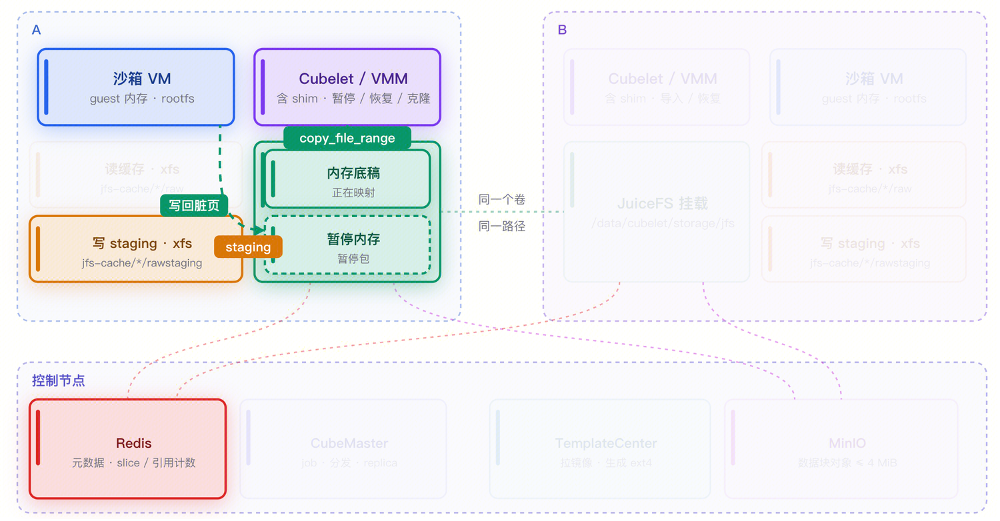
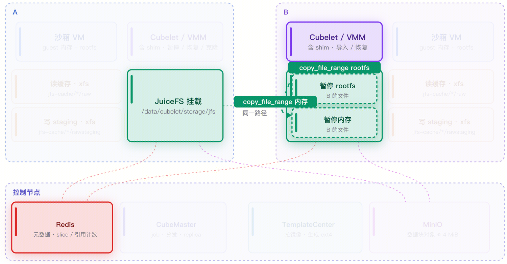

# Cube + JuiceFS 跨机存储架构

本文介绍 CubeSandbox 基于 JuiceFS 的跨机存储方案和主要流程。

> 相关部署步骤见 [JuiceFS 服务配置](../guide/cross-node-snapshot/juicefs.md)
>
> 性能测试数据见 [JuiceFS 性能测试](/zh/blog/posts/2026-11-04-cubesandbox-juicefs-perf-benchmark)

## 方案背景

CubeSandbox 的沙箱是一个完整的 MicroVM，它需要三样东西：

- 一份只读的 rootfs；
- 一块可写的磁盘；
- 一份可以恢复运行状态的内存镜像。

这三类数据构成了 Cube 的全部存储对象——模板、快照和暂停包，本质上都是"一组文件"。

目前 Cube 的核心存储方案基于 XFS。XFS 把元数据和数据分开管理，因此克隆一个文件时只需要复制 inode 和数据块的引用（reflink），不需要真正搬运数据块。基于这一点，Cube 把模板、沙箱磁盘和内存快照都表达成普通文件，用一次 `FICLONE` 就能在常数时间内派生出一份新的沙箱状态，快照和克隆几乎不花时间，也不需要额外的数据拷贝。

问题在于，XFS 是节点本地的。模板、快照和暂停包都躺在源节点的数据盘上，另一台机器既看不到这些文件，也没有办法把它们的引用关系搬过去。于是当某台宿主机资源不足、需要升级重启，或者平台的负载分布发生变化时，长时运行的 Agent 沙箱只能重建，任务上下文全部丢失。跨机能力的缺失，把 Cube 的可调度范围限制在了单机之内。

因此 JuiceFS 方案的设计目标非常明确：**保留原有的文件操作模型，在几乎不改动上层逻辑的前提下，把"本地文件系统"换成"集群共享文件系统"**，从而让任意节点都能看到并使用同一份模板、快照和暂停包。

## 为什么是 JuiceFS

JuiceFS 是一个 POSIX 兼容的分布式文件系统，它的几个特性正好对应 Cube 的需求：

- **POSIX 兼容**。上层仍然是打开、读、写、克隆这样的文件操作，Cube 不需要把存储逻辑重写成对象 API，也不需要维护一套自己的分布式元数据。
- **分布式与强一致**。多个节点可以挂载同一个卷，各节点看到的文件视图完全一致。这正是跨机恢复的前提：A 节点写下的文件，B 节点在同一路径下就能看到，而且看到的是同一份内容。
- **元数据与数据分离**。文件的数据被切成块存进对象存储，目录树、inode、块映射等元数据存进独立的元数据引擎。这个结构和 XFS 的 extent 模型很像，所以 `copy_file_range` 在 JuiceFS 上退化成一次纯元数据操作，与 XFS 的 reflink 在效果上等价。
- **后端可替换**。元数据引擎可以是 Redis、MySQL、PostgreSQL、TiKV，对象存储可以是 MinIO、S3、COS 等，同一套方案可以在试用环境和生产环境之间平滑演进。
- **基于 FUSE**。客户端在用户态，行为易于观察和调整，这对一个仍在快速迭代的存储方案很重要。
- **成熟稳定**。JuiceFS 已经在业界得到了广泛的使用和认可，其文件系统的稳定性也是 Cube 选择它的一个重要标准。

## 整体架构

当前 Cube + JuiceFS 的架构大致分为三个层面：

**共享存储层**位于控制节点，包括 JuiceFS 的元数据引擎（默认使用控制节点上的 Redis）和对象存储（默认使用控制节点上的 MinIO）。这两者的地址都可以改指向独立的机器或云服务，放在控制节点上只是为了交付方便，属于快速上手用的默认组合。

**节点侧**每台机器运行一个 JuiceFS 客户端，把同一个卷挂载到**同一个路径** `/data/cubelet/storage/jfs`。

**计算与缓存层**是 Cubelet 与 VMM。沙箱的 rootfs 和内存文件都落在 JuiceFS 挂载点下，由 VMM 直接打开和映射。与此并行，每个节点还有一份本地缓存目录，里面分成两类数据：

- `raw`：读缓存（read cache），从对象存储拉回来的数据块，可按 LRU 淘汰；
- `rawstaging`：写缓存（write staging），`--writeback` 模式下尚未上传的脏数据块，写入此处的数据块采用异步上传的方式，上传完成后即被删除。

缓存目录的后端可以是本地任意文件系统（通常是数据盘上的 XFS），只有挂载点本身是 JuiceFS。

| 层次 | 组件 | 职责 |
|---|---|---|
| 共享存储 | JuiceFS 元数据（Redis） | 目录树、inode、chunk/slice 映射、引用计数 |
| 共享存储 | JuiceFS 数据（MinIO / S3 / COS） | 数据块对象，单对象不超过 4 MiB |
| 节点侧 | JuiceFS 客户端（FUSE 挂载） | 把共享卷挂到统一路径，管理读写缓存 |
| 节点侧 | Cubelet / VMM | 克隆 rootfs、映射内存、暂停与恢复 |

需要强调的是，**共享卷里并没有"分布式"的复杂性泄漏到 Cube 上层**。对 Cubelet 来说，`/data/cubelet/storage/jfs` 下的文件就是普通文件；它进行读写、复制操作时不会关心底层是本地块还是远端对象，这部分复杂性由 JuiceFS 来处理。

## 主要流程

### 模板制作

模板制作的流程和 XFS 几乎完全相同：启动临时沙箱后，把 rootfs 和内存写入到对应的位置。区别只在落盘路径——XFS 写在 `/data/cubelet/storage/xfs`，JuiceFS 写在 `/data/cubelet/storage/jfs`。

除此之外，两者在**构建范围**上有一个关键差异。XFS 采用每台机器分别制作一次模板的方式，因此会在多台机器上都保存一份 rootfs 和内存镜像。JuiceFS 则会把所有节点按机型划分，根据 CPU 和 kernel 划分为不同的组，**每一个组只构建一份模板**。构建产物写入本机的写缓存 staging 目录，再异步上传到对象存储。

### 从模板启动沙箱

启动的第一步是克隆 rootfs：Cubelet 在 JuiceFS 内用 `copy_file_range` 从模板 rootfs 派生沙箱自己的 rootfs，只复制 slice 引用，不复制数据。

第二步是映射内存：VMM 直接以 `MAP_PRIVATE` 映射模板内存文件。之后 VM 从内存快照恢复，沙箱进入运行态。

第一次访问某些数据块时，本机读缓存是空的，缺页会把块从对象存储拉到 `raw` 目录；此后对同一块的读取都命中本地缓存。

对于跨机启动来说，由于 `/data/cubelet/storage/jfs` 下的所有文件都是所有节点共享的，因此启动流程完全相同：直接操作文件，复制、映射，然后启动沙箱即可。

### 暂停

暂停沙箱的流程和制作快照的流程相同，只是多了一个销毁沙箱的过程。

暂停按磁盘和内存两条线推进。磁盘侧会**排空 virtio-blk**，把在途的 IO 请求落到正在使用的沙箱 rootfs 上。

内存侧则先克隆内存底稿——此时克隆出的文件还没有包含本次的脏页，因为脏页还在 VM 的匿名页里。随后 VMM 冻结 vCPU，扫描页表拿到脏页，将所有脏页的数据写回刚才的克隆文件，写入同步进入 staging。元数据提交后，暂停返回。

至此，暂停包在文件层面已经完整，本机可以直接使用；跨机则要等 writeback 把相关块上传完，包才会被标记为 ready，控制面才会允许把它调度到其他节点。

### 本机恢复

本机恢复不需要等待任何上传。VMM 直接 `MAP_PRIVATE` 映射暂停包里的内存文件；rootfs 则再克隆一次成沙箱自己的文件，因为恢复之后还要继续写盘。

由于刚写过的脏页块还在本地 staging、之前读过的块还在 `raw` 缓存，本机恢复几乎全部命中本地数据，是这套方案里最快的路径。

### 跨机恢复

跨机恢复的第一件事是判断"能不能跨"。源节点健康且可调度时，调度器始终优先把沙箱放回源节点；只有当源节点不可用或被隔离时，才会检查共享数据是否 ready、目标节点是否与源节点 CPU 与内核兼容，条件都满足才落到目标节点。

恢复的流程和从模板启动的流程相似：VMM 复制 rootfs 文件，以 `MAP_PRIVATE` 映射导入后的内存镜像，缺页按需从对象存储取块进入目标节点的读缓存。目标节点的缓存是冷的，所以第一次恢复的耗时明显高于本机和热启动；源节点的读缓存不会跟着沙箱一起过来。

除此之外，刚恢复的 guest 还需要先被"叫醒"。Cubelet 会对 guest 做健康检查，而检查本身会触碰 guest 的代码页和数据页，这些缺页才转化成对象存储的 GET 请求。所以 API 要等健康检查成功才返回，跨机恢复的耗时里包含了一段不可避免的冷启动抖动。

## 与 XFS 方案的对比

| 维度 | XFS 后端 | JuiceFS 后端 |
|---|---|---|
| 克隆方式 | `FICLONE`（reflink） | `copy_file_range`（复制 slice 引用） |
| 模板分布 | 每个节点各建一份 | 按机型构建，上传到对象存储 |
| 数据可见性 | 仅本节点 | 全集群，同一卷同一路径 |
| 跨机能力 | 不支持 | 支持暂停包与快照跨机恢复 |
| 本地路径开销 | 无网络参与，最低 | 多一层 FUSE，元数据可能走网络 |
| 依赖 | 本地数据盘 | FUSE、元数据引擎、对象存储 |
| 适用场景 | 单机高密度、本地生命周期 | 需要迁移、重调度、宿主维护的场景 |

## 小结

Cube + JuiceFS 方案的核心思路可以概括为一句话：**用分布式文件系统替换本地文件系统，而不是在 Cube 里再建一套分布式存储**。

它成立的支点有三个：

- 第一，JuiceFS 提供 POSIX 接口，Cube 原有的文件操作模型（克隆、映射、按文件组织快照）可以原样保留。
- 第二，元数据与数据分离，让 `copy_file_range` 变成一次常数时间的元数据操作，克隆和共享都不需要搬运数据。
- 第三，多节点强一致的同一视图，让"在 A 写下的文件在 B 也能用"成为自然结果，跨机恢复因此不需要额外的数据通道。

代价主要集中在写入粒度和状态语义上：脏页必须按合适的窗口聚合，否则元数据事务和后台合并会拖垮暂停；writeback 让"写入完成"和"数据可跨机读取"分离，因此必须有一套明确就绪语义和及时的通知机制。这两点都在方案里做了针对性的设计和优化。

最终结果是：Cube 用一套与本地几乎同构的文件模型，获得了跨节点调度、宿主维护和负载再平衡的能力。
