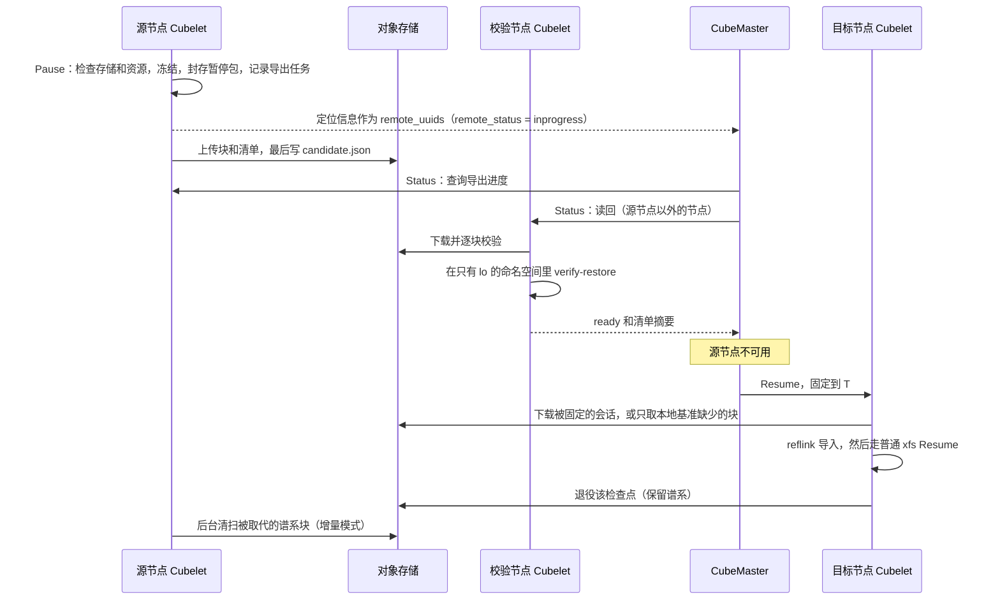

# xfs-s3 存储架构

`xfs-s3` 的沙箱和 `xfs` 一样运行在节点本地的 XFS reflink 存储上，另外会把每个暂停包作为自包含的检查点发布到 S3 兼容的对象存储。检查点由源节点以外的节点校验；源节点无法承接 Resume 时，由另一个节点下载检查点，在本机恢复沙箱。

本文介绍它的设计：恢复承诺、暂停包如何跨节点、检查点格式、增量检查点、后台清扫的正确性论证，以及如何保证一次 Resume 不会把沙箱启动两次。

> 部署、配置项和运维见 [xfs-s3 后端](../guide/cross-node-snapshot/xfs-s3.md)。
>
> 调度和 CPU、kernel 兼容条件见 [跨机迁移](../guide/cross-node-snapshot/requirements.md)。

## 背景

`xfs` 后端把模板、沙箱磁盘和内存快照都表示为本地 XFS 上的文件，用 `FICLONE` 派生新状态，暂停和恢复几乎没有开销。但暂停包只留在源节点：源节点不可用，暂停的沙箱也就跟着不可用。

另外两种跨节点后端都把运行期数据面搬到了共享存储：`jfs` 的所有文件都在 JuiceFS 挂载上，`s3` 让沙箱运行在带本地 WAL 的 CubeS3lvol 块设备上。运行中沙箱的每一次读写都依赖这一层共享存储。

`xfs-s3` 把这两件事拆开：

- 运行中的沙箱只读写本地盘，与 `xfs` 相同；
- 只有暂停时才发布数据，发布的是一份自包含的检查点，任何兼容节点都可以校验和恢复；
- 对象存储是唯一的共享依赖，只有后台上传、校验和跨节点 Resume 会访问它。

`xfs-s3` 沙箱的模板和用户快照仍是普通 `xfs`，只有暂停包能跨节点。

## 恢复承诺

| 边界 | 含义 | 可接受 / 不可接受 |
|---|---|---|
| Pause 成功 | 冻结 guest 之前，Cubelet 已确认对象存储可用、资源可以被检查点带走；冻结之后，暂停包已封存（文件和目录都已 fsync），导出任务已记录在包旁边，检查点定位信息作为 `remote_uuids` 返回。 | 远端此时可以还没就绪。对象存储不可用的节点会在冻结前拒绝暂停，沙箱继续运行。 |
| 导出提交 | 所有块和清单都已上传，固定的 `candidate.json` 最后写入，读取方要么看到完整的检查点，要么看不到。 | 提交前源节点丢失，最新检查点无法跨节点恢复。这个窗口是可接受的。 |
| `remote_status = ready` | 源节点以外的节点按清单读回了检查点；`verify = full` 时还在隔离的网络命名空间里试恢复并连上了 guest agent。Master 固定校验过的清单摘要。 | 只凭上传成功或源节点自己读取，检查点永远不会 ready。单节点集群永远到不了 ready。 |
| 跨节点 Resume | 目标节点只接受被固定的会话，校验下载的内容后导入，然后走普通的 `xfs` Resume；之后退役远端检查点。 | 结果未知的 Resume 不能在第二个节点再启动一份沙箱；Resume 失败不会消耗检查点。 |

## 组件

| 组件 | 职责 |
|---|---|
| Cubelet `storage/checkpoint` | 自包含的检查点包：S3 客户端、清单格式、全量和增量导出、读回、导入、清扫。 |
| Cubelet `storage/xfss3_*.go` | 后端接线：暂停封存与导出任务、Status、校验与试恢复、跨节点导入、基准、退役。 |
| `cube-runtime verify-restore` | 在隔离的网络命名空间里把暂停包恢复成一个临时虚拟机，并检查 guest agent。 |
| CubeMaster | 接受该后端，分两步判定远端状态，固定 Resume 尝试，回收孤儿。 |
| S3 兼容对象存储 | 检查点放在独立前缀下，可以与 CubeS3lvol 共用一个桶。 |

所有选择存储（Store）的地方都把 `xfs-s3` 当作 `xfs`；只有 Pause、Status、跨节点 Resume 和暂停包清理会看原始的后端名。

## 生命周期

状态记录在两处：

- **CubeMaster 暂停记录。** `remote_status` 依次为 pending → inprogress → ready / failed。ready 时，`export_uuids` 换成带校验摘要的定位信息：`{"checkpoint": "<prefix>/<snapshot>/candidate.json", "manifest_sha256": "..."}`。迁移 `20261116120000_pause_resume_attempt` 新增 Resume pin 用的 `resume_target`、`resume_state`、`resume_attempt` 三列。
- **Cubelet 任务记录。** 暂停包旁边的 `checkpoint.json` 记录角色（导出为 `origin`，导入为 `materialized`）、状态（exporting、exported、failed、retired）、会话、清单摘要、谱系世代、实例的恢复来源检查点、传输统计和各阶段耗时。Cubelet 重启后，未完成的导出沿用同一个会话继续。

## 检查点格式

| 对象键 | 内容 | 写入规则 |
|---|---|---|
| `<prefix>/<snapshot>/candidate.json` | 指向某个会话的清单，以及清单的摘要和大小 | 最后写入，带 `If-None-Match: *`；只由快照 ID 推出，读取方不需要其他信息就能找到 |
| `.../<snapshot>/s-<session>/manifest.json` | 暂停包的每个文件及逐块 SHA-256；第 2 版增加每个卷的类型和块大小、所属沙箱和模板、谱系世代 | 带 `If-None-Match: *`；同一会话重试时逐字节相同 |
| `.../<snapshot>/s-<session>/c/<sha256>` | 会话内的块（全量导出，或增量导出中不复用的块） | 按内容寻址，从不改写 |
| `.../<snapshot>/s-<session>/verified.json` | 校验节点的读回和试恢复证据 | 校验通过后写入 |
| `<prefix>/lineage/<sandbox>/g/<generation>/c/<sha256>` | 增量检查点的块，每个世代一个目录（19 位，零填充） | 每次导出只写自己的新世代 |
| `<prefix>/template/<template>/c/<sha256>`、`base.json` | 模板的内存基准，同一模板的所有沙箱共用 | 每个模板只上传一次 |

- 清单没有覆盖的范围就是零，空洞和全零块不上传。
- 条目越界、重叠、跨会话或包含路径穿越时，清单会被拒绝。块只能位于本会话、本沙箱的谱系或本模板的基准中，不能引用其他沙箱的块。
- 检查点只能命名暂停包自己的磁盘、`tpl-<snapshot>-rootfs` 和 `tpl-<snapshot>-memory`，因此伪造但哈希自洽的检查点也无法让导入删掉其他沙箱的对象。

### 提交保护

Cubelet 启动时会探测对象存储是否遵守 `If-None-Match`。探测还没有结果时，暂停会在冻结 guest 之前自己询问一次（最多 10 秒），因此先到的暂停也能及时被拒绝。

- `conditional_writes = required`（默认）时，不遵守的存储会在冻结前拒绝 xfs-s3 暂停。
- `optional` 时，这类存储改用降级提交：先 HEAD，对象不存在才 PUT，然后读回并逐字节比较。这不是互斥，依赖的是导出端的保证：每个快照只有源节点导出，同一时间只有一个任务，重试的会话生成逐字节相同的提交对象。

## 导出

**全量导出**（`incremental = off`，默认）：上传所有非零块，再上传清单。只有确认“没有 candidate”之后才提交；查询失败会重试，发现其他会话的 candidate 视为永久冲突。写入 `candidate.json` 即完成提交，任务记为 exported。

**增量导出**（`incremental = on`）：

1. 每个卷按固定窗口切块（`chunk_profile`：远端存储下内存 4 MiB、rootfs 16 MiB），相同字节始终得到相同的键。
2. FIEMAP 显示仍与本节点该沙箱的 reflink 基准共享块的窗口，直接复用基准的块，不读取也不上传；其他窗口读出、计算哈希，存储里没有才上传。
3. 提交前列出所有被引用的块；缺失的块重新上传到新世代，并改写清单指向新位置。
4. 提交后，节点把这次导出的文件和清单 reflink 一份作为该沙箱的新基准（附每个文件的 extent 映射），并在后台清扫被取代的谱系块。

**基准身份。** 节点为每个沙箱记录实例是从哪个检查点恢复的，在暂停和导入时各写一次。只有基准正好是这个检查点时，导出才复用谱系块；否则除模板内存基准外全部重新上传，并在日志中说明原因。沙箱的第一次导出可以复用模板的内存基准。

**传输。**

- 导出和读回默认同时传输 32 个块（可设 1–64）。
- `max_bandwidth_mbps` 限制单个节点的检查点流量，上传和下载共用一个限速器。
- 429 和 503 最多重试 10 次，退避从 1 秒到 30 秒并加抖动，遵守 1 分钟以内的 `Retry-After`；其他错误只有较短的重试预算。
- 导出任务本身按 2 秒到 5 分钟退避重试。每次重试都会遇到的错误则直接判任务失败：暂停包里有检查点带不走的文件（清单不接受的元数据文件名，例如以 `.` 开头），或者其他任务已经提交了另一个会话。
- 每个被限流的请求都会打一条 WARN 并计数。任务记录中保存计划、传输、补传和提交各阶段的耗时，以及各 worker 读取、哈希、上传和等待限速器的累计时间。

## 校验

CubeMaster 先向源节点查询导出进度。源节点提交之后，或者根本联系不上时，CubeMaster 从源节点以外的健康节点中选一个校验节点：按快照 ID 在候选节点上做哈希，跳过对这个快照处于排除期的节点。校验节点自己也会核对清单里记录的源节点：按 Cubelet 向 Master 注册的节点 ID（`CUBE_SANDBOX_NODE_ID`，未设置时为节点 IP）比较，不用可能重复的主机名。

- **`verify = full`**（默认）：校验节点下载已提交的会话，逐块校验并重建暂停包，然后在 clone 时新建、只有 `lo` 的网络命名空间里运行 `cube-runtime verify-restore`。`verify-restore` 的检查依次为：
  - 检查 VMM、内核、镜像和 agent 的兼容性，以及每个只读依赖；
  - 拒绝直通设备、可写 pmem，以及没有映射到私有副本的可写盘；
  - 恢复虚拟机，并在 15 秒内完成 agent 握手和 `reset_guest`。

  只有试恢复通过、确认进程已退出、试恢复文件已删除干净，才判为 ready；证据保存在会话旁边。
- **`verify = existence`**：只检查每个块都已存储且大小正确，不下载、不试恢复。存储中的数据损坏或目标不兼容要到 Resume 时才会暴露；Resume 时下载的块仍会按摘要校验。

| 试恢复失败 | 含义 | 处理 |
|---|---|---|
| `config` | 暂停包无法恢复 | 检查点立即失败 |
| 数据损坏 | 存储里缺块或缺清单，或者内容与清单不符 | 该节点 30 秒后再读回一次，仍判为损坏才让检查点失败；列举或读取落后于写入的存储不会因此让好的检查点失败 |
| `restore` | 可能是暂停包的问题，也可能是这个节点的问题 | 该节点报告 `retry(restore)` 后停止尝试；Master 记录该节点并换一个节点。只有**两个不同节点**都恢复失败，检查点才失败 |
| `compat`、`deps`、`isolation` | 节点的 CPU 或内核不同（CPU 特性不匹配算 compat）、缺少只读依赖，或无法隔离试恢复 | 该节点 30 分钟内不再被选为这个快照的校验节点 |
| `infra`、`agent` | VMM 创建失败，内存、文件描述符或空间不足；agent 未就绪 | 保持 pending；退避重试，从 30 秒起翻倍，最长 10 分钟 |
| 单个节点 6 次试恢复失败 | 下载失败不计入，那是存储的问题 | 该节点报告 `retry(exhausted)`，Master 把它当作无法作证的节点 |

集群里没有源节点以外的节点时，没有节点能为检查点作证：检查点一直处于 inprogress，Master 记一条告警。在源节点上恢复不受影响。

## 跨节点 Resume

源节点不可调度时，按已有规则选择目标节点（`remote_status = ready`，且 CPU 和内核兼容）。

### Resume pin

跨节点 Resume 要先下载整个检查点，Cubelet 才会应答，耗时可能超过 120 秒的 Redis 恢复锁。在 Create 和路由提交之间，应答丢失或 Master 崩溃，都不能让下一次 Resume 在第二个节点上再启动同一个沙箱。

| 机制 | 行为 |
|---|---|
| 记录尝试 | 每次 xfs-s3 Resume 之前，Master 在暂停记录上写入目标、inflight 状态和尝试编号。写入是条件更新（以读到的值为条件），并发的多个 Master 只有一个能成功。 |
| 固定路由 | 尝试处于 inflight 时，所有 Resume 都发往该节点，不再走调度。Resume 期间 Master 续期沙箱生命周期锁，失去所有权后停止续期。 |
| 重复请求 | 目标 Cubelet 先拿生命周期锁再下载。同一 ID 的沙箱处于 RUNNING 时按重放直接应答；处于 PAUSED 以外的其他状态时报告生命周期冲突，不释放 pin。 |
| 释放 pin | 失败应答只有在目标按 ID 查询、确认上面没有在运行的实例之后才释放 pin：没有这个沙箱的记录，或者只有暂停时留在源节点上的 PAUSED 墓碑（在源节点上 Resume 失败不会改变它）。其他任何状态（包括 EXITED）都保留 pin。释放时只释放这一次尝试（目标、状态和尝试编号都要仍然一致）。请求根本没有发出时，立即释放本次尝试产生的 pin；继承来的 pin 保留。 |
| 节点永久下线 | `cubemastercli cubebox release-resume-pin <sandbox-id>` 或 `POST /cube/sandbox/resume-pin/release`。运维确认节点已下线；节点仍有应答时，Master 会拒绝。 |
| 删除暂停的沙箱 | Master 先询问最后一次尝试的节点：上面有非 PAUSED 的实例就销毁，并清理该节点上的暂停包副本。询问不到该节点时，Delete 失败并保留绑定。 |

### 目标节点导入

1. 取定位信息固定的会话，拒绝其他会话，先暂存到 `objects/checkpoint-staging`。
2. 增量导入：类型和块大小一致时，每个卷先从本节点该沙箱的基准 reflink 克隆。基准在相同偏移处持有、且摘要相同的块：
   - `import_verify = full`（默认）时读出并计算哈希核对；
   - `import_verify = fiemap` 时，只要克隆仍与基准共享块、且基准的 extent 自保存以来没有变动，就不读回、直接采信。

   其他块从存储下载并校验，克隆中清单以外的内容打洞清除，结果与全量下载逐字节相同。基准过期只会多下载一些块，不会产出错误的暂停包。
3. 写入持久化的导入标记，然后以暂停包自己的对象名把磁盘导入本地 reflink 池，并写 catalog。已有同名对象只有在标记表明它是本快照早先导入留下的时候才会被替换；否则拒绝导入，不删除任何东西。
4. 记录实例的恢复来源检查点；导入的文件成为该沙箱在本节点的基准。然后走普通的 `xfs` Resume。
5. Resume 成功后，Master 让目标节点和源节点都清理暂停包。目标节点在“仍被活沙箱映射的暂停包要保留”这一判断之前退役远端检查点，因此源节点下线时检查点也会被删除。退役是幂等的。

## 谱系世代与后台清扫

在删除较慢的存储上，每次提交后同步删除被取代的谱系块，会占据远端就绪的大部分时间。因此清扫改为后台运行，并用谱系世代保证它与任何节点上的任何后续导出并发都是安全的。

**不变式：检查点 N 之后的清扫，永远不会删除比 N 新的检查点所引用的块。**

1. 导出在创建任务时决定世代，取值大于实例恢复来源检查点的世代，因此两个节点的时钟不会打乱顺序。新块只写在 `g/<generation>/` 下。
2. 导出只通过基准复用谱系块，并且只有当基准正是它的恢复来源检查点 N 时才复用；导出从不通过列举谱系来寻找可复用的块。
3. 提交前发现缺失的块，补传到新世代，并改写清单指向新位置；旧键不会再被写入。
4. 检查点 N 之后的清扫，只删除列举到的、世代不高于 N、且 N 没有引用的键。

比 N 新的检查点只会引用 N 引用过的块，或者它自己更高世代的块。因此，无论清扫和更新的导出如何交错、是否被取消、在哪个节点上运行，都删不到新检查点引用的块。

- 清扫最多 4 个请求并发，每秒不超过 `sweep_requests_per_second`（默认 30）；存储支持 DeleteObjects 时批量删除；遇到 429/503 与其他请求一样重试。
- 同一沙箱在本节点的下一次导出会先取消正在进行的清扫并等待它退出，这只是为了不与导出争用存储的请求配额。任务记录中，清扫与传输分开计时。
- 重启中丢失的清扫会被记为 lost；该沙箱的下一次清扫会把它留下的块删掉。
- 引入世代之前的清单仍可读取，但其中的块不会被复用。

## 回收与对账

- **退役。** CleanupTemplate 先在 `objects/checkpoint-retire` 写入持久化的退役意图，再停止导出、删除检查点的整个前缀，全部删除完成后才删除意图。删除方式与清扫相同：存储支持时用 DeleteObjects 批量删除，请求速率不超过 `sweep_requests_per_second`。启动时以及每 5 分钟重试未完成的意图。谱系保留，留给沙箱下一次暂停使用。
- **孤儿回收。** Master 每 2 分钟执行一轮（宽限 10 分钟），清理不再被任何绑定引用的 xfs-s3 暂停包，并删除已在别处运行或已删除的沙箱留下的 PAUSED 墓碑。读不到绑定或节点列表时跳过本轮。
- **启动。** Cubelet 启动后继续未完成的导出，并回收残留的试恢复目录。

## 资源限制

检查点只携带沙箱自己的磁盘。

- CubeMaster 拒绝创建带 host-mount、`host_dir` 或 Plugin Volume 的 xfs-s3 沙箱。
- 冻结 guest 之前，Cubelet 拒绝暂停带有以下任一项的沙箱：host-mount 或宿主机路径、`host_dir`、目录形式的 `sandbox_path`、Plugin Volume、多于一个基于磁盘的 `empty_dir`、没有设置 `discard_writes` 的 pmem。

暂停被拒绝时，沙箱继续运行。

## 配置

对象存储和 xfs-s3 配置项依次从 `CUBE_XFSS3_CONFIG`、`RCOW_S3_CFG`、`/data/cubelet/s3.cfg`（one-click 为 CubeS3lvol 写入的文件）读取。配置项及默认值见 [xfs-s3 后端](../guide/cross-node-snapshot/xfs-s3.md#配置对象存储)。设计上有两点需要注意：

- **块大小。** 远端对象存储每个请求需要几十到几百毫秒，而请求耗时的增长远慢于请求大小的增长，所以块越大，每个请求搬运的数据越多。
  - `chunk_profile = remote`（默认）：内存 4 MiB、rootfs 16 MiB；
  - `low_latency`：1 MiB / 4 MiB，适合部署在节点本机或近旁的存储，较小的块让增量检查点更小。

  不同大小的块不能共用。
- **所有节点必须读取相同的配置**，因为任何节点都可能校验或恢复其他节点写入的检查点。

## 实测表现

两套测试集群，都使用 4 GiB 内存的沙箱，每次暂停前用 fio 写入 4 GiB，每次恢复后校验全部数据：

- **测试集群 A**：2 个节点，SAS HDD RAID；S3 兼容存储前有一层限制带宽的代理，单节点 2000 Mbit/s，16 个 worker，1 MiB / 4 MiB 块。
- **测试集群 B**：3 个节点，XFS 位于独立的 NVMe 盘上；生产级 S3 兼容存储起初按账号限制请求数，后来只限制带宽。使用最终配置：4 MiB / 16 MiB 块、32 个 worker、后台清扫。

两套集群都使用 `incremental = on`、`verify = existence`、`import_verify = fiemap`。

| 指标 | 测试集群 A | 测试集群 B |
|---|---|---|
| 跨节点通过 | 3/3 | 3/3 |
| 暂停 | 15.5 秒（HDD 上的封存 fsync） | 0.69 秒 |
| 远端就绪 | 28.2 秒 | 5.5 秒 |
| 跨节点 Resume | 31.1 秒（全量下载） | 4.3 秒 |
| 从暂停到在另一节点运行 | 约 75 秒 | 10.5 秒 |
| 4 次暂停链通过 | 2/2 | 2/2 |
| 增量暂停的远端就绪 | 13.8–14.3 秒 | 3.1–3.4 秒 |
| 被限流的请求 | — | 0 |

在测试集群 B 上：

- worker 同为 16 时，4 / 16 MiB 块比 1 / 4 MiB 快 30–85%；worker 从 16 提到 32，跨节点 Resume 从 6.4 秒降到 4.3 秒。
- 存储按账号限制请求数期间，1 / 4 MiB 块每次导入约有 26 个请求被限流，4 / 16 MiB 为 0。
- 清扫移出就绪路径后，暂停链中一次暂停的远端就绪从 32.3 秒降到 9.7 秒。
- 每一轮的数据校验都一致，包括同一谱系的清扫与导出在两个节点上真正重叠的情况。

在测试集群 A 上，FIEMAP 采信的导入比读回基准每次快 35–51 秒。

更早时，在引入增量之前的全量校验版本上跑过一组故障注入，13 个场景全部通过：篡改块、Resume 时源节点宕机、导出重启、校验节点重启、重复 Resume、Resume pin、孤儿回收。

## 已知限制

- 删除沙箱不会删除它在对象存储中的谱系和各节点上的基准；删除模板不会删除它的内存基准。
- 同一个沙箱不能在支持和不支持 xfs-s3 的 Cubelet 之间迁移；请先执行迁移，并同时部署 Cubelet 和 CubeMaster。
- `verify = existence` 和 `import_verify = fiemap` 以检测能力换速度：前者不试恢复，后者发现不了原地的介质损坏。两者默认都是 `full`。
- `conditional_writes = optional` 不是互斥。
- 单节点集群永远到不了 ready。校验节点是源节点以外的任意健康节点，不按兼容类别挑选；所有候选都不兼容时，`verify = full` 的检查点会一直 pending。
- Cubelet 导入中途崩溃留下的暂存目录不会被清理。在写入退役意图之后、任务标记为退役之前崩溃，会重新上传整个暂停包，之后由孤儿回收清理。
- 故障注入没有在增量检查点、FIEMAP 导入和谱系世代上重跑；这些路径目前由单元测试和暂停链测试覆盖。`low_latency` 和 64 个 worker 还没有实测。

## 代码地图

| 位置 | 职责 |
|---|---|
| `CubeShim/shim/src/snapshot/verify.rs`、`CubeShim/cube-runtime` | `cube-runtime verify-restore` |
| `Cubelet/storage/checkpoint/` | S3 客户端和提交协议（`s3.go`）、节点限速器、配置、清单格式、全量和增量导出、读回和导入、FIEMAP 与 reflink 工具、清扫 |
| `Cubelet/storage/xfss3_checkpoint.go` | 暂停封存、导出任务、Status、校验、导入、退役 |
| `Cubelet/storage/xfss3_incremental.go`、`xfss3_sweep.go`、`xfss3_trial*.go` | 基准与恢复来源记录、世代；后台清扫；网络命名空间中的试恢复 |
| `Cubelet/services/cubebox/` | 暂停拒绝与导出启动、带生命周期锁和重放的 Resume 入口、资源白名单、暂停包清理 |
| `CubeMaster/pkg/remotestatus/xfss3*.go` | 两步判定 ready、校验节点的选择与排除、孤儿回收 |
| `CubeMaster/pkg/pausesnap/`、`CubeMaster/pkg/service/sandbox/` | Resume 尝试、固定路由、暂停沙箱的删除、创建时的限制 |
| `pkgs/cubedb/migrate/migrations/*/20261116120000_pause_resume_attempt.sql` | Resume pin 的三列 |
