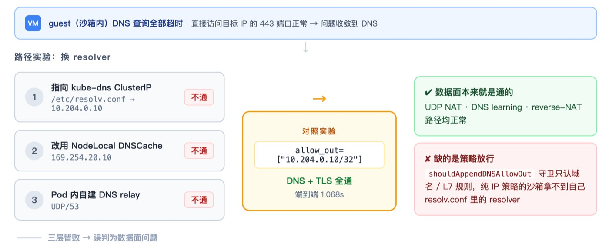

# 沙箱出海记：CubeSandbox 落地 GKE 的选型、排障与性能实录

作者｜Alva Infra 工程师 · RuiPeng Zhang

**编者按｜** Alva 是一个金融分析服务，用大模型驱动的 Agent 完成分析工作，Agent 需要在隔离环境中执行不完全可信的分析代码。

因为业务运行在海外云上，Alva 团队对 CubeSandbox 的完整评估就发生在 GKE（Google Kubernetes Engine）上。这篇文章记录了他们走过的三道关卡：私有仓库凭据的 ADC 修复、模板快照的存活判定、以及排查时间最长的 guest DNS 问题，同时也勾勒出"国内开源沙箱跑进海外云"要注意的三类适配成本。我们把它分享给同样在海外云上评估 Agent 沙箱的团队。

## 一、多沙箱方案共存

Alva 是一个金融分析服务，用大模型驱动的 Agent 完成分析工作。Agent 在执行过程中要运行 Python、Shell，安装依赖，也会执行不完全可信的分析代码，隔离的执行环境是整条链路的前提。

这个业务链路此前跑在 OpenSandbox 上，底层是 Kata 3.x / Cloud Hypervisor 这类方案。它能够工作，但 Alva 的负载是典型的短生命周期任务——工作区频繁创建、执行、销毁，几乎每次调用都要付一次"环境冷启动"的成本。Kata 路径为通用虚拟化负载设计，实例按完整 VM 的粒度占用资源，环境就绪依赖完整的启动流程；这在实践里意味着，负载越短、创建越频繁，固定开销在单次任务里的占比就越高，启动时延、实例开销与资源利用率三个指标随之都有优化空间。**正因如此，我们没有把问题限定为"是否替换现有方案"，而是并行评估四条路线**：

- 继续优化现有 Kata 路径（OpenSandbox）
- 自建 Agent sandbox 加 MicroVM 加简单 operator
- 采用已有的 MicroVM sandbox 项目
- 开始评估和测试 CubeSandbox

今年 8 月，CubeSandbox v0.6.0 提供 Helm/Kubernetes 支持后，我们遂在 STG 的 GKE 集群上启动 PoC。选择它做验证，是因为它同时具备几个值得检验的点：MicroVM 隔离、面向 Agent 的模板与快照模型、E2B 兼容接口、CubeVS/CubeEgress 网络策略，以及 K8s 部署方式。**我们想验证的是同一件事：这些能力在海外 GKE 的真实网络、镜像仓库、Workload Identity 与 CNI 数据面下，能否一起成立。**

## 二、共存而不迁移

在评估中，我们没有新建集群，而是在现有 sandbox 集群内增加独立的 CubeSandbox 专用 Node Pool：控制面落在普通 main 节点，计算面只允许进入新池，既有沙箱平台留在原 kata-firecracker 节点，互不复用。共存而不迁移，保证评估期间的任何问题都不波及现有业务。

*图 1：GKE 集群内的共存部署*

节点选用 n2-standard-8、Ubuntu Containerd、打开嵌套虚拟化，挂 200GB 独立磁盘；新池设独立 label 与 taint，防止 Cube 特权组件误调度到 Kata 节点；所有 Terraform 变更只经 PR 加 Atlantis 落地。Cube Node 初始化依次检查 KVM、XFS/reflink、bpffs、主机目录与 CIDR 冲突。

实际跑下来，XFS/reflink 与 KVM 并非最长阻塞点——Chart 的 node-init 走 loopback XFS 路径后，基础预检即可通过。真正耗时的是三个跨层问题：私有镜像仓库认证、模板快照的存活判定、Kubernetes 网络兼容。下文中我将详细拆解和分享这三个问题的现象和解决方案。

另外这里有一点需要澄清：我们当前 PoC 并未启用 Cube 的 PVM host kernel。上游 v0.6.0 的 host-kernel bootstrap 以 RPM 交付，而我们的 GKE 节点是 Ubuntu；为避免在 STG 节点上走未经验证的内核改造，本次验证的是标准 KVM MicroVM 路径。

## 三、第一道关卡：私有仓库的凭据

完成 Cube 部署后的第一个问题出现在模板导入环节：CubeMaster 从内部 Artifact Registry 拉取模板镜像时，manifest 请求返回未认证，而运行 CubeMaster 的 Pod 已处在启用 GKE Workload Identity 的环境里。

**排查之后，我们发现根因是两套凭据体系出现了偏差**：原逻辑在源无显式用户名密码时只使用 authn.DefaultKeychain，它读取 Docker 配置一类的 keychain；而 GKE Workload Identity 的短期 access token 只通过 ADC（Application Default Credentials）与元数据服务提供，不会自动出现在 Docker keychain 中。

我们在 [PR #1544](https://github.com/TencentCloud/CubeSandbox/pull/1544) 中修复了这个问题，它已于 9 月初合入上游。里面的修复逻辑遵循五条原则：

- 仅当 registry 为 \*.pkg.dev 且无显式凭据时使用 ADC；
- 显式用户名/密码优先级最高；
- 其他 registry 保持原有 DefaultKeychain 行为；
- ADC token 走可刷新的 token source，避免一次超过约一小时的 pull 中途失效；
- ADC 失败时保留清晰日志与回退，区分"权限不足"、"ADC 不可用"、"匿名拉取"三种情形。

坚持 ADC 而非塞服务账号 JSON key，是出于组件身份最小化的原则：模板导入只需要一个组件读取 Artifact Registry，因此只给 CubeMaster 的 KSA 绑定一个专用 GSA，权限收敛到必要的读取范围，其余 Cube 控制面组件不获得云身份。长期凭据一旦进入 Helm values、Kubernetes Secret、镜像、宿主机或业务 Agent 环境，暴露面就从"一个组件"扩大到"整条供应链"，JSON key 恰是为此设计的反面。

## 四、第二道关卡：模板快照的存活判定

第二个遇到的问题，是由一次 AMD64/ARM64 rootfs 不匹配暴露的：在 Apple Silicon 环境同步镜像时若未确认 AMD64 child manifest，模板会拿到错误架构的 rootfs。

这个问题让人非常迷惑的地方在于，它的表现和原因相距甚远：guest init 因架构不匹配退出后，模板构建流程照常继续，快照正常生成，状态显示 READY，直到后续 restore 才失败，乍看是快照或 restore 的问题。但当我们把 guest init、CubeShim 的 task 生命周期、Cubelet 的 snapshot 调用放到同一条时间线上对齐后，才定位到快照之前缺一个可信的 task 存活判定——已死亡的 guest 被持久化成了看似可用的模板。

在修复这个问题的过程中，我们有一个经验希望重点分享：为什么不用 ExitCh / Task.Wait？

原有 wait stream 绑定的是创建 RPC 的 context，而创建 RPC 成功返回后该 context 正常会被取消。即使 guest 仍在运行，等待方也可能拿到 context canceled。若据此判定"guest 已退出"，会制造反向误报：活着的 guest 被判死，构建流程被误中断。正是基于这个发现，我们提交 [PR #1541](https://github.com/TencentCloud/CubeSandbox/pull/1541) 的最终方案，是让 CubeShim 在 app snapshot 创建时注册 init-task watcher，Cubelet 在 containerd namespace 下用独立短超时 context 调 Task.Status，在快照前做两次 Running 检查、中间留一个很短的稳定窗口。

我们想强调的是，这一修复的目的不是让快照无限等待，而是避免把已死环境固化成"看似可用"的模板。对下游使用者而言，后者比构建失败更危险：它把故障推迟到了最不相关的时刻。

## 五、第三道关卡：guest 的 DNS

最后这个问题是我们排查时间最长的。需求来自真实业务链路，需要解析内部模型网关域名；访问 LLM、第三方 API 与包仓库同样依赖 DNS。

最初的现象是：guest 的 /etc/resolv.conf 指向 GKE kube-dns ClusterIP，解析内部网关、api.openai.com、google.com 全部超时，而直接访问模型网关 IP 的 443 端口可以成功。我们先绕路排除了上层：业务临时通过代理绕过 DNS 后，拿到了真实的 CUBE_CODEX_OK 回复，模型、SDK、key 与基本 HTTPS 路径由此全部排除，问题收敛到 DNS 本身。

随后是三层路径验证：guest 直接指向 kube-dns ClusterIP，不通；改用 GKE NodeLocal DNSCache，模板能正确写入 169.254.20.10，仍不通；在 Pod 内自建 DNS relay，relay 本身健康、模板正确写入 relay 地址，guest 仍无法把 UDP/53 的包送达。三层皆败后，我们查看了 Cubelet/CubeVS 运行配置与 v0.6.0 源码，当时得出结论：guest 使用独立的内部地址与 gateway，CubeVS 对该内部 gateway 的 UDP 有特殊处理，仅靠 Helm 配置 DNS server、增加 allow_out 或在 Pod 内起 CoreDNS，都无法建立 guest DNS 包的完整转发与回包路径。这个判断后来被证明只对了一半。

转折来自一个对照实验：创建沙箱时显式传入 network.allow_out=\["10.204.0.10/32"\]，这个沙箱的 DNS 与 TLS 全部成功——内部网关域名、api.openai.com、google.com 解析全部通过，TLS 1.3 握手成功，端到端耗时 1.068 秒。这个实验说明，CubeVS 现有的 UDP NAT、DNS learning、reverse-NAT 路径本来就是通的；真正缺的是 Cubelet 对 resolver 的策略放行——原有的 shouldAppendDNSAllowOut 守卫只在沙箱配置了域名或 L7 规则时才自动放行 resolver，而纯 IP/CIDR 策略的沙箱，拿不到自己 resolv.conf 里配置的那个 resolver。

*图 2：guest DNS 排查思路*

根因修正之后，修复反而是窄的。我们在 [PR #1741](https://github.com/TencentCloud/CubeSandbox/pull/1741) 中只做了一件事：当有效 guest resolver 是私有、链路本地或环回 IPv4 地址时（如 GKE kube-dns 的 10.204.0.10），Cubelet 自动放行该 resolver 的 /32，即使策略本身是 IP-only。原有守卫被有意保留，以防只用 IP 目标的沙箱获得策略不需要的 resolver 访问；公网 resolver 仍走原条件；混合私网与公网 resolver 的列表不会自动放行其中的公共项。整个修复复用 CubeVS 现有数据面，没有改动 CubeVS。它也有诚实的局限：v0.6.0 的策略映射是 CIDR 粒度，resolver 例外目前授予该 IP 的全部端口，未来的端口感知策略可将其收窄至 UDP/TCP 53；IPv6 在现有 IPv4 数据面下仍被跳过。

这道关卡也留下一则教训：三层验证全部失败时，"数据面不通"与"策略不放行"两种假设在现象上完全一样。区分它们需要的不是更多路径实验，而是一个最小对照——先显式放行，再看通不通。

## 六、性能数据测试情况

评估期我们始终坚持一点：不为了先跑通而放开不该放的东西。具体做法是，所有变更只落在隔离好的范围内：专用 Node Pool 不触碰现有 Kata 节点；控制面与计算面分开调度；镜像全部同步至内部 Artifact Registry；Cube API 与 Proxy 通过源 CIDR 限制的专用 Internal LoadBalancer 暴露给测试方；不开公网入口、不复用既有 Ingress、不动现有平台的 release；不使用长期服务账号 JSON key。

生产化时的职责，我们也做了比较明确的划分：CubeSandbox 只承担受限执行面，业务用户身份、审批、租户与调用审计由上层平台负责；每类工作负载使用独立的模板、网络策略与身份；第三方凭据优先走短期 token 或 CubeEgress 的按请求注入，而不是落进环境变量。

性能上，当前已验证的模板创建—执行—删除短任务路径确实很快。以下数据来自业务集群跨集群调用专用 Internal LoadBalancer、同一预热模板、5 次串行加 2 次并发：

| 指标 | p50 | 本轮最高值 |
|:--|:--|:--|
| Sandbox.create | 0.228s | 0.758s |
| Shell | 0.103s | 0.178s |
| Python | 0.281s | 0.308s |
| 完整生命周期（含删除） | 0.779s | 1.348s |

七次执行全部成功。但我们没有将这组数字与 Cube 标称的"裸机冷启动"或既有沙箱方案的结果做一对一比较，原因有三方面：

1. 预热模板、单专用节点、极小并发，不是完整的 cold-start benchmark；
2. Cube 侧测的是 Shell/Python 短任务；
3. 既有沙箱方案的业务镜像测的是 Agent HTTP/SSE 路径，资源规格、网络位置、ready 语义均不同。

因此，我们的感受是"在 Cube 上，短生命周期任务的确实体感很快"，但因此对照条件不明确，我们暂时还不能证明 Cube 能比现有方案快多少倍，这个待后续再验证。

## 七、给同类团队的建议

基于上述探索和实际经验，我们希望给同样在海外云上考虑 Agent sandbox 的团队七条建议：

- 一开始就建独立的 compute Node Pool，不与已有业务 sandbox/runtime 共用宿主机。
- 显式控制镜像架构；在 Apple Silicon 等环境同步镜像时必须确认 AMD64 child manifest（我们第二道关卡的原始触发点就在这里）。
- 私有仓库从第一天起就设计 Workload Identity/ADC，不要为拉模板引入长期 JSON key。
- 部署前先验证 KVM、存储、CIDR 冲突与 Node Pool 升级策略；不要把 guest 地址池和 Pod/Service/VPC 网段混为一谈。
- 不要把 Helm Ready 当成网络兼容通过；第一天就应做真实沙箱的 DNS、HTTPS、Service DNS、ClusterIP 与拒绝内网 E2E（我们排查最久的一道关卡，恰恰出现在部署预检全绿之后）。
- GKE Dataplane V2 / Cilium 一类数据面要单列适配成本，目前不能假设它和 TKE VPC-CNI、Flannel 一样开箱即用。
- 把性能 benchmark 排在网络、模板可靠性与安全策略之后，否则测到的只是"能创建"，不代表业务 Agent 可以稳定使用。
