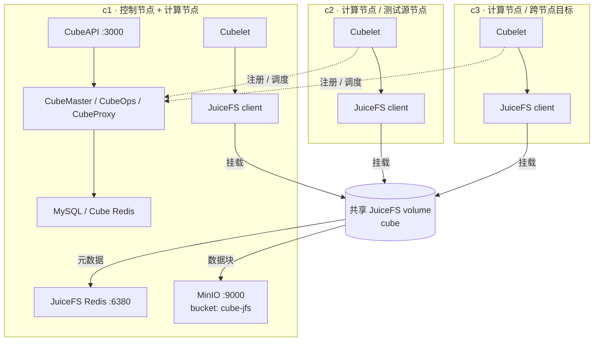

# CubeSandbox JuiceFS 多节点性能基准测试报告

## 一、前言

本文测试 CubeSandbox 使用 JuiceFS 共享存储的生命周期性能，覆盖模板启动、快照、暂停与恢复，以及跨节点快照启动和暂停恢复。

**重要说明：性能结果与硬件、网络、模板内容、JuiceFS 缓存、对象存储、Redis 延迟和沙箱负载高度相关。** 本文数据用于描述本次部署的测试结果，不应直接视为其他环境的性能承诺。

## 二、测试环境

### 2.1 三节点硬件

三台节点均为腾讯云 PVM 云服务器，CPU 和数据盘规格一致；系统盘容量存在差异。

| 节点 | 角色 | CPU | 内存 | 系统盘 | 数据盘 |
|---|---|---|---|---|---|
| c1 | 控制节点 + 计算节点 + 存储服务 | 16 vCPU，AMD EPYC 9754 | 32 GiB（系统显示约 30 GiB） | 500 GiB XFS | 1 TiB XFS，挂载到 `/data` |
| c2 | 计算节点，测试源节点 | 16 vCPU，AMD EPYC 9754 | 32 GiB（系统显示约 30 GiB） | 500 GiB XFS | 1 TiB XFS，挂载到 `/data` |
| c3 | 计算节点，跨节点目标 | 16 vCPU，AMD EPYC 9754 | 32 GiB（系统显示约 30 GiB） | 100 GiB XFS | 1 TiB XFS，挂载到 `/data` |

三台节点的软件环境一致：

| 项目 | 配置 |
|---|---|
| OS | TencentOS Server 4.4 |
| 内核 | `6.6.69-opencloudos9.cubesandbox.pvm.host-g0de43d6b3bcd` |
| CPU 拓扑 | 1 Socket × 16 Core × 1 Thread，1 个 NUMA 节点 |
| CubeSandbox 组件版本 | v0.8.0 安装包 |
| 测试日期 | 2026-11-04 |

### 2.2 部署拓扑

c1 同时运行 CubeSandbox 控制面和一个 Cubelet；c2、c3 作为计算节点连接 c1。本机测试和跨节点测试均从 c1 发起，通过 c1 的 CubeAPI 发出请求。



测试中的本机操作固定在 c2，跨节点操作固定为 c2 → c3。脚本通过 CubeAPI 的 `distribution_scope` 请求将沙箱调度到指定节点；控制面查询与节点隔离命令均直接在 c1 执行。

### 2.3 JuiceFS、Redis 与 MinIO

三台节点挂载同一个名为 `cube` 的 JuiceFS volume：

具体配置步骤见 [JuiceFS 服务配置](/zh/guide/cross-node-snapshot/juicefs)。

| 项目 | 配置 |
|---|---|
| JuiceFS 客户端 | `juicedata/mount:ce-v1.4.1` |
| 挂载点 | `/data/cubelet/jfs` |
| 元数据引擎 | c1 上的 Redis 7，`redis://c1:6380/0` |
| 对象存储 | c1 上的 MinIO，`http://c1:9000/cube-jfs` |
| 本地缓存目录 | `/data/cubelet/jfs-cache` |
| 单节点缓存上限 | 102400 MiB（100 GiB） |
| JuiceFS 回收站 | 1 天 |

三台节点使用相同挂载参数：

```text
--no-usage-report
--cache-dir /data/cubelet/jfs-cache
--cache-size 102400
--prefetch 16
--max-fuse-io 1M
--cache-large-write
--writeback
```

`--writeback` 允许脏数据先写入本地 staging，再异步上传 MinIO。测试因此分别记录 API 返回耗时和数据进入 `remote_status=ready` 的等待耗时。

### 2.4 沙箱与模板

| 项目 | 配置 |
|---|---|
| 后端 | JFS |
| 镜像 | `cube-sandbox-cn.tencentcloudcr.com/cube-sandbox/sandbox-code:latest` |
| 沙箱规格 | 2 vCPU / 2000 MiB |
| 可写层 | 1 GiB |
| 暴露端口 | 49999、49983 |
| 健康检查 | HTTP 49999 |

模板制作命令：

```bash
cubemastercli tpl create-from-image \
  --image cube-sandbox-cn.tencentcloudcr.com/cube-sandbox/sandbox-code:latest \
  --writable-layer-size 1G \
  --expose-port 49999 \
  --expose-port 49983 \
  --probe 49999 \
  --backend jfs
```

记录模板 ID 用于后续测试

## 三、测试脚本与执行方法

### 3.1 测试脚本

本次使用仓库中的 `tests/perf/cubebench_jfs_local.py` 和 `tests/perf/cubebench_jfs_cross_node.py`。两者均直接在 c1 执行。

### 3.2 SDK 与环境变量

在仓库根目录安装本地 Python SDK：

```bash
python3 -m venv /tmp/cube-perf-venv
source /tmp/cube-perf-venv/bin/activate
pip install -e ./sdk/python
```

设置集群地址：

```bash
export CUBE_API_URL=http://<cubeapi-host>:3000
export CUBE_PROXY_NODE_IP=<cubeproxy-ip>
export CUBE_CONTROL_NODE=c1
export CUBE_NODES="c1=<c1-ip>,c2=<c2-ip>,c3=<c3-ip>"
```

### 3.3 完整测试命令

先在 c1 执行 JuiceFS 本机相关性能测试：

```bash
python3 tests/perf/cubebench_jfs_local.py \
  <tpl-id> \
  --section local \
  --origin c2 \
  --samples 10 \
  --concurrency 1 5 10 \
  --warmups 3 \
  --round-gap 10 \
  --label "$(date +%F), c2 local, bundled MinIO" \
  --out /tmp/jfs-local-perf.json
```

再在 c1 执行 c2 → c3 的跨节点测试：

```bash
python3 tests/perf/cubebench_jfs_cross_node.py \
  <tpl-id> \
  --backend jfs \
  --section all \
  --origin c2 \
  --target c3 \
  --samples 10 \
  --concurrency 1 5 10 \
  --warmups 3 \
  --round-gap 10 \
  --allow-node-isolation \
  --label "$(date +%F), c2-to-c3, bundled MinIO" \
  --out /tmp/jfs-cross-node-perf.json
```

两个 JSON 可直接生成第 4.1–4.4 节的 Markdown 表格：

```bash
python3 tests/perf/cubebench_jfs_report.py \
  /tmp/jfs-local-perf.json \
  /tmp/jfs-cross-node-perf.json \
  --out /tmp/jfs-perf-tables.md
```

### 3.4 场景与测量口径

| 场景 | 测量方式 |
|---|---|
| 模板启动 | 从指定模板在 c2 创建沙箱，到 SDK 创建调用返回 |
| 快照制作 | 在 c2 创建沙箱，调用 `create_snapshot` 到 API 返回 |
| 快照就绪 | 快照 API 返回后，到 CubeMaster 数据库记录 `remote_status=ready` |
| 本机快照启动 | 复用一个已就绪快照，在 c2 创建沙箱 |
| 暂停 | 在 c2 调用 pause，到沙箱进入 paused |
| 暂停就绪 | pause 返回后，到暂停包 `remote_status=ready` |
| 本机恢复 | 在 c2 对 paused sandbox 调用 connect，到恢复完成 |
| 跨机首次快照启动 | 每个样本创建唯一新快照，再在 c3 第一次启动 |
| 跨机预热快照启动 | 复用同一个快照，多次在 c3 启动 |
| 跨机恢复 | 在 c2 暂停，临时隔离除 c3 外的节点，再恢复到 c3 |

每个场景分别测试 1、5、10 并发，每格保留 10 个有效样本。

整套测试开始前已删除全部沙箱，并清理 c1、c2、c3 的 JuiceFS 磁盘缓存和 Linux 页缓存；不同测试格和批次之间不再清缓存。脚本测量每个 worker 自己的 API 调用和立即就绪等待时间；资源清理不计入指标。报告中的结果取每组 10 个有效样本的平均耗时。

## 四、测试结果

表格仅展示平均耗时（Avg），所有数值均以 `ms` 为单位。

### 4.1 模板启动与快照

| 指标 | 1 并发 | 5 并发 | 10 并发 |
|---|---:|---:|---:|
| 从模板启动 | 159.8 ms | 252.7 ms | 353.1 ms |
| 快照制作 | 594.0 ms | 1187.7 ms | 1909.7 ms |
| 快照数据就绪 | 59.3 ms | 463.0 ms | 2294.7 ms |
| 快照制作到数据就绪总耗时 | 653.3 ms | 1650.7 ms | 4204.4 ms |

模板启动随并发度平滑增长。快照 API 在 10 并发下平均约 1.91 秒；等待 writeback 数据可安全跨节点读取还需要平均约 2.29 秒。

### 4.2 本机快照启动、暂停与恢复

| 指标 | 1 并发 | 5 并发 | 10 并发 |
|---|---:|---:|---:|
| 本机从快照启动 | 158.6 ms | 238.2 ms | 362.1 ms |
| 暂停 | 613.8 ms | 1077.0 ms | 1484.7 ms |
| 暂停包数据就绪 | 60.1 ms | 793.3 ms | 2830.3 ms |
| 暂停到数据就绪总耗时 | 674.0 ms | 1870.3 ms | 4315.0 ms |
| 本机恢复 | 390.6 ms | 1036.8 ms | 1496.7 ms |

经过三批 warmup 后，本机快照启动在各并发度下都接近模板启动。暂停 API 返回只要求数据进入本地 staging；“暂停包数据就绪”继续等待相关 staging 块上传完成。高并发时，本机恢复和后台上传都会受到共享 FUSE、磁盘和对象存储队列影响。

### 4.3 跨节点快照启动

| 指标 | 1 并发 | 5 并发 | 10 并发 |
|---|---:|---:|---:|
| c2→c3 首次启动 | 766.8 ms | 1111.9 ms | 2410.6 ms |
| c2→c3 预热启动 | 199.5 ms | 241.5 ms | 311.9 ms |

首次启动需要在 c3 读取此前未由该快照触发读取的数据；预热场景复用相同快照和缓存，因此明显更快。整套测试开始前清理了 JuiceFS 和 Linux 页缓存，但样本与测试格之间没有重复清理，因此首次启动数据不等同于每个样本都执行严格冷缓存。

### 4.4 跨节点暂停恢复

| 指标 | 1 并发 | 5 并发 | 10 并发 |
|---|---:|---:|---:|
| c2 暂停 | 616.4 ms | 1082.1 ms | 1768.1 ms |
| 暂停包数据就绪 | 60.6 ms | 799.4 ms | 2605.3 ms |
| 暂停到数据就绪总耗时 | 677.0 ms | 1881.5 ms | 4373.4 ms |
| c3 恢复 | 1044.4 ms | 1666.8 ms | 2611.1 ms |

10 个样本均以 c3 为调度目标完成恢复。跨节点恢复包含在 c3 建立目标节点私有对象、启动 VMM 和等待 guest 健康检查，不包含测试脚本执行节点隔离与恢复调度状态的时间。

## 五、结论与注意事项

- **模板启动具有良好的并发扩展性。** 1/5/10 并发平均延迟分别为 160、253、353 ms。
- **快照和暂停分为 API 阶段与异步数据就绪阶段。** 使用 writeback 时，API 返回不代表其他节点已经可以安全读取全部数据；跨节点消费前必须等待 `remote_status=ready`。
- **跨节点能力验证通过。** 从 c2 制作的快照可以在 c3 启动，c2 暂停的沙箱也能在 c3 恢复，所有正式样本均成功落到目标节点。
- **runtime snapshot 的 warmup 会显著影响启动耗时。** 三批 warmup 可在正式采样前显著降低启动阶段的瞬时延迟；纯冷启动的场景性能较差。

复现前请阅读 [`tests/perf/README.md`](https://github.com/TencentCloud/CubeSandbox/blob/master/tests/perf/README.md) 中的安全说明、参数限制和跨节点隔离行为。
