# Managed Agents 云端智能体托管平台：从跑通 Agent 到稳定交付

作者｜张师傅的博客

> 本文原文刊发于微信公众号「张师傅的博客」（作者：挖坑的张师傅），经作者授权后于 Cube Sandbox 官方博客刊发，内容保持原作原意，仅做格式适配。

这篇文章介绍我们构建的云端托管智能体平台 OMA，以及它背后的整体架构和设计取舍。

在把 Agent 接入实际业务的过程中，我们发现，模型和工具接起来之后，还有大量运行问题需要解决：长任务中断后如何恢复，凭证怎样安全使用，文件如何持久保存，内网工具如何访问，以及执行过程和成本能否追溯。这些问题在不同业务中反复出现，适合由一套共享的运行平台集中处理。

OMA 希望承担的就是这部分工作。我们参考 Anthropic 的托管智能体设计，在自己的基础设施上实现会话管理、推理与执行解耦、凭证托管和文件系统等能力，让业务团队通过 API 定义和使用 Agent。下面从这套分工讲起，再展开各个模块的实现方式，以及我们在选型和实践中的考虑。

## 从模型 API 到托管智能体

直接使用模型 API 构建 Agent 时，模型提供商负责运行模型，应用端负责智能体循环：发送上下文、解析工具调用、执行工具、回传结果，再决定继续还是结束任务。

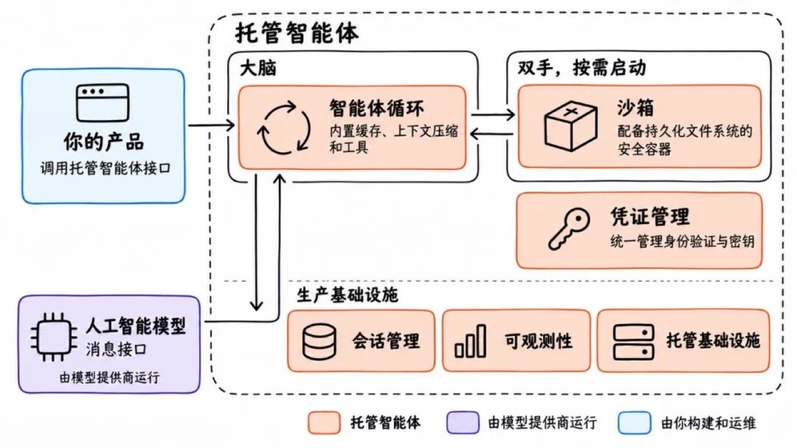

*图 1：直接使用模型 API 时，应用团队需要自建和运维的部分*

图中蓝色的部分都需要应用团队构建和运维，包括上下文管理、工具执行、会话持久化、凭证管理、沙箱隔离和可观测性。现成的 Agent 框架可以减少循环本身的开发工作，但这些上线所需的能力，仍然需要有人接起来。

托管智能体平台把这些共性职责集中起来，业务系统通过接口提交任务、接收事件和获取结果。

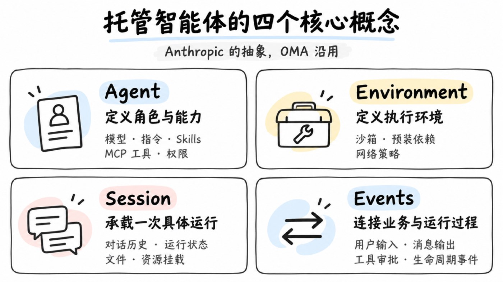

*图 2：托管智能体平台的分工*

业务开发者定义 Agent 的角色、指令、Skills 和工具，决定哪些操作需要审批，并把结果接回业务流程。平台负责背后的运行、状态保存和安全管控。

对于 OMA 这样的自托管平台，企业仍然需要部署和运维，但可以由平台团队集中承担，让不同业务复用同一套能力。模型服务则由配置的模型提供方运行，数据流向取决于具体部署与模型配置。

## 从 Anthropic 的设计出发

OMA 主要参考 Anthropic 的 Claude Managed Agents 构建。它把智能体循环与生产基础设施一起作为服务提供，清晰地划分了业务定义和运行机制。我们借鉴了它的资源模型、API 设计，以及会话持久化、手脑分离和凭证托管等架构思路。

其他厂商也在推进类似产品。OpenAI Agents API 将 Codex 运行框架作为托管服务，管理会话、上下文压缩与恢复；阿里云的 Qoder Cloud Agents 也提供 Agent 定义、环境配置、会话管理和事件流等接口。

各家的实现不同，但都在解决同一个问题：如何把模型调用、工具执行和状态管理组织成能够持续运行的任务。随着任务变长，开发者需要管理的对象也从单次请求扩展到了整个会话。

OMA 希望在企业自己的基础设施上提供这些能力。我们提供兼容 Anthropic SDK 的接口，接入已有的模型服务、存储、私网工具和安全体系，同时保留底层组件的替换空间。

## 抽象，还是抽象

Anthropic 将托管智能体的对外接口抽象为 Agent、Environment、Session 和 Events，分别描述能力定义、执行环境、运行实例和交互过程。OMA 沿用这套抽象。

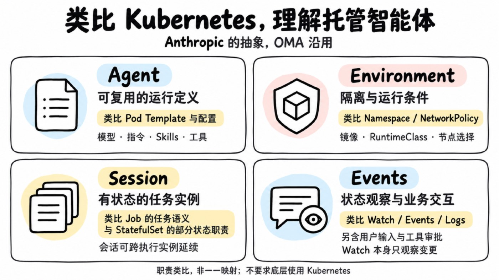

*图 3：Agent、Environment、Session、Events 四层抽象*

以分析报告为例，开发者在 Agent 中配置模型、报告要求、分析 Skill 和数据查询工具，在 Environment 中准备 Python 依赖并限制网络访问。用户提交数据时，业务系统创建 Session 并发送任务，再订阅 Events 展示进度、处理审批，完成后获取报告。

用户继续追问时，可以沿用原来的 Session；另一个任务则创建新的 Session，复用同一份 Agent 定义。能力配置与运行状态由此分开管理，业务代码也不必直接处理进程、沙箱和存储。

## 类比 Kubernetes 理解这套抽象

熟悉 Kubernetes 的话，可以把 Agent 理解为可复用的运行定义，Environment 理解为执行条件，Session 理解为有状态的任务实例，Events 则连接状态观察与业务交互。

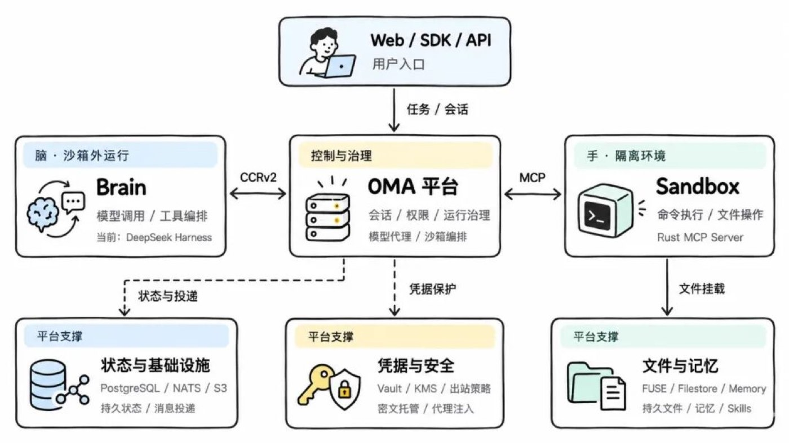

*图 4：与 Kubernetes 概念的职责类比*

这是职责上的类比：Session 可以跨执行实例延续，Events 还承载输入与审批。它们不与 Kubernetes 资源一一对应，也不要求底层使用 Kubernetes。可对照官方的工作负载与 API 概念理解。

## 整体架构

在实现上，OMA 的核心分为三个部分：平台负责控制与治理，Brain 负责推理和工具编排，Sandbox 负责命令执行和文件操作。

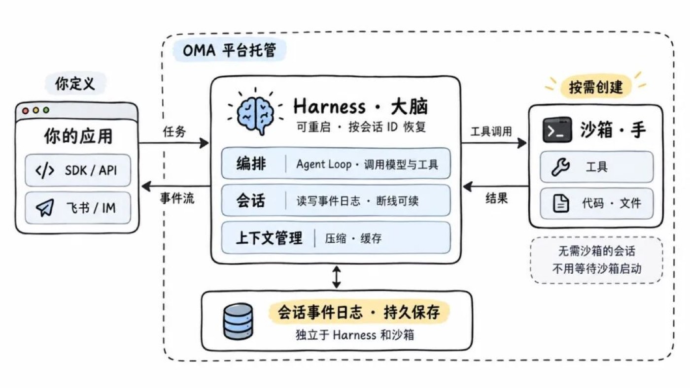

*图 5：OMA 整体架构*

OMA 平台是业务接入和运行管理的入口，管理会话、权限与资源，提供模型代理和沙箱编排，并向业务系统传递消息、审批请求与状态变化。

Brain 在沙箱外运行智能体循环，通过 CCRv2 与平台交换输入、输出和运行事件。我们采用 DeepSeek Harness 实现这一部分。需要执行命令时，Brain 发起工具调用，平台处理权限与资源，沙箱内的 Rust MCP Server 完成执行并返回结果。

底层由 PostgreSQL、NATS 和 S3 承担状态存储、消息投递和对象存储；Vault、KMS 与出站策略保护凭证和网络访问；FUSE、Filestore 和 Memory 提供持久文件、Skills 和记忆。

整个任务的流程是：业务提交输入，Brain 调用模型并编排工具，Sandbox 执行操作，平台保存状态并向业务返回事件和产出。这里最关键的边界，是让推理进程、执行环境和会话状态拥有各自的生命周期。

## 解耦「大脑」和「手」

一种常见的部署方式，是把运行框架和命令执行环境一起放进沙箱。这样容易起步，但用户发起任务后，需要先等沙箱启动，再等 Agent 进程启动，最后才开始模型调用。沙箱出故障时，推理进程和会话状态也可能一起受到影响。

我们参考 Anthropic 的设计，将 Brain 移到沙箱外，沙箱只承担工具执行，会话状态则由平台独立保存。

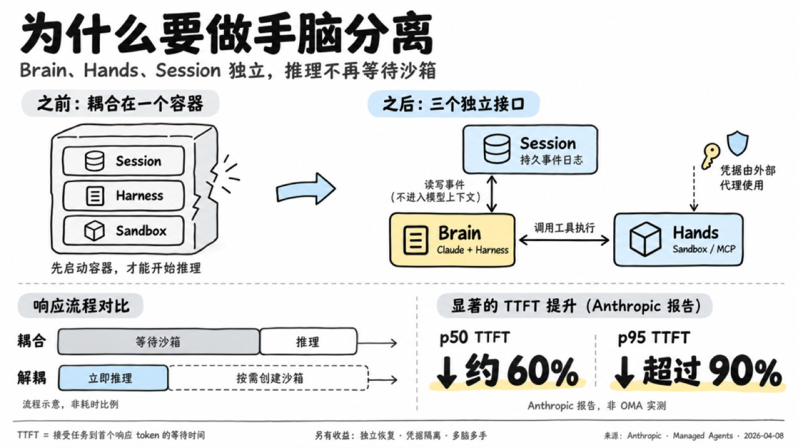

*图 6：手脑分离——Brain 在沙箱外，沙箱只承担工具执行*

**首次响应不必等待沙箱**

Brain 可以在收到输入后开始推理，沙箱并行准备，或等到真正需要执行工具时再创建。对于不需要执行命令的任务，也能省去环境准备。

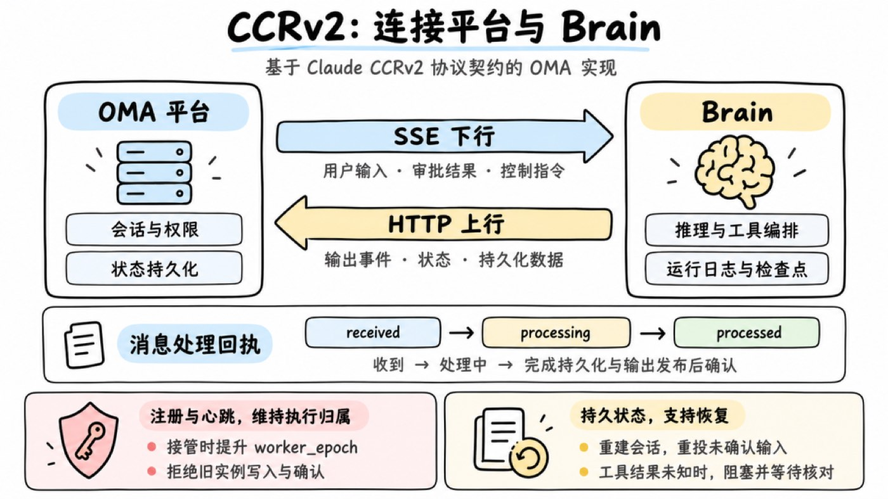

*图 7：首次响应不必等待沙箱*

Anthropic 在相关架构报告中给出的结果是，p50 TTFT 降低约 60%，p95 降低超过 90%。TTFT 指首个响应 Token 的等待时间。

**运行进程可以替换，状态需要保留**

沙箱故障后可以重新创建，Brain 重启后可以根据会话 ID 读取历史。恢复的基础，是对话、事件和文件独立保存在平台中。至于已经发出的工具调用能否重试，还需要结合执行状态和业务幂等处理，后面介绍 CCRv2 时会展开。

**Brain 可以替换，协议需要稳定**

手脑分离后，平台与 Brain 之间需要一套运行协议。我们参考的是 Claude Code 用于远程运行场景的 CCRv2。它是 Claude 的非公开协议，约定运行端与服务端如何交换输入、输出、审批和会话状态。

从 OMA 的适配实践来看，它与 Claude 模型及特定运行框架的绑定并不深。它主要解决远程执行中的通信和生命周期问题，包括断线重投、进程恢复、实例接管，以及任务执行期间的审批交互。其他 Brain 实现这套契约后，也可以接入同一套后端。

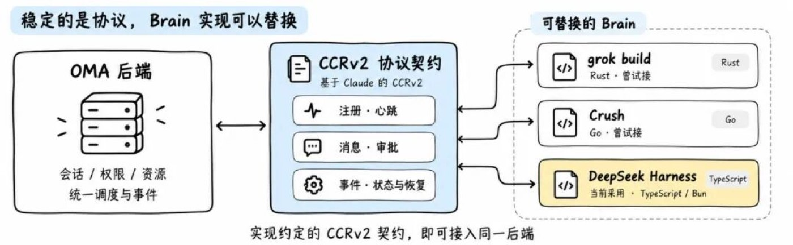

*图 8：CCRv2 协议下的租约与接管*

在 OMA 中，Brain 注册后通过心跳维持租约。接管发生时，平台提升 worker_epoch，拒绝旧实例继续写入或确认消息。用户输入、审批结果和控制指令通过 SSE 下发，输出、状态与持久化数据通过 HTTP 回传。received、processing 和 processed 区分收到、处理中和完成，避免把消息送达等同于任务完成；控制回应单独处理，也不会被等待审批的任务堵住。

运行日志和检查点由平台保存，用于重建会话。但如果工具已经执行，结果却未保存，恢复时会将其标为结果未知，阻塞并等待核对，避免自动重放造成重复操作。MCP 负责工具接入，模型 API 负责推理调用，CCRv2 则管理执行过程与平台的协作。

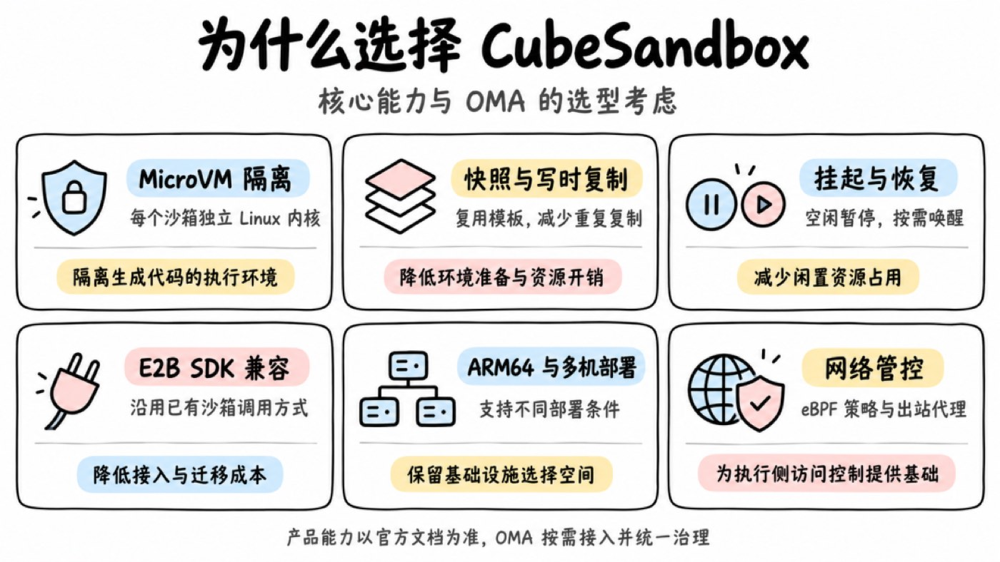

*图 9：MCP、模型 API 与 CCRv2 的分工*

我们试接过 Rust 实现的 grok build，也试接过 Go 实现的 Crush，最终选择了 DeepSeek Harness，主要看中它的插件扩展方式。事件上报、平台数据读取和协议适配可以通过插件完成，减少对核心代码的修改，也降低跟进上游升级的成本。

这次选型里，语言统一、性能和资源占用都很重要，但长期维护需要改多少代码，同样是实际的考量。保留协议边界，就是为了让后续更换 Brain 时，业务接入和会话数据能够继续复用。

## 沙箱方案

OMA 的云端部署采用腾讯开源的 CubeSandbox。我在它刚开源时就开始关注，并研究了底层实现。相比此前尝试的 E2B 方案，它的一些设计更符合我们的需求：通过 PVM 支持在适配的云服务器上运行，减少对裸金属的依赖；使用 eBPF 管理网络，整体实现也更轻量。

不过，早期版本的稳定性仍有不足，我们在使用中也遇到了一些问题。因此，OMA 保留独立的沙箱适配层，持续评估其他方案，根据成熟度和部署需求选择底层实现。

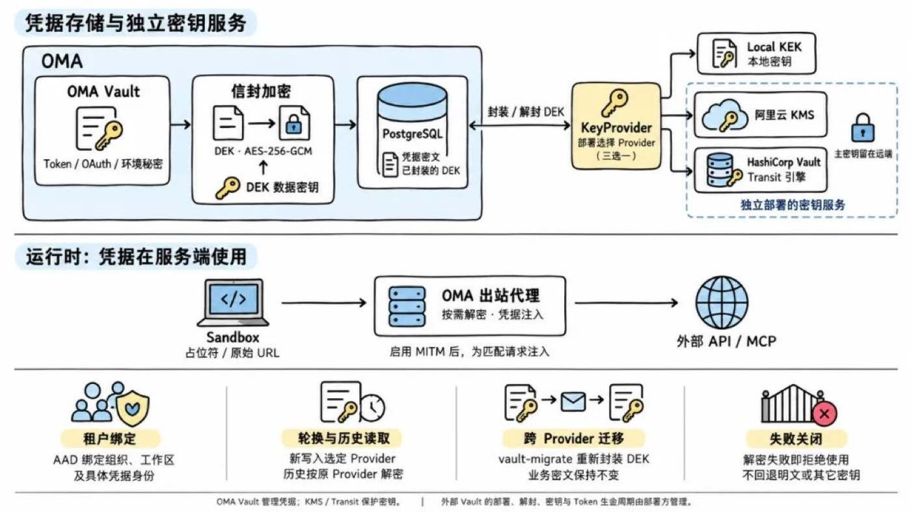

*图 10：沙箱适配层——云端 CubeSandbox，本地 e2b-local*

本地开发使用我们自己开发的 e2b-local，一个用 Go 编写的 E2B 兼容网关。它接收 E2B SDK 请求，将沙箱运行在 Docker、OrbStack CLI 管理的 Linux VM 或 Apple Container 上。云端与本地沿用同一套接口，尽量复用调用逻辑，减少切换环境时的适配工作。

## 凭证安全

运行边界拆开之后，另一个关键问题是凭证。我们之前专门介绍过凭证不进入 Agent 和沙箱的设计，这里结合调用链路再说一下。

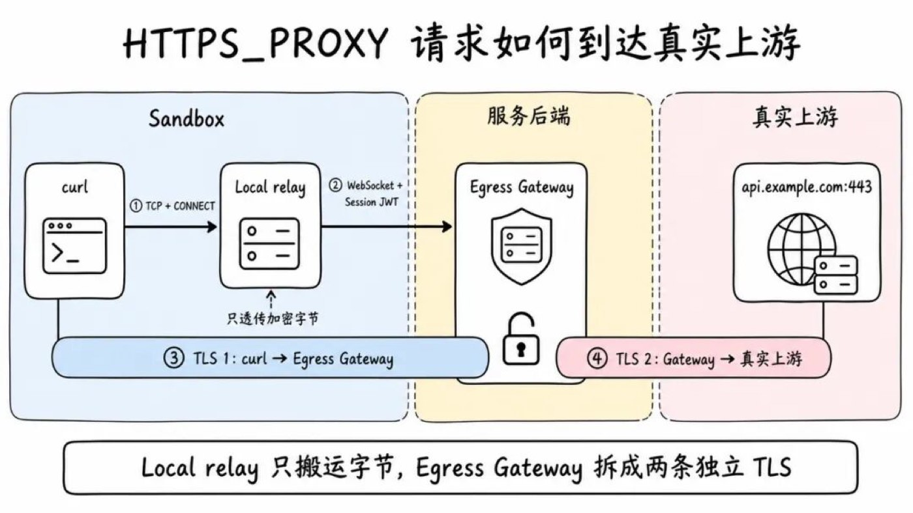

*图 11：凭证不进入 Agent 和沙箱的调用链路*

Agent 会接触用户输入、网页、仓库文件和工具结果，其中可能夹带恶意指令。如果生成代码能读到长期凭证，就存在复制或外传的风险。因此，OMA 将长期凭证留在平台控制面，沙箱只持有访问平台所需的会话身份，真实凭证在请求上游时由代理注入。

模型和 MCP 的地址由平台管理，请求分别经过模型代理与 MCP 网关。脚本、命令行工具和生成代码发起的其他网络访问，则经过出站网关，由平台检查目标与授权配置。

例如，命令行工具调用需要认证的业务 API 时，无需提前把 API Key 写进沙箱。网关匹配目标服务和凭证绑定关系，再添加认证信息并请求上游。

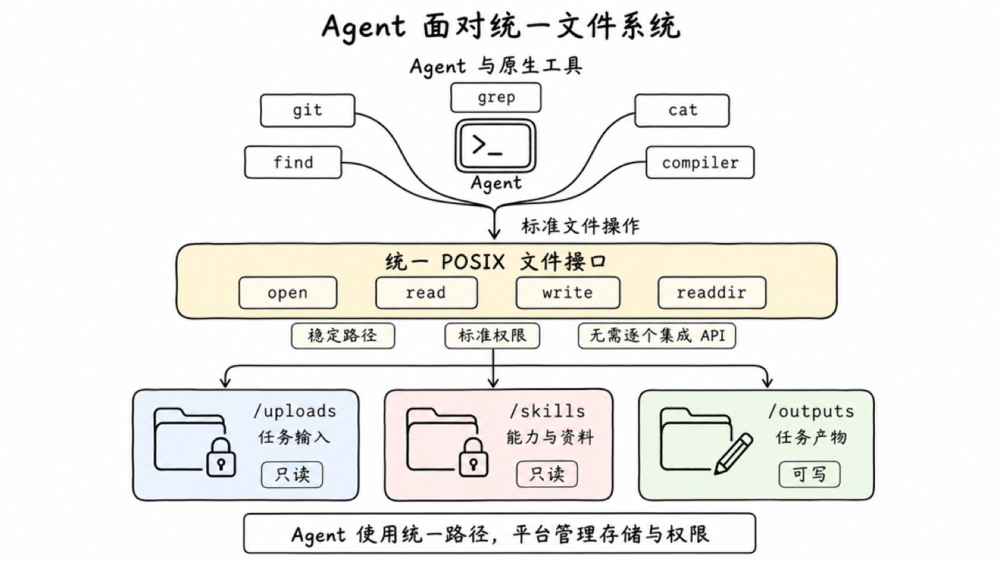

*图 12：出口网关的凭证注入*

HTTPS 链路中，客户端通过代理发起 CONNECT 请求，Local relay 将加密字节转送到服务端。出口网关处理客户端到网关、网关到上游的两条独立 TLS 连接，执行策略检查与凭证注入。客户端需要配置相应的证书信任。

这条链路也有明确的协议边界，例如 HTTPS CONNECT 443、Git 统一使用 HTTPS；实际效果依赖出口约束、代理配置和客户端兼容性。

**密文与解密能力分开管理**

凭证存储使用 Vault 与 KMS 相关机制保护。数据库保存密文，运行服务在授权条件下调用密钥服务解密，再向匹配的上游注入。拿到数据库密文，不等于拿到了可用凭证。平台还需要管理解密权限、使用范围和调用审计。

## 基于 FUSE 的用户态文件系统

Agent 在 Sandbox 中执行任务时，仍大量依赖 git、find、grep 等原生 CLI。这些工具要求底层提供稳定的 POSIX 文件接口：输入文件、Skill 与任务产物需要落在可预测的逻辑路径上，访问方式也不应随底层存储形态变化。文件系统还提供了直观的权限边界，例如将 /skills 挂为只读、将 /outputs 挂为可写。

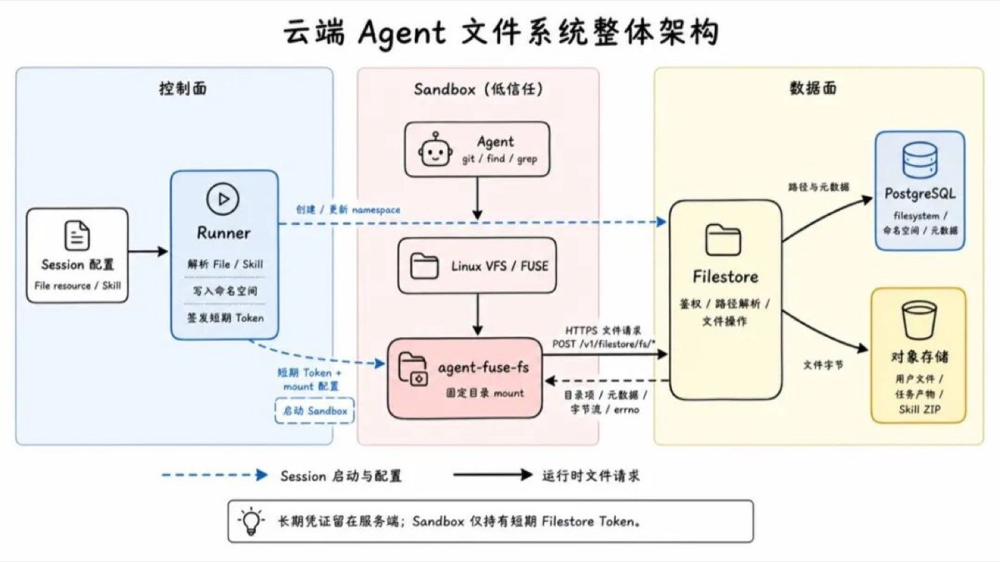

*图 13：FUSE 文件系统的权限边界*

问题在于，传统分布式文件系统（如 NFS、NAS）多为长生命周期、共享工作负载设计，并不契合按 Session 动态创建、短生命周期且高并发的 Sandbox。以阿里云 NAS 为例，官方使用限制包括：

- 单个文件系统最多同时挂载 1000 个计算节点；
- 单账号单地域最多创建 20 个通用型 NAS 文件系统，或 200 个极速型 NAS 文件系统。

若每个 Sandbox 都作为独立计算节点挂载，或为每个 Session 单独申请文件系统，上述配额很快会成为并发扩展与资源编排的瓶颈。

另一条常见路径是用 ossfs 等工具，把对象存储 Bucket 下的子路径直接挂进 Sandbox。这样可以绕过 NAS 的实例与挂载节点配额，并继续用绝对路径访问文件；但对象存储本质是扁平的 Key-Value 空间，ossfs 只是按对象 Key 中的 / 分隔符推导虚拟目录。它解决了「如何用文件路径读远程对象」，却没有回答「当前任务应该看到哪些文件」。

因此，Agent 侧的文件挂载不能直接暴露物理 Bucket 或宿主机目录，而需要一层可编程抽象：按任务动态构建虚拟视图，并在服务端控制权限与生命周期。FUSE（Filesystem in Userspace）刚好适合承担这一层机制——向上继续提供标准 POSIX 接口，向下将命名空间、鉴权与生命周期交由平台处理。

FUSE 为标准 POSIX 文件接口与平台服务提供了可编程抽象层。Agent 通过 open、read、write、readdir 等系统调用透明访问挂载目录，无需感知底层数据源来自数据库、对象存储还是远程 API。

FUSE 只负责把 Linux 文件操作交给用户态进程。要让这套机制适用于云端 Agent，还需要在 FUSE 之外建立 Session 编排、虚拟命名空间、远程文件协议和凭证边界。

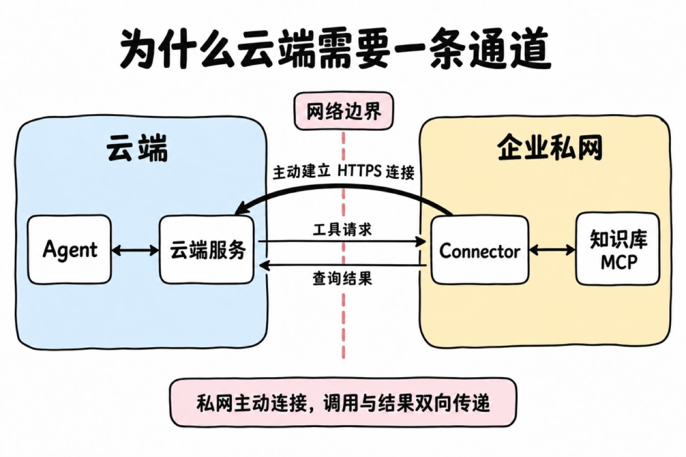

*图 14：FUSE 之上的 Session 编排与虚拟命名空间*

我觉得，基于 FUSE 实现文件系统最大的好处，是可以为每个 Session 提供按任务组织的虚拟视图。Agent 看到的路径，不必对应对象存储里的实际位置。平台可以把散落在不同位置的文件，按当前任务需要组合成一棵目录树，同时决定哪些内容可见、哪些只读、哪些允许写入。

例如，用户上传一份 CSV 后，可以在将文件关联到 Session 时通过 mount_path 指定挂载位置。设置为 /reports/input.csv，平台会将其规范化为 /uploads/reports/input.csv，Agent 在沙箱中通过 /mnt/session/uploads/reports/input.csv 读取。这个路径由任务需要决定，与文件在对象存储中的实际 Key 无关，也无需用户手动把文件复制进沙箱。

同样，多个 Skill 可以组合到统一目录，同一份内容也可以被不同 Session 引用，并按需选择版本和挂载路径。平台负责组织视图，Agent 按约定路径使用文件。

这对 Skill 管理尤其方便。多个 Skill 的版本可以在准备会话时分别解析，再组合到统一目录中；即使内容以 ZIP 包保存，后端也可以解析包内目录，按需读取文件，减少提前下载、完整解压和重新打包目录的工作。

因此，这层设计把"文件存在哪里"和"任务看到什么"分开了。FUSE 承接文件操作，Filestore 根据会话的目录映射与权限处理请求，再访问实际内容。上传文件和 Skill 可以设为只读，输出目录允许写入；底层存储布局变化时，也可以通过调整映射保持 Agent 使用的路径稳定。

文件操作经过平台，还让权限检查和变更记录有了统一入口。沙箱替换后，可以重新挂载会话的文件视图，持久内容仍由后端保存，对象存储的长期密钥也无需下发到执行环境。

## MCP Tunnel，让云端 Agent 调用私网工具

云端 Agent 拥有强大的推理能力，但当其执行任务需要触达私网核心资产（如企业内部知识库、内网 OA 系统）时，往往会受阻于企业防火墙限制。

常见的解决方案有三种：

1. 给 MCP Server 开公网入口：改动最少，但私网服务要直接暴露在公网上，攻击面随之扩大。
2. 用 VPN 或专线打通网络：连通范围大，适合整体网络互联。如果只需要暴露几个工具，网络和运维成本偏高。
3. 反向建连：在私网里运行一个客户端，由它主动连接云端，再通过这条连接接收工具调用。

我们选择了第三种。企业只需放行这个客户端访问云端的出站连接，MCP Server 仍然留在私网里。反向建连不等于授权：它只改变了"连接由谁发起"；通道建立之后，调用照样会进入私网，结果也会回到云端。授权范围和数据流向，仍然要单独设计。

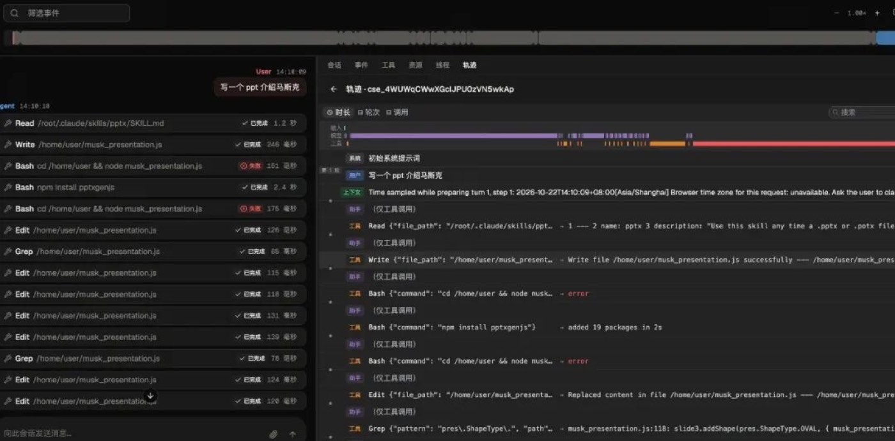

*图 15：MCP Tunnel 反向建连*

为了让现成的客户端和管理工具可以直接使用，我们当了一次缝合怪：

- 管理 API 完全对齐 Claude Managed Agents 的 Tunnels 的接口协议；
- 私网客户端我们没有开发，直接使用 OpenAI 开源的 tunnel-client，下文称为 Connector。

协议是现成的，真正要自己设计的是夹在中间的调度层。

tunnel-client 的数据面基于 HTTPS 长轮询：Connector 向云端建立一个长连接请求"有没有新任务"，领到任务后在本地调用 MCP，再通过另一个 Response 请求提交结果。整个过程只有普通的出站 HTTPS，对企业防火墙最友好。

对 Agent 来说，仍然是一次普通 MCP 调用。这条通道只承载工具请求与结果，无需因此将内部服务变成通用公网入口，也不必打通整个私网。

## 可观测性

任务能够运行之后，我们还需要知道它运行得怎么样。

报告没生成出来，可能是模型理解偏了，也可能是工具失败、依赖缺失或权限拒绝。只看最终回复，很难定位原因；只看总 Token，也解释不了某次任务为什么突然变贵。

OMA 用时间线展示模型与工具调用，帮助开发者检查执行步骤、耗时和失败位置。一个任务反复调用同一工具时，可以沿记录检查工具描述、参数设计和 Skill 指令。

*图 16：任务时间线*

全局视图汇总请求、Token、费用与失败情况，支持按团队和场景分析用量。

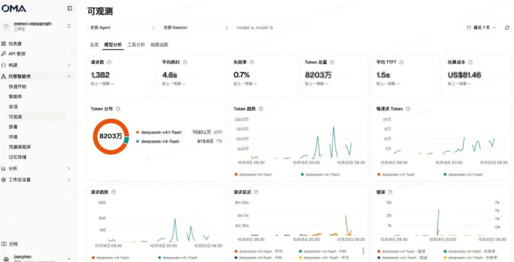

*图 17：全局视图*

目前这些记录主要用于人工排查。后续我们计划基于 Trace 提供诊断建议，帮助调整提示词、工具配置和执行过程。

## 其他功能与规划

除了上面展开的设计，OMA 还支持长期记忆、Dream、定时运行、会话预算，以及 GitLab、GitHub 仓库挂载。定时任务可以生成每日摘要，也可以在夜间整理一天积累的记忆；仓库挂载则为研发任务准备代码和文件。

接下来我们重点推进 Agent 评测。调整 Skill、增加工具或切换模型之后，仅凭几次聊天体验，很难判断真实任务是否改善。我们希望根据实际产出比较版本：报告是否生成、内容是否达标、流程在哪里失败，以及成本如何变化。

## 写在最后

这个项目本质是一个重后端的基建项目，我们后面还会持续分享这个项目里更多的一些实现细节。
