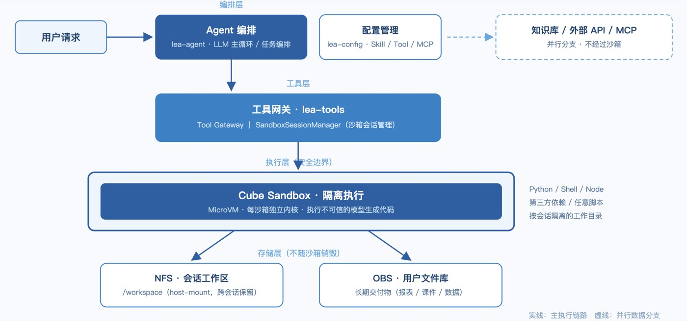
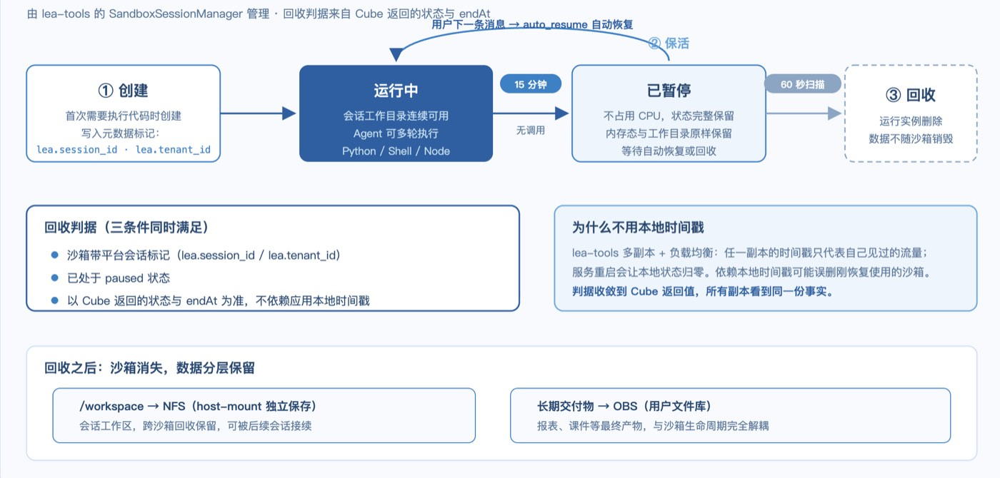
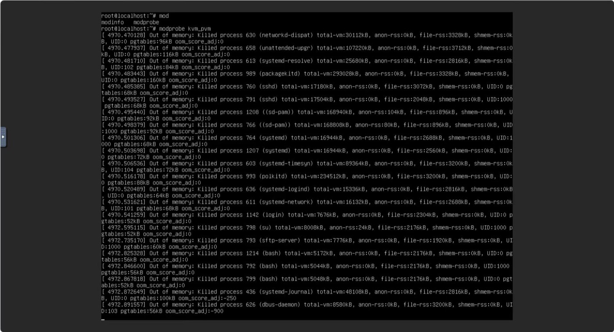

# 在 Cube Sandbox 中构建 Agent 代码执行层：从会话隔离、三段式生命周期到部署资源排障的工程实践

作者｜国开在线人工智能研发工程师 · 陆昊洋

**编者按｜** 让 Agent 执行模型生成的代码，是所有 Agent 平台都要面对的问题：代码不可信、来源不可控，执行环境本身就是整条链路的安全边界。国开在线（国家开放大学在线教育科技有限公司）正在开发一款面向教育与办公场景的 Agent 平台，支持用户自定义 Agent、Skill、Tool、知识库和 MCP，再由 Agent 将检索、文件处理和代码执行组合为连续任务。

平台目前处于评估期，尚未进入生产环境；也正因为处在探索阶段，这篇记录保留了大量一手的过程细节：执行边界如何设计、沙箱生命周期如何管理，以及按文档部署时遇到的服务器资源问题。我们把它分享给同样处于 Agent 研发阶段的团队。

## 一、国开在线 Agent 平台架构

我们正在开发的是一款面向教育与办公场景的类 Manus Agent 平台。用户可以在平台上配置 Agent、Skill、Tool、知识库和 MCP，然后让 Agent 把检索、文件处理和代码执行组合成连续任务。具体场景上，当前运行较为稳定的典型任务包括这几类：基于知识库生成和编辑 XLSX 报表、生成 PPTX 课件并做校验、解析用户上传的文档并再加工、执行脚本化的数据分析，以及复杂文件转换和多 Agent 协作。

整个平台的架构分为五层：lea-agent 负责 LLM 主循环和任务编排；lea-config 管理 Agent、Skill、Tool 和 MCP 的配置；lea-tools 是工具网关，同时承担沙箱会话管理；CubeSandbox 负责实际的隔离执行；NFS 和 OBS 分别承担会话工作区和长期交付物存储。

*图 1：国开在线 Agent 平台架构*

用户请求进来之后，先经过 Agent 编排，再通过 Tool Gateway 进入 Cube 沙箱执行；知识库、外部 API 和 MCP 的调用则走并行分支。**沙箱在其中需要承载的执行角色是**：任意 Python、Shell、Node 脚本和第三方依赖都可能被模型生成出来执行，而且同一个会话的工作目录要能跨任务连续使用。

## 二、为什么执行层用沙箱

平台接入沙箱后，最常被问到的问题是：这些任务为什么不能放在普通容器或虚机中运行？

我们的理解是：问题不在于容器或虚机能否做到，而在于普通业务容器和共享虚机是否适合充当不可信、模型生成代码的执行边界。我们实际需要的能力，归纳起来是这样几条：

- 按会话隔离的运行环境，任务之间可复用但彼此不串数据；
- 超时和资源限制，防止单个任务失控拖垮宿主机；
- 受控挂载，让会话工作区可控地进出沙箱；
- 网络与文件边界，阻止模型生成的代码触达不应访问的内部服务；
- 可回收的生命周期，沙箱使用完毕后能被确定性清理。

这套完整边界是普通容器无法提供的，因此我们将执行层放在了沙箱上。此前我们也评估过其他方案，Cube 把我们需要的这部分能力产品化了，测试下来各项概念都能对应，于是决定先用它完成整条链路的验证。

## 三、三段式生命周期：短暂保活、自动暂停、最终回收

沙箱接入之后，第一个需要回答的工程问题是生命周期：一个会话的沙箱，使用完毕是立即删除，还是长期保留？

这个问题我们从两个极端分别推演，结论是都不合适。立即删除会影响多轮任务的体验，因为用户的下一条消息又要等待一次冷启动；长期保留则会持续消耗沙箱槽位和宿主资源。权衡之后，我们采用了"短暂保活、自动暂停、最终回收"的中间路线，由 lea-tools 中的 SandboxSessionManager 统一管理。

第一段是创建。会话第一次需要执行代码时，我们才创建沙箱，并在创建时写入 lea.session_id 和 lea.tenant_id 两个元数据标记。

第二段是保活。沙箱默认 15 分钟无调用后，由 Cube 的 `on_timeout=pause` 加 `auto_resume=true` 自动暂停。暂停之后沙箱不再占用 CPU，但状态完整保留；用户的下一条消息进来，沙箱自动恢复，工作目录原样可用。这个行为与"每用户一个常驻工作环境"的产品设想高度契合，是我们最看重的特性之一。

第三段是回收。平台侧的生命周期循环每 60 秒扫描一次 Cube，只回收同时满足两个条件的沙箱：带平台会话标记，且已处于 paused 状态。回收之后运行实例消失，但会话的 /workspace 通过 NFS host-mount 独立保存，长期交付物留在用户文件库的 OBS 中，数据不随沙箱销毁。

*图 2：三段式生命周期状态流转示意图*

这套设计中，回收判据使用 Cube 返回的状态和 endAt，而不是应用实例内存中的时间戳。这个选择来自对多副本场景的顾虑：lea-tools 部署了多个副本，请求经过负载均衡，任何一个副本本地的时间戳都只代表它自己见过的流量；服务重启更会让本地状态直接归零。如果回收逻辑依赖本地时间戳，一个刚恢复使用的沙箱，就可能被另一个从未见过它的副本判定为超时并删除。将判据收敛到 Cube 返回的状态之后，所有副本看到的是同一份事实，误删的隐患随之消除。需要说明的是，这套逻辑目前仅在测试环境中验证过，生产规模下的表现仍有待观察。

## 四、第一道坎：按文档部署，服务器卡死

平台逻辑大致成型后，我们开始部署 CubeSandbox，随即遇到了整个评估过程中最棘手的问题。

最初申请的机器是 4 核 8G、50G 系统盘。按照文档的推荐资源和部署命令完成依赖安装后，到加载 PVM KVM 模块这一步，输入 `modprobe kvm_pvm` 之后，服务器直接卡死。系统不会自动重启，SSH 连接断开。

我们当时的第一判断是资源不足，于是申请升配，将机器从 4 核 8G 更换为 4 核 16G。升级后重新部署，现象完全一致，仍然阻塞在 modprobe 这一步，仍然只能通过控制台强制重启。至此我们确认了两件事：问题可以稳定复现；阻塞点在模块加载本身，与系统盘和 CPU 无关。

下面这张 OOM 截图，让我们确认了根因：宿主机在卡死前发生了系统级的内存耗尽。比较遗憾的是，这台服务器没有做 journald 持久化，重启之后上一轮 boot 的内核日志、内存曲线和 slab 统计全部丢失，因此我们无法事后精确还原默认参数 16000 当时实际消耗了多少内存。

*图 3：OOM 截图*

最终的解法是，将 `kmem_cache.max_num` 从默认的 16000 调整为 2000。调整之后模块顺利加载，部署一次通过。

需要强调的是，这个参数不是系统性分析的产物，我们当时没有做根因分析的条件，还是以求先部署通过为目标。事后回看，这次调整与 OOM 截图指向的方向是自洽的：模块加载阶段的内存开销确实随这个参数变化，将它调低之后，16G 内存就足够了。稳定性方面，在目前的轻量样本下，我们没有观察到任何影响，但这个结论的适用范围也仅限于此。

这个问题对我们的最大提醒是：**文档给出的最小资源推荐值与真实资源下限之间存在落差，下限必须自行验证**。如果当时保留了 journald 和内核日志，这本可以是一次完整的根因分析；现在能够做到的只是"现象确认 + 定向绕过"，中间缺失了机制推导这一环。因此我们给同样处于起步阶段的团队一条实操建议：部署沙箱宿主机之前，先完成日志持久化配置。

## 五、部署稳定后的性能观测

部署稳定之后，我们对平台的常用链路进行了一轮计时。这组数字均来自轻量样本，未做压力测试，参考意义大于考核意义。

参数调整完成后的首次创建，观测到的耗时约为 5.5 秒。模板和节点缓存预热完成后，同样的创建动作降至 0.3 到 0.6 秒。沙箱就绪后首次实际执行一条代码，端到端约为 2.8 秒。

对处于评估阶段的平台而言，这组数字已经足以支撑初步判断：会话首次执行的等待在可接受范围内，后续任务的沙箱创建开销基本被缓存消除。但我们不打算以这些数字对外做横向对比——压力测试尚未进行，以轻量样本对比其他部署形态也不公平，严格的基准测试留待进入生产环境后再做。

## 六、写给同样在评估沙箱的团队

整个评估过程结束后，我们记录了四条对处于相同阶段的团队可能有参考价值的建议：

- **资源下限自行验证**。文档推荐的最小资源配置可能在模块加载阶段就失败，我们验证到 16G 内存配合参数调整可以运行，更低的配置尚未测试，不宜替他人下结论。
- **生命周期判据依赖平台侧状态，减少对应用本地时间戳的依赖**。多副本部署和服务重启都会污染本地状态，回收逻辑建立在"所有副本看到同一份事实"之上，可以避免大量后续问题。
- **部署前先完成日志持久化**。这次卡死排查最大的遗憾就是没有留下完整的内核日志，导致根因只能确认到"系统级内存耗尽"这一层。
- **评估期就完成回收策略设计**。"短暂保活、自动暂停、最终回收"这套三段式在验证中表现良好，多轮任务体验和宿主资源占用都得到了兼顾，远比进入生产后再补充设计更为从容。
