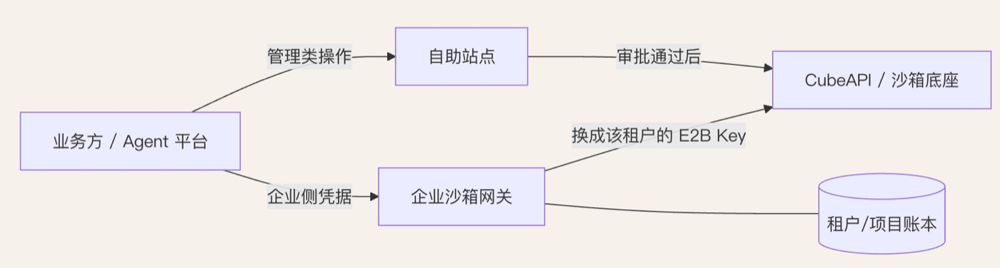
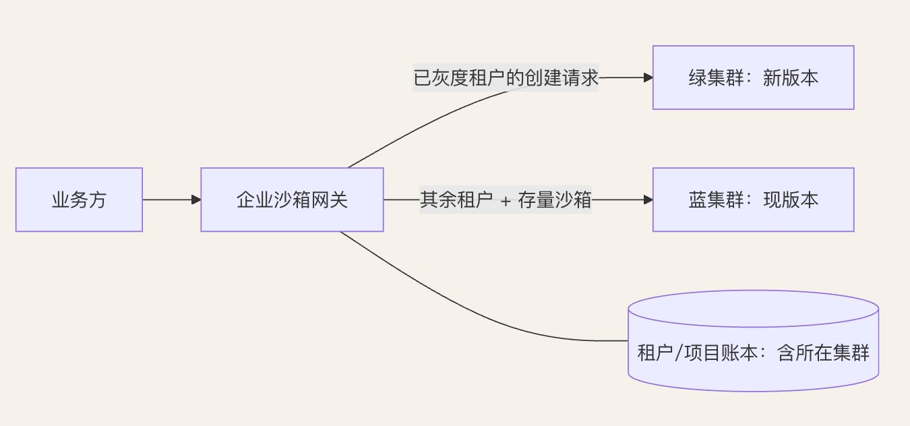

# 多租户沙箱平台的四层能力实践：网关、网络、存储与蓝绿升级

作者｜腾讯工程师 廖喜友、常震华

**编者按｜** AnyDev 是面向腾讯内部多条业务线的开发平台，使用 CubeSandbox 为 Agent 应用提供隔离执行环境。当沙箱接入多租户平台时，单个沙箱的创建与运行只是起点，平台还需要解决一系列问题，如租户如何隔离、管理操作如何审批、企业网络与存储如何接入，以及底座升级时如何保护存量任务。

AnyDev 平台团队没有为这些需求改造沙箱底座，而是在外层建立相应的平台能力。本文从租户接入、企业网络、模板与持久化存储、版本升级四个方面，介绍这套方案的设计依据、具体做法和适用条件。

### 一、为什么需要自建一层

CubeSandbox 提供毫秒级启动、硬件隔离和 CoW 快照等能力，但它主要围绕沙箱本身建模。AnyDev 要把这些能力提供给腾讯内部多条业务线，还需要处理租户归属、配额、审批、成本和审计等平台问题。

如果业务方直接调用底座的 E2B 接口，平台很难保证每项操作都符合租户边界：没有租户维度的列表接口会暴露其他租户的沙箱；模板创建、删除等操作则会波及共用底座的其他业务方。

因此，**我们的原则是：不改造底座，企业侧能力构建在外层三个地方——**

| 位置 | 承担什么 |
|:---|:---|
| **前置网关** | 身份转换、API 隔离、配额校验、记账、升级路由 |
| **自助站点** | 模板、配额、出网白名单等审批类动作 |
| **数据消费** | 生命周期事件的计量与归档 |

底座侧保持“只认 Key”的简单模型，租户级可见性由外层承担。

### 二、多租户怎么管：前置网关 + E2B Key + API 隔离 + 自助站点

#### 2.1 业务请求如何进入底座

业务请求分两条路径进入底座：

- 数据面（创建、查询、操作沙箱）：业务方 → 网关 → CubeAPI；
- 管理面（模板、配额、白名单等）：业务方 → 自助站点 → 审批 → 底座，不经业务方的 SDK 调用。

*图 1：业务请求进入底座的两条路径：数据面经企业沙箱网关直达 CubeAPI，管理类操作经自助站点审批后进入底座*

#### 2.2 网关做的四件事

###### ① 身份转换与 E2B Key 分发

网关为每个租户（或租户下的项目）额外分配一个下游 E2B Key，业务方只持有企业侧凭据，永远接触不到底层 Key。这样做的收益有三点：

- 底座本身按 Key 限流。由于每个租户持有独立的 Key，这层限流天然落在租户级别，我们无需再实现一层令牌桶；
- 底层 Key 可随时轮换、吊销，单个租户退出时不影响其他租户；
- 业务方只对接企业接口，底层因此可替换——换集群、换形态时业务方无感。

###### ② API 隔离：白名单放行 + 屏蔽不具备租户语义的接口

网关按“方法 + 路径”维护一张白名单，只放行对租户安全的操作；其余不具备租户语义的接口一律屏蔽，典型的如：

| 屏蔽对象 | 原因 |
|:---|:---|
| 全集群列表类（全部沙箱、全部快照的列举） | 没有租户维度，透传即越权 |
| 模板类操作（创建/删除/重建模板） | 影响面跨租户，且无法归属 |
| 节点与集群运维类 | 属于平台运维，不应暴露给业务方 |
| 任何读不到归属、无法做行级过滤的接口 | 同上 |

###### ③ 配额与前置校验

租户并发沙箱数、模板白名单这类校验放在网关，而不是依赖底座，原因在于底座的认证回调只转发方法和路径、看不到请求体——“某租户只能使用指定模板”这类规则，必须由网关解析请求体后才能判断。

###### ④ 记账与归属校验

创建成功取得 sandboxID 后，网关把租户、项目、创建者和时间写入账本；后续 kill、pause、快照等操作先按账本核对归属，租户只能操作自己的沙箱。账本之外，创建时还会把 tenant/project 写进沙箱的 metadata，供后续检索、出网策略绑定和事后追溯使用。

#### 2.3 自助站点：把管理动作收口

模板创建跨租户影响、需要审批与归属，因此不在 SDK 中开放，统一走自助站点。具备同样性质的管理动作也会一并收口到这里：

| 动作 | 为什么走站点 |
|:---|:---|
| 创建/升级/下线模板 | 跨租户影响，需审批与版本规范 |
| 配额调整 | 涉及成本，需审批 |
| 出网域名白名单申请 | 涉及安全，需安全团队审批 |
| “永不超时”沙箱申请 | 配额漏洞，需单独审批与计数 |

站点背后仍调用底座能力，但租户维度、审批流、审计留痕都在我们这一侧。

#### 2.4 回收：自动暂停换成本，约束“永不超时”

回收策略建立在对沙箱状态的理解上。沙箱有 running / paused / terminated 三个状态（另有暂停中、恢复中的瞬态）；其中 paused 表示快照已持久化，不再占用 CPU 和内存，只占存储。

默认回收策略正是利用了这一特性：空闲 N 分钟自动暂停，超过 M 天自动回收。暂停让出计算资源以降低成本，同时保留快照让长任务可以断点续跑——下次访问时自动恢复，冷恢复延迟计入 SLA。

状态回收之外还有一类例外需要单独处理：底座允许把超时设为“永不回收”。不加约束时租户会堆积常驻沙箱，配额形同虚设，因此“永不超时”申请在自助站点单独审批并计数。

这套方案有两个值得注意的地方：

- 网关成为所有请求的必经路径：鉴权、配额、记账和路由都集中在这里，需要按控制面关键依赖对待——部署多副本并准备降级预案。特别是认证回调不可达时，底座接口返回的是 5xx 而非表示凭据错误的 401，回调服务（我们的网关/认证服务）的可用性直接影响全部租户。
- 屏蔽清单是持续维护项：底座升级会引入新接口，因此我们把“新增接口默认屏蔽”作为网关的硬约束，否则底座一升级，屏蔽面就出现缺口。

### 三、网络怎么解决：避免私有网段冲突 + 进出流量收口到企业网关

企业内使用，网络上最关键的是两件事：网段冲突和流量收口。

#### 3.1 首要问题：企业私有网段与 Cube 私有网段冲突

Cube 沙箱有自己的私有地址模型：沙箱内部使用链路本地地址（169.254.68.x），同时把 10/8、172.16/12、192.168/16、169.254/16 等私有网段设为默认拒绝。问题在于，企业内网、云上 VPC 和容器网段几乎都落在这些范围里，由此会产生三类冲突：

| 冲突 | 表现 | 处理 |
|:---|:---|:---|
| 内网服务落在“默认拒绝”网段 | 沙箱访问内部包管理源、镜像仓库、内部 API 全部不通 | 逐条**显式放行**（具体 allow 优先于 deny，用它打洞），**不要放开默认策略** |
| 网段占用重叠 | 企业侧若也占用 169.254.0.0/16（云元数据、内部公共服务常见）或与沙箱地址模型重叠，会出现路由/策略异常，且极难排查 | **规划阶段错开网段** |
| 多 VPC / 多集群叠加 | 出网策略越写越碎，维护成本高 | 收敛出口，减少逐条策略 |

针对这三类冲突，我们把结论写进了部署规范：

1. Cube 集群所在的 VPC/子网必须避开企业内网网段与容器网段；
2. 提前梳理“沙箱需要访问的内网地址清单”，按域名优先、CIDR 兜底的方式逐条放行；
3. 已部署在重叠网段上的集群，改造成本通常高于新建，按错开原则新建集群再迁移。

#### 3.2 入站：统一走企业网关

业务方不直连沙箱的域名/路径入口，统一经企业网关接入：统一域名、统一鉴权、限流、审计，再由网关转发到底座的入站入口——域名模式 \<端口\>-\<沙箱ID\>.\<域名\> 或路径模式 /sandbox/\<沙箱ID\>/\<端口\>/...。

这样对外只有一个入口，证书、域名、访问控制都掌握在企业手里；换底座集群/换形态时业务方无感。沙箱端口在创建时自动分配、随响应返回，网关按 sandboxID 组装后端地址即可。

需要注意的是，请求命中已暂停的沙箱会触发自动恢复，网关侧要设置好超时与重试提示，避免业务方误认为请求失败。

#### 3.3 出站：统一走企业出网网关

沙箱出网统一经企业已有的出网网关/代理，而不是让每个沙箱各自出公网。这样域名白名单、审计、带宽与成本管控的口径与企业现有体系一致；出口 IP 收敛后，外部服务按 IP 放行变得可行；底座侧的出网策略作为第二道闸（默认拒绝私有网段 + 域名白名单）。

出网链路收口之后，容量规划要两端一起看：底座侧出网源地址池是共享且有限的（连接数有上限），企业出网网关也有连接数与带宽上限，任一端都可能先于 CPU/内存成为瓶颈。

#### 3.4 凭据与审计

- 凭据注入（请求经代理时改写请求头加密钥）是我们对业务方强制执行的默认规范：Agent 能调内部 API，但密钥不出现在沙箱文件系统、环境变量和模型上下文里；
- 出网访问日志（请求、安全事件、TLS 握手三类）采集到企业日志平台；密钥只留指纹/名称占位，不落明文；
- 出网日志按时间与沙箱账本关联，可归因到租户。

### 四、存储怎么解决

#### 4.1 模板治理：收口到自助站点

模板是沙箱的只读基础，也是启动速度的来源，因此治理规范围绕来源可控、引用稳定展开：

| 项 | 规范 |
|:---|:---|
| 谁能建模板 | 自助站点提交 + 平台团队审批，镜像来源可追溯 |
| 命名与别名 | 用别名做稳定引用（如 python-3.12-agent），避免业务方硬编码模板 ID |
| 版本升级 | 出新模板 → 灰度 → 切别名指向，业务方无感 |
| 基础镜像 | 统一 FROM 底座提供的基础镜像，保证沙箱内守护进程版本一致 |

#### 4.2 Volume：基于企业内共享存储做持久工作区

Volume 的生命周期独立于沙箱，并采用插件式设计：控制面负责创建与销毁，节点负责挂载与卸载。我们没有直接用现成的对象存储插件，**而是基于企业内共享存储自研了 Volume 插件**，选型依据如下：

| 维度 | 企业共享存储插件 | 对象存储（COS/S3）插件 |
|:---|:---|:---|
| 性能 | 更好，尤其 Agent 场景的小文件密集负载（git clone、依赖安装、编译缓存） | 对象存储的请求延迟与元数据开销明显 |
| 共享语义 | 多沙箱 / 多节点挂载同一工作区更自然 | 需要额外的同步与一致性处理 |
| 权限与配额 | 直接复用企业已有的目录权限、配额、备份与生命周期 | 要另建一套 |
| 运维归属 | 沿用现有存储团队的体系 | 新的存储形态与成本口径 |

在实际使用中，这套 Volume 主要承载三类负载：代码仓库、数据集常驻工作区，避免每次沙箱重建都重新拉取；依赖目录挂 Volume 做构建缓存复用，显著缩短任务耗时；跨沙箱共享产物，按用途只读挂载防止误改。

插件实现上还有几个必须覆盖的点：挂载/卸载发生在节点侧，需要处理并发挂载、引用计数，以及故障节点上的挂载回收；仍被挂载时删除会返回冲突（409），可作为安全网。

### 五、版本怎么升级：0.6 → 0.7 之后定下来的蓝绿模式

#### 5.1 为什么不再原地滚

在从 0.6 升级到 0.7 的过程中，我们遇到了与控制面组件拆分、模板及快照兼容基线相关的兼容性问题。原地滚动会把这类风险直接压到存量沙箱上——存量一旦异常，业务方正在运行的长任务就断了，而回滚镜像又慢又不可控。因此我们确定的升级原则是：

**存量不迁移，新增走新版。**

#### 5.2 蓝绿形态

*图 2：蓝绿升级形态：已灰度租户的创建请求路由到绿集群，其余租户与存量沙箱留在蓝集群，账本记录每个沙箱所在集群*

- 蓝 = 现版本集群，承载存量沙箱与未灰度租户的新建；
- 绿 = 新版本集群，承载已灰度租户的新建；
- 两套集群在企业侧共用一套账本与自助站点，底层（控制面、节点、模板、存储）相互独立；
- 创建请求的路由由前置网关控制：按租户（或租户分组）决定 create 打到蓝还是绿；查询/操作按 sandboxID 的归属路由到对应集群。

**这正是前置网关的额外收益：它不只是鉴权和配额，也是升级的流量开关。**

#### 5.3 升级步骤

我们整个升级按四步推进：

- 建绿集群（新版本），先只放内部测试租户，跑冒烟与 SDK 兼容回归；
- 网关小步放量：按租户白名单逐个切到绿，观测创建成功率、启动耗时、出网、快照/Volume；
- 存量留在蓝：蓝不再接受已灰度租户的新建；设迁移窗口，长任务在蓝侧打快照——若快照可跨集群使用，则在绿侧从快照恢复，否则重建并通过共享 Volume 或对象存储搬数据；
- 全量切绿：默认路由改到绿；蓝保留一个回滚窗口后下线。

#### 5.4 为什么蓝绿比回滚镜像划算

- **回切成本极低**：改网关路由即可，秒级生效；不需要回滚数据库结构，也不需要重刷节点镜像；
- **影响面可控**：兼容性问题只影响“被切到绿的新沙箱”，不会波及存量；
- **可以按租户节奏灰度**：重要租户最后切，出问题只影响一个租户分组。

#### 5.5 前置条件与代价

这套方案有明确的前置条件和代价：

| 项 | 说明 |
|:---|:---|
| 前置条件 | 网关具备按租户路由能力；账本记录每个沙箱所在集群 |
| 代价 | 升级期间同时承载两套集群（成本翻倍窗口）；模板/快照/Volume 若不能跨集群共享，迁移成本由业务方承担，需提前公告 |

### 六、几个可供参考的实践结论

总结一下上面我们提到的实践方法，大概是以下几点，希望能给做多租户沙箱平台的用户一些参考：

1. **引擎开箱可用，管理面必须自建。**我们的形态是：前置网关（身份转换 + E2B Key 分发 + API 隔离 + 配额 + 路由）+ 自助站点（模板、配额、白名单等审批类动作收口）。
2. **多租户的关键是“屏蔽 + 收口”**：不支持租户语义的接口一律在网关屏蔽；模板创建这类跨租户动作一律走自助站点。屏蔽清单随底座版本持续维护，新增接口默认屏蔽。
3. **企业内用网络的首要问题是私有网段冲突**：部署前把 Cube 集群的 VPC/子网与企业内网、容器网段错开；内网访问靠逐条显式放行，不放开默认策略。进出流量统一收口到企业网关——入口统一鉴权与审计，出口统一白名单与成本管控，换集群对业务方无感。
4. **存储：Volume 用企业共享存储自研插件**，性能与权限体系都优于用现成的存储插件；模板治理收口到自助站点，用别名做稳定引用。
5. **升级走蓝绿**：存量留蓝、新增走绿，由网关按租户控制创建路由；回切只需改路由，兼容性风险被限制在“被切到绿的新沙箱”，不会波及存量。
