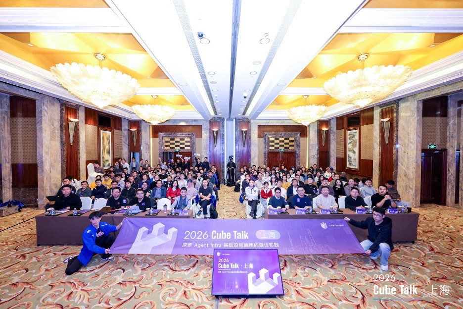
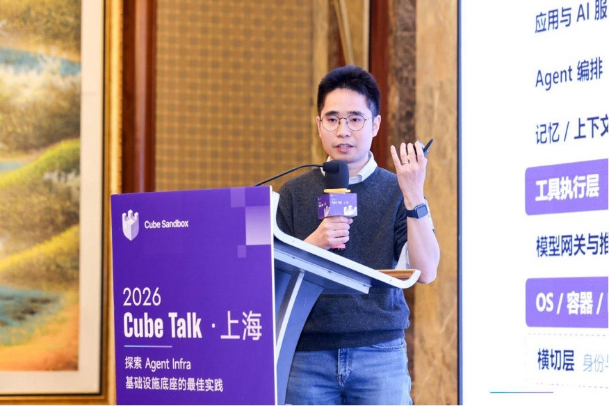
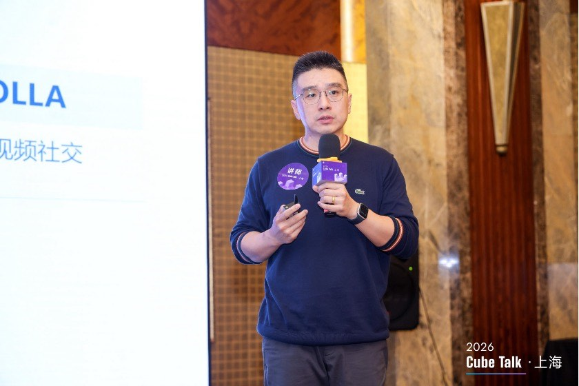
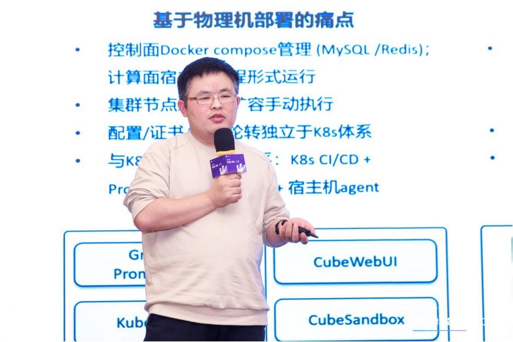
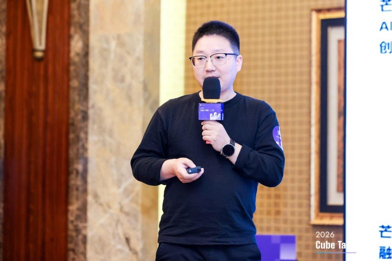
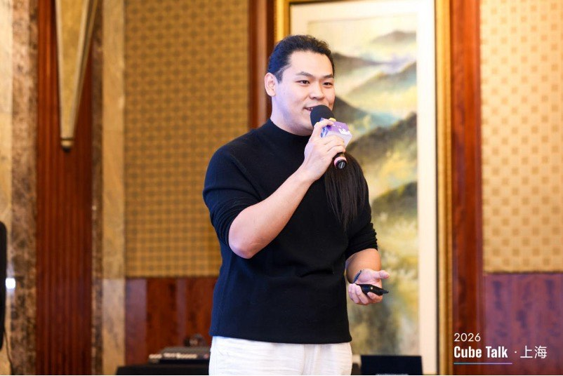
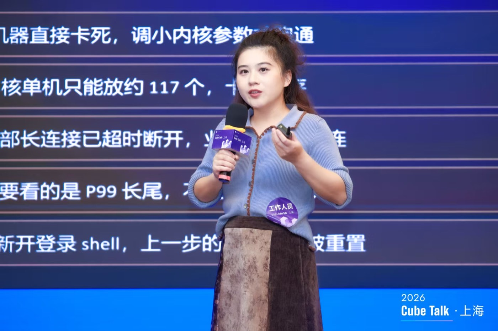
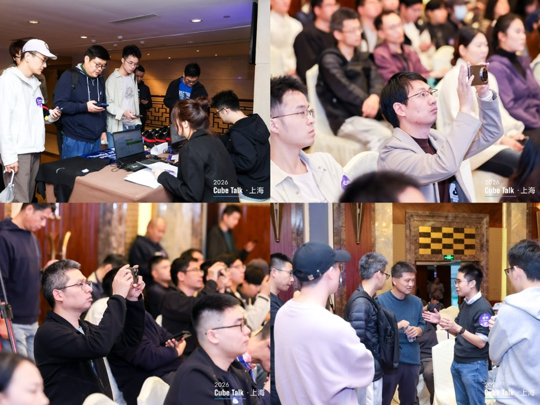

# 2026 Cube Talk 上海站回顾：Agent 走向生产，基础设施如何从“能跑”走向“可靠”？

当 AI 从“生成答案”走向“完成任务”，行业的关注点也在发生变化：模型之外，Agent 在哪里运行代码、调用工具、保存状态？面对动态生成且不可完全预测的行为，如何同时守住安全、性能、成本与可运维性的边界？

11 月 14 日，CubeSandbox 首场线下技术活动——**2026 Cube Talk 上海站**举行。来自 CubeSandbox、花椒直播、openFuyao、芒果 TV、弘则弥道等团队的一线技术负责人，围绕 Agent Infra 的技术演进与生产实践展开分享。从开源底座的工程设计，到企业 Agent 平台、Kubernetes 集群、内容生产平台和金融投研 Agent 的真实落地，活动现场呈现出一条清晰的路径：**Agent 的生产力，不只取决于模型有多聪明，也取决于执行底座能否让任务安全、稳定、持续地跑起来。**

*图 1：2026 Cube Talk 上海站现场合影*

## 一、执行底座：从“隔离盒子”走向 Agent 基础设施

### CubeSandbox 核心维护者 徐黎科｜《Agent 时代的执行底座：CubeSandbox 的技术甜点与工程挑战》

*图 2：CubeSandbox 核心维护者徐黎科分享《Agent 时代的执行底座》*

Agent 负载与传统应用有什么不同？徐黎科从三类目标负载切入：高并发拉起的工具执行环境、运行数天到数周的 Harness 长时任务，以及多租户、7×24 小时运行的服务 Agent。它们共同指向一组新的基础设施要求——突发创建、CPU 稀疏、长时有状态、行为不可信，以及任务可中断、可恢复。

这意味着，沙箱不能只负责“把代码关起来”，还要成为状态、网络、存储、安全与生命周期管理的综合底座。围绕这些要求，CubeSandbox 给出了六组核心能力：**模板快照低时延启动、只读共享与写时复制支撑高密部署、快照/回滚/克隆、独立内核与受控出网、兼容 E2B SDK、AutoPause/AutoResume 自动暂停恢复。**

性能层面，CubeBench v0.7.3 的实测数据给出了直观答案：单并发场景下，沙箱平均创建时延仅 41 ms；单个沙箱的 VMM 额外内存开销小于 5 MB；单节点 50 并发下，创建吞吐可达 512 个/秒。三组数字共同说明，CubeSandbox 在“快启动”与“低开销”之间取得了工程平衡。

## 二、企业平台：真正需要沉淀的，是任务契约与结果证据

### 花椒直播 CTO、超序 AI 创始人兼 CEO 封冰清｜《企业 Agent 平台的架构演进与 CubeSandbox 实践》

*图 3：花椒直播 CTO 封冰清分享《企业 Agent 平台的架构演进与 CubeSandbox 实践》*

企业引入 Agent，并不是把一个通用对话助手接进办公系统那么简单。经营分析、职能审核和 AI Coding 都涉及跨资料、跨系统的连续工作，还包含等待确认、人工复核、长命令执行和结果验收。封冰清结合实践案例，展示了以 Agent Runtime 连接模型、企业工具、知识与执行环境的统一架构。

其中一个关键设计，是把**Thread、Sandbox、Session**分开管理：平台保存任务上下文与运行事件，沙箱承载隔离资源，命令会话记录进程、输入输出和退出状态。任务事实与执行资源分开保存，才能明确故障后的恢复与清理责任。

**连接中断，进程可能仍在运行；进程丢失，文件可能仍然存在；外部操作结果不明时，应先查询原系统，而不是直接重试。**

在这一运行契约之下，CubeSandbox 承接独立 MicroVM、模板与生命周期管理，企业平台则继续掌握身份授权、任务状态和业务结果。分享也提醒，驻留沙箱需要纳入完整资源预算，业务等待与资源释放之间还存在需要联合验证的并发窗口。

封冰清表示企业 Agent 的价值不能只用“工具是否跑通”来衡量。**工具完成、任务合格与业务改善需要分别验收**；基础设施逐步标准化之后，企业真正积累的是任务契约、专业方法与结果证据。

## 三、K8s 生产实践：K8s 管节点，Cube 管沙箱

### openFuyao Agent 沙箱架构师 王文涛｜《CubeSandbox On K8s 国计民生行业生产实践》

*图 4：openFuyao Agent 沙箱架构师王文涛分享《CubeSandbox On K8s 国计民生行业生产实践》*

Agent 沙箱不仅要跑起来，还要进入企业已有的私有云、信创和云原生运维体系。王文涛给出的职责边界十分明确：**Kubernetes 负责节点编排、Pod 调度、弹性扩缩、滚动升级与配置/密钥管理，CubeSandbox 负责沙箱生命周期、沙箱级调度、模板分发、快照与暂停恢复、网络隔离。**

在架构上，访问层与控制层通过 Deployment、StatefulSet 等标准工作负载实现多副本高可用，计算层的 Cubelet、CubeVS、CubeEgress 运行在同一 Big Pod 中，并以 DaemonSet 方式部署。现场披露的生产实践已覆盖**100+ 节点、3 万+沙箱，稳定运行 2 个月**。

更具参考价值的是那些只有进入生产才会遇到的问题：adminToken 不一致导致暂停恢复鉴权失败、首次部署与 PVM 门禁校验的时序矛盾、Cubelet 孤儿进程导致 Big Pod 异常、同节点流量因 checksum 校验失败被内核丢弃，以及非 root 运行、NFS 存储接入、健康检查和统一可观测等需求。

从 Helm 静态渲染走向 Operator 持续调谐，从统一资源感知调度到基于超节点分布式缓存加速镜像与快照分发，分享呈现的不只是部署方法，更是 Agent 沙箱融入企业云原生体系的演进路线。

## 四、芒果 TV：安全不是断网，而是让每次执行都有边界

### 芒果 TV 算法基础研究负责人 刘旭升｜《智能体平台的安全底座：CubeSandbox 在芒果 TV 的应用实践》

*图 5：芒果 TV 算法基础研究负责人刘旭升分享《智能体平台的安全底座》*

当 Agent 从内容生成走向 CLI、Skill 脚本和媒体处理工具执行，任务时长、资源需求和副作用都变得难以预测。芒果 TV AgentX 选择了**Sandbox as Tool**：可信的 Agent 主循环留在平台侧，只有不可信执行进入远端 Sandbox，并按需创建、按会话动态绑定。

**沙箱不是一个 Execute API，而是一套远端执行基础设施。**

围绕隔离、执行契约、状态与生命周期、文件系统、凭据与网络五类挑战，AgentX 在托管 CubeSandbox 之上构建统一 Sandbox Provider，让命令执行、文件上传下载、创建恢复、续租取消与安全策略在不同后端之间保持一致语义。

在安全体系上，外层 MicroVM 负责基础隔离，内层 Fence 约束文件、网络、环境变量和命令行为；AgentX Vault 将外部服务访问收敛到受控代理，让 Agent 可以使用服务能力，却不直接持有真实密钥。

芒果灵创 AIGC 内容创作、智能融媒、智能体与芒果创影智能后期四类业务场景已接入沙箱执行，当前最大并发约 100，并面向千级并发持续演进。

## 五、金融投研：让完整 Agent 在沙箱中持续研究

### 弘则弥道 CTO 王正凯｜《在 CubeSandbox 中运行完整投研 Agent：弘则 4as 的架构与实践》

*图 6：弘则弥道 CTO 王正凯分享《在 CubeSandbox 中运行完整投研 Agent》*

弘则 4as 则展示了另一种路径：**把模型循环、工具选择、文件与代码操作组成的完整 Agent 放进 CubeSandbox。**这源于投研工作的特殊性——研究不是一次性问答，而是围绕既有判断、证据和未决问题持续推进。

4as 采用两层 Harness：沙箱外的 BWA Runtime Harness 负责身份授权、生命周期、取消超时与事件持久化，沙箱内的 Pi Agent Harness 负责模型循环、上下文、工具和会话续接。研究文件 Workspace、持续会话 Thread 与执行环境 Cell 分开管理，使执行环境可以按需取得、复用或回收，而研究积累仍然持续存在。

通过 CubeSandbox Host Mount，研究方持续维护的专业目录以只读方式挂载，用户自己的材料、分析和成果则在私有工作区中可读写。一位“AI 研究员”由此具备了可独立发布、按版本订阅、按需具身的运行方式。

上线七日的运行数据同样亮眼：中央云端服务累计完成 5,600 次 Run，七日去重活跃执行 Cell 达 4,890 个，10 分钟内续跑的同 Cell 复用率达到 84.5%。4as 的实践说明：沙箱不只是风险控制手段，也可以成为专业知识持续运行、研究成果持续积累的基础设施。

## Cube 100 发布：寻找首批 100 位 AI Agent 生产先行者

*图 7：CubeSandbox 运营 Maintainer 曹倩芸发布「Cube 100」计划*

从 Demo 到生产，中间往往隔着一层“没人教”的工程经验。从今年 4 月 CubeSandbox 正式开源到目前为止，接入使用的开发者和企业越来越多，“怎么用好”比“怎么使用”更加重要。

为此，CubeSandbox 运营 Maintainer 曹倩芸在活动现场公开发布**「Cube 100」计划**，面向全球征集 100 篇真实 AI Agent 沙箱落地案例，寻找首批 100 个共创团队。无论是用 Cube 跑业务，还是把 Cube 集成进自研平台，架构选型、部署实践和踩坑复盘都可以成为值得共享的社区资产。

截至目前，CubeSandbox 已获得**13,100+ GitHub Star、131 位贡献者**。入选团队可获得核心研发一对一架构共创与性能优化支持、新特性抢先体验、全渠道联合宣发，以及优秀案例证书与共创席位。

*图 8：现场签到与交流花絮*

## Agent Infra 的刻度，由落地而非故事标定

**当前，Agent 的竞争焦点，正在从“模型有多强”转向“底座有多稳”。**这些实践共同勾勒出一个更完整的判断，**Agent 基础设施的成熟度，不取决于任何单一技术指标，而取决于从启动速度、资源密度、隔离强度、状态管理、安全治理到生态兼容的系统性能力。**

Agent 时代真的来了，而那些愿意为 Agent 建造底座的人，正在把“故事”变成“刻度”。

2026 Cube Talk 上海站已经收官，但关于 Agent Infra 的实践才刚刚开始。接下来，CubeSandbox 将继续通过开源共建、真实案例与线下交流，把更多一线问题带回社区，也让更多团队的工程经验被看见。
