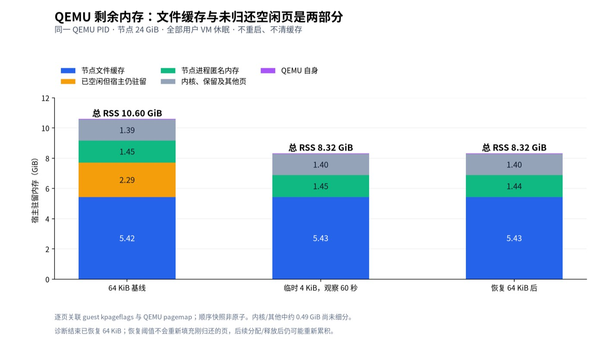
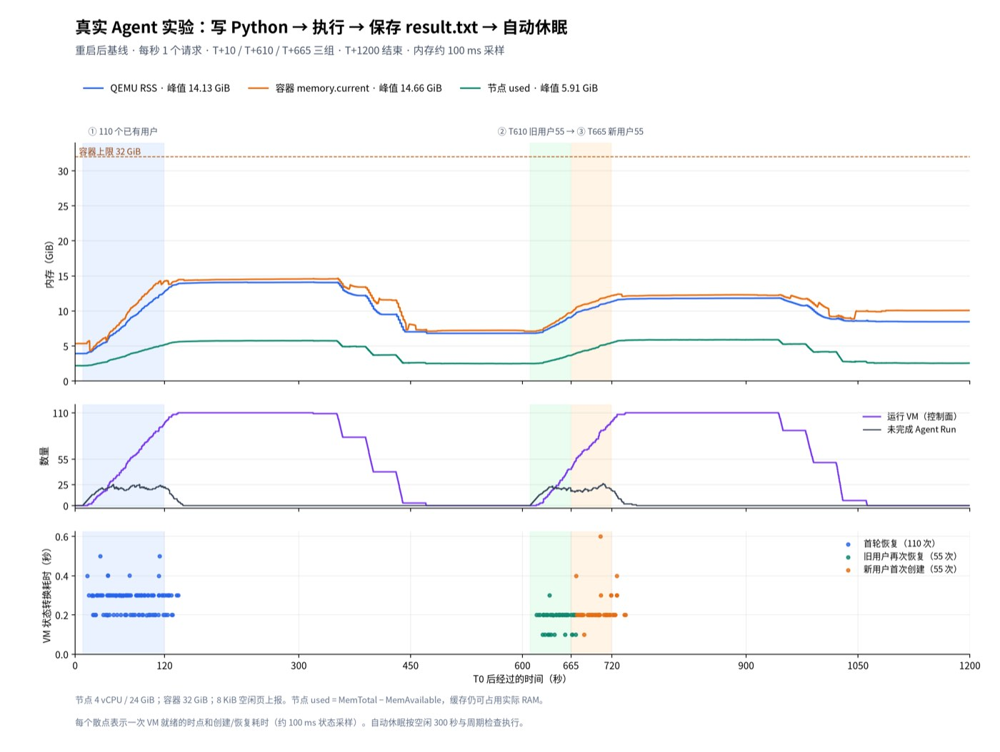

# 多租户 Agent 平台的沙箱资源管理实践：调度准入、空闲页回收与百台密度验证

作者｜Yuxi 开源项目作者 · 江南大学软件工程博士研究生 · 张文杰

**编者按｜** Yuxi 是一个可私有部署的多租户知识智能体平台，把 RAG、知识图谱、多智能体、MCP/Skills、沙盒与权限管理统一在一套系统里，目前在 GitHub 上已超过 7.5K stars。Yuxi 平台里的 Agent 要装依赖、处理用户文件、执行自己生成的代码，所以每个用户都需要一个隔离的执行环境。

这类平台集成沙盒，难度在于两点：用户环境要长期保留，节点内存必须够用。这篇实践对于“休眠一台沙箱到底省下了什么”这个命题做了深入的实验取证，并用 220 次真实 Agent 负载做了闭环验证，对所有把沙盒接进 Agent 平台的团队都有参考价值。

### 一、背景：用户环境保留与内存复用的矛盾

#### 1.1 切换至 Cube Sandbox 的主要关注点

此前，我们的企业 Agent 项目 [Yuxi](https://github.com/xerrors/Yuxi) 中采用了 Docker 容器作为沙盒，为每个环境创建独立容器和网络，已经跑通了真实模型调用、代码执行和并发请求链路。

**但容器方案解决不了一件事：用户环境的长期保留。**容器一旦回收，用户装过的软件和运行状态就没了；不回收，几百个用户的容器又会一直占用内存。因此，我们这次转向 [CubeSandbox](https://github.com/TencentCloud/CubeSandbox)，**主要关注的就是用户环境的长期保留与资源复用：即用户安装的软件和运行状态能够保留，空闲时将环境休眠，需要执行任务时再恢复。**

补充：休眠和恢复的时机由 Yuxi 掌握：沙箱创建时 timeout 为 -1、lifecycle 为 onTimeout: pause 加 autoResume: false，worker 按最后活动时间判断休眠，并在下次任务到来时主动恢复。适配层读取状态和统计实例均使用只读接口，不调用会触发恢复的 connect，监控本身不改变 VM 状态。

要把这种方式用于较多用户，就需要弄清楚三件事：**休眠释放了哪些资源、保留环境需要多少成本，以及集中恢复时节点能够承受多大负载。**这篇文章记录了我们为回答这三个问题做的一轮实践，使用 CubeSandbox v0.7.3，配套 QEMU 8.2.2、virtiofsd 1.10.0，节点内核为 OpenCloudOS 6.6.119。文中的容量单位 GiB、MiB、KiB 按 1024 进位。

#### 1.2 全部用户 VM 休眠时的 6 GiB 内存

我们采用了嵌套部署的方式：Docker 容器中运行一个 QEMU Linux 节点，节点里的 Cube 再为用户创建 MicroVM。用户代码运行在内层 MicroVM 中，外层 QEMU 则承载整个执行节点，包括 Cube 服务、节点内核和缓存。

补充：普通 Linux 容器与宿主共享内核；MicroVM 是拥有独立内核的轻量虚拟机。QEMU 管理虚拟硬件和内存，并通过 KVM 使用 Linux 的硬件虚拟化能力。后文将外层 Linux 虚拟机称为“节点”（guest），将运行 QEMU 的机器称为“宿主机”（host）。

用户 MicroVM 跑的是我们自己构建的模板。它基于官方的 cubesandbox-base 镜像，安装了 Python 3.13、Node 24、uv，以及 Playwright 和 Chromium。模板向调度器声明 1 核、1024 MiB 内存和 2G 可写层，后文说的轻量 VM 都是这个规格。环境本身并不算小，轻的是跑在里面的任务。

用户 VM 休眠后，外层节点仍然运行。我们**最初观察到，全部用户 VM 已休眠时，QEMU 仍占用约 6 GiB 内存**。这个数值包含哪些内容、其中多少可以释放，是后续测试要解决的主要问题。

### 二、资源占用分析：调度准入、预建池与缓存驻留

要讲清这 6 GiB，首先要区分调度额度和实际占用。调度额度根据 VM 声明的规格计算，用于决定节点是否接收创建或恢复请求；实际占用则取决于 VM 正在执行的任务，以及节点服务、内核和缓存的状态。休眠会停止用户 VM 执行，但调度器是否释放它的额度，由单独的策略控制。

我们最初用 Yuxi 的磁盘用量接口触发 VM 创建或恢复，再执行一次磁盘查询，做了一轮小规模测试，下文简称 Usage 请求。我们按 1、2、4、10 个用户逐步加压，但实际始终只有一台测试 VM 运行。日志表明，请求被 CPU 配额过滤器拒绝。

当时节点已有六台休眠 VM，逻辑 CPU 额度为八核，每台用户 VM 声明一个核。默认的 paused_resource_release_ratio=0.0 使休眠 VM 继续保留全部额度；v0.7.3 的 CPU 过滤器还会在剩余额度恰好等于请求量时拒绝调度，因此只接受了一台新 VM。我们**将释放比例改为 1.0 后**，各规模的创建和恢复全部成功，十台同时恢复的 Usage 平均耗时约为 1.063 秒。

这一设置允许其他 VM 使用休眠后释放的额度。旧 VM 恢复时会重新检查容量，满载时可能被拒绝，需要在容量释放后重试。休眠实例的对象和快照仍然保留，继续计入实例总数并占用磁盘。后来百次创建请求中，只成功 26 次，日志指向实例数量上限；在另一轮中成功 23 次，则同时出现了数量和资源额度过滤。这些失败属于准入限制，不能用成功数量推算物理容量。

但是休眠状态下，QEMU 依然占据很多的内存，我们继续调试发现，预建池也与容量有关，但它控制的是提前准备的资源槽位数量。放宽准入额度后，我们观察到预建 100 个槽位的池能够创建第 101 台 VM，后续还扩展到了 110 个。缩小预建池可以降低基础开销，使用时仍可按需扩展。本机将 pool_size 设为 99，实际预建编号 0～99，共 100 个槽位；这个包含上界的行为需要按版本核对。

缩小预建池的收益可以从内核统计中直接读出。调整池并重启后，cgroup 目录从 6076 个降到 167 个，SUnreclaim 从 626596 KiB 降到 167832 KiB，Percpu 从 86752 KiB 降到 5680 KiB。这里同时发生了重启和缓存变化，因此我们不把 RSS 的总差值全部归因于预建池，但 slab 与 percpu 两项的降幅足以说明预建规模的内核开销。

补充：CubeMaster 负责调度，Cubelet 负责节点上的执行管理。本次调整的是 Cubelet 的 cgroup 预建池；cgroup 是 Linux 管理进程资源额度与统计的机制，提前创建目录及内核对象也会占用内存。mvm_limit 限制包括休眠对象在内的 VM 总数，pool_size 描述预建规模，二者独立。

解除准入限制后，我们才有足够的运行样本来观察内存。早期节点实际配置为四核、8 GiB 内存，外层容器上限为 10 GiB。在 26 台 VM 的测试中，全部休眠后节点 used 从约 3.747 GiB 降到 3.020 GiB，QEMU RSS 却从约 6.424 GiB 变为 6.450 GiB，外层容器用量还略有上升。

节点内部腾出了内存，宿主侧却没有归还，这个现象需要同时看三个指标才能解释。QEMU RSS 是该进程驻留在宿主 RAM 中的内存，包含外层节点的内容和 QEMU 自身开销；容器 memory.current 记录整个容器计入的内存，还包括宿主侧缓存等开销；节点 used 按 MemTotal − MemAvailable 计算，将内核估计可回收的部分缓存视为可用内存。因此，同一批缓存可以占着宿主 RAM、计入 RSS，又在节点内部被视为可用。

缓存的来源也能与此对上。暂停 VM 要写快照，恢复 VM 要读快照。文件内容可以保留在节点页缓存中，加快后续读取。嵌套部署下，节点磁盘本身又是宿主上的文件，其读写也可能产生外层缓存。这解释了为何用户 VM 释放了工作内存，QEMU 和容器用量却没有同步下降，甚至在写快照时暂时上升。

我们在后续实验中，据此同时记录 QEMU RSS、容器原始 memory.current 和节点 used，并结合节点的空闲页、可用内存与缓存信息判断资源去向。优化重点是识别 guest 已经空闲、却仍驻留在宿主的页，以及仍有复用价值的文件缓存。

补充：RSS 是“驻留集大小”。MemFree 表示当前空闲页面，MemAvailable 还包含预计可回收的内存。早期小规模报告中的 Docker Stats 展示值扣除了部分文件缓存；本文后续表格统一采用原始 cgroup 用量。各指标独立采样，峰值可能出现在不同时间。

### 三、内存回收与负载验证：空闲页上报、粒度对照与百台实测

#### 3.1 空闲页上报与粒度选择

为了观察已释放内存的去向，我们先用程序申请 1 GiB 内存，逐页写入，保持十秒后释放。启用回收功能前，释放后的 QEMU RSS 仍约为 6.443 GiB。随后在外层 QEMU 中增加 virtio-balloon-pci,free-page-reporting=on，正常重启节点，再做相同探针。

这里还有一个容易漏掉的前提：节点的内存后端要用 memory-backend-memfd 并开启 share=on，QEMU 才能把 guest 报上来的空闲页真正还给宿主，否则只加 balloon 参数看不到 RSS 回落。

两次结果如下：

| 探针 | 分配前 RSS | 持有内存时 RSS | 释放后 RSS |
|:---|:---|:---|:---|
| 第一次 | 4.666 GiB | 5.633 GiB | 4.690 GiB |
| 第二次 | 4.691 GiB | 5.646 GiB | 4.722 GiB |

两次探针期间均未清缓存或重启，RSS 随申请上升、随释放回落，容器用量也分别回落约 0.983 和 0.927 GiB。启用的空闲页上报功能由 guest 内核报告已空闲页面，再由 QEMU 归还对应宿主内存。节点配置的内存容量保留，之后重新访问这些页面时再分配物理页。

进一步观察我们发现，上报粒度会影响回收效果。如果大量空闲页分散在较小的块里，较粗的粒度就覆盖不到。同一个 QEMU 进程内，将粒度从 2 MiB 依次降到 64 KiB、4 KiB，RSS 从约 5.725 GiB 降到 5.105 GiB、4.880 GiB。这一段没有重启或清缓存。另做的主动清缓存诊断使 RSS 降到约 3.44 GiB，说明剩余内存中也有文件缓存，但我们没有将清缓存设为定时任务。

补充：本机基础页为 4 KiB，最低上报块大小按 4 KiB × 2^page_reporting_order 计算。例如 order 8 对应 1 MiB，order 4 对应 64 KiB，order 1 对应 8 KiB。Linux 按连续块管理空闲页，零散小块可能无法合并成较大的上报块。更细的粒度能覆盖更多空闲页，也会增加上报和后续重新分配的处理量。

#### 3.2 百台规模下的驻留归因

随后在四核／8 GiB 节点、10 GiB 容器上，以 1 MiB 上报粒度测试百台规模。逻辑额度临时放宽到 128 核／128 GiB，110 台已有 VM 按每 100 ms 一台恢复，全部成功；另一组连续两轮恢复和新建也完成了全部请求。不过容器用量已经达到 10 GiB 上限，memory.events.max 也记录了触及限制的事件。尽管没有发生内存耗尽杀进程，这些结果仍受到上限与回收压力约束。

为留出更多余量，我们将节点内存增加到 24 GiB，容器上限增加到 32 GiB，CPU 保持四核，上报粒度改为 64 KiB。两轮测试后，所有 VM 休眠 120 秒，节点 used 已降到约 2.545 GiB，QEMU RSS 却仍约为 10.851 GiB。扩大容量同时改变了缓存与驻留条件，因此需要直接检查页面组成。

进一步诊断时 RSS 约为 10.60 GiB。我们将 guest 的 /proc/kpageflags 页类型与 QEMU 的 /proc/PID/pagemap 驻留信息关联，按节点内存地址映射分类，得到以下结果：

| 内容 | 驻留内存 GiB |
|:---|:---|
| 节点文件缓存 | 5.423 |
| guest 已空闲、宿主仍驻留的页 | 2.293 |
| 节点进程匿名内存 | 1.447 |
| 内核、保留及其他页 | 1.392 |
| QEMU 自身 | 0.043 |

其中约 2.29 GiB 已被 guest 视为空闲。我们保持同一个 QEMU、全部用户 VM 休眠，不清缓存，将粒度临时降到 4 KiB，等待约一分钟后 RSS 降到 8.320 GiB，空闲驻留页只剩约 0.002 GiB；文件缓存和匿名内存基本不变。**这次对照明确了较粗粒度留下的空闲页成本。**分类中的“内核、保留及其他页”仍含约 0.49 GiB 未分类页面；guest 与宿主为顺序采样，表格描述的是诊断时点的近似组成。



*图 1：百台规模诊断时 QEMU 驻留内存的页面组成：64 KiB 粒度基线 10.60 GiB，临时降到 4 KiB 后降至 8.32 GiB，其中约 2.29 GiB 是 guest 已空闲、宿主仍驻留的页*

文件缓存则具有另一种用途。我们扫描相关目录下 470 个至少 16 MiB 的文件时，内存快照和模板的驻留缓存约为 3.86 GiB，是文件缓存的重要来源。节点发生内存压力时，Linux 可以回收干净文件页；修改过的页通常先写回。页面成为 guest 空闲页后，才能继续通过上报机制归还宿主。缓存回收可能增加后续恢复的读盘成本，因此我们保留内核的正常缓存策略，并将持久上报粒度选择为 8 KiB。它在后续实验中可用，长期性能仍需进一步比较。

#### 3.3 真实 Agent 任务验证

完成节点层面的调整后，我们把验证入口换成真实 Agent 请求：要求 Agent 在当前工作目录写 hello.py，执行后把打印的 hello 和换行保存到 result.txt。这一轮使用四核／24 GiB 节点、32 GiB 容器和 8 KiB 上报，模型固定为 opencode-go:deepseek-v4.1-flash，自动批准工具执行。为容纳既有对象及新增 VM，逻辑额度临时设为 128 核／192 GiB，结束后恢复。

节点重启就绪后记为 T0。从 T10 到 T119，我们每秒为一个已有用户发送请求，共 110 个；任务完成后等待五分钟空闲自动休眠。从 T610 到 T664，每秒为其中一个旧用户的原会话重发请求，共 55 个；从 T665 到 T719，再为 55 个全新账号首次发送请求。采样持续至 T1200，两组发送时间没有重叠，任务执行时间可以重叠。

最终 220 次任务全部完成。核验包括任务状态、对应工具执行记录以及实际文件，result.txt 的内容和更新时间均符合本次任务要求，避免把旧用户的上次产物计入成功。新用户在请求前没有 VM，旧用户恢复后身份保持。内存结果如下：

| 时点或阶段 | QEMU RSS GiB | 容器用量 GiB | 节点 used GiB |
|:---|:---|:---|:---|
| T0 基线 | 3.922 | 5.348 | 2.192 |
| 首轮及休眠阶段采样峰值 | 14.128 | 14.662 | 5.782 |
| T500 首轮全部休眠后 | 6.812 | 7.212 | 2.511 |
| 第二轮及休眠阶段采样峰值 | 11.855 | 12.406 | 5.907 |
| T1198 最终休眠快照 | 8.464 | 10.082 | 2.553 |



*图 2：220 次真实 Agent 任务的内存与 VM 状态转换曲线：110 个已有用户、55 个旧用户恢复、55 个新用户创建，全程无 OOM、无 502*

这轮没有触及容器上限，没有 OOM，也没有出现 502。最终节点 used 比基线高约 0.36 GiB，QEMU RSS 高约 4.54 GiB；该终点没有再做逐页分类，剩余驻留的具体组成需要继续跟踪。此前受控诊断的组成比例不能直接套用到这一时点。

观察到的 VM 创建或恢复平均耗时约为 0.18～0.27 秒，任务完成平均耗时约为 19～22 秒。两者分别反映环境就绪过程和包含模型推理、排队、工具调用的完整执行过程。分组结果如下：

| 请求组 | 数量 | VM 转换均值／P95 | 任务总耗时均值／P95 |
|:---|:---|:---|:---|
| 首轮已有用户 | 110 | 274／400 ms | 21.50／44.66 秒 |
| 旧用户再次恢复 | 55 | 184／200 ms | 19.48／35.72 秒 |
| 新用户首次创建 | 55 | 222／400 ms | 20.53／45.89 秒 |

补充：P95 表示至少 95% 的样本不超过该耗时。VM 状态约每 100 ms 采集一次，表中转换耗时从观察到创建或恢复中算到运行，适合衡量环境就绪，不能直接视为虚拟机底层操作的精确耗时。

内存也按约 100 ms 间隔分别采集并对齐时钟，表中峰值为各指标的已采样最大值。这些数据只覆盖 Cube 节点，不包含独立的 Yuxi API、worker 和外部模型服务。监控及产物核验没有通过额外 VM 命令刷新空闲时间。

空闲时间从每台 VM 的最后活动开始计算，后台约每 30 秒检查一次，再执行暂停，因此最后活动到休眠完成实际为 300.33～346.80 秒。最后一台在 T1062.09 休眠，之后继续观察到 T1200。

### 四、部署配置与适用范围

这些结果为轻量任务提供了可用的部署依据。最终目标采用 QEMU 八核／24 GiB、外层容器八核／32 GiB，面向 100 台轻量 VM。CPU 增至八核，给后续任务留出计算余量；容器与 QEMU 的 CPU 配置需要一起调整，避免外层额度限制节点。

Cubelet 配置如下：

```yaml
host:
  quota:
    mcpu_limit: 128000
    mem_limit: "128Gi"
    mvm_limit: 512
    creation_concurrent_num: 4
    paused_resource_release_ratio: 1.0
```

这里的 128 核／128 GiB 是资源超卖，允许 VM 声明资源的总量超过实际硬件。所有运行 VM 仍共享八核和 24 GiB。实例上限 512 包含休眠对象，创建并发 4 限制同时创建操作，释放比例 1.0 允许复用休眠额度。它们共同容纳百台目标，但没有实现严格的“最多 100 台运行”准入或应用排队。

八核配置已生效，重新部署后的资源回读与目标一致，281 个既有实例的身份和状态保持。百台真实 Agent 的数据仍来自此前四核实验，八核目标下的业务容量需要另行压测。

这次负载使用打印脚本，VM 处于运行态的时间还包含模型等待和执行后的空闲期。它说明了轻量任务的完整生命周期能够运行，持续计算、大型依赖和大量内存写入则需要更低密度或更多节点。上线前应换用实际业务脚本，分别测量平稳请求、集中恢复与持续执行的成功率、内存峰值和任务时延，并验证容量不足时如何拒绝、等待和重试。

当前外层 QEMU 运行器用于嵌套验证。正式部署我们会优先使用原生 Linux/KVM 节点，并重新核算资源额度；多节点还需要解决快照与工作目录的跨节点访问。细粒度上报的长期 CPU 成本、内存压力下的回收速度、恢复尾延迟，以及故障后的可恢复性，我们都保留为后续验证事项。

对这次实践而言，休眠的收益需要结合调度策略和实际页面回收一起衡量。配额决定能否接收环境，页面组成解释内存去向，真实任务则提供密度与时延的依据。部署配置应建立在这几项观测之上，并随业务工作负载重新校准。
