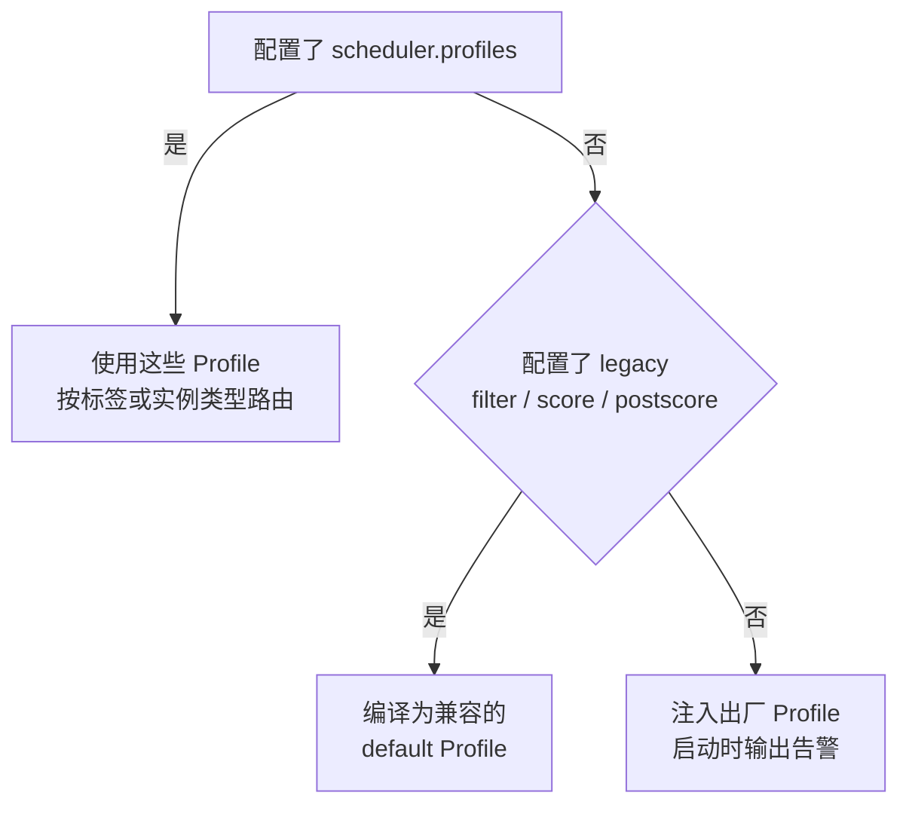

# CubeMaster 调度器配置参考

配置 CubeMaster 调度器只需要回答三个问题：配置写在哪、哪份配置在生效、怎么配。本页按这个顺序展开，末尾是排障参考。

只需要给多机部署加基础评分的话，看[多机集群部署](./multi-node-deploy.md#配置-cubemaster-调度评分)就够了。

## 配置在哪里

调度配置在 CubeMaster 的 `conf.yaml` 里。不同部署方式的文件位置：

| 部署方式 | 位置 |
|----------|------|
| one-click / systemd | `/usr/local/services/cubetoolbox/CubeMaster/conf.yaml` |
| 源码配置模板 | `configs/single-node/cubemaster.yaml` |
| Terraform / TKE | `tke-addons.tf` 中的 `kubernetes_secret.cubemaster_conf` |
| Helm chart | `chart/files/cube-master/conf.yaml`（渲染为 Secret） |

修改后重启或滚动更新 cube-master 使其生效。

节点的资源配额和标签不在这份配置里——它们由每台 Cubelet 自己上报。one-click 环境下 Cubelet 的配置在 `/usr/local/services/cubetoolbox/Cubelet/` 下：静态配置 `config/config.toml`（上报频率），动态配置 `dynamicconf/conf.yaml`（标签和配额），改完重启 Cubelet。动态配置长这样：

```yaml
host:
  scheduler_label: "default-cluster"
  quota:
    mcpu_limit: 0
    mem_limit: ""
    mvm_limit: 0
    creation_concurrent_num: 0
```

配额里的 `0` 表示让 Cubelet 按宿主机资源自动推导，不是无限。压测或高密度场景要显式设置这些值。

Terraform 部署的环境变量见[腾讯云集群部署](./tencentcloud-terraform-deploy.md)，计算节点的环境变量见[多机集群部署](./multi-node-deploy.md)。

## 哪份配置在生效

CubeMaster 按下面的优先级决定调度策略：



三个分支的行为：

- **配了 `profiles`**：按配置顺序做路由，第一个命中请求标签或实例类型的 Profile 生效，都没命中走标记为 `default: true` 的那个。
- **只配了 legacy 块**：编译成一个兼容的 `default` Profile，容错语义和 `priority_select_num`、`least_select_name` 的行为都保持不变。
- **全为空**：注入出厂 Profile（`burst_balance`、`template_reuse`、`mixed_binpack`），零配置也能按真实策略调度。因为放置行为和旧版的随机选点不同，注入时会打一条告警；想保持旧行为就设 `scheduler.disable_factory_profiles: true`。

有一个容易踩的坑：内置 Score（`real_time_weighted_average`、`image_score`、`multi_factor_weighted_average`）的因子开关不在 Profile 里配，而是始终读全局的 `scheduler.score` 树。Profile 引用了它们但缺这块配置，会在启动或热更新时报编译错误。出厂 Profile 自带这块配置，所以零配置部署不受影响；自己写 Profile 引用内置 Score 时要记得保留。

## 推荐配置

### 小集群

POC、功能验证、低并发场景。新建集群可以直接用，已有集群按需合并，不要整体覆盖：

```yaml
scheduler:
  priority_select_num: 3
  metric_update_timeout: 300s
  local_metric_update_timeout: 300s
  filter:
    enable_filters:
      - cpu
      - mem
      - template_locality
      - realtime_create_num
  score:
    enable_scorers:
      - real_time_weighted_average
    resource_weights:
      mvm_num: 2
      local_create_num: 3
      quota_cpu_usage: 1
      quota_mem_usage: 1
    plugin_conf:
      real_time_weighted_average:
        weight: 1.0
        enable_weight_factors:
          - mvm_num
          - local_create_num
          - quota_cpu_usage
          - quota_mem_usage
```

要点：至少 2 台计算节点；`priority_select_num` 从 3 开始，节点不够 3 台就设成节点数；Cubelet 上报周期和超时保持默认；配额用推导值即可，压测前再显式检查。

### 生产集群

规模上去之后，在起始配置基础上注意：

- 用 `host.scheduler_label` 把不同用途的节点分成节点池（通用、内存型、压测等），避免互相挤占。
- 大小规格混部时，给不同 `instance_type` 单独设 `node_max_mvm_num_conf`，不要共用一组上限。
- `priority_select_num` 调到健康节点数的一小部分即可，大到接近全量就退化成完全随机。
- `template_locality` 过滤器保持开启。
- 给 `host.quota.creation_concurrent_num` 设明确上限，防止单节点被突发创建打满。
- 控制面同步扩容（TKE 节点数、控制面副本数），别让 CubeMaster 或 cube-api 先成为瓶颈。

## 调度流程

一次创建请求进来后，CubeMaster 做四步：


过滤阶段会排除不健康、指标过期、超出 MVM 上限、缺模板副本、创建并发到顶、不满足亲和性的节点。打分基于 MVM 数、实时创建数、CPU/内存配额使用率加权。最后从评分靠前的候选里选：legacy 配置下由 `priority_select_num` 控制候选范围，Profile 模式下对应 `selection.method` 与 `selection.top_n`（见[调度插件](./scheduler-plugin.md#profile-配置)）。

没配评分时仍然会过滤，但选点会偏向候选列表的前几个节点，表现为新沙箱集中到少数机器，直到资源过滤器把流量推走。

::: details 字段参考

| 字段 | 作用 |
|------|------|
| `priority_select_num` | 最终选点从评分前 N 名里做。多节点建议大于 1，小集群从 3 开始。 |
| `metric_update_timeout` | 节点指标超过此时长视为过期、不可调度。应远大于上报周期。 |
| `local_metric_update_timeout` | 本地指标超时字段。当前预过滤对两类指标的新鲜度检查都用 `metric_update_timeout`。 |
| `filter.enable_filters` | 启用过滤器，常见有 CPU、内存、模板本地性、实时创建并发。 |
| `score.enable_scorers` | 启用评分器。多机部署通常启用 `real_time_weighted_average`，且必须配好对应的 `plugin_conf`，否则该评分器不生效（有 Warn 日志）。 |
| `score.resource_weights` | 各打分因子的权重；因子必须同时列在 `enable_weight_factors` 里。 |
| `node_max_mvm_num` / `node_max_mvm_num_conf` | 全局或按实例类型限制单节点 MVM 数，与 Cubelet 上报值共同决定实际上限。 |
| `disk_usage_max_percent` | 磁盘水位阈值，超过的节点被排除。 |
| `affinityconf` / `node_affinity_selector_allowed_keys` | 按标签、可用区、机型等做亲和约束。 |

:::

## 节点元数据

Cubelet 通过 CubeOps 的 `/internal/v1/node-agent` 接口注册并持续上报状态，数据落在 MySQL/Redis；CubeMaster 每隔几秒同步一次节点视图，调度时读的是本地缓存快照。

::: details Cubelet 上报了什么

| 上报内容 | 来源 | 用途 |
|----------|------|------|
| `instance_type` | 节点身份 | 匹配请求、选模板副本、套用按类型的上限 |
| `cluster_label` | `host.scheduler_label` | 节点池亲和与隔离 |
| `quota_cpu` / `quota_mem_mb` | `host.quota` 或宿主机推导 | 可调度容量，参与过滤和打分 |
| `max_mvm_num` | `host.quota.mvm_limit` 或内存推导 | 单节点 MVM 上限 |
| `create_concurrent_num` | `host.quota.creation_concurrent_num` | 创建并发；为 0 时调度层回落到 CubeMaster 自身的限流配置 |
| 资源用量 / 磁盘 / cgroup | 周期上报 | 使用率、磁盘水位、打分因子 |

这些值是每台节点独立配置的，异构集群里不同节点可以有不同的标签、配额和上限。
:::

## 扩容后的 template redo

新节点注册成功不代表模板已经在它上面可用——`template_locality` 过滤器要求目标节点有模板副本，否则创建会失败或继续落到旧节点。镜像构建的模板需要在扩容后执行一次 redo：

```bash
cubemastercli tpl redo --template-id <tpl-id> --node <node-ip>
```

`--node` 可重复传入多个节点；默认等待任务完成，`--detach` 只提交不等待，`--failed-only` 只重做失败的节点。redo 成功后再放开这个节点上的业务流量。

标准扩容顺序：装节点 → 确认节点健康、上报正常 → 对需要的模板执行 redo → 等任务成功 → 放流量。

## 排障

### 创建报 no more resource

按顺序检查：配额是否低于请求的资源需求（尤其还在用推导默认值时）；`mvm_num` 是否到上限；创建并发是否被打满。注意 `create_concurrent_num: 0` 在调度层仍会回落到 CubeMaster 的限流配置，不等于不限并发。

```bash
curl http://127.0.0.1:3010/internal/v1/nodes
sudo tail -F /data/log/CubeMaster/cubemaster-req.log
sudo tail -F /data/log/Cubelet/Cubelet-req.log
```

### 节点指标过期

日志出现 metric update timeout 时：确认计算节点的 `cube-sandbox-cubelet.service` 在跑；确认从计算节点能访问 CubeOps 地址；检查 `node_status_update_frequency` 有没有被误改；确认 `metric_update_timeout` 远大于上报周期。

### 模板不可用

新节点加入后创建仍只落旧节点，或日志提示模板本地副本不可用。确认请求的 `template_id`，对新增节点执行 redo，看模板 job 状态确认成功。不要通过关掉 `template_locality` 来绕过。

### 节点标签不匹配

请求带了 affinity 或 cluster label 但没有候选节点：对照 Cubelet 的 `host.scheduler_label` 和请求的标签；确认 `node_affinity_selector_allowed_keys` 放行了请求用的 selector key；异构节点池要确认模板已 redo 到对应实例类型。

### 创建集中在少数节点

确认 `score.enable_scorers` 已启用、`enable_weight_factors` 包含预期因子、`priority_select_num` 大于 1。再检查各节点的模板副本是否都可用——`template_locality` 会把缺副本的节点排除出候选集。

## 相关文档

- [多机集群部署](./multi-node-deploy.md)
- [腾讯云集群部署（Terraform）](./tencentcloud-terraform-deploy.md)
- [服务管理与日志](./service-management.md)
- [模板相关排障](./troubleshooting/templates.md)
