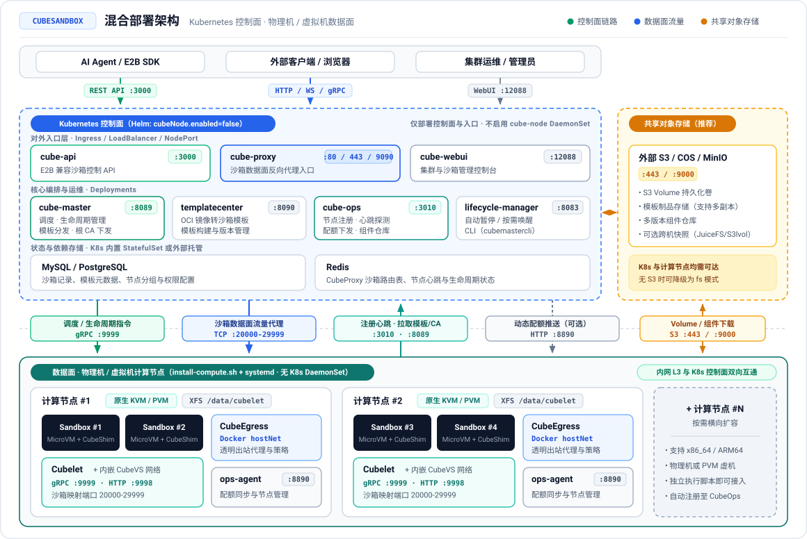

# 混合部署（K8s 控制面 + 物理机 / 虚拟机数据面）

本指南介绍如何采用**混合部署**架构运行 CubeSandbox：**控制面**通过 Helm Chart 部署在 Kubernetes 集群中，**数据面**（计算节点）以独立宿主机模式部署在物理机、裸金属服务器或普通虚拟机（支持原生 KVM 或 PVM）上，并接入 K8s 控制面接受统一编排与代理。

::: tip 为什么选择混合部署？
- **控制面云原生运维**：`cube-master`、`cube-templatecenter`、`cube-api`、`cube-ops`、`cube-proxy`、`cube-lifecycle-manager`、`cube-webui` 等控制面与入口组件运行在 Kubernetes 中，天然获得多副本、滚动升级、自愈、监控与标准 Ingress/LB 接入能力。
- **数据面零 K8s 耦合**：计算节点直接运行在物理机或虚拟机上，无需向 K8s 引入特权 `cube-node` DaemonSet，避免宿主机网络与 CNI（如 Cilium eBPF）或 Pod Security Admission 的冲突，也不受 kubelet 驱逐或 Pod 重建影响存量沙箱。
:::

::: warning 生产环境注意
在将集群暴露到不可信网络前，请参阅[网络加固](./network-hardening.md)与[API 鉴权](./authentication.md)。`CubeMaster`（8089）、`CubeOps`（3010）、`Cubelet` gRPC（9999）与 `ops-agent`（8890）属于内部控制链路，**切勿暴露到公网**，仅允许集群内网互通。
:::

## 1. 架构概览



### 组件分工

| 层级 | 部署载体 | 包含组件 | 职责说明 |
| --- | --- | --- | --- |
| **控制面与入口** | Kubernetes（Helm Chart，`cubeNode.enabled=false`） | `cube-master`、`cube-templatecenter`、`cube-api`、`cube-ops`、`cube-proxy`、`cube-lifecycle-manager`、`cube-webui`、`cubemastercli` | 集群调度、模板构建与分发、E2B API、节点管理、沙箱流量反代、自动暂停/恢复、控制台 |
| **依赖存储** | K8s 内置 StatefulSet 或外部托管服务 | MySQL / PostgreSQL、Redis、S3 / COS / MinIO | 元数据存储、路由与生命周期状态、Volume / 模板制品 / 组件仓库存储 |
| **数据面（计算节点）** | 物理机 / 裸金属 / 虚拟机（`install-compute.sh` + systemd） | `Cubelet`（内置 network runtime / CubeVS）、`CubeShim`、`CubeEgress`、`ops-agent` | 启动与管理 MicroVM 沙箱、节点状态上报、出站透明代理与策略执行、动态配额同步 |

## 2. 部署前置要求

### 2.1 控制面要求（Kubernetes 集群）

| 项目 | 要求 | 说明 |
| --- | --- | --- |
| Kubernetes 版本 | **≥ v1.24** | 托管集群（TKE / EKS / ACK 等）或自建 K8s 均可 |
| 客户端工具 | `kubectl`、**Helm ≥ v3.10** | 能够操作目标集群并执行 `helm upgrade --install` |
| 控制面节点规格 | ≥ 1 台（生产建议 ≥ 3 台）；每台 ≥ 4C8G | 仅需为控制面节点打标签 `cube.tencent.com/cube-control=true`，**不要**打 `cube-node=true` |
| 持久化存储与依赖服务 | **建议使用外部高可用 MySQL（或 PostgreSQL）、Redis、S3 服务** | 配合 `controlPlane.artifactStore.s3Backed: true` 可让控制面完全无状态，无需依赖 K8s 侧 StorageClass / PVC；仅在测试环境使用 Chart 内置 MySQL / Redis 或 `fs` 模式时，才需要集群提供可用的 `StorageClass`（可通过 `persistence.storageClassName` 指定） |
| Service 暴露能力 | 内网 `LoadBalancer`（推荐）或 `NodePort` | 计算节点需从集群外访问 `cube-master`（8089）和 `cube-ops`（3010）；客户端需访问 `cube-api`、`cube-proxy`、`cube-webui` |
| 镜像拉取 | 节点可连通官方镜像库，或将所需镜像导入私有镜像仓库 | 官方境外库为 `cube-sandbox-int.tencentcloudcr.com`，中国大陆环境可追加 `-f deploy/kubernetes/chart/values-cn.yaml` 切换至 `cube-sandbox-cn.tencentcloudcr.com`；无公网或使用私有镜像仓库时，详见[第 5 节：离线与私有镜像仓库部署](#offline-deployment) |

### 2.2 数据面要求（物理机 / 虚拟机）

每台作为数据面的物理机或虚拟机需满足以下条件：

- **虚拟化能力（二选一）**：
  - **物理机 / 裸金属 / 支持嵌套虚拟化的虚拟机**：`x86_64` 或 `aarch64`（ARM64）Linux 主机，`/dev/kvm` 存在且可用（`ls -la /dev/kvm`）。
  - **无 `/dev/kvm` 的普通云服务器 / 虚拟机**：仅支持 **`x86_64`**；需先安装 **PVM 宿主机内核** 并重启（推荐操作系统 **OpenCloudOS 9**，也支持 Ubuntu / Debian / RHEL / CentOS），安装数据面时启用 `CUBE_PVM_ENABLE=1`。
- **硬件规格**：单节点最低 **4C8G**、系统盘 ≥ 50 GB；生产环境建议 **16C32G+** 并挂载独立数据盘。
- **文件系统（硬性要求）**：`/data/cubelet` 必须位于 **XFS** 文件系统上（`df -T /data/cubelet` 输出为 `xfs`），否则 `install-compute.sh` 预检会直接中止。生产环境建议为每台计算节点挂载独立数据盘并格式化为 XFS。
- **容器运行时（必需）**：已安装并运行 **Docker**（**不支持 Snap 版 Docker**）。即使计算节点不跑控制面容器，`cube-egress` 仍以宿主机网络 Docker 容器形态运行。
- **cgroup 与内核**：Linux 内核版本 **≥ 5.4**（`uname -r`），cgroup v2 需启用 `cpu` 控制器（或使用 cgroup v1），且需要 **root** 权限执行安装。
- **版本一致**：物理机 / 虚拟机使用的发布包（`cube-sandbox-one-click-<version>.tar.gz`）应与 Kubernetes Helm Chart 使用的组件镜像版本保持一致。

### 2.3 网络连通性与端口矩阵

混合部署最关键的前置条件是 **Kubernetes 控制面 Pod 与物理机 / 虚拟机计算节点之间的三层网络双向互通**：

1. **K8s Pod → 计算节点可直连**：`cube-master`、`cube-ops`、`cube-proxy` 等 Pod 必须能够直接路由到每台计算节点的 `CUBE_SANDBOX_NODE_IP`（无需 NAT 回环或跨网段阻断）。通常建议 K8s 节点与物理机 / 虚拟机处于同一 VPC / 内网路由域，且计算节点安全组/防火墙对 K8s Pod CIDR 与 Node CIDR 放行必要端口。
2. **计算节点 → K8s 控制面可达**：计算节点必须能够访问 Kubernetes 暴露出来的 `cube-master`（8089 或对应 NodePort）与 `cube-ops`（3010 或对应 NodePort）地址。
3. **网段不冲突**：计算节点本地 CubeVS 沙箱网段 `CUBE_SANDBOX_NETWORK_CIDR`（默认 `192.168.0.0/18`，掩码范围 `/16`～`/24`）**不得**与宿主机网卡网段、VPC CIDR、Kubernetes Pod CIDR 或 Service CIDR 重叠。

| 方向 | 源端 | 目标端 | 端口 / 协议 | 用途 | 暴露范围建议 |
| --- | --- | --- | --- | --- | --- |
| 数据面 → 控制面 | 计算节点（Cubelet / ops-agent） | K8s `cube-ops` Service | `3010/tcp`（或 NodePort） | 节点注册、心跳上报、ops-agent 拉取配额、`fs` 模式组件下载 | **仅内网** |
| 数据面 → 控制面 | 计算节点（Cubelet / CubeEgress） | K8s `cube-master` Service | `8089/tcp`（或 NodePort） | 拉取 CubeEgress MITM 根 CA（`/cube/ca/*`）、下载模板 rootfs 制品、健康探活 | **仅内网** |
| 数据面 → 对象存储 | 计算节点（Cubelet / s3fs） | 外部 S3 / COS / MinIO | `443/tcp` 或 `9000/tcp` | S3 Volume 挂载、S3 组件仓库预签名下载（可选 JuiceFS / CubeS3lvol） | **仅内网**（或云对象存储端点） |
| 控制面 → 数据面 | K8s `cube-master` Pod | 计算节点（Cubelet gRPC） | `9999/tcp` | 沙箱创建/销毁/暂停/恢复、模板分发、快照操作 | **仅 K8s Pod/Node 网段** |
| 控制面 → 数据面 | K8s `cube-proxy` Pod | 计算节点（CubeVS 端口映射） | `20000-29999/tcp` | 代理转发沙箱 HTTP / HTTPS / WebSocket / gRPC 流量 | **仅 K8s Pod/Node 网段** |
| 控制面 → 数据面 | K8s `cube-ops` Pod | 计算节点（`ops-agent`） | `8890/tcp` | 动态配额配置实时推送（若未放通则退化为 300s 定时拉取） | **仅 K8s Pod/Node 网段** |
| 客户端 → 入口 | SDK / 业务后端 | K8s `cube-api` Service | `3000/tcp`（或 LB/NodePort） | E2B 兼容沙箱控制 API | 按需内网或公网（公网须配[鉴权](./authentication.md)） |
| 客户端 → 入口 | SDK / 浏览器 | K8s `cube-proxy` Service / Ingress | `80/tcp`、`443/tcp`、`9090/tcp` | 沙箱数据面访问入口（`*.domain` / `/sandbox/...`） | 按需内网或公网 |
| 运维 → 入口 | 管理员浏览器 | K8s `cube-webui` Service | `12088/tcp`（或 `port-forward`） | WebUI 管理控制台 | **仅内网 / 办公网白名单** |

### 2.4 时钟同步（必需）

Kubernetes 控制面所在的所有节点，以及全部物理机 / 虚拟机计算节点，都必须启用统一的时间同步服务（如 `chrony`、`ntpd`、`systemd-timesyncd` 或 PTP）。

::: warning 保持时钟偏差远小于 15 秒
如果计算节点时间落后于控制面，其上报的心跳可能超过 15 秒的过期窗口，导致 `CubeOps` / `CubeMaster` 将该节点判定为不健康并拒绝调度与模板分发。
:::

### 2.5 持久化存储与外部依赖规划

生产环境**强烈建议使用外部高可用 MySQL（或 PostgreSQL）、高可用 Redis（托管主从 / Sentinel / Redis Cluster）以及外部共享 S3 / COS / MinIO**，让 Kubernetes 控制面保持无状态且易于水平扩展：

- **外部数据库（MySQL / PostgreSQL）**：填写 `mysql.host`（或设置 `database.driver: postgres` 并填写 `postgres.host`）后，Chart 会自动跳过内置 MySQL StatefulSet。
- **外部高可用 Redis**：支持单入口高可用（`redis.host`）、Redis Sentinel（`redis.masterName` + `redis.sentinelNodes`）以及原生 Redis Cluster（`redis.clusterNodes`），配置任一外部模式均会自动跳过内置 Redis StatefulSet。
- **对象存储（必须规避内置 MinIO 跨集群不可达问题）**：Helm Chart 默认内置的 MinIO 使用的是 **Headless Service（`clusterIP: None`）**，仅在 Kubernetes 集群内部 DNS 可达，**集群外的物理机 / 虚拟机计算节点无法直接访问**。请在安装前选定以下两种对象存储方案之一：
  - **方案 A：使用外部高可用 S3 / COS / MinIO（推荐，支持完整功能与控制面多副本）**
    - 准备一个 K8s 集群与物理机 / 虚拟机**都能访问**的 S3 兼容对象存储（例如腾讯云 COS、AWS S3、或独立高可用 MinIO）。
    - Helm 侧关闭内置 MinIO（`minio.enabled: false`），配置 `volumeS3.*` 并开启 `controlPlane.artifactStore.s3Backed: true`（CubeOps 组件仓库、S3 Volume 与模板制品存储自动复用该 S3 配置；控制面多副本时还可设置 `controlPlane.master.persistence.enabled: false` 与 `controlPlane.templateCenter.colocateWithMaster: false`，彻底摆脱 K8s PVC 依赖）。
    - 计算节点 `.env` 中填写相同的 `CUBE_S3_*` 配置，即可正常使用 S3 Volume 插件与组件多版本仓库。
  - **方案 B：无外部 S3（文件系统 / PVC 模式，适合快速验证）**
    - Helm 侧关闭内置 MinIO（`minio.enabled: false`），并将模板制品与组件仓库均切换为文件系统后端：`controlPlane.artifactStore.backend: fs`、`cubeOps.store.backend: fs`，同时将 `cubeOps.store.fs.publicURL` 设为计算节点可达的 `http://<K8s-CubeOps-外部地址>`（此模式需要集群提供可用 StorageClass）。
    - 此模式下模板构建、分发和组件仓库均可经 HTTP 正常工作，但 S3 Volume 插件不可用（计算节点安装时仅会打印黄色告警并继续）。

## 3. 部署步骤

整体部署流程如下：

```text
① K8s 准备控制面节点（打标签 / 可选污点）
    ↓
② 编写混合部署控制面 values（cubeNode.enabled=false + Service 暴露 + 存储配置）
    ↓
③ Helm 安装 K8s 控制面，并记录暴露出的 CubeMaster / CubeOps 地址
    ↓
④ 准备物理机 / 虚拟机（KVM 或 PVM 内核、XFS 数据盘、Docker、时钟同步）
    ↓
⑤ 在物理机 / 虚拟机配置 .env 并执行 install-compute.sh 接入控制面
    ↓
⑥ 多节点调度评分与客户端接入配置
```

### 第一步：部署 Kubernetes 控制面

#### 1.1 确认集群就绪并给控制面节点打标签

```bash
kubectl get nodes -o wide
kubectl get storageclass
helm version --short
```

为承载 CubeSandbox 控制面的 K8s 节点打上 `cube-control=true` 标签（如有多台控制面节点，可逐台执行）：

```bash
kubectl label nodes <control-node-1> cube.tencent.com/cube-control=true --overwrite

# 可选：添加污点防止无关业务 Pod 调度到控制面节点
# kubectl taint nodes <control-node-1> cube.tencent.com/control=true:NoSchedule --overwrite
```

::: tip 无需在 K8s 侧标记计算节点
由于数据面运行在集群外的物理机 / 虚拟机上，本步骤**不要**给 K8s 节点打 `cube.tencent.com/cube-node=true` 或 `cube.tencent.com/allow-pvm-bootstrap=true` 标签。
:::

#### 1.2 准备控制面 Helm 配置文件

在独立的本地部署工作目录（例如 `~/cube-deploy/`，建议与代码仓库分离并妥善保管其中的数据库、Redis 与 S3 凭据）中创建 `hybrid-control-plane-values.yaml`。以下示例采用生产推荐的**外部高可用 MySQL + 外部高可用 Redis + 外部 S3**配置（若使用私有镜像仓库，可将[第 5 节：离线与私有镜像仓库部署](#offline-deployment)中的字段合并到此文件中）：

```yaml
# 关键开关：禁用 K8s 侧所有计算面 DaemonSet（cube-node / installer / bootstrap / pvm）
cubeNode:
  enabled: false

# --- 外部高可用数据库（推荐；填写 host 后自动跳过内置 MySQL StatefulSet） ---
database:
  driver: mysql              # 如使用外部 PostgreSQL，改为 postgres 并配置下方 postgres.*
mysql:
  host: "<ha-mysql-host>"
  port: 3306
  database: "cube_mvp"
  user: "cube"
  password: "<mysql-password>"

# 如使用外部 PostgreSQL：
# postgres:
#   host: "<ha-postgres-host>"
#   port: 5432
#   database: "cube_mvp"
#   user: "cube"
#   password: "<postgres-password>"

# --- 外部高可用 Redis（推荐；自动跳过内置 Redis StatefulSet） ---
# 方式 1：托管高可用 Redis 单入口（host 需填 FQDN 或 IP）
redis:
  host: "<ha-redis-host>"
  port: 6379
  password: "<redis-password>"
  db: 0
# 方式 2：Redis Sentinel（留空 redis.host）
#   masterName: "mymaster"
#   sentinelNodes: "10.0.0.11:26379,10.0.0.12:26379,10.0.0.13:26379"
#   sentinelPassword: ""
# 方式 3：Redis Cluster（留空 redis.host 与 masterName，且 db 必须为 0）
#   clusterNodes: "10.0.0.21:6379,10.0.0.22:6379,10.0.0.23:6379"

# --- 暴露控制面服务供外部物理机/虚拟机计算节点访问 ---
controlPlane:
  artifactStore:
    s3Backed: true           # 模板制品存入外部 S3，支持控制面无状态与多副本高可用
  master:
    replicas: 2              # 生产建议 ≥ 2；单副本测试可设为 1
    persistence:
      enabled: false         # s3Backed=true 时无需 RWO PVC，支持多副本跨节点调度
    service:
      # 推荐使用内网 LoadBalancer（如云厂商内网 LB / MetalLB），
      # 无 LB 环境可改为 NodePort（部署后通过 kubectl get svc 查询分配端口）
      type: LoadBalancer
      port: 8089
  templateCenter:
    replicas: 2              # s3Backed=true 时支持多副本；单副本测试可设为 1
    colocateWithMaster: false
  api:
    replicas: 2
    sandboxDomain: "cube.app"
    service:
      type: LoadBalancer     # 或 NodePort（支持设置 nodePort: 30030）
      port: 3000

cubeOps:
  enabled: true
  replicas: 2
  service:
    type: LoadBalancer       # 或 NodePort
    port: 3010

# --- 数据面代理与 WebUI 入口 ---
cubeProxy:
  enabled: true
  domain: "cube.app"
  advertiseIP: ""            # 可选：填写对外访问 IP 供提示
  # 混合部署中如不希望修改 kube-system/coredns，可设为 false
  configureClusterDNS: true
  service:
    type: LoadBalancer       # 或 NodePort + nodePorts.{http,https,grpc}
  ingress:
    enabled: false           # 若通过 Ingress Controller 暴露，则改为 true 并保持 service.type: ClusterIP
  tls:
    mode: selfSigned         # 试用；生产环境建议使用 existingSecret 或 certManager

webui:
  enabled: true
  service:
    type: ClusterIP          # 默认建议 ClusterIP 配合 port-forward，或改用内网 LB

# --- 外部高可用共享 S3 / COS / MinIO（推荐） ---
minio:
  enabled: false

volumeS3:
  endpoint: "https://<s3-endpoint>"         # 必须同时被 K8s Pod 与物理机/虚拟机访问
  accessKeyId: "<s3-access-key>"
  secretAccessKey: "<s3-secret-key>"
  bucket: "cube-volumes"
  region: "us-east-1"
  pathStyle: false                          # MinIO 或 path-style S3 请设为 true
  extraOpts: ""                             # MinIO 或 path-style S3 请填 "-ouse_path_request_style"
```

::: details 仅测试/PoC 场景：使用 K8s 内置 MySQL / Redis（依赖集群 StorageClass）
如果仅做临时验证、暂无外部数据库与 Redis，可将上方 `mysql` 与 `redis` 段改为留空 `host`（Chart 会自动创建单副本内置 StatefulSet 并申请 PVC，同时必须替换默认 `CHANGE_ME_*` 密码）：

```yaml
mysql:
  host: ""
  password: "replace-me-mysql-password"
  rootPassword: "replace-me-mysql-root-password"

redis:
  host: ""
  password: "replace-me-redis-password"
```
:::

::: details 方案 B：无外部 S3 时的配置片段
如果没有外部 S3 / COS，可替换上述 `minio` 与 `volumeS3` 段为以下配置（`cubeOps.store.fs.publicURL` 需设为计算节点可达的 CubeOps 地址；若使用 NodePort 可在首次获取端口后回填并再次 `helm upgrade`）：

```yaml
minio:
  enabled: false

controlPlane:
  artifactStore:
    backend: fs

cubeOps:
  store:
    backend: fs
    fs:
      publicURL: "http://<K8s-CubeOps-外部可达IP>:<端口>"
```
:::

::: details 云托管 K8s（如 TKE / ACK / EKS）需要为内网 LB 添加注解或固定 NodePort？
当前 Chart 模板中 `controlPlane.master.service` 与 `cubeOps.service` 仅暴露 `type` 和 `port` 字段。如果云厂商默认把 `LoadBalancer` 创建为**公网**负载均衡，建议将上述两项保持 `type: ClusterIP`，并额外 apply 一个带内网 LB 注解（或固定 NodePort）的伴生 `Service` 指向相同的 Selector，避免把 8089 / 3010 暴露到公网：

```yaml
apiVersion: v1
kind: Service
metadata:
  name: cube-master-internal
  namespace: cube-system
  annotations:
    # 按所用云厂商替换为内网 LB 注解，例如 TKE:
    # service.kubernetes.io/qcloud-loadbalancer-internal-subnetid: subnet-xxxxxxxx
spec:
  type: LoadBalancer
  selector:
    app.kubernetes.io/name: cube
    app.kubernetes.io/instance: cube
    app.kubernetes.io/component: master
  ports:
    - name: cubemaster
      port: 8089
      targetPort: cubemaster
---
apiVersion: v1
kind: Service
metadata:
  name: cube-ops-internal
  namespace: cube-system
  annotations:
    # 按所用云厂商替换为内网 LB 注解
spec:
  type: LoadBalancer
  selector:
    app.kubernetes.io/name: cube
    app.kubernetes.io/instance: cube
    app.kubernetes.io/component: ops
  ports:
    - name: http
      port: 3010
      targetPort: http
```
:::

#### 1.3 使用 Helm 安装控制面

::: tip 中国大陆用户
在下方命令中追加 `-f <chart-dir>/values-cn.yaml`，即可从国内镜像源拉取镜像。
:::

将 `<chart-dir>` 替换为本地 Helm Chart 目录（例如 `CubeSandbox/deploy/kubernetes/chart`）或离线打包后的 Chart `.tgz` 路径，并指定步骤 1.2 创建的配置文件路径：

```bash
helm upgrade --install cube <chart-dir> \
  -n cube-system \
  --create-namespace \
  -f ~/cube-deploy/hybrid-control-plane-values.yaml \
  --wait \
  --timeout 30m
```

#### 1.4 获取并记录控制面访问地址

```bash
kubectl get svc -n cube-system -o wide
```

记录以下两个地址（后续物理机 / 虚拟机接入会用到）：

- **`MASTER_ADDR`**：`cube-master` 对外可达的 `<内网LB-IP>:8089` 或 `<K8s节点IP>:<master-NodePort>`
- **`OPS_ADDR`**：`cube-ops` 对外可达的 `<内网LB-IP>:3010` 或 `<K8s节点IP>:<ops-NodePort>`

同时记下 `cube-api`（`3000`）与 `cube-proxy`（`80`/`443`/`9090`）的访问入口供客户端和验收阶段使用。

---

### 第二步：准备物理机 / 虚拟机数据面节点

以下命令均需在每台计算节点上以 **root** 身份执行（`sudo su root`）。

#### 2.1 确认虚拟化环境（原生 KVM 或 PVM）

- **场景 A：物理机 / 裸金属 / 已开启嵌套虚拟化的虚拟机（x86_64 或 aarch64）**

  直接检查 KVM 设备是否存在且可读写：

  ```bash
  ls -la /dev/kvm
  lsmod | grep kvm
  ```

  确认输出包含 `/dev/kvm` 与 `kvm_intel` / `kvm_amd`（或 ARM64 内核内置 KVM）即可继续下一步。

- **场景 B：无 `/dev/kvm` 的普通云服务器 / 虚拟机（仅 x86_64）**

  按 [PVM 部署](./pvm-deploy.md#第一步安装-pvm-宿主机内核) 为宿主机安装 PVM 内核并重启：

  1. 前往 [CubeSandbox Releases](https://cnb.cool/CubeSandbox/CubeSandbox/-/releases) 筛选 `kernel-release`，按发行版下载对应的 PVM 宿主机内核包（RPM 或 DEB）。
  2. 安装内核、设为默认启动项并应用 GRUB 启动参数（`host_grub_config.sh`），然后执行 `reboot`。
  3. 重启后加载并持久化 `kvm_pvm` 模块：

  ```bash
  uname -r               # 期望包含 opencloudos9.cubesandbox.pvm.host
  modprobe kvm_pvm
  echo 'kvm_pvm' > /etc/modules-load.d/kvm-pvm.conf
  ls -la /dev/kvm
  lsmod | grep kvm_pvm
  ```

#### 2.2 准备 `/data/cubelet` 的 XFS 文件系统

检查 `/data/cubelet` 所在挂载点是否已为 XFS：

```bash
mkdir -p /data/cubelet
df -T /data/cubelet
```

如果文件系统类型**不是 `xfs`**，请挂载一块独立数据盘（或独立分区）并格式化为 XFS（将 `/dev/vdb` 替换为实际未使用的块设备）：

```bash
mkfs.xfs /dev/vdb
mkdir -p /data/cubelet
mount /dev/vdb /data/cubelet

# 写入 /etc/fstab 确保持久化挂载
UUID="$(blkid -s UUID -o value /dev/vdb)"
echo "UUID=${UUID} /data/cubelet xfs defaults 0 0" >> /etc/fstab

df -T /data/cubelet
```

#### 2.3 检查 Docker、时钟同步与到 K8s 控制面的网络连通性

```bash
# 1) 确认非 Snap 版 Docker 正常运行
docker info >/dev/null && which docker

# 2) 确认时钟同步正常
timedatectl status || chronyc tracking

# 3) 验证到 K8s 控制面的连通性（替换为步骤 1.4 记录的地址）
curl -fsS "http://<MASTER_ADDR>/notify/health"
curl -fsS "http://<OPS_ADDR>/health"
```

确认上述两个健康检查接口均返回成功后再执行安装。

---

### 第三步：在物理机 / 虚拟机上部署数据面

#### 3.1 下载并解压发布包

从 [GitHub Releases](https://github.com/TencentCloud/CubeSandbox/releases) 或 [CNB Releases（国内）](https://cnb.cool/CubeSandbox/CubeSandbox/-/releases) 下载与 Kubernetes Helm Chart **相同版本** 的发布包（ARM64 物理机下载 `*-arm64.tar.gz`）：

```bash
tar -xzf cube-sandbox-one-click-<version>.tar.gz
cd cube-sandbox-one-click-<version>
```

#### 3.2 配置 `.env`

```bash
cp env.example .env
```

编辑 `.env`，填写以下关键配置：

```bash
# 部署角色：计算节点固定为 compute
ONE_CLICK_DEPLOY_ROLE=compute

# 当前物理机/虚拟机的主网卡内网 IP（必须能被 K8s 控制面 Pod 直接路由到达）
CUBE_SANDBOX_NODE_IP=<当前计算节点内网IP>

# 关键：K8s 控制面中 cube-master 与 cube-ops 往往拥有不同的 LB IP 或 NodePort。
# 请保持 ONE_CLICK_CONTROL_PLANE_IP 为空，改为分别显式指定以下两个地址！
ONE_CLICK_CONTROL_PLANE_IP=
ONE_CLICK_CONTROL_PLANE_CUBEMASTER_ADDR=<MASTER_ADDR>   # 例如 10.0.1.20:8089 或 10.0.1.10:31889
ONE_CLICK_CONTROL_PLANE_CUBEOPS_ADDR=<OPS_ADDR>         # 例如 10.0.1.21:3010 或 10.0.1.10:31010

# 虚拟化模式：物理机 / 原生 KVM 填 0；PVM 虚拟机必须填 1
CUBE_PVM_ENABLE=0

# 如默认 192.168.0.0/18 与 VPC 或 K8s Pod/Service CIDR 冲突，请指定无冲突私网段（/16~/24）
# CUBE_SANDBOX_NETWORK_CIDR=10.100.0.0/18

# 中国大陆环境建议取消注释，从国内源拉取 cube-egress 镜像
# MIRROR=cn
# 若使用私有镜像仓库，可直接显式指定 cube-egress 镜像地址：
# CUBE_SANDBOX_CUBE_EGRESS_IMAGE=registry.internal.example.com/cube-sandbox/cube-egress:<version>

# 若 K8s 侧采用方案 A（外部 S3），填写完全一致的 S3 配置供 Volume 插件使用
CUBE_S3_ENDPOINT=http://<s3-endpoint>:9000
CUBE_S3_ACCESS_KEY_ID=<s3-access-key>
CUBE_S3_SECRET_ACCESS_KEY=<s3-secret-key>
CUBE_S3_BUCKET=cube-volumes
CUBE_S3_REGION=us-east-1
CUBE_S3_S3FS_EXTRA_OPTS=-ouse_path_request_style
```

::: warning 两个常见配置陷阱
1. **不要同时混填 `ONE_CLICK_CONTROL_PLANE_IP` 与不同端口/IP 的 `ONE_CLICK_CONTROL_PLANE_CUBEMASTER_ADDR`**：安装脚本预检会严格比对两者，若不一致将直接报错退出。在 K8s 混合部署中，最稳妥的做法是**将 `ONE_CLICK_CONTROL_PLANE_IP` 留空**，显式填写 `ONE_CLICK_CONTROL_PLANE_CUBEMASTER_ADDR` 和 `ONE_CLICK_CONTROL_PLANE_CUBEOPS_ADDR`。
2. **PVM 虚拟机必须在 `.env` 中修改 `CUBE_PVM_ENABLE=1`**：由于安装脚本会加载同目录 `.env`，仅在命令行前置传入环境变量会被 `.env` 中的 `CUBE_PVM_ENABLE=0` 覆盖。
:::

#### 3.3 执行计算节点安装脚本

```bash
sudo ./install-compute.sh
```

`install-compute.sh` 在混合模式下会自动完成以下操作：

1. 安装 `Cubelet`（内嵌 network runtime 与 CubeVS）、`CubeShim`、guest 内核（按 `CUBE_PVM_ENABLE` 选择普通版或 PVM 版）、guest 镜像、`cube-agent.ext4`、`ops-agent` 及 `CubeEgress` 运行时脚本。
2. 将 `Cubelet/dynamicconf/conf.yaml` 中的 `meta_server_endpoint` 指向 K8s `CubeOps`（`OPS_ADDR`），将 `cubemaster_http_addr` 指向 K8s `CubeMaster`（`MASTER_ADDR`）——后续 CubeMaster 下发模板制品下载 URL 时，Cubelet 会自动将域名重写为 `cubemaster_http_addr`，无需计算节点解析 K8s 集群内 DNS。
3. 将 `ops-agent` 指向 K8s `CubeOps`，并监听 `0.0.0.0:8890`。
4. 通过 `cube-egress-prepare.sh` 自动从 K8s `CubeMaster`（`http://<MASTER_ADDR>/cube/ca/...`）拉取与控制面完全一致的 CubeEgress MITM 根 CA，确保 K8s 中构建的模板与计算节点上运行的 `CubeEgress` 信任链一致。
5. 启动 `cube-sandbox-compute.target` 下的计算面服务，并自动运行 `quickcheck.sh` 完成基础自检。

#### 3.4 扩容多台计算节点与客户端接入

- **扩容更多计算节点**：在每台新增的物理机或虚拟机上重复**第二步**与**第三步**即可自动注册入集群。多节点集群建议配置 CubeMaster 调度评分，并在扩容后按需执行 `template redo`，详见 [CubeMaster 调度器配置参考](./cubemaster-scheduler-config.md)。
- **客户端连接集群**：通过 K8s 暴露的 `cube-api` 与 `cube-proxy` 接入客户端（支持泛域名 DNS、CubeSandbox SDK 直连、路径模式或 E2B Header 模式），详见[从客户端连接集群](./multi-node-deploy.md#从客户端连接集群)与[HTTPS 证书与域名解析](./https-and-domain.md)。

---

## 4. 部署后的检查

建议按**控制面 → 数据面 → 跨平面注册与连通 → 端到端业务闭环**四个层次逐项验收。

### 4.1 控制面检查（Kubernetes 侧）

1. **确认控制面 Pod 全部 Ready，且未部署任何 K8s 计算面 DaemonSet**：

```bash
kubectl get pods -n cube-system -o wide
kubectl get ds -n cube-system
```

期望结果：
- `cube-master`、`cube-templatecenter`、`cube-api`、`cube-ops`、`cube-proxy`、`cube-lifecycle-manager`、`cube-webui`、`cube-cubemastercli`（以及内置 MySQL / Redis）均为 `Running` 且 `READY`。
- `kubectl get ds -n cube-system` 无 `cube-node`、`cube-node-installer`、`cube-node-bootstrap`、`cube-node-pvm` 资源。

2. **确认各 Service 暴露正常**：

```bash
kubectl get svc -n cube-system
```

3. **运行 Helm 内置健康测试**：

```bash
helm test cube -n cube-system --timeout 10m --logs
```

期望结果：测试通过（在 `cubeNode.enabled=false` 下，`health-test` 会验证 CubeMaster / CubeOps / CubeAPI / WebUI / CubeProxy 以及内置 DB / Redis / DNS，并自动跳过 K8s 集群内 `cube-node` 检查）。

### 4.2 数据面检查（每台物理机 / 虚拟机）

1. **执行一键烟雾检查（`smoke.sh`）**：

```bash
cd cube-sandbox-one-click-<version>
sudo ./smoke.sh
```

`smoke.sh` 会调用 `quickcheck.sh`，逐项验证：
- `cube-sandbox-cubelet.service`、`cube-sandbox-cube-egress-net.service`、`cube-sandbox-ops-agent.service` 处于 `active`
- `ops-agent` 本地健康接口 `http://127.0.0.1:8890/health` 正常
- `Cubelet` 内嵌 network runtime `http://127.0.0.1:9998/v1/policies/dump` 正常
- 远端 K8s `CubeMaster` `/notify/health` 可达
- 当前节点已成功注册至远端 K8s `CubeOps`（`/internal/v1/nodes/<node_id>` 返回包含本机 IP）
- `/data/cubelet/cubelet.sock` 与核心运行时资产文件就绪

2. **检查所有计算面 systemd 服务与 CubeEgress 健康状态**：

```bash
systemctl status \
  cube-sandbox-cubelet \
  cube-sandbox-cube-egress-net \
  cube-sandbox-cube-egress \
  cube-sandbox-ops-agent \
  --no-pager

# 检查 CubeEgress 进程健康
curl -fsS http://127.0.0.1:9091/admin/v1/health
```

3. **核对 CubeEgress CA 与 K8s 控制面一致**：

```bash
# 在计算节点查看 CA 证书指纹
sha256sum /etc/cube/ca/cube-root-ca.crt

# 在 K8s 侧对比 Secret 中的 CA 证书指纹（两者必须完全一致）
kubectl get secret -n cube-system cube-egress-ca \
  -o jsonpath='{.data.cube-root-ca\.crt}' | base64 -d | sha256sum
```

4. **检查虚拟化与磁盘（PVM 虚拟机额外核对）**：

```bash
df -T /data/cubelet            # 期望文件系统为 xfs
ls -la /dev/kvm                # 期望存在且可读写

# 仅 PVM 虚拟机需要核对以下三项：
uname -r                       # 期望包含 opencloudos9.cubesandbox.pvm.host
lsmod | grep kvm_pvm           # 期望已加载 kvm_pvm
grep CUBE_PVM_ENABLE /usr/local/services/cubetoolbox/.one-click.env   # 期望 =1
```

### 4.3 跨平面注册与连通性检查

1. **从 K8s 控制面查询已注册的计算节点列表与分组**：

```bash
kubectl exec -n cube-system deploy/cube-cubemastercli -- \
  sh -lc 'cubeopscli --address "$CUBEOPSCLI_ADDRESS" --port "$CUBEOPSCLI_PORT" node list'

kubectl exec -n cube-system deploy/cube-cubemastercli -- \
  sh -lc 'cubeopscli --address "$CUBEOPSCLI_ADDRESS" --port "$CUBEOPSCLI_PORT" node groups'
```

期望结果：每一台物理机 / 虚拟机计算节点均出现在列表中，IP 与 `CUBE_SANDBOX_NODE_IP` 一致，且健康状态为正常（不带 `(down)` 标记）。

2. **验证 K8s 控制面 Pod 可主动访问计算节点端口**：

```bash
# 从 cubemastercli Pod 探测计算节点 Cubelet gRPC (9999) 与 ops-agent (8890)
kubectl exec -n cube-system deploy/cube-cubemastercli -- \
  sh -lc 'nc -zv -w 3 <计算节点IP> 9999 && nc -zv -w 3 <计算节点IP> 8890'
```

3. **确认 WebUI 控制台可见所有计算节点**：

```bash
kubectl -n cube-system port-forward svc/cube-webui 12088:12088
# 浏览器打开 http://127.0.0.1:12088，进入「节点管理」查看节点状态与版本矩阵
```

### 4.4 端到端业务闭环验收

完整验证**模板构建（K8s）→ 制品分发（K8s → 物理机/虚拟机）→ 沙箱调度与启动（物理机/虚拟机）→ 代理数据面访问（K8s CubeProxy → 物理机/虚拟机）**：

1. **构建并分发测试模板**：

```bash
# 国内优先使用 cube-sandbox-cn.tencentcloudcr.com，境外使用 cube-sandbox-int.tencentcloudcr.com
kubectl exec -n cube-system deploy/cube-cubemastercli -- \
  sh -lc 'cubemastercli --address "$CUBEMASTERCLI_ADDRESS" --port "$CUBEMASTERCLI_PORT" \
    tpl create-from-image \
    --image cube-sandbox-cn.tencentcloudcr.com/cube-sandbox/sandbox-code:latest \
    --writable-layer-size 1G \
    --expose-port 49999 \
    --expose-port 49983 \
    --probe 49999'
```

跟踪构建与分发进度，直到状态变为 `READY`（记下输出中的 `<template_id>`）：

```bash
kubectl exec -n cube-system deploy/cube-cubemastercli -- \
  sh -lc 'cubemastercli --address "$CUBEMASTERCLI_ADDRESS" --port "$CUBEMASTERCLI_PORT" \
    tpl watch --job-id <job_id>'
```

2. **创建沙箱并通过 CubeProxy 访问**：

通过 CubeAPI 创建沙箱并使用 CubeProxy 路径模式（无需配置泛域名 DNS）快速验证数据面链路：

```bash
# 创建沙箱（将 <API_ADDR> 替换为 K8s cube-api 地址，<PROXY_HTTP_ADDR> 替换为 K8s cube-proxy HTTP 地址）
SANDBOX_ID="$(curl -fsS -X POST "http://<API_ADDR>/sandboxes" \
  -H 'Content-Type: application/json' \
  -d '{"templateID":"<template_id>"}' | jq -r '.sandboxID')"
echo "Created sandbox: ${SANDBOX_ID}"

# 经 K8s CubeProxy 访问运行在物理机/虚拟机上的沙箱端口 49999
curl -fsS "http://<PROXY_HTTP_ADDR>/sandbox/${SANDBOX_ID}/49999/health"

# 清理测试沙箱
curl -fsS -X DELETE "http://<API_ADDR>/sandboxes/${SANDBOX_ID}"
```

上述步骤全部成功，即表明 Kubernetes 控制面与物理机 / 虚拟机数据面的全链路已完全打通。

---

## 5. 离线与私有镜像仓库部署 {#offline-deployment}

当目标环境无公网访问（内网机房、隔离网段）或要求所有容器镜像统一走私有镜像仓库（如 Harbor）时，需同时对 **Kubernetes 控制面** 和 **物理机 / 虚拟机计算节点** 做好镜像与离线产物准备，其余安装与验收步骤与第 3、4 节一致。

### 5.1 Kubernetes 控制面（私有镜像仓库与 Helm 字段改写）

1. **导入控制面镜像与 Chart**：
   - 在有公网的环境中，拉取所需版本的控制面组件镜像并推送至私有镜像仓库（保留 `/cube-sandbox/<镜像名>:<tag>` 路径最省心），同时将 `deploy/kubernetes/chart` 目录（或 `helm package` 打包后的 `.tgz`）拷贝到内网操作机。
   - 若私有仓库需要认证，先在 `cube-system` 命名空间创建 `docker-registry` Secret：

   ```bash
   kubectl create namespace cube-system --dry-run=client -o yaml | kubectl apply -f -
   kubectl create secret docker-registry regcred -n cube-system \
     --docker-server=registry.internal.example.com \
     --docker-username=<user> \
     --docker-password=<password>
   ```

2. **需要改写的 Helm 字段一览**：

| 镜像 / 配置类别 | 需要改写的 Helm 字段 | 说明 |
| --- | --- | --- |
| **Cube 自研控制面镜像**（保留 `/cube-sandbox/<镜像名>` 路径） | `global.imageRegistry` | **仅填写仓库主机名（含可选端口）**，如 `registry.internal.example.com`（不要加路径或末尾 `/`）。Chart 会自动把 `cube-master`、`cube-templatecenter`、`cube-api`、`cube-ops`、`cube-proxy`、`cube-lifecycle-manager`、`cube-webui`、`cubemastercli` 的官方域名替换为该主机 |
| **Cube 自研控制面镜像**（自定义项目路径） | `images.<组件>.repository`（及 `tag`） | 若私有仓库路径不是 `/cube-sandbox/`，需逐项覆盖：`images.master`、`images.templateCenter`、`images.api`、`images.ops`、`images.proxy`、`images.lifecycleManager`、`images.webui`、`images.cubemastercli` |
| **非自研辅助镜像**（**不受 `global.imageRegistry` 改写**，须单独指定） | `images.kubectl.repository`<br/>`helmTest.image.repository`<br/>`helmTest.dnsImage.repository` | `images.kubectl` 用于 `cubeProxy.configureClusterDNS: true` 时的 CoreDNS 配置 Job；`helmTest.*` 用于 `helm test` 验收。若测试环境启用内置数据库 / Redis StatefulSet，还需改写 `mysql.image.repository`、`redis.image.repository` |
| **私有仓库拉取凭据** | `imagePullSecrets` | 顶层字段（非 `global` 下），引用已创建的 `docker-registry` Secret，如 `imagePullSecrets: [{ name: regcred }]` |
| **私有仓库自签 / 内部 CA**（可选） | `trustedCACerts.enabled`<br/>`trustedCACerts.certs` 或 `existingConfigMap` | 当 `cube-templatecenter` 从自签证书的私有仓库拉取业务 OCI 镜像构建模板时启用 |

3. **私有镜像仓库 Helm values 示例**（可单独保存为 `private-registry-values.yaml`，安装时与 `hybrid-control-plane-values.yaml` 一起通过多个 `-f` 传入）：

```yaml
# 1. 统一改写所有 Cube 自研镜像的 Registry 主机（保留 /cube-sandbox/<name>:<tag>）
global:
  imageRegistry: "registry.internal.example.com"

# 2. 私有仓库认证凭据（需先在 cube-system 中创建同名 docker-registry Secret）
imagePullSecrets:
  - name: regcred

# 3. 单独改写不受 global.imageRegistry 影响的辅助镜像
images:
  kubectl:
    repository: "registry.internal.example.com/cube-sandbox/alpine-k8s"
    tag: "1.28.15"
  # 若私有仓库项目路径不是 /cube-sandbox/，还需逐项覆盖：
  # master / templateCenter / api / ops / proxy / lifecycleManager / webui / cubemastercli 的 repository

helmTest:
  image:
    repository: "registry.internal.example.com/cube-sandbox/curl"
    tag: "8.10.1"
  dnsImage:
    repository: "registry.internal.example.com/cube-sandbox/busybox"
    tag: "1.36"

# 若未使用外部托管 MySQL / Redis（仅测试环境启用内置 StatefulSet 时需要）：
# mysql:
#   image:
#     repository: "registry.internal.example.com/cube-sandbox/mysql"
#     tag: "8.0"
# redis:
#   image:
#     repository: "registry.internal.example.com/cube-sandbox/redis"
#     tag: "7-alpine"

# 若私有仓库使用自签/企业根 CA（供 cube-templatecenter 拉取业务 OCI 镜像构建模板）：
# trustedCACerts:
#   enabled: true
#   existingConfigMap: "private-registry-ca"
```

### 5.2 物理机 / 虚拟机数据面（计算节点离线部署）

一键部署包（`cube-sandbox-one-click-<version>-<arch>.tar.gz`）已内置计算节点的全部版本锁定二进制与镜像产物（`Cubelet`、`CubeShim`、`vmlinux`、guest 镜像、`cube-agent.ext4`、`ops-agent`、`mkcert` 等），离线部署计算节点只需提前准备以下三类内容：

1. **离线安装包（与控制面版本一致）**：
   - 在有公网的机器下载对应架构（`amd64` / `arm64`）的一键部署包 `cube-sandbox-one-click-<version>-<arch>.tar.gz` 并拷贝至计算节点。
   - 若计算节点为无 `/dev/kvm` 的 x86_64 虚拟机，额外下载对应发行版的 PVM 宿主内核包（RPM / DEB），离线安装并重启（详见 [PVM 部署](./pvm-deploy.md#第一步安装-pvm-宿主机内核)）。

2. **宿主机系统软件包（无内网 apt / dnf 源时提前安装）**：
   - 若内网已有软件源且包含 Docker Engine（非 Snap 版），可跳过本项。
   - 若完全无软件源，需提前离线安装 **Docker Engine（非 Snap）**、`e2fsprogs`、`util-linux`、`s3fs`、`jq`，以及在宿主机无 `systemd-resolved` 时安装 `dnsmasq`（完整清单见[离线部署指南 — 1.3 准备宿主机系统软件包](./offline-deploy.md#preinstall-os-packages)）。

3. **计算节点容器镜像（`cube-egress` 必需）**：

| 镜像 | 默认引用 | `.env` 覆盖变量 | 说明 |
| --- | --- | --- | --- |
| `cube-egress` | `cube-sandbox-int.tencentcloudcr.com/cube-sandbox/cube-egress:<tag>` | `CUBE_SANDBOX_CUBE_EGRESS_IMAGE` | **必需**（每台计算节点运行透明出站代理）；可在解压后的部署包目录执行 `grep -rhE 'CUBE_EGRESS_IMAGE.*_DEFAULT="' scripts/` 查看精确 `<tag>` |
| `juicefs` | `cube-sandbox-int.tencentcloudcr.com/cube-sandbox/juicefs:ce-v1.4.1` | 仅在开启 `ONE_CLICK_ENABLE_JFS=1` 时需要 | 启用 JuiceFS 跨机快照时才需准备 |

提供计算节点镜像有两种方式，任选其一：

- **方式 A：使用内网私有镜像仓库（多计算节点推荐）**
  - 将 `cube-egress` 镜像推送至私有仓库；若仓库需要认证，在计算节点执行一次 `docker login registry.internal.example.com`。
  - 在计算节点 `.env` 中显式指定：

  ```bash
  CUBE_SANDBOX_CUBE_EGRESS_IMAGE=registry.internal.example.com/cube-sandbox/cube-egress:<version>
  ```

- **方式 B：纯离线 `docker save` / `docker load`（无内网仓库时）**
  - 在有公网且与目标节点同架构（`amd64` / `arm64`）的机器上拉取并打包：

  ```bash
  # 在有公网的机器上（按实际版本替换 <tag>）
  docker pull cube-sandbox-int.tencentcloudcr.com/cube-sandbox/cube-egress:<tag>
  docker save -o cube-egress.tar cube-sandbox-int.tencentcloudcr.com/cube-sandbox/cube-egress:<tag>
  ```

  - 将 `cube-egress.tar` 拷贝到每台计算节点并导入本地 Docker：

  ```bash
  docker load -i cube-egress.tar
  docker images   # 确认镜像名称与 tag 与 .env 中的引用完全一致
  ```

  - `cube-egress` 启动脚本会优先检查本地 Docker 是否已存在目标镜像；只要本地镜像名与 tag 完全一致（未设 `MIRROR=cn` 对应 `-int`，设 `MIRROR=cn` 对应 `-cn`，或与 `CUBE_SANDBOX_CUBE_EGRESS_IMAGE` 一致），`sudo ./install-compute.sh` 会直接使用本地缓存而不尝试联网拉取。

更多计算节点离线细节与排障可参阅[离线部署指南](./offline-deploy.md)。

### 5.3 离线模板源镜像

在无公网环境中构建沙箱模板时，将所需的业务基础镜像（例如 `sandbox-code:latest`）提前推送至私有镜像仓库；构建模板时直接指定私有仓库镜像地址即可：

```bash
kubectl exec -n cube-system deploy/cube-cubemastercli -- \
  sh -lc 'cubemastercli --address "$CUBEMASTERCLI_ADDRESS" --port "$CUBEMASTERCLI_PORT" \
    tpl create-from-image \
    --image registry.internal.example.com/cube-sandbox/sandbox-code:latest \
    --writable-layer-size 1G \
    --expose-port 49999 \
    --expose-port 49983 \
    --probe 49999'
```

如果私有仓库使用自签 / 企业内部 CA，确保在控制面 Helm values 中开启 5.1 节的 `trustedCACerts` 配置，否则 `cube-templatecenter` 拉取镜像时会报 TLS 证书校验失败。

---

## 6. 常见故障排查

| 现象 | 可能原因 | 排查与处理方式 |
| --- | --- | --- |
| `install-compute.sh` 报错 `ONE_CLICK_CONTROL_PLANE_IP ... conflict` | 同时填写了 `ONE_CLICK_CONTROL_PLANE_IP` 与不同 IP/端口的 `ONE_CLICK_CONTROL_PLANE_CUBEMASTER_ADDR` | 在 `.env` 中清空 `ONE_CLICK_CONTROL_PLANE_IP=`，仅使用 `ONE_CLICK_CONTROL_PLANE_CUBEMASTER_ADDR` 和 `ONE_CLICK_CONTROL_PLANE_CUBEOPS_ADDR` |
| `cubeopscli node list` 能看到节点，但模板分发或创建沙箱超时 | K8s `cube-master` Pod 无法路由到计算节点 `CUBE_SANDBOX_NODE_IP:9999` | 检查 K8s Pod CIDR 到计算节点的路由表、安全组及计算节点本机防火墙是否放通 TCP `9999` |
| 沙箱创建成功，但经 `CubeProxy` 访问返回 `502` / `504` | K8s `cube-proxy` Pod 无法访问计算节点动态映射端口 `20000-29999` | 检查 `cube-proxy` Pod 到计算节点 TCP `20000-29999` 的路由与防火墙放行规则 |
| `cube-sandbox-cube-egress` 启动失败，日志提示 `fetch .../cube/ca/cube-root-ca.crt failed` | 计算节点无法访问 `ONE_CLICK_CONTROL_PLANE_CUBEMASTER_ADDR`，或 K8s `cube-master` 尚未就绪 | 在计算节点测试 `curl -fsS http://<MASTER_ADDR>/cube/ca/cube-root-ca.crt`，并检查 `kubectl logs -n cube-system deploy/cube-master` |
| 节点健康状态反复在健康与 `(down)` 之间抖动 | K8s 控制面节点与计算节点系统时间不同步（偏差接近或超过 15 秒） | 在两侧节点检查并修复 `chrony` / NTP 同步，恢复后可按需执行 `template redo` |
| S3 Volume 挂载失败或组件仓库下载失败 | 计算节点无法访问 S3 端点（例如误用 K8s 内置 MinIO 的 Headless Service 地址），或 `fs` 模式未配置 `cubeOps.store.fs.publicURL` | 确认外部 S3 地址可同时被 K8s Pod 与计算节点访问，且两侧凭据一致；`fs` 模式确认 `cubeOps.store.fs.publicURL` 为计算节点可达地址 |
| 安装预检报 `/data/cubelet ... is not XFS` 或拒绝 Snap Docker | 计算节点磁盘非 XFS，或 Docker 通过 Snap 安装 | 按 2.2 / 2.3 节挂载 XFS 分区至 `/data/cubelet`，并改用官方 apt/dnf 源安装标准 Docker |

更多日志路径与通用排障手段请参阅[组件日志位置](./troubleshooting/component-log-locations.md)与[部署问题排查](./troubleshooting/deployment.md)。

---

## 7. 运维与卸载

### 下线或卸载单个计算节点

1. 先按[节点相关操作](./node-operations.md)在控制面隔离并清理该节点上的存量沙箱。
2. 在该物理机 / 虚拟机上执行卸载脚本：

```bash
sudo /usr/local/services/cubetoolbox/scripts/one-click/uninstall.sh
sudo /usr/local/services/cubetoolbox/scripts/one-click/uninstall.sh check
# 确认无残留且不再需要工具目录后手动删除
sudo rm -rf /usr/local/services/cubetoolbox
```

### 卸载 Kubernetes 控制面

确认所有计算节点已下线且无需保留集群数据后，在 K8s 侧执行：

```bash
helm uninstall cube -n cube-system
kubectl delete namespace cube-system
```

## 下一步

- [网络加固](./network-hardening.md) — 收紧控制面与计算面端口访问边界
- [CubeMaster 调度器配置参考](./cubemaster-scheduler-config.md) — 多计算节点调度评分与扩容后 `template redo`
- [节点相关操作](./node-operations.md) — 节点隔离、分组、机型绑定与日常运维
- [从客户端连接集群](./multi-node-deploy.md#从客户端连接集群) — SDK 直连、路径模式、泛域名 DNS 接入方式
- [HTTPS 证书与域名解析](./https-and-domain.md) — 生产环境 TLS 与泛域名配置
- [API 鉴权](./authentication.md) — 配置 `AUTH_CALLBACK_URL` 保护 CubeAPI
- [沙箱可观测性部署](./observability.md) — 接入计算节点指标、日志与链路追踪
