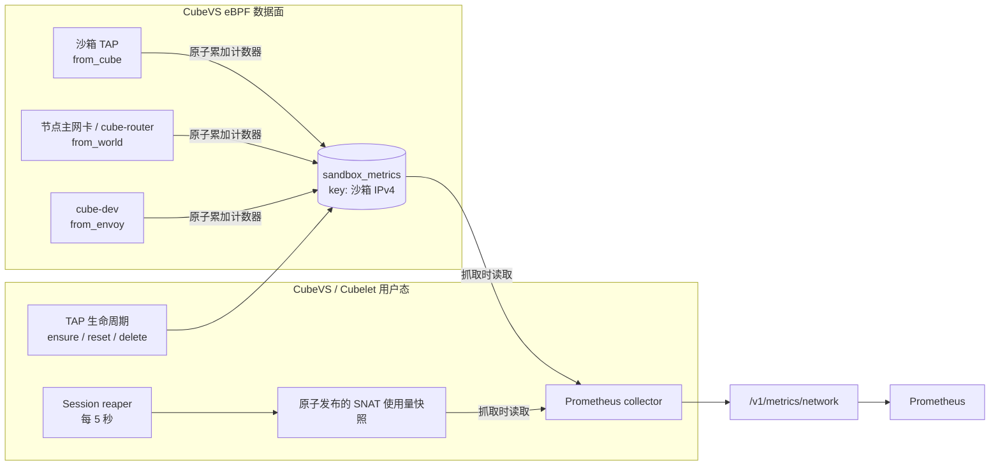

# 沙箱网络指标

## 背景

CubeSandbox 的沙箱网络由节点上的 CubeVS 数据面统一转发。已有的 CPU、内存和
节点资源指标可以说明沙箱消耗了多少计算资源，但无法回答下面这些网络问题：

- 某个沙箱是否实际产生了 ingress/egress 流量，当前吞吐和报文量是多少；
- 流量是在 CubeVS 中正常转发，还是因策略、NAT、报文改写等原因被丢弃；
- 高密度节点上的普通 SNAT session 是否持续增长；
- SNAT IP 的 `30000-65535` 源端口范围是否正在承受压力；
- 是否已经出现真实的 SNAT 源端口分配失败。

因此，此次网络指标能力的直接目标有两个：

1. **获取沙箱网络情况**：按 `sandbox_ip` 提供 ingress/egress 的报文、字节、
   丢包和 SNAT 分配失败 Counter，用于定位单个沙箱的网络活跃度和 CubeVS
   数据面异常。
2. **获取 SNAT 端口压力情况**：按 `snat_ip` 提供存活普通 SNAT session 数、
   物理源端口占用量和端口容量 Gauge，用于判断节点出口是否接近压力区间。

SNAT 端口可以在不同目的地址/协议 tuple 之间复用，因此不能用
`端口容量 - session 数` 推导剩余端口，也不能把“全局未使用端口数”理解为某个
目的地址还能建立的精确连接数。`snat_ports_unused` 用于观察整体物理端口号占用
趋势，`snat_alloc_failures_total` 才是实际分配失败的直接信号。

在多节点集群中，每个 Cubelet 只导出本节点 CubeVS 的网络状态。Prometheus 需要
抓取所有计算节点，再通过 `instance`、`sandbox_ip` 和 `snat_ip` 区分节点、
沙箱与出口地址。

整体设计分为三部分：

1. CubeVS eBPF 程序在转发报文时更新每沙箱计数器。
2. CubeVS 用户态负责计数器 entry 的生命周期，并定期发布 SNAT 使用量快照。
3. Prometheus 抓取时，Cubelet 将以上两个来源转换为 Prometheus 时间序列。

## 设计目标

- 无需 guest vm 配合，即可把数据面流量和丢包归属到具体沙箱。
- 由用户态维护 map entry 所有权，使指标身份与 TAP、IP 所有权严格一致。
- Prometheus 抓取不进入报文处理路径，也不触发 guest RPC。
- 只使用沙箱 IP 和 SNAT IP 控制 label 基数，不增加目的地址、端口、协议、
  session 或策略规则等高基数维度。
- 复用已有 session reaper 扫描结果 储存在缓存中，计算 SNAT 占用，不增加第二次完整 session
  map 扫描。
- sandbox Counter 或 SNAT 状态任一来源暂时不可用时，仍保留另一来源的可观测性。

## 指标范围

网络指标描述单个计算节点上由 CubeVS 处理的流量。它们是数据面记账指标，
不是应用层计费记录。

| 来源 | 标识维度 | 数据 | 更新方式 |
| --- | --- | --- | --- |
| 沙箱流量 | `sandbox_ip` | 转发和丢弃的报文/帧计数，以及 SNAT 分配失败次数 | 在 eBPF 报文路径中更新 |
| SNAT 分配 | `snat_ip` | 普通 SNAT 存活 session 数和不同源端口占用量 | 由用户态 session reaper 定期刷新 |
| Exporter 健康状态 | `source` | 上述两个来源是否可读 | 每次抓取时分别判断 |

### 纳入统计的流量

每沙箱计数器覆盖三个 CubeVS 边界上能够归属到沙箱的 IPv4 流量：

- TAP ingress 上的 `from_cube`：沙箱通过普通 SNAT、端口映射、DNS 处理、
  ICMP 或重定向到 CubeEgress 的出站流量；
- 节点主网卡 ingress 或 cube-router egress 上的 `from_world`：反向 NAT
  和端口映射后送往沙箱的流量；
- `cube-dev` egress 上的 `from_envoy`：宿主机或 CubeEgress 送往沙箱的
  流量。该程序名为兼容历史命名而保留，当前 CubeEgress 基于 OpenResty，
  并非 Envoy。

方向始终以沙箱为参照：

- **egress** 表示沙箱发出、进入其 TAP 数据面的报文；
- **ingress** 表示能够归属到该沙箱、并向其 TAP 投递的报文。

“已转发”表示 CubeVS 已完成处理并执行相应 redirect，不代表远端或沙箱内
应用最终一定成功接收。

### 明确不在统计范围内的内容

这些指标不提供：

- 应用 payload 字节、HTTP 请求数、Method、状态码或 L7 策略判决；
- 按目的地址、协议、端口、session 或策略规则拆分的数据；
- ARP 或通用非 IPv4 流量统计；
- 在到达 CubeVS hook 前已经丢失的报文；
- CubeVS 完成 egress redirect 后发生的丢包，包括宿主机路由、NIC、
  underlay 或远端丢包；
- CubeEgress 应用层拒绝次数。CubeVS 成功把报文重定向到 CubeEgress 后，
  即记为 egress forward，即使 CubeEgress 随后拒绝该请求；
- 无法归属到已注册沙箱的流量。例如，与沙箱无关的主网卡流量和反向 NAT
  miss 不会创建沙箱时间序列；
- 每沙箱 SNAT Gauge。SNAT Gauge 按 SNAT IP 聚合。

字节计数使用计数位置上的 `skb->len`，表示 TC 程序看到的帧长度，而不是
TCP/UDP payload 字节。重传报文会被再次计数。

## 架构设计



### 数据面计数器

`sandbox_metrics` 是一个 pinned `BPF_MAP_TYPE_HASH` map：

- key：网络字节序的沙箱 IPv4 地址；
- value：9 个 `uint64` 计数器；
- 最大 entry 数：`8192`；
- 分配方式：`BPF_F_NO_PREALLOC`。

eBPF helper 只执行 lookup；key 不存在时立即返回，不会在内核态创建 entry。
已存在的 value 通过原子 `__sync_fetch_and_add` 更新，避免不同 CPU 并发处理
同一沙箱报文时丢失增量。

entry 所有权有意放在用户态。如果允许残留报文在数据面自动创建 entry，
已删除沙箱的时间序列可能被重新创建，还可能与 IP 复用竞争，并长期保留
不属于任何活跃沙箱的 key。

该方案的报文侧成本是一次有界 map lookup 和若干原子累加。同一沙箱的所有
计数器共享一个 map value，在明确生命周期和控制时间序列基数之间，优先采用
简单、可控的所有权模型，而没有采用 per-CPU 聚合。

### 用户态 entry 生命周期设计

`sandbox_metrics` entry 的所有者是 Cubelet 内置 network runtime 和 CubeVS Go
控制面。guest 不会创建、删除或发布 entry，eBPF 数据面也不会在 key 缺失时自动
创建 entry。

#### 创建时机

| 场景 | 用户态动作 | Counter 结果 |
| --- | --- | --- |
| 新建沙箱或为新沙箱分配 IP | `AddTAPDevice` 尝试删除该 IP 的残留 entry，再通过 `UpsertTAPDeviceMetadata` 尝试 ensure | reset 和 ensure 失败都只记录告警，不阻塞注册；reset 失败时 IP 复用可能保留旧 Counter |
| Metadata 修复、幂等 upsert 或 legacy TAP 替换 | `UpsertTAPDeviceMetadata` 在写 metadata 前尝试 ensure | entry 已存在时保留累计值；创建成功时从零开始；失败时保持无指标 |
| 网络策略更新 | 只更新策略 map，不操作 `sandbox_metrics` | Counter 连续累加 |
| 使用同一 TAP/IP 的沙箱回滚 | 只更新 TAP/session 代际，不操作 `sandbox_metrics` | Counter 不随快照回滚或清零 |
| CubeVS 初始化重建 `sandbox_metrics` | map 中所有 entry 被删除；启动恢复在校验 metadata 后独立为每个活跃 TAP 执行 ensure | ensure 成功的 entry 从零重新开始；失败的 `sandbox_ip` 不导出时间序列 |

ensure 使用 `UpdateNoExist` 写入全零 value。`ebpf.ErrKeyExist` 是 ebpf 包表示
`EEXIST` 冲突的 sentinel，该错误被视为成功，因此 metadata 刷新不会覆盖运行中
沙箱已经累计的 Counter。用户态会在 TAP metadata 发布前尝试创建 entry；ensure
失败只记录告警，不会阻止后续 TAP metadata 和网络策略写入。注册前 reset 同样
采用 best-effort：失败时记录告警，但不阻止 TAP metadata 和网络策略写入。该取舍
优先保证沙箱网络可用；IP 复用时，旧 owner 的 Counter 可能暂时归属到新 owner。

启动恢复会独立于 metadata 修复执行同一个 ensure。即使 pinned TAP metadata
已经与恢复中的沙箱完全匹配、不需要 upsert，重建后的 map 也会重新补建 entry。

新 TAP 注册的顺序为：

1. `AddTAPDevice` 调用 `DeleteSandboxTrafficMetrics`，清除 IP 上一个生命周期可能
   留下的 Counter。
2. `UpsertTAPDeviceMetadata` 调用 `EnsureSandboxTrafficMetrics`，以
   `UpdateNoExist` 创建全零 entry。
3. 用户态写入 `ifindex_to_mvmmeta` 和 `mvmip_to_ifindex`。
4. 用户态应用该沙箱的网络策略。
5. reset 和 ensure 失败时记录告警并继续；metadata 或策略写入失败时返回错误。
   策略失败还会触发已写状态的清理。

先 reset、再 ensure、最后发布 metadata，优先避免新沙箱继承同一 IP 上一个
使用者的累计值。若 ensure 失败，系统优先保证 TAP 网络可用，并用缺少该
`sandbox_ip` 时间序列表示观测数据不可用；若 reset 失败，同样优先保证 TAP
网络可用。旧 entry 仍可访问时，其 Counter 可能归属到新 IP owner，直到后续
delete、reset 或 CubeVS 重启成功。

#### 创建失败和 key 缺失

- **Reset 失败**：用户态无法确认旧 Counter 已清除。系统记录包含
  `sandbox_id`、`ifindex`、`sandbox_ip` 和错误原因的告警，然后继续 TAP 注册。
  网络转发保持可用，但 Counter 可能包含上一个 IP owner 的流量。
- **Ensure 失败**：无法打开 `sandbox_metrics`、map 已满或 `UpdateNoExist`
  返回不匹配 `ebpf.ErrKeyExist` 的错误时，用户态记录包含 `sandbox_id`、
  `ifindex`、`sandbox_ip` 和错误原因的告警，然后继续 TAP 注册。该失败不影响
  沙箱网络转发。
- **运行态 key 缺失**：`update_metrics` lookup miss 后直接返回，不创建 entry，
  也不影响当前报文后续处理。该沙箱的所有流量 Counter 都不会增长，Prometheus
  响应中不会出现这个 `sandbox_ip`，因此网络指标实际不可用。

::: info 重启后的空数据
CubeVS 初始化会主动重建 `sandbox_metrics`，原有 Counter 不持久化。重启后，
启动恢复会独立为每个活跃 TAP ensure entry，因此即使 metadata 已经完整，成功
补建的 IP 也会从零恢复导出。如果 ensure 失败，该沙箱不会导出 Counter 序列，
直到后续恢复、metadata upsert、TAP re-registration 或新建沙箱再次触发 ensure
并成功。这里使用“无序列/空数据”表示数据缺失，不能把它解释为 Counter 为零或
沙箱没有网络流量。
:::

`cubesandbox_network_exporter_up{source="sandbox"} == 1` 只表示本次抓取成功
打开并遍历了 map，不保证每个活跃沙箱都存在 entry。判断覆盖完整性时，需要把
活跃 TAP/IP 列表与 Prometheus 中的 `sandbox_ip` label 集合进行对比。

#### 删除时机

| 场景 | 用户态动作 |
| --- | --- |
| 删除沙箱、释放 TAP 或清理 stale TAP | 先清理策略和 metadata，再调用 `DeleteSandboxTrafficMetrics` 删除该 IP 的 entry |
| 删除一个不存在的 entry | 按幂等成功处理 |
| metrics entry 删除失败 | 记录告警，但不阻塞 TAP、IP 和端口回收 |
| IP 被后续沙箱复用 | 即使上一次删除失败，新的 `AddTAPDevice` 仍会在注册前再次 reset；再次失败时记录告警并继续注册，Counter 可能残留 |
| CubeVS 初始化 | 直接重建整个 `sandbox_metrics` map；所有旧 Counter 消失，未补建的沙箱表现为空数据 |

网络策略更新、metadata 刷新和使用同一网络分配的回滚不会删除 entry。删除动作与
TAP/IP 所有权释放绑定，而不是与单次连接或策略变更绑定。

### SNAT 用户态快照

SNAT Gauge 复用已有 session reaper 的扫描结果，不会在每次 Prometheus
抓取时重新遍历 session map：

1. reaper 每 5 秒扫描一次 `egress_sessions`。
2. 使用已有的安全延迟删除遍历方式移除过期 session。
3. 仅纳入仍存活、SNAT IP 非零的普通 SNAT session（`SNAT_PACKET`）；
   L7 proxy 和端口映射 session 不纳入。
4. 按 SNAT IP 统计 session 数。
5. 使用 `(snat_ip, source_port)` 对源端口去重。
6. 完成整个扫描后，原子发布一份不可变快照供抓取读取。

任意一次 5 秒扫描失败时，上一份快照会立即失效。下一次抓取不再导出任何 SNAT
Gauge，并返回 `exporter_up{source="snat"} == 0`，而不是继续展示陈旧的端口
占用状态。超过 10 秒的快照也会被判定为过期并拒绝导出，用于覆盖 reaper
未返回错误但停止推进的情况。后续扫描成功并发布新快照后，SNAT Gauge 恢复。

源端口范围为 `30000` 到 `65535`，包含两端，共 `35536` 个端口。同一个源端口
可以在不同目的地址/协议 tuple 之间复用，因此 session 数和不同物理源端口数
是两个不同指标。

### 抓取路径与局部失败

Cubelet handler 使用独立的 Prometheus registry。每次抓取时 collector：

1. 遍历并排序 `sandbox_metrics`；
2. 读取最新 SNAT 使用量快照和已配置的 `snat_iplist`；
3. 对同一 SNAT IP 的重复 allocator shard 去重；
4. 生成 Prometheus 常量样本；
5. 分别导出两个来源的健康状态。

两个来源相互独立。即使 sandbox map 读取失败，只要 SNAT 快照健康，SNAT
指标仍会正常导出，仅 `exporter_up{source="sandbox"}` 变为 `0`。

Prometheus 抓取不会扫描运行中的沙箱，不会调用 CubeShim 或 guest，也不会
向数据面增加报文。sandbox map 遍历成本与活跃 entry 数成正比；SNAT session
map 扫描仍由后台 reaper 承担。

## 生命周期语义

| 生命周期事件 | 沙箱流量计数器 | SNAT Gauge |
| --- | --- | --- |
| 新建沙箱 / 新 IP 分配 | reset 和 ensure 失败都不阻塞注册；reset 失败可能保留旧 Counter，ensure 失败可能不导出该 IP 序列 | 建立 session 后由下一次 reaper 快照反映 |
| 执行 metadata upsert 或修复 | ensure 成功时保留已有 entry 或从零补建；失败时保持无指标 | 下一次快照前保持不变 |
| 网络策略更新 | 计数继续；被新策略拒绝的报文进入 drop 计数 | 被淘汰的 session 在后续快照中消失 |
| 保持同一网络分配的沙箱回滚 | 计数继续，不跟随快照回滚 | 陈旧 session 被删除，后续快照收敛 |
| 删除沙箱 | TAP 清理后移除时间序列 | session 删除或回收后消失 |
| 沙箱 IP 复用 | 注册前尝试 reset；失败时记录告警并继续，残留 Counter 可能进入新生命周期 | session 使用独立生命周期 |
| CubeVS/Cubelet 网络初始化 | 重建 `sandbox_metrics`，旧 Counter 消失；恢复路径独立从零补建每个活跃沙箱，ensure 失败的沙箱仍以空表示数据缺失 | 清空 SNAT cache，再由 reaper 重新发布 |

这些 Counter 的范围是当前 CubeVS runtime 和当前沙箱 IP 分配。Prometheus
应把 CubeVS 重启或 IP 重新分配视为 Counter reset 边界。出现 reset 告警时，
该边界不可靠，时间序列可能仍包含上一个 IP owner 的值。

label 使用 `sandbox_ip` 而不是 `sandbox_id`，因为数据面稳定且随时可用的所有权
key 是沙箱 IPv4。需要沙箱 ID 时，应在该端点之外与控制面 inventory 做关联。

## 指标列表

### 沙箱流量 Counter

每个活跃 `sandbox_ip` entry 导出 9 条时间序列。

| 指标 | 类型 | 单位与含义 |
| --- | --- | --- |
| `cubesandbox_network_sandbox_ingress_packets_total` | Counter | CubeVS 向沙箱转发的 IPv4 报文数。 |
| `cubesandbox_network_sandbox_ingress_bytes_total` | Counter | 上述 ingress 转发报文的 `skb->len` 字节数。 |
| `cubesandbox_network_sandbox_ingress_drop_packets_total` | Counter | 可归属到沙箱、但被 CubeVS 拒绝或改写失败的 ingress 报文数。 |
| `cubesandbox_network_sandbox_ingress_drop_bytes_total` | Counter | 上述 ingress 丢弃报文的 `skb->len` 字节数。 |
| `cubesandbox_network_sandbox_egress_packets_total` | Counter | CubeVS 从沙箱转发的 IPv4 报文数。 |
| `cubesandbox_network_sandbox_egress_bytes_total` | Counter | 上述 egress 转发报文的 `skb->len` 字节数。 |
| `cubesandbox_network_sandbox_egress_drop_packets_total` | Counter | 被 CubeVS 拒绝或处理失败的沙箱 egress 报文数。 |
| `cubesandbox_network_sandbox_egress_drop_bytes_total` | Counter | 上述 egress 丢弃报文的 `skb->len` 字节数。 |
| `cubesandbox_network_sandbox_snat_alloc_failures_total` | Counter | 该沙箱普通 SNAT 源端口分配失败次数。 |

SNAT 分配失败同时会导致一次 egress drop。该指标是 egress drop 中按原因细分的
子集，不能与 drop Counter 相加。

### SNAT Gauge

每个逻辑 `snat_ip` 导出 3 条时间序列。

| 指标 | 类型 | 单位与含义 |
| --- | --- | --- |
| `cubesandbox_network_snat_sessions_in_use` | Gauge | 使用该 SNAT IP 的存活普通 SNAT session 数。 |
| `cubesandbox_network_snat_ports_capacity` | Gauge | 每个目的地址/协议 tuple 可使用的源端口范围大小，固定为 `35536`。 |
| `cubesandbox_network_snat_ports_unused` | Gauge | 该 SNAT IP 上未被任何存活普通 SNAT session 使用过的源端口号数量。 |

`snat_ports_unused` 是整个节点 SNAT IP 的占用视角，不是某个目的地址的精确分配
余量，因为同一源端口号可以在不同目的地址/协议 tuple 间复用。判断真实端口
耗尽应优先观察 `cubesandbox_network_sandbox_snat_alloc_failures_total` 是否
出现正增长。

### Exporter 健康指标

| 时间序列 | 含义 |
| --- | --- |
| `cubesandbox_network_exporter_up{source="sandbox"}` | 本次抓取是否成功读取 pinned sandbox Counter map。 |
| `cubesandbox_network_exporter_up{source="snat"}` | 本次抓取是否成功读取新鲜的 SNAT 快照和 SNAT IP 配置。 |

某个来源为 `0` 只影响该来源，其他可读指标仍会导出。

## 基数与性能

每个 sandbox map entry 导出 9 条时间序列。map 的硬上限为 8192，因此单节点
沙箱流量指标最多为 73728 条。最多 4 个逻辑 SNAT IP 额外产生 12 条 Gauge，
再加 2 条 exporter 健康指标。

实际部署的沙箱上限通常更低，但 Prometheus 仍需要处理所有导出的指标族。如果
不需要同时保留 packet、byte 和 drop 指标，可使用 `metric_relabel_configs`
丢弃不需要的指标族。

该端点最多同时处理两个抓取请求。更多并发请求会收到 HTTP 503，避免多个大
响应同时消耗过多 Cubelet CPU 和内存。

## Prometheus 配置

Cubelet 通过以下端点导出 CubeVS 网络数据面的 Prometheus 指标：

```text
http://<cubelet-node>:9998/v1/metrics/network
```

该端点独立于 Cubelet 通用指标端点 `/v1/metrics` 和沙箱资源指标端点
`/v1/metrics/resource`。网络指标不依赖 guest agent，也不会发起 guest RPC，
全部来自节点本地的 CubeVS 状态。

```yaml
scrape_configs:
  - job_name: cubesandbox-network
    scrape_interval: 30s
    scrape_timeout: 10s
    metrics_path: /v1/metrics/network
    static_configs:
      - targets:
          - <compute-node-ip>:9998
```

将 target 替换为各 Cubelet 节点在可信管理网络中的地址。

::: warning 网络访问
Cubelet HTTP 服务本身不提供鉴权或 TLS。仅应在可信管理网络中开放 `9998`
端口，或通过防火墙、安全组限制访问来源。详见[网络加固](./network-hardening.md)。
:::

在 Cubelet 节点上验证端点：

```bash
curl -fsS http://127.0.0.1:9998/v1/metrics/network | \
  grep '^cubesandbox_network_'
```

## PromQL 示例

沙箱 egress 吞吐量，单位 bit/s：

```promql
8 * rate(cubesandbox_network_sandbox_egress_bytes_total[5m])
```

沙箱 egress 丢包比例：

```promql
rate(cubesandbox_network_sandbox_egress_drop_packets_total[5m])
/
clamp_min(
  rate(cubesandbox_network_sandbox_egress_packets_total[5m])
  +
  rate(cubesandbox_network_sandbox_egress_drop_packets_total[5m]),
  1e-9
)
```

真实发生的 SNAT 分配失败：

```promql
sum by (instance, sandbox_ip) (
  rate(cubesandbox_network_sandbox_snat_alloc_failures_total[5m])
) > 0
```

SNAT 源端口占用率：

```promql
1 -
cubesandbox_network_snat_ports_unused
/
cubesandbox_network_snat_ports_capacity
```

该比例表示节点 SNAT IP 上物理端口号的整体占用情况，不是特定目的地址的精确
分配余量。

## 故障排查

| 现象 | 常见原因与处理方式 |
| --- | --- |
| 无法连接 `9998` 端口 | 检查 `cube-sandbox-cubelet.service`、监听地址、防火墙和安全组。 |
| HTTP 503 | 已有两个网络指标抓取正在执行。检查重复的 Prometheus job 或并发手工请求。 |
| `exporter_up{source="sandbox"}` 为 `0` | 检查 Cubelet 日志中的 pinned `sandbox_metrics` map 打开或遍历错误。 |
| `exporter_up{source="snat"}` 为 `0` | 确认 CubeVS session reaper 正常运行。不存在或超过 10 秒的快照会被拒绝。 |
| 两个健康指标均为 `1`，但没有 sandbox 序列 | map 可读但为空，常见于 CubeVS 重启后未补建 entry，或 ensure 失败。空表示数据缺失，不表示零流量。 |
| 运行中沙箱存在全零序列 | 确认流量确实经过 CubeVS，并检查 pinned map。ARP、无关宿主机流量和 CubeVS 外部丢包不会累加。 |
| 运行中沙箱没有流量序列 | 该沙箱网络指标不可用。检查 metrics reset/ensure 告警；eBPF 数据面有意不创建缺失 entry。 |
| 已删除沙箱仍然存在 | 检查 Cubelet 清理告警。清理和注册前 reset 都是 best-effort；后续成功删除、reset 或 CubeVS 重启后该 entry 才会移除。 |
| SNAT 占用率较高但没有分配失败 | 这可能是正常现象，因为源端口可在不同目的地址/协议 tuple 间复用。应对分配失败告警。 |

默认安装可通过以下命令检查 map 和 Cubelet 日志：

```bash
sudo bpftool map dump pinned /sys/fs/bpf/sandbox_metrics
sudo tail -200 /data/log/Cubelet/Cubelet-req.log
```

## 相关文档

- [CubeVS 网络模型](../architecture/network.md)
- [网络策略](./network-policy.md)
- [沙箱资源指标](./resource-metrics.md)
- [网络加固](./network-hardening.md)
