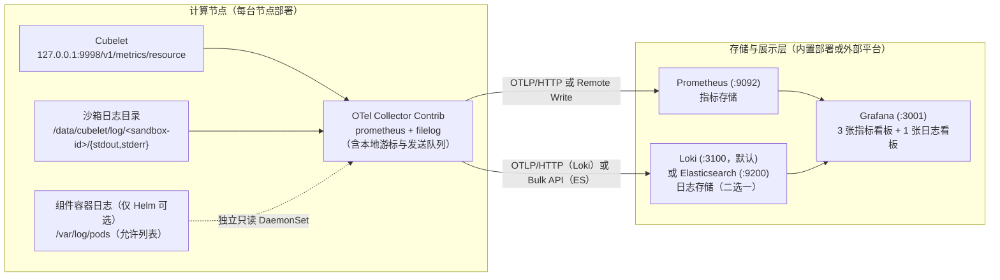

# 沙箱可观测性部署（CubeObservability）

CubeObservability 为 CubeSandbox 提供开箱即用的**沙箱资源指标**与**沙箱日志**可观测性方案。该能力在 one-click（CVM / 裸金属）和 Kubernetes Helm 安装流程中均**默认关闭**，通过一个环境变量或 Helm Value 即可按需开启，既支持部署内置的 Prometheus + Loki（或 Elasticsearch）+ Grafana 全栈，也支持直接对接团队已有的外部监控与日志平台。

::: tip 能力定位
本文聚焦**指标（Metrics）与日志（Logs）**的采集、存储和看板展示：
- 详细指标口径见 [沙箱资源指标](./resource-metrics.md)；
- 单机日志读取工具见 [沙箱日志](./sandbox-logs.md)；
- 端到端请求耗时分析见 [分布式链路追踪](./tracing.md)。
:::

---

## 总体架构

CubeObservability 采用**节点侧轻量采集 + 中心侧集中存储与展示**的三层架构，不改动 Cubelet 自身逻辑，并保持后端可替换：



### 采集范围与数据流

| 数据类型 | 数据源 | 采集方式 | 关键特性 |
| --- | --- | --- | --- |
| **沙箱资源指标** | 本机 Cubelet `127.0.0.1:9998/v1/metrics/resource` | `prometheus` receiver 定时抓取 | 覆盖沙箱 CPU、内存及节点沙箱计数共 24 个指标族，自动附带 `cluster` / `node` 标签 |
| **沙箱标准日志** | `/data/cubelet/log/<sandbox-id>/{stdout,stderr}` | `filelog` receiver 实时 tail | 从路径自动解析 `sandbox_id` 和 `stdout`/`stderr`；沙箱销毁会删除本地目录，因此需在存活期间持续上报 |
| **组件容器日志**（仅 Helm 可选） | `/var/log/pods` 下允许列表内的 CubeSandbox 容器 | 独立只读 `component-otelcol` DaemonSet | 默认关闭，从文件末尾开始采集，不回放历史日志；one-click 暂不支持 |

每个计算节点上的 OTel Collector 通过独立管道分别上报指标和日志，并将文件读取游标与 OTLP 发送队列持久化到本机磁盘（systemd 为 `/var/lib/cube-sandbox/otelcol/storage`，Helm 为 `/var/lib/cube-sandbox/otelcol-k8s`），进程重启或后端短暂抖动时可续传。

### 部署拓扑一览

| 部署方式 | 节点采集器（Collector） | 监控后端（Prometheus + 日志后端 + Grafana） | 说明 |
| --- | --- | --- | --- |
| **one-click 第一台节点**（默认 all-in-one） | 本机 systemd 服务 | 同机部署（无需另建监控控制面） | 设置 `ONE_CLICK_ENABLE_OBSERVABILITY=1` 自动安装全栈 |
| **one-click 后续计算节点** | 本机 systemd 服务 | 自动推送到第一台节点 | 填写第一台节点内网 IP，仅安装采集器 |
| **Kubernetes Helm** | 计算节点 DaemonSet | 控制面部署内置后端（默认）或对接外部平台 | 通过 `--set observability.enabled=true` 开启 |
| **独立安装**（不依赖 one-click/Helm） | 本机 systemd 服务 | 支持全栈（`all`）、纯后端（`backend`）或纯采集器（`cvm`） | 通过 `deploy/one-click/observability/install.sh` 直接管理 |

::: info 说明
- Terraform 集群部署不包含可观测性安装。
- 源码目录职责：Grafana 镜像与看板源文件位于 `CubeObservability/`；one-click/systemd 安装器位于 `deploy/one-click/observability/`；Helm 模板与配置位于 `deploy/kubernetes/chart/`。
:::

---

## 依赖与前置条件

在启用安装前，请先确认以下组件版本、运行环境与网络条件。

### 组件版本与选型

#### 组件版本与外部兼容基线

安装器为内置部署锁定了经过验证的组件版本；如需对接自建或托管的外部平台，请满足下表的兼容基线：

| 组件 | 内置锁定版本 | 外部自建兼容基线 | 默认端口 | 角色说明 |
| --- | --- | --- | --- | --- |
| **OTel Collector Contrib** | `0.162.0` | 建议 `0.162.x`（升级后需执行 `otelcol validate`） | `127.0.0.1:13133` | 节点采集器（健康检查端口） |
| **Prometheus** | one-click `3.13.4`；Helm `v3.2.1` | `3.x`（需启用 `--web.enable-otlp-receiver` 与 `--web.enable-remote-write-receiver`） | `9092` | 指标后端（注意 `9090` 被 `cube-proxy` 占用） |
| **Loki**（默认日志后端） | `3.7.9` | `3.x`（需启用原生 OTLP `/otlp` 与 structured metadata） | `3100` | 默认日志后端，Grafana 使用 LogQL 查询 |
| **Elasticsearch**（可选日志后端） | `8.17.3` | `8.x` | `9200` | 可选日志后端，使用 `raw` mapping 和 Bulk API |
| **Grafana OSS** | `10.4.18` | `>= 10.4`（兼容 dashboard schema `39`） | `3001` | 指标与日志可视化看板 |

#### 日志后端二选一：Loki 还是 Elasticsearch？

同一部署**只启用一个日志后端，不会双写**：

- **Loki（默认推荐）**：资源占用低、部署轻量，适合快速落地以及按集群、节点、沙箱 ID 和正则筛选日志。
- **Elasticsearch（可选）**：适合已有 ES 运维体系或需要全文检索（Lucene / Query DSL）的团队。
- 生产环境建议优先对接团队已有的托管监控/日志平台。

### 系统与平台依赖

| 维度 | one-click / systemd（CVM / 裸金属） | Kubernetes / Helm |
| --- | --- | --- |
| **宿主机环境** | 64 位 Linux（`amd64` / `arm64`）、`systemd` | 无需宿主机预装监控相关二进制 |
| **基础命令工具** | `curl`、`tar`、`python3`（用于安全解包并校验 Loki 安装包） | `helm`、`kubectl` |
| **Cubelet 要求** | Cubelet 正常运行并暴露 `127.0.0.1:9998/v1/metrics/resource` | 需保持默认 `cubeNode.hostNetwork=true`，以便同节点 Collector 访问 `127.0.0.1:9998` |
| **持久化存储** | 宿主机本地磁盘（`/var/lib/cube-sandbox/*`） | 内置后端默认启用 PVC，需集群具备可用 `StorageClass`（仅临时验证可设 `persistence.enabled=false`） |
| **Grafana 密码** | 必须显式配置 `CUBE_GRAFANA_ADMIN_PASSWORD`，**至少 16 个字符**且首尾不含空白 | 留空时自动生成 release 级随机 Secret；手工指定内联密码同样需至少 16 个字符 |

### 网络与端口要求

| 访问方向 | 端口（TCP） | 用途 |
| --- | --- | --- |
| 计算节点 → 后端节点 | `9092` | Collector 上报指标到 Prometheus |
| 计算节点 → 后端节点 | `3100`（Loki）或 `9200`（Elasticsearch） | Collector 上报日志到所选日志后端 |
| 管理员 → 后端节点 | `3001` | 访问 Grafana Web 界面 |
| 节点本机回环（`127.0.0.1`） | `9998`、`13133` | Collector 抓取本机 Cubelet 指标、本地健康检查 |

::: warning 安全提醒
内置部署的 Prometheus、Loki 和 Elasticsearch **不自带服务端鉴权**。请在防火墙/安全组中仅对计算节点内网放通 `9092`、`3100`、`9200`，**切勿直接暴露到公网**；如需公网或跨网段访问，请前置认证网关/反向代理，或直接对接带鉴权的外部托管平台。
:::

### 安装前自检（已有 Cubelet 节点）

如果节点已经安装 Cubelet，可先确认指标接口和日志路径就绪（全新 one-click 安装可直接进入 [安装与部署](#安装与部署)）：

```bash
# 1. 检查 Cubelet 版本与运行状态
/usr/local/services/cubetoolbox/Cubelet/bin/cubecli version
sudo systemctl is-active cube-sandbox-cubelet.service

# 2. 检查沙箱资源指标接口
curl -fsS http://127.0.0.1:9998/v1/metrics/resource | \
  grep -E '^cubesandbox_(host_sandbox|guest_workload|node_sandbox_)'

# 3. 如有运行中的沙箱，检查其 stdout/stderr 日志路径
SANDBOX_ID=<替换为实际沙箱ID>
ls -l "/data/cubelet/log/${SANDBOX_ID}"/{stdout,stderr}
```

> 没有活跃沙箱时，逐沙箱指标与日志可以为空，但 `cubesandbox_node_sandbox_count` 和 `cubesandbox_node_sandbox_available_count` 应返回 `0`。

---

## 安装与部署

按你的部署形态选择对应入口即可，无需额外命令行开关：

| 场景 | 安装入口 | 核心启用方式 |
| --- | --- | --- |
| **one-click 全新 / 存量部署** | `deploy/one-click/install.sh` / `install-compute.sh` | `.env` 设置 `ONE_CLICK_ENABLE_OBSERVABILITY=1` |
| **Kubernetes Helm** | `deploy/kubernetes/chart` | 安装时增加 `--set observability.enabled=true` |
| **对接已有外部平台** | one-click 或 Helm | 填入外部 Prometheus / Loki / ES 地址及凭据 |
| **独立安装（不走主安装器）** | `deploy/one-click/observability/install.sh` | 执行 `all` / `backend` / `cvm` 子命令 |

### one-click 部署（CVM / 裸金属）

one-click 沿用原有的 `.env` 和安装脚本。第一台节点默认安装全栈（控制面 + 计算 + 监控后端 + 采集器），后续计算节点只需指向第一台节点内网 IP。

#### 步骤 1：部署第一台 all-in-one 节点

1. 进入 `deploy/one-click`（或解压后的发布包根目录），首次安装时创建 `.env`：

```bash
cd deploy/one-click
[[ -f .env ]] || cp env.example .env
chmod 600 .env
```

2. 在 `.env` 中填入可被计算节点访问的内网 IP 和可观测性参数（如需 Elasticsearch，将 `CUBE_LOGS_BACKEND` 改为 `elasticsearch`）：

```dotenv
CUBE_SANDBOX_NODE_IP=10.0.0.10
ONE_CLICK_ENABLE_OBSERVABILITY=1
CUBE_OBSERVABILITY_CLUSTER_ID=cube-prod
CUBE_LOGS_BACKEND=loki
CUBE_GRAFANA_ADMIN_PASSWORD='<随机且至少16字符的密码>'
```

3. 执行常规安装命令，并确认最终生效的内网 IP（供后续计算节点使用）：

```bash
sudo ./install.sh
grep '^CUBE_SANDBOX_NODE_IP=' /usr/local/services/cubetoolbox/.one-click.env
```

#### 步骤 2：部署后续计算节点

在每台计算节点准备同版本发布包与 `.env`，填写第一台节点内网 IP（保持集群 ID 和日志后端一致），然后执行 `install-compute.sh`：

```dotenv
# .env
ONE_CLICK_CONTROL_PLANE_IP=10.0.0.10
ONE_CLICK_ENABLE_OBSERVABILITY=1
CUBE_OBSERVABILITY_CLUSTER_ID=cube-prod
CUBE_LOGS_BACKEND=loki
```

```bash
sudo ./install-compute.sh
```

`install-compute.sh` 会自动识别计算节点角色，**仅安装本机 OTel Collector**，并自动推导第一台节点的 Prometheus（`:9092`）与日志后端（`:3100` 或 `:9200`）地址。

#### 步骤 3：在存量 one-click 集群中启用或关闭

保留原安装目录中的 `.env`（**不要**用 `env.example` 覆盖，也不要直接编辑 `/usr/local/services/cubetoolbox/.one-click.env`）：

1. 在第一台节点的 `.env` 中添加上述可观测性变量，执行升级：

```bash
sudo ./install.sh --mode=upgrade --yes
```

2. 第一台节点验收通过后，在各计算节点的 `.env` 中添加对应变量，执行升级：

```bash
sudo ./install-compute.sh --mode=upgrade --yes
```

> 升级时默认配置中的 `ONE_CLICK_ENABLE_OBSERVABILITY=0` 不会误关已启用的监控；如需明确关闭，执行 `sudo env ONE_CLICK_ENABLE_OBSERVABILITY=0 ./install.sh --mode=upgrade --yes`（计算节点使用 `./install-compute.sh`）。

#### 补充：在线一键安装（`online-install.sh`）

如需直接通过在线脚本安装，可通过 `env` 透传相同变量（如涉及外部鉴权 Token 等敏感信息，建议下载 release 包写入 `0600` 权限的 `.env`，避免残留在 shell 历史中）：

```bash
# 第一台 all-in-one 节点
GRAFANA_ADMIN_PASSWORD="$(openssl rand -hex 16)"
echo "Grafana admin password: ${GRAFANA_ADMIN_PASSWORD}"
curl -fsSL https://raw.githubusercontent.com/tencentcloud/CubeSandbox/master/deploy/one-click/online-install.sh \
  | sudo env ONE_CLICK_ENABLE_OBSERVABILITY=1 \
      CUBE_OBSERVABILITY_CLUSTER_ID=cube-prod \
      CUBE_LOGS_BACKEND=loki \
      CUBE_GRAFANA_ADMIN_PASSWORD="${GRAFANA_ADMIN_PASSWORD}" \
      bash

# 后续计算节点
curl -fsSL https://raw.githubusercontent.com/tencentcloud/CubeSandbox/master/deploy/one-click/online-install.sh \
  | sudo env ONE_CLICK_DEPLOY_ROLE=compute \
      ONE_CLICK_CONTROL_PLANE_IP=10.0.0.10 \
      ONE_CLICK_ENABLE_OBSERVABILITY=1 \
      CUBE_OBSERVABILITY_CLUSTER_ID=cube-prod \
      CUBE_LOGS_BACKEND=loki \
      bash
```

---

### Kubernetes Helm 部署

在现有 `runtime-values.yaml`（含数据库、Redis 凭据及节点调度配置）基础上，追加 `observability.*` 参数即可。

#### 使用内置后端（快速部署）

```bash
helm upgrade --install cube ./deploy/kubernetes/chart \
  -n cube-system --create-namespace \
  -f /path/to/runtime-values.yaml \
  --set observability.enabled=true \
  --set observability.clusterId=k8s-prod \
  --set observability.logs.backend=loki
```

- **获取 Grafana 密码**：Chart 默认生成 release 级随机密码 Secret 并在升级时复用，通过以下命令读取（生产环境建议提前创建 Secret 并配置 `observability.backend.grafana.existingSecret`）：

```bash
kubectl get secret -n cube-system \
  -l app.kubernetes.io/component=grafana-admin \
  -o jsonpath='{.items[0].data.admin-password}' | base64 --decode; echo
```

- **切换为 Elasticsearch**：将 `--set observability.logs.backend=loki` 改为 `--set observability.logs.backend=elasticsearch`。
- **开启组件容器日志采集（可选）**：追加 `--set observability.logs.components.enabled=true`。这会启动第二个只读 DaemonSet，仅采集当前 namespace 下白名单容器（默认 `cube-master`、`cube-api`、`cube-ops`、`cube-templatecenter`、`cubelet`、`cube-proxy`、`cube-lifecycle-manager`）在 `/var/log/pods` 中的新增日志。开启前请确认组件日志不含明文密钥。
- 所有内置监控 Pod 均配置了 readiness/liveness probe 用于健康检查和自动重启（不包含 Alertmanager 告警规则）。

#### 常用 Helm Values 速查

| Value | 默认值 | 说明 |
| --- | --- | --- |
| `observability.enabled` | `false` | 可观测性总开关 |
| `observability.clusterId` | `cubesandbox` | 写入指标与日志的集群标签 |
| `observability.backend.enabled` | `true` | 是否部署集群内 Prometheus、日志后端与 Grafana |
| `observability.otelCollector.scrapeInterval` | `15s` | Cubelet 抓取周期（不得小于固定的 `10s` 超时） |
| `observability.otelCollector.cubeletMetricsTarget` | `127.0.0.1:9998` | 本机 Cubelet 地址（要求 `cubeNode.hostNetwork=true`） |
| `observability.otelCollector.stateHostPath` | `/var/lib/cube-sandbox/otelcol-k8s` | 节点持久状态目录（游标、队列、WAL） |
| `observability.metrics.otlpEndpoint` / `remoteWriteUrl` | `""` | 外部指标 OTLP/HTTP 或 Remote Write 地址（二选一） |
| `observability.logs.backend` | `loki` | 日志后端：`loki` 或 `elasticsearch` |
| `observability.logs.otlpEndpoint` / `esEndpoint` | `""` | 外部日志 OTLP（Loki）或 Elasticsearch 地址（二选一） |
| `observability.logs.components.enabled` | `false` | 是否启用独立只读 DaemonSet 采集组件 CRI 日志 |
| `observability.metrics.auth.existingSecret` / `observability.logs.auth.existingSecret` | `""` | 外部后端鉴权与租户 Header 所在 Secret |
| `observability.backend.<component>.persistence.*` | `enabled: true` | 配置内置组件的 PVC（`storageClassName`、`existingClaim`、`size`） |
| `observability.backend.grafana.existingSecret` | `""` | 外部管理的 Grafana 管理员 Secret（`admin-user` / `admin-password`） |

---

### 对接外部监控与日志平台（含鉴权）

如果团队已有 Prometheus / VictoriaMetrics / Loki / Elasticsearch 或托管可观测性平台，可以**只部署节点 Collector**，将数据推送到外部后端。

::: warning 互斥与安全约束
- 指标输出端（OTLP/HTTP 与 Remote Write）只能二选一；日志输出端（Loki OTLP 与 Elasticsearch）同样只能二选一。
- 鉴权配置仅用于 Collector 与 Grafana 客户端请求头，不会给内置后端开启服务端认证。
- HTTPS 端点默认校验证书（使用系统/容器 CA）；私有 CA 场景请挂载信任链，勿长期关闭 TLS 校验。
:::

#### 方式 A：one-click / systemd 对接外部后端

在 `.env` 中显式配置外部地址后，`ONE_CLICK_OBSERVABILITY_ROLE=auto` 会自动跳过本地后端，仅安装节点 Collector：

```dotenv
ONE_CLICK_ENABLE_OBSERVABILITY=1
ONE_CLICK_OBSERVABILITY_ROLE=auto
CUBE_OBSERVABILITY_CLUSTER_ID=cube-prod
CUBE_LOGS_BACKEND=loki

# 外部指标与日志地址（OTLP 填基础路径，不要附加 /v1/metrics 或 /v1/logs）
CUBE_METRICS_OTLP_HTTP_ENDPOINT=https://prometheus.example.com/api/v1/otlp
CUBE_LOGS_OTLP_HTTP_ENDPOINT=https://loki.example.com/otlp

# 外部后端鉴权（可选；*_AUTHORIZATION 填完整 Header，*_TOKEN 填裸 Token，二者不可同时设置）
CUBE_METRICS_AUTHORIZATION='Bearer <metrics-token>'
CUBE_METRICS_TENANT_ID=cube-prod
CUBE_LOGS_AUTHORIZATION='Bearer <logs-token>'
CUBE_LOGS_TENANT_ID=cube-prod
```

- 对接外部 **Elasticsearch** 时，将 `CUBE_LOGS_BACKEND` 改为 `elasticsearch`，改填 `CUBE_LOGS_ES_ENDPOINT=https://es.example.com:9200`（可选 `CUBE_LOGS_ES_INDEX`），并使用 `CUBE_LOGS_ES_API_KEY` 或成对的 `CUBE_LOGS_ES_USER` / `CUBE_LOGS_ES_PASSWORD`。
- 对接 Prometheus **Remote Write** 时，改用 `CUBE_METRICS_REMOTE_WRITE_URL` 替代 `CUBE_METRICS_OTLP_HTTP_ENDPOINT`。

#### 方式 B：Kubernetes Helm 对接外部后端

1. 关闭内置后端并指定外部地址：

```bash
helm upgrade --install cube ./deploy/kubernetes/chart \
  -n cube-system --create-namespace \
  -f /path/to/runtime-values.yaml \
  --set observability.enabled=true \
  --set observability.backend.enabled=false \
  --set observability.clusterId=k8s-prod \
  --set observability.metrics.otlpEndpoint="https://prometheus.example.com/api/v1/otlp" \
  --set observability.logs.backend=loki \
  --set observability.logs.otlpEndpoint="https://loki.example.com/otlp"
```

2. 如外部后端需要鉴权，通过集群 Secret 管理流程创建 Secret（保存完整 `Authorization` Header，如 `Bearer ...` 或 ES 的 `ApiKey ...`，不要通过 `--set` 明文传入）：

```yaml
apiVersion: v1
kind: Secret
metadata:
  name: cube-observability-auth
  namespace: cube-system
type: Opaque
stringData:
  metrics-authorization: "Bearer <metrics-token>"
  metrics-tenant-id: "cube-prod"
  logs-authorization: "Bearer <logs-token>"
  logs-tenant-id: "cube-prod"
```

并在 `runtime-values.yaml` 中引用（后端无需 `X-Scope-OrgID` 时将 `tenantIdKey` 置空或删除）：

```yaml
observability:
  metrics:
    auth:
      existingSecret: cube-observability-auth
      authorizationKey: metrics-authorization
      tenantIdKey: metrics-tenant-id
  logs:
    auth:
      existingSecret: cube-observability-auth
      authorizationKey: logs-authorization
      tenantIdKey: logs-tenant-id
```

---

### 独立安装（不依赖 one-click / Helm，可选）

如果不想触动现有 CubeMaster / Cubelet 服务，可以直接使用独立脚本管理可观测性组件：

```bash
# 1. 全栈节点（后端 + 本机 Collector）；如节点不运行沙箱，将末尾 all 改为 backend
sudo env \
  CUBE_OBSERVABILITY_CLUSTER_ID=cube-prod \
  CUBE_LOGS_BACKEND=loki \
  CUBE_GRAFANA_ADMIN_PASSWORD='<随机且至少16字符的密码>' \
  ./deploy/one-click/observability/install.sh all

# 2. 其他 CVM / 裸金属计算节点（仅安装 Collector，Loki 示例）
sudo env \
  CUBE_OBSERVABILITY_CLUSTER_ID=cube-prod \
  CUBE_METRICS_OTLP_HTTP_ENDPOINT=http://10.0.0.10:9092/api/v1/otlp \
  CUBE_LOGS_OTLP_HTTP_ENDPOINT=http://10.0.0.10:3100/otlp \
  ./deploy/one-click/observability/install.sh cvm

#    如使用 Elasticsearch，将上例中的日志参数替换为：
#    CUBE_LOGS_BACKEND=elasticsearch CUBE_LOGS_ES_ENDPOINT=http://10.0.0.10:9200

# 3. 卸载组件（保留历史数据目录）
sudo ./deploy/one-click/observability/install.sh uninstall all
```

---

## 部署验证与 Grafana 看板

### 服务健康检查

#### one-click / systemd 环境

```bash
# 全栈 / 后端节点一键检查
sudo /usr/local/services/cubetoolbox/observability/install.sh status

# 计算节点检查本机 Collector
sudo systemctl --no-pager --full status cube-sandbox-otelcol.service
sudo journalctl -u cube-sandbox-otelcol.service -n 100 --no-pager

# 手动探活后端接口
curl -fsS http://127.0.0.1:9092/-/ready
curl -fsS http://127.0.0.1:3100/ready
# Elasticsearch 场景改为：
# curl -fsS 'http://127.0.0.1:9200/cubesandbox-logs*/_count'
```

#### Kubernetes Helm 环境

```bash
kubectl -n cube-system rollout status daemonset/cube-node-otelcol
# 仅当开启 observability.logs.components.enabled=true 时存在
kubectl -n cube-system rollout status daemonset/cube-component-otelcol
```

### 内置 Grafana 看板

浏览器访问 `http://<后端节点IP>:3001`（或通过 Kubernetes Service / port-forward 访问），内置 Grafana 自动预置 **3 张指标看板 + 1 张日志看板**：

| 看板文件 | 用途 | 核心维度 |
| --- | --- | --- |
| `cubesandbox-cluster.json` | 集群级沙箱资源汇总 | `cluster` |
| `cubesandbox-node.json` | 单节点沙箱资源汇总 | `cluster` → `node` |
| `cubesandbox-sandbox.json` | 单沙箱 Host Sandbox 与 Guest Workload 详情 | `cluster` → `node` → `sandbox_id` → `container_id` |
| `cubesandbox-logs.json`（Loki）或 `cubesandbox-logs-elasticsearch.json`（ES） | 沙箱 stdout/stderr 日志趋势与检索，含默认折叠的 **Component logs** 分组 | 统一 UID `cubesandbox-logs` |

::: tip 看板口径说明
- 指标看板覆盖 Cubelet 导出的全部 24 个指标族，下拉按 `cluster → node → sandbox_id → container_id` 逐级联动。
- CPU 速率单位为使用核数；内存限额为已导出有限限额之和，不等同于物理机容量。
- Host Sandbox 与 Guest Workload 记账口径不同，**不可直接相加**；缺样本不等于 `0`。
- Loki 仅将低基数字段 `service_name`、`cubesandbox_cluster_id`、`host_name` 建为索引 label，`cubesandbox_sandbox_id` 与 `log_iostream` 保留为 structured metadata，避免产生高基数 stream。
:::

### 常用日志查询与告警表达式参考

#### 日志查询示例

- **Loki（LogQL）**：

```text
# 所有沙箱的 stderr
{service_name="cubesandbox-sandbox"} | log_iostream="stderr"

# 单个沙箱中的错误日志
{service_name="cubesandbox-sandbox"}
  | cubesandbox_sandbox_id="<sandbox-id>"
  |~ "(?i)error|fatal|panic"
```

- **Elasticsearch（Lucene）**：

```text
# 所有沙箱的 stderr
service_name:"cubesandbox-sandbox" AND log_iostream:"stderr"

# 单个沙箱日志
cubesandbox_sandbox_id:"<sandbox-id>"
```

#### 建议监控告警表达式（PromQL）

安装器默认不部署 Alertmanager 或告警规则。以下 PromQL 可作为告警起点（CPU、节流、内存占比和采样不可用建议加 `for: 5m`；内存限制失败建议立即触发；占比类表达式仅适用于配置了有限配额的沙箱）：

```promql
# 沙箱 CPU 使用率超过 80%
100 * rate(cubesandbox_host_sandbox_cpu_usage_seconds_total[5m])
  / clamp_min(cubesandbox_host_sandbox_cpu_limit_cores, 0.001) > 80

# CPU 节流周期占比超过 20%
100 * rate(cubesandbox_host_sandbox_cpu_throttled_periods_total[5m])
  / clamp_min(rate(cubesandbox_host_sandbox_cpu_periods_total[5m]), 0.001) > 20

# 沙箱内存使用率超过 85%
100 * cubesandbox_host_sandbox_memory_current_bytes
  / clamp_min(cubesandbox_host_sandbox_memory_limit_bytes, 1) > 85

# 最近 5 分钟内出现内存限制失败
increase(cubesandbox_host_sandbox_memory_failures_total[5m]) > 0

# 存在沙箱但当前无可用资源采样
cubesandbox_node_sandbox_count - cubesandbox_node_sandbox_available_count > 0
```

---

## 进阶配置与运维参考

### 核心环境变量速查（one-click / systemd）

one-click 用户可直接在 `deploy/one-click/env.example` 的 `Observability` 配置段中按需取消注释（Helm 使用 `observability.*` Values，不读取以下环境变量）：

| 类别 | 变量 | 默认值 | 说明 |
| --- | --- | --- | --- |
| **基础开关** | `ONE_CLICK_ENABLE_OBSERVABILITY` | `0` | 设为 `1` 在 one-click 安装/升级时启用可观测性 |
| | `ONE_CLICK_OBSERVABILITY_ROLE` | `auto` | 角色覆盖：`auto` / `all` / `backend` / `cvm` |
| | `CUBE_OBSERVABILITY_CLUSTER_ID` | `cubesandbox` | 写入指标与日志的集群标签 |
| | `CUBE_SANDBOX_NODE_IP` | 自动探测 | 节点标签及第一台节点地址 |
| | `CUBE_LOGS_BACKEND` | `loki` | 日志后端：`loki` 或 `elasticsearch` |
| **指标输出** | `CUBE_METRICS_OTLP_HTTP_ENDPOINT` | 自动推导 | 外部 Prometheus OTLP/HTTP 基础地址（不含 `/v1/metrics`） |
| | `CUBE_METRICS_REMOTE_WRITE_URL` | 空 | 外部 Prometheus Remote Write 地址（与 OTLP 二选一） |
| | `CUBE_METRICS_AUTHORIZATION` / `CUBE_METRICS_REMOTE_WRITE_TOKEN` | 空 | 指标上报鉴权（完整 Header 或裸 Token，二选一） |
| | `CUBE_METRICS_TENANT_ID` | 空 | 指标 `X-Scope-OrgID` 租户头 |
| **日志输出** | `CUBE_LOGS_OTLP_HTTP_ENDPOINT` | 自动推导 | 外部 Loki OTLP/HTTP 基础地址（不含 `/v1/logs`） |
| | `CUBE_LOGS_ES_ENDPOINT` / `CUBE_LOGS_ES_INDEX` | 自动推导 / `cubesandbox-logs` | Elasticsearch 地址与索引名（与 OTLP 二选一） |
| | `CUBE_LOGS_AUTHORIZATION` / `CUBE_LOGS_TOKEN` | 空 | Loki 上报鉴权（完整 Header 或裸 Token，二选一） |
| | `CUBE_LOGS_TENANT_ID` | 空 | 日志 `X-Scope-OrgID` 租户头 |
| | `CUBE_LOGS_ES_API_KEY` | 空 | ES API Key 鉴权（与 Basic Auth 二选一） |
| | `CUBE_LOGS_ES_USER` / `CUBE_LOGS_ES_PASSWORD` | 空 | ES Basic Auth 凭据（必须成对设置） |
| | `CUBE_LOGS_ES_TLS_INSECURE_SKIP_VERIFY` | `false` | 跳过 ES TLS 校验（仅限临时诊断） |
| **采集微调** | `CUBE_LOGS_SANDBOX_ID` | `*` | 仅 systemd：限制采集单个沙箱 ID（排障时使用） |
| | `CUBE_LOGS_FILE_START_AT` | `beginning` | 仅 systemd：首次读取位置，可选 `beginning` 或 `end` |
| **存储与容量** | `CUBE_PROMETHEUS_RETENTION_TIME` / `CUBE_PROMETHEUS_RETENTION_SIZE` | `15d` / `40GB` | 内置 Prometheus 数据保留时长与空间上限 |
| | `CUBE_LOKI_RETENTION_PERIOD` | `15d` | 内置 Loki 日志保留时长 |
| | `CUBE_ES_HEAP_SIZE` | `1g` | 内置 Elasticsearch JVM 堆大小（建议不超过可用内存 50%） |
| | `CUBE_GRAFANA_ADMIN_PASSWORD` | 必填（≥16位） | 内置 Grafana 管理员密码 |

> 内置 Grafana provisioning 会自动复用上述指标/日志凭证；执行 `grafana/install.sh dashboards` 可向已有 Grafana 按 UID 导入或更新数据源与看板。

### 预览与排查生成的 Collector 配置

**请勿直接手工修改**安装后的 `/etc/cube-sandbox/otelcol/otelcol.yaml` 或 Kubernetes ConfigMap，重新安装/升级会将其覆盖。如需确认当前参数渲染出的完整配置，请使用内置渲染命令：

```bash
# systemd 形态：基于当前环境变量渲染 Collector 配置（不执行安装）
./deploy/one-click/observability/install.sh render cvm

# Kubernetes Helm 形态：预览模板（render-only 占位凭据仅用于本地渲染）
helm template cube ./deploy/kubernetes/chart \
  --set observability.enabled=true \
  --set-string mysql.password=render-only \
  --set-string mysql.rootPassword=render-only \
  --set-string redis.password=render-only \
  -s templates/observability.yaml
```

### 默认运行参数与语义字段

| 项目 | 默认行为与调优建议 |
| --- | --- |
| **抓取周期 / 超时** | systemd：`5s / 3s`；Helm：`15s / 10s`（Helm 周期不得小于固定超时 `10s`，较大规模建议保持 `15s`） |
| **内存限制与批处理** | Collector `memory_limiter` 固定 `256MiB`（Helm Pod request/limit `128Mi / 512Mi`）；batch 大小 `1024`，超时 `2s`（systemd）/ `5s`（Helm） |
| **队列与可靠性** | OTLP 使用 `1000` 容量的磁盘队列（`file_storage`）并持续重试；Remote Write 使用 WAL；ES 使用内存队列（`1000`、`10` 消费者、最多重试 `5` 次，持续故障可能丢日志） |
| **数据保留策略** | 内置 Prometheus 与 Loki 默认保留 `15d`；Elasticsearch 需自行配置 ILM 清理策略 |
| **日志标准字段** | 沙箱日志包含 `service_name=cubesandbox-sandbox`、`cubesandbox_log_source=sandbox-init`、`cubesandbox_cluster_id`、`host_name`、`cubesandbox_sandbox_id`、`log_iostream`（`stdout`/`stderr`）、`log_file_path`；Helm 组件日志使用 `service_name=cubesandbox-<container>`、`cubesandbox_log_source=component`、`cubesandbox_component_name=<container>` |

### 扩展采集其他组件日志

Helm 已内置允许列表内的组件容器日志采集（见 [Kubernetes Helm 部署](#kubernetes-helm-部署)），参考实现位于 `deploy/kubernetes/chart/templates/observability.yaml`；one-click/systemd 当前仅采集沙箱日志。

如需扩展新组件日志，请修改配置生成器而非运行态文件：
- systemd：`deploy/one-click/observability/otelcol/install.sh` 中的 `write_otel_config()`；
- Helm：`deploy/kubernetes/chart/templates/observability.yaml` 中的 Collector ConfigMap 与 volumes，并在 `values.yaml` 暴露默认关闭的开关。

扩展约束：
- 每个组件使用独立 receiver 与 pipeline（如 `filelog/component_cubelet`、`logs/component_cubelet`），以 `start_at: end` 读取，解析失败需保留原始 `Body` 且不得阻断其他管道；
- 同时写入 OTel 资源属性与 Elasticsearch 扁平字段（`service.name`/`service_name`、`cubesandbox.log.source`/`cubesandbox_log_source=component`、`cubesandbox.component.name`/`cubesandbox_component_name`），只索引稳定低基数 label，高基数 ID 保留为 structured metadata；
- 只挂载必需的宿主机只读目录，严禁挂载宿主机根目录；按需使用 `redaction`/`transform` 脱敏凭据与 Header；
- 同步更新生成器、双语文档、Grafana 看板与 `otelcol validate` 测试。

关于 Collector Pipeline 内部实现与数据契约的更多细节，请参阅 [CubeObservability 与 OTel Collector 方案](../dev/sandbox-otel-recommendation.md)。
