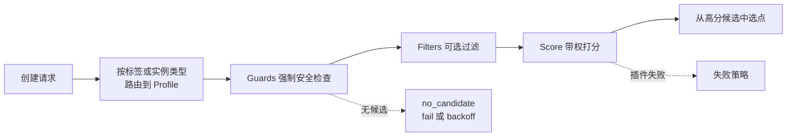

# 可扩展调度插件

CubeMaster 把每个创建请求路由到一个**调度 Profile**，按 Profile 定义的 Guards、Filter、Score 和选点方式完成调度。一个请求走完整条管线：



请求由哪个 Profile 服务由[策略选择规则](./cubemaster-scheduler-config.md#当前生效的调度策略)决定；本页讲怎么配置和扩展 Profile。

## 升级时的行为变化

从 **v0.7.3 及更早版本**升级、且不修改调度配置的集群，受两处影响：

**零调度配置会激活出厂 Profile。** 完全没配调度策略的集群，选点从"预过滤候选里随机挑"变为"强制 Guards + 出厂 Score 按 spread 选点"，放置会不同（注入时打一条告警）。想保持旧行为，设 `scheduler.disable_factory_profiles: true`，或配置任一 legacy 块；已配置过调度策略的集群不受影响。

**模板亲和打分：持有模板的节点得满分，其余 0 分。** 受影响的只有显式启用 `image_score` 的部署（含出厂 `template_reuse` Profile 和 legacy `enable_scorers: [image_score]` 集群）——默认配置、推荐配置和一键部署都不启用它，升级无感知。落点变化不符合预期时：

- 想完全恢复升级前的放置：从 `score.plugin_conf.image_score.enable_weight_factors` 移除 `template_id`，或把 `score.resource_weights.template_id` 置 0。
- 想保留模板亲和、但让负载能压过它：调低 `image_score` 权重。
- JFS 等共享存储后端不要为此启用模板亲和——模板所有节点都能直接读取，没有"避免拉取"的收益。

::: details 为什么有这个变化
`template_id` 因子以前按模板本地副本大小线性打分，但副本注册到调度器的尺寸是占位值，线性分值恒为 0——升级前模板亲和在打分中从未生效，本次变更让它第一次真正起作用。即使注册真实大小，GiB 级模板的线性分值也会被资源因子数值碾压；布尔化后它与暴露给插件的 `template_local` 事实语义一致，行为可预测。
:::

## 出厂 Profile

二进制内置三条 Profile（`scheduler_factory.yaml`）：

| Profile | 路由条件 | 行为 |
|---------|---------|------|
| `burst_balance` | label `workload=burst_balance` | 高并发同规格请求按资源水位与在途创建打散 |
| `template_reuse` | label `workload=template_reuse` | 优先落在已持有模板本地副本的节点 |
| `mixed_binpack` | 默认 | 紧凑放置，保留整空节点 |

系统只在没有任何调度配置时注入这套出厂策略；显式配置了 `profiles` 或任一 legacy 块，整套出厂策略就不生效（legacy 块编译为兼容的 `default` Profile，行为不变）。

## 配置 Profile

```yaml
scheduler:
  profile_route_label_keys: [workload]
  profiles:
    - name: burst
      route:
        labels: {workload: burst}
      filters:
        - name: skip-high-create
          type: expr
          expr: "node.creating < 8"
      scores:
        - name: prefer-idle
          type: expr
          expr: "node.cpu_util < 60.0 ? 80.0 : 20.0"
          weight: 2
      selection: {top_n: 5, method: spread}
      failure:
        filter: fail-closed
        score: default-score
        no_candidate: fail
```

规则要点：

- 只有 `profile_route_label_keys` 列出的请求 label 能参与路由，也才会传给外部插件。
- 路由按配置顺序匹配，第一个命中的 Profile 生效；非默认 Profile 必须带 instance type 或 label 条件（`instance_type` 当前统一为 `cubebox`，实际区分流量用 label 即可）。
- `selection.method` 从打分结果里选最终节点：`highest` 取最高分；`spread` 在前 `top_n` 里选当前运行沙箱数最少的（把放置摊开）；`random`（缺省）按分数加权随机。`top_n: -1` 表示全部通过过滤的节点。
- 每个 Profile 固定跑 `node_safety`、`cpu`、`mem`、`disk`、`template_locality`、`realtime_create_num` 这六个 Guards，配置关不掉。

内置 Score 的因子开关在全局 `scheduler.score` 树里配，不在 Profile 里——详见[调度器配置参考](./cubemaster-scheduler-config.md#哪份配置在生效)。

## 失败语义

Guards 永远 fail-closed。Filter 默认 fail-closed，显式配 fail-open 会打风险告警。Score 默认 default-score，单个插件失败后用它的 `default_score` 继续，也可以配成 fail-closed。`no_candidate` 支持 fail 和 backoff，backoff 时会重新执行整条管线。

配置在启动或热更新时整体编译——插件名、路由、表达式、权重、选点或失败策略任何一处无效，新配置都不生效，调度器继续用上一份。

## 验证

所有调度指标都带 `profile` 标签。最常用的三个：

- `scheduler_attempts_total{profile=...}`——哪个 Profile 在承接流量；
- `scheduler_plugin_duration_seconds{profile,kind,plugin}`——逐插件耗时，调权重时用；
- `sandbox_create_duration_seconds{profile,result}`——按 Profile 的端到端创建延迟。

## 准入与预留

跨副本准入是建议性的：每个副本按本地节点快照做准入，指标按上报窗口独立传播，所以窗口内多个 Master 可能对同一份可见容量重复准入，短暂超发。节点实际装不下时，创建第一次尝试就直接失败，不会转移到其他节点重试——建议配额贴近节点实际容量，并在客户端处理好创建失败。

Redis 是必选依赖（节点指标读取和创建后的路由元数据写入都要走它），Redis 故障会打断创建链路。滚动升级时混合版本不具备完整跨副本协调；旧版本还在服务时不要删旧版本的 reservation key，全部升级完后这些 key 就没人用了。

::: details 以下内容面向插件开发者

上面的内容针对配置和运维调度策略的部署者。从这里开始讲怎么写 CubeMaster 调度插件——只用内置 Profile 或 CEL 表达式的话，可以到此为止。

### 插件类型

三种插件类型：

- **go**（默认）：编译进 CubeMaster，实现 `filter.Selector` 或 `score.Selector` 接口，在包初始化时调 `plugin.RegisterGoFilter` / `plugin.RegisterGoScore` 注册。二进制需要导入该包，新增插件后要重新编译；重名在启动时被拒。
- **expr**：启动时编译 CEL。Filter 返回 `bool`，Score 返回 0—100。CEL 拿到的是强类型只读的 `node` 和 `request` 对象，未知字段、类型错误、返回类型不对在 Profile 激活时被拒；Score 数值超出 0—100 在请求时才会报错并触发 score 失败策略。常用节点字段有 `cpu_util`、`quota_cpu`、`allocated_cpu`、`creating`、`mvm_num`、`labels`、`template_local`、`snapshot_storage_writable` 等；请求字段有 `instance_type`、`cpu_millis`、`memory_bytes`、`template_id`、`labels`。
- **grpc**：独立进程。启动时完成一次握手，之后批量调 `Filter` 或 `Score`；CubeMaster 校验超时、熔断、快照版本和返回值。

gRPC 插件配置示例：

```yaml
      filters:
        - name: company-policy
          type: grpc
          socket_path: /run/cube/company-scheduler.sock
          timeout: 100ms
          circuit_breaker_failures: 3
          circuit_breaker_cooldown: 30s
```

协议在 `pkgs/proto/services/schedulerplugin/v1/plugin.proto`。每个请求都带完整冻结快照，所以插件服务端可以无状态，并发请求共享一条连接即可。生产环境建议 Unix Domain Socket。可运行示例在 `examples/scheduler-plugin`：

```bash
cd examples/scheduler-plugin
SOCKET=/tmp/cube-scheduler-example.sock go run .
```

### Score 插件契约

两点：

- 评分维度对当前请求不适用时，返回 `score.ErrNotApplicable` 显式跳过——不计分、不计权重，也不算失败（即使在 fail-closed 下）。
- 返回空评分列表加 nil 错误是违反契约，会触发配置的失败策略。内置 scorer 在 legacy 因子配置缺失、被禁用或权重全为零时也返回 `ErrNotApplicable`。
:::
