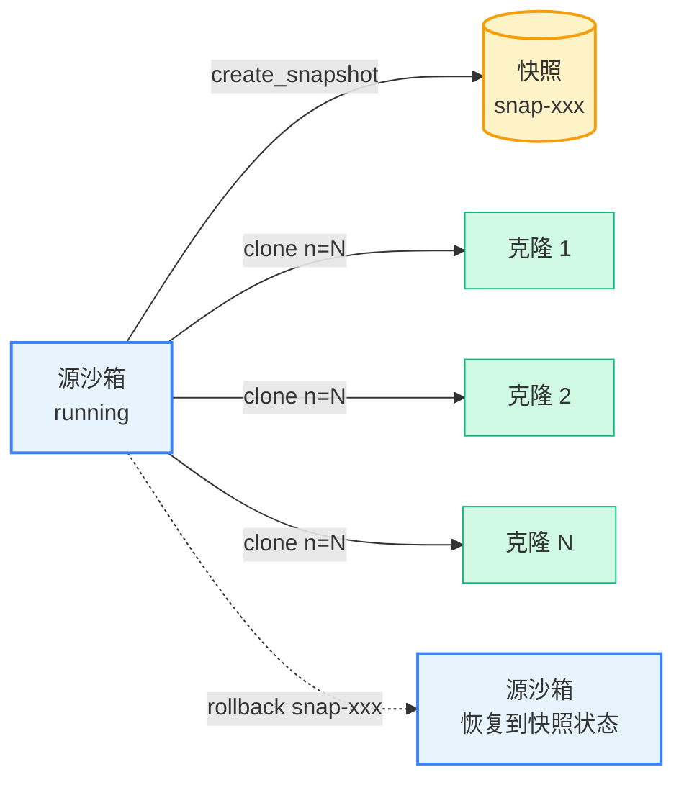

# 快照、回滚与克隆

本文介绍 Cube Sandbox Python SDK 提供的三组进阶接口：

- **快照（Snapshot）**：把一个运行中的沙箱的完整状态（内存 + 文件系统）持久化为一份镜像，后续可以反复用来创建新沙箱或执行回滚。默认是 **full** 模式；另有 **fs-only** 模式只保留文件系统，详见下文。
- **克隆（Clone）**：对一个正在运行的沙箱调用 `clone()`，可以立即派生出 N 个完全独立的副本，每个副本都从源沙箱的当前状态出发，互不干扰。
- **回滚（Rollback）**：把一个正在运行的沙箱原地恢复到先前某次快照的状态，沙箱 ID 不变，可以继续执行。

## 概念模型



| 接口 | 作用对象 | 沙箱 ID | 典型用途 |
|------|---------|--------|---------|
| `sb.create_snapshot()` | 源沙箱本身 | 不变 | 制作 checkpoint 或持久化状态 |
| `sb.clone(n=N)` | 从运行中的沙箱派生 N 个新沙箱 | 新建 N 个 | Agent 并行 rollout、可重复实验 |
| `sb.rollback(snap_id)` | 把当前沙箱原地恢复到快照状态 | **不变** | 撤回失败一步、回到分支点继续 |

## 安装

> **注意**：快照、克隆、回滚是 Cube Sandbox 特有的能力，e2b SDK 没有对应接口。[`cubesandbox`](https://pypi.org/project/cubesandbox/) SDK 兼容 e2b SDK，可以直接替换使用，同时获得以下进阶能力。

本文所有接口需要 [`cubesandbox`](https://pypi.org/project/cubesandbox/) **0.2.0 或更高版本**。

```bash
pip install "cubesandbox>=0.2.0"
```

环境变量约定：

```bash
export CUBE_API_URL=http://127.0.0.1:3000
export CUBE_TEMPLATE_ID=tpl-xxxxxxxxxxxxxxxxxxxxxxxx
```

## 快照（Snapshot）

`sb.create_snapshot()` 将沙箱的当前状态（文件系统 + 内存）持久化为一份快照，返回 `SnapshotInfo`，其中 `snapshot_id` 可以作为 `Sandbox.create(template=...)` 的入参。可选的 `name` 不能以 `tpl-` 或 `snap-` 开头（返回 HTTP 400），因为这两个前缀表示 ID。

```python
from cubesandbox import Sandbox

with Sandbox.create(template=TEMPLATE_ID) as sb:
    sb.run_code("open('/tmp/data.txt','w').write('hello')")
    snap = sb.create_snapshot()
    print(f"snapshot: {snap.snapshot_id}")
```

快照的生命周期独立于沙箱：源沙箱被 `kill()` 之后，快照仍然可用。不再需要时，调用 `Sandbox.delete_snapshot(snapshot_id_or_name)` 手动清理。它既接受快照 ID，也接受创建快照时指定的名称，删除成功返回 `True`、快照不存在返回 `False`。SDK 只匹配快照、不会匹配模板：名称没有对应快照时返回 `False`，即使存在同名模板别名，模板也不会被删除；名称匹配多个快照时返回 HTTP 409 且不删除任何对象，请改用 `snap-` ID。该行为要求 CubeAPI 支持 `snapshot_only`，旧版服务端会忽略该参数，名称没有对应快照时仍会路由到同名模板。

### 仅文件系统快照（fs-only）

给 `create_snapshot()` 传 `mode="fs-only"`，只捕获文件系统、不捕获 guest 内存。调用期间 guest 不会暂停，返回时即可继续读写。代价是：用它创建的沙箱会**冷启动**——文件都在，但所有进程都是新的。

```python
snap = sb.create_snapshot(mode="fs-only")
assert snap.mode == "fs-only"

child = Sandbox.create(template=snap.snapshot_id)
# 快照前的文件可见……
out = child.run_code("print(open('/tmp/data.txt').read())").logs.stdout[0]
assert out.strip() == "hello"
# ……但进程不在。
```

两种模式的差异：

| 维度 | `mode="full"`（默认） | `mode="fs-only"` |
|---|---|---|
| guest 内存 | 保存 | 不保存 |
| 调用期间源沙箱 | 短暂暂停 | 持续运行 |
| 用它创建的沙箱 | 恢复内存，进程继续 | 冷启动，进程全新 |
| 之后的 `pause()` / `resume()` | 保留内存 | 保留内存（首次 pause 是全量捕获） |
| `rollback(snapshot)` 回滚到它 | 支持 | **拒绝**（`snapshot_filesystem_only_rollback_unsupported`） |
| 外部挂载（plugin 卷、host mount） | 快照记录挂载配置，恢复后重新挂载 | 快照不记录挂载；用这份快照创建时重新声明即可 |
| 配置了 restart 策略时 `restart` | 保留文件 | 保留文件（复用捕获时的可写层） |

几个值得注意的行为：

- fs-only **不是增量链**：每份快照都是独立的时间点镜像，打 N 次就存 N 份。容量按「多份独立镜像」规划，不要假设「只存文件系统所以很小」——实际占用取决于存储后端的 CoW/reflink 能力。
- 从 fs-only 快照创建的沙箱之后与普通沙箱无异：配置了 restart 策略时，`restart` 复用捕获的可写层、文件保留、进程重建；也可以对它**再打 fs-only 快照**，新包会记录它实际使用的可写层。
- fs-only 包只记录根文件系统，不携带任何外部挂载。用它创建沙箱时：
  - **必须重新声明**要用的 plugin 卷与 host mount（含容器路径）；没声明的不会挂载。
  - 没有"必须与快照一致"的限制：快照本来就没有挂载记录，挂载完全由本次请求决定。
  - 沙箱可以落在任意节点，声明的宿主路径在该节点上解析；挂不上（宿主路径不存在、卷不存在）就让创建失败，不会留下空目录。

调用失败时，错误码会说明原因：

| HTTP | 错误码 | 触发条件 | 处理建议 |
|---|---|---|---|
| 409 | `snapshot_filesystem_only_unsupported_node` | 控制面或节点 agent 不支持 fs-only 模式 | 升级版本较旧的一侧；不会静默退回 full 快照 |
| 409 | `snapshot_filesystem_only_freeze_unsupported` / `snapshot_filesystem_only_rootfs_unsupported` | 节点不支持冻结文件系统 / 该 rootfs 类型 | 集群侧能力缺口，重试前先确认节点状态 |
| 5xx | `snapshot_filesystem_only_freeze_failed` / `snapshot_filesystem_only_thaw_failed` | 冻结或解冻在捕获过程中失败 | 集群侧问题，重试前先确认节点状态 |
| 409 | `snapshot_filesystem_only_shared_volume_unsupported` | 源沙箱挂了**可写** plugin volume | 可写 plugin volume 不属于被捕获的根文件系统；请先用不含该卷的沙箱再打快照 |
| 409 | `snapshot_filesystem_only_multi_container_unsupported` | 沙箱带有额外的用户容器 | 一份包只记录一个可写层，请使用单容器沙箱 |

响应里的 `mode` 永远是**实际记录**的模式；与请求不一致时调用直接失败（409 `snapshot_mode_conflict`），不会把这份产物返回给你，因此不会静默拿到一份 full 快照。

### 列举快照

```python
# 获取快照列表（第一页）
items, next_token = Sandbox.list_snapshots()

# 按 sandbox_id 过滤
items, _ = Sandbox.list_snapshots(sandbox_id=sb.sandbox_id)
```

`list_snapshots()` 返回 `(list[SnapshotInfo], next_token)`，将 `next_token` 传回可获取后续页；为 `None` 时表示没有更多页。

## 克隆（Clone）

对一个正在运行的沙箱调用 `sb.clone(n=N)`，可以立即派生出 N 个独立副本。每个副本都完整继承源沙箱在 clone 时刻的运行状态（内存 + 文件系统），但之后的写入互不影响，源沙箱也继续正常运行。

```python
src = Sandbox.create(template=TEMPLATE_ID)
src.run_code("open('/tmp/shared.txt','w').write('hello')")

clones = src.clone(n=3)
for sb in clones:
    # Each clone inherits the file written in src
    out = sb.run_code("print(open('/tmp/shared.txt').read())").logs.stdout[0]
    assert out.strip() == "hello"
```

### 并发克隆

默认串行创建，对于 fan-out 场景可以传 `concurrency=C` 并发执行：

```python
clones = src.clone(n=10, concurrency=5)
```

- 任一子任务失败时，已成功创建的克隆会被自动 `kill()`，调用方拿到的要么是 N 个沙箱，要么是异常，不会留下孤儿资源。

### 继承性与隔离性

`clone()` 返回的副本满足以下性质：

| 性质 | 含义 |
|------|------|
| **继承性** | 每个副本的初始状态与源沙箱在 clone 时刻完全一致 |
| **隔离性** | 副本之间的写入互不可见，与源沙箱也互相隔离 |
| **连续性** | 源沙箱在 `clone()` 返回后仍在运行，状态不受影响 |

## 分叉（Fork）

`sb.fork(count=N)` 通过**一次服务端调用**派生 N 个运行中的副本：后端对源沙箱只打一次快照，所有副本都从该快照派生。源沙箱继续运行，临时快照由服务端管理，客户端无需清理。

```python
src = Sandbox.create(template=TEMPLATE_ID)
forks = src.fork(count=3)
for sb in forks:
    if isinstance(sb, Sandbox):
        sb.run_code("print('alive')")  # 运行中的副本
    else:
        print(f"fork failed: {sb}")    # 该槽位的异常
```

每个 fork 独立成败。返回值恰好有 `count` 个元素——`Sandbox`，或阻止该 fork 启动的 `Exception`。部分成功会保留副本且不抛异常；只有整体失败才抛异常（如源沙箱不存在）。

### clone 与 fork 的区别

| | `clone(n=N)` | `fork(count=N)` |
|---|---|---|
| 失败语义 | 全成或全败：任一失败即回收兄弟并抛异常 | 各自独立：部分成功保留成功项 |
| 编排方式 | 客户端：打快照 + N 次 create | 一次服务端调用（单次快照，N 路派生） |
| 临时快照 | 最后一个克隆被杀后由 SDK 删除 | 由服务端管理 |
| 并发 | `concurrency` 参数（默认 1） | 由服务端决定 |

### 参数与错误

- `count`：1..100，默认 1。越界在所有 SDK 中都会抛错。
- `timeout` —— 新派生沙箱的空闲存活时长，不影响源沙箱。各 SDK 单位不同：Python 为**秒**，Node 为 `timeoutMs` **毫秒**，Go 为 `time.Duration`；线上传输单位是秒。
- `404` 源沙箱不存在；`409` 源沙箱当前状态不可 fork——刚创建的沙箱可能需要片刻才能打快照，稍后重试即可。

## 回滚（Rollback）

`sb.rollback(snapshot_id)` 把当前沙箱**原地**恢复到指定快照的状态：文件系统完全还原，**沙箱 ID 不变**，`sb` 对象可以继续使用。回滚只支持 **full** 快照——对 fs-only 快照回滚会被拒绝（`snapshot_filesystem_only_rollback_unsupported`，见上文对比表）。

```python
sb = Sandbox.create(template=TEMPLATE_ID)
sb.run_code("open('/tmp/v.txt','w').write('v1')")
checkpoint = sb.create_snapshot()

sb.run_code("open('/tmp/v.txt','w').write('v2')")
sb.rollback(checkpoint.snapshot_id)

after = sb.run_code("print(open('/tmp/v.txt').read())").logs.stdout[0]
assert after.strip() == "v1"
```

回滚后沙箱仍然可写，可以继续执行并再次创建快照，非常适合 Agent 的回退-重试循环：

```python
# Continue on the rolled-back branch
sb.run_code("open('/tmp/v.txt','w').write('v3')")
new_snap = sb.create_snapshot()

with Sandbox.create(template=new_snap.snapshot_id) as forked:
    out = forked.run_code("print(open('/tmp/v.txt').read())").logs.stdout[0]
    assert out.strip() == "v3"
```

## 最佳实践

- **快照不是免费的**。每个快照对应底层的一份完整镜像，记得用完即删，或定期调用 `list_snapshots()` 清理。
- **`with` 语句不会自动删快照**。上下文管理器只负责 `kill` 沙箱，快照需要显式调用 `Sandbox.delete_snapshot()` 清理。
- **`clone()` 会自动清理内部快照**。临时派生几个副本时直接用 `clone()`，无需手动管理快照生命周期。
- **大批量派生**优先用 `fork(count=N)`——一次往返、各自独立成败、服务端统一清理。需要全成或全败语义时再用 `clone(n=N, concurrency=C)`。

## 参考

- [跨机迁移](./cross-node-snapshot/requirements.md) —— 共享后端、`remote_status=ready`，以及 Resume / FromSnap 落到其他节点的调度规则
- 示例代码：[`examples/snapshot-rollback-clone/`](https://github.com/TencentCloud/CubeSandbox/tree/master/examples/snapshot-rollback-clone)
- SDK 源码：[`sdk/python/`](https://github.com/TencentCloud/CubeSandbox/tree/master/sdk/python)
