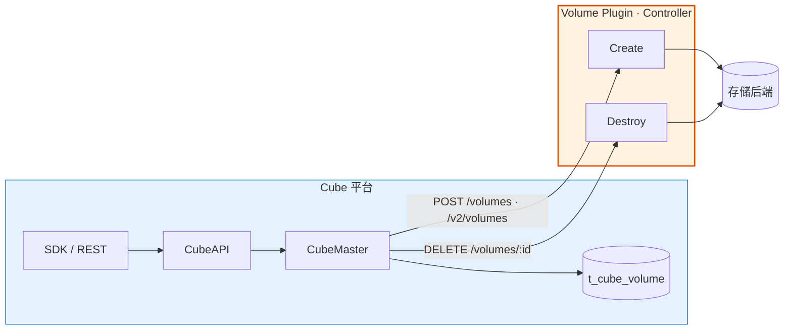
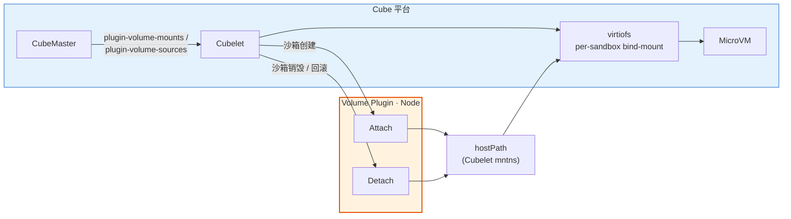
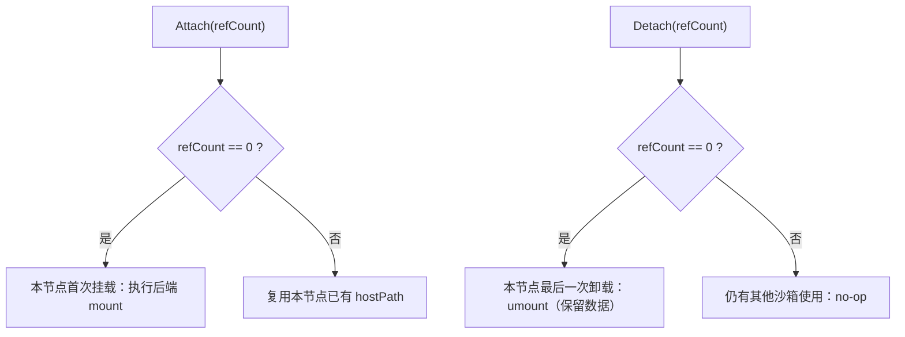
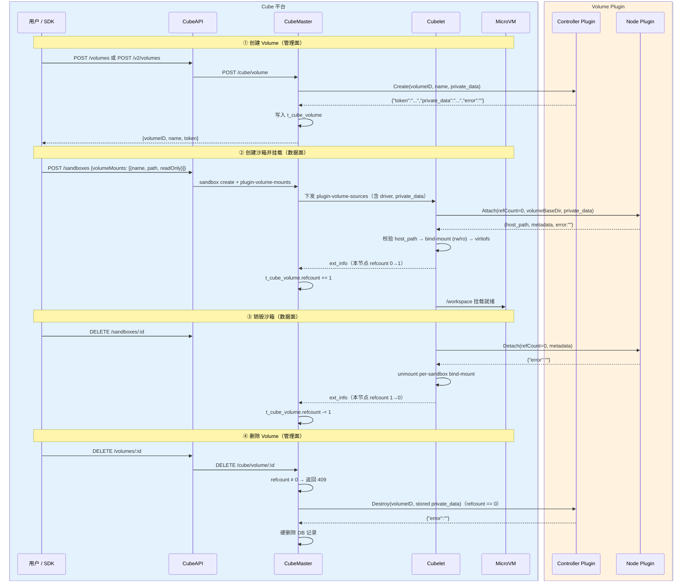

# Volume 插件开发

如果你希望将自研分布式存储、企业内部对象存储、块存储或其他自定义文件系统接入 CubeSandbox，可以通过实现 **Volume 插件** 来扩展存储后端。

> 如果你只是想了解如何部署和使用内置的 S3、JuiceFS、NFS、COS 插件，请参阅 [Volume 使用](./volume.md)。

本文分为两部分：先拆解 **Volume 框架的内部实现原理与协议规范**，再通过一个完整可运行的示例带你 **从零开发、测试并部署自己的第一个 Volume 插件**。

---

## 一、Volume 实现原理

> **图示约定**：蓝色填充 = Cube 平台组件；橙色填充 = Volume 插件（开发者实现）。

### 1.1 双角色模型：Controller 与 Node

借鉴 Kubernetes CSI，CubeSandbox 将 Volume 插件的职责划分为**管理面（Controller）**与**数据面（Node）**两组 Hook，由不同平台组件调用：

| 角色 | 调用方 | Hook | 核心职责 |
|------|--------|------|----------|
| **Controller** | CubeMaster | `Create` / `Destroy` | 在存储后端创建或删除卷资源，可选签发 `token` 并返回持久化私有状态 `private_data` |
| **Node** | Cubelet | `Attach` / `Detach` | 在计算节点宿主机挂载或卸载后端存储，产出位于 `volumeBaseDir` 内的 `hostPath` |

同一套 Hook 协议既可以用 **binary**（子进程可执行文件）实现，也可以用 **rpc**（gRPC 长驻服务）实现；四个 Hook 可以做在同一个程序里，也可以按角色拆分为两个程序。

#### 管理面流程（Controller）



#### 数据面流程（Node）



### 1.2 数据面挂载链与 Mount Namespace

理解“插件返回的 `hostPath` 如何进入 MicroVM”是写好 Node Hook 的关键。Cubelet 内部执行链如下（源码见 `Cubelet/storage/pluginvolume.go`）：

1. **元数据注入**：沙箱创建时，CubeAPI 将请求中的 `volumeMounts` 透传给 CubeMaster；CubeMaster 查 `t_cube_volume` 补齐 `driver` 与 `private_data`，以 `plugin-volume-mounts` 和 `plugin-volume-sources` 注解随创建请求下发给目标 Cubelet。
2. **驱动路由与串行化**：Cubelet 的 `volume.Manager` 按 `driver` 名路由到对应插件，并使用按 `volumeID` 粒度的互斥锁（`volMu`）串行化同一卷的并发 `Attach` / `Detach`，避免两个并发请求同时看到 `refCount == 0` 造成重复挂载或挂载/卸载交错。
3. **路径安全校验**：插件返回 `hostPath` 后，Cubelet 通过 `validateHostPathUnderBase` 强制校验 `hostPath` 必须是绝对路径且严格位于 `volume_plugin_base_dir`（默认 `/data/cube-shared/volume`）的子路径内；若越界，Cubelet 立即调用 `Detach` 回滚并让沙箱创建失败。
4. **Per-Sandbox Bind Mount → virtiofs**：Cubelet 将共享的 `hostPath` 以 `MS_BIND | MS_REC` 绑定挂载到当前沙箱专属的 virtiofs 共享目录 `/data/cubelet/hostdir/<sandboxID>/<rw|ro>/<volumeName>`。如果本次沙箱声明了 `readOnly: true`，Cubelet 再执行一次 `MS_BIND | MS_REMOUNT | MS_RDONLY` 只读重挂——因此**插件本身不需要关心单沙箱的只读标志**。
5. **销毁清理**：沙箱销毁时，Cubelet 先调用插件 `Detach`（由 `refCount == 0` 决定是否卸载共享后端），再执行 `umount(MNT_DETACH)` 清理该沙箱专属的 bind-mount。

#### Mount Namespace 机制

Cubelet 启动时通过 `unshare(CLONE_NEWNS)` 运行在**独立的 mount namespace** 中：

- 插件在 `Attach` 阶段建立的挂载（FUSE、NFS、bind-mount 等）必须对 **Cubelet 的 mount namespace** 可见；宿主机根 mntns 的 `/proc/mounts` 通常看不到这些挂载。
- **`binary` 插件**由 Cubelet 直接 `fork`/`exec` 启动，**自动继承 Cubelet 的 mount namespace**，无需额外处理。
- **`rpc` 插件**作为独立常驻进程运行在自己的 mount namespace 中；如果 Node 侧采用 RPC 形态，必须确保其挂载在 Cubelet 的 mntns 中可见（例如通过共享挂载传播或 `nsenter` 进入 Cubelet mntns）。

### 1.3 两级引用计数与端到端生命周期

同一 Volume 可同时挂载到同一节点或多个节点上的多个沙箱，平台通过**节点本地 + 集群级**两级引用计数协调挂载与删除保护：

- **节点本地 RefCount（Cubelet 维护）**：Cubelet 持久化维护 `(namespace, volumeID)` 在本节点上的沙箱引用计数（`refcount.Store`）：
  - `Attach` 前先 `Acquire`，并将 **Attach 之前的计数**作为 `refCount` 传给插件：`0` 表示本节点首次挂载，需要建立后端挂载；`> 0` 表示已有挂载，直接返回既有 `hostPath`。若插件返回失败，Cubelet 自动回滚本地计数。
  - `Detach` 前先 `Release`，并将 **Detach 之后的计数**作为 `refCount` 传给插件：`0` 表示本节点最后一个沙箱退出，可以卸载共享后端（**不得删除持久数据**）；`> 0` 则 no-op。若插件返回失败，Cubelet 自动回滚本地计数。
- **集群级 RefCount（CubeMaster 维护）**：只有当某节点本地计数发生 **`0 → 1`** 或 **`1 → 0`** 跳变时，Cubelet 才在沙箱创建/销毁响应的 `ext_info["cube-volume-refcount-events"]` 中上报事件（`referenced=1` 或 `referenced=0`；创建失败回滚不触发上报）。CubeMaster 将其累加到 `t_cube_volume.refcount`（最小钳位为 0）。当 `refcount ≠ 0` 时，管理面拒绝 `DELETE /volumes/:id` 并返回 **409**。



#### 端到端时序图



### 1.4 插件形态：binary vs rpc

| 维度 | `binary`（推荐入门） | `rpc`（长驻 gRPC 服务） |
|------|----------------------|-------------------------|
| 调用方式 | 每次 Hook fork 子进程，命令行参数输入 + stdout 单行 JSON 输出 | 通过 `socket_path`（Unix socket 或 TCP）调用 gRPC |
| 实现语言 | 任意语言（Go、Shell、Python、Rust 等） | 任意支持 gRPC 的语言 |
| Mount Namespace | 由 Cubelet fork，**自动继承 Cubelet mntns** | 独立进程，需自行处理与 Cubelet 的 mntns 对齐 |
| 运维复杂度 | 无常驻进程，免进程守护 | 需单独部署并托管守护进程（systemd / DaemonSet） |
| 适用场景 | 绝大多数插件（S3、JuiceFS、NFS、COS 默认均为 binary） | 需要复用长连接池、内存状态或超高频低延迟调用 |

无论 `binary` 还是 `rpc`，CubeMaster / Cubelet 都在调用 Hook **之前**按配置中的 `name`（即 `driver`）选定插件——**`driver` 不是 Hook 入参**。

> **错误表示约定**：`binary` 插件通过非零退出码和/或 stdout JSON 中非空 `"error"` 表示失败；`rpc` 插件通过 gRPC error status 返回错误（protobuf 响应消息不含 `error` 字段）。

### 1.5 Hook 协议规范

#### Create

| 方向 | 字段 | 类型 | 说明 |
|------|------|------|------|
| 输入 | `volumeID` | string | 稳定 ID（用户指定 `name` 或服务端生成的 UUID） |
| 输入 | `name` | string | 展示名 |
| 输入 | `private_data` | string | 可选的不透明调用方输入，由 CubeMaster 原样转发（最长 **1024** UTF-8 字节）。binary：`--private-data`，为空时不传 |
| 输出 | `token` | string | 可选鉴权令牌，返回给 SDK |
| 输出 | `private_data` | string | 插件私有状态（最长 **1024** 字节），写入 `t_cube_volume` 并转发给 **Attach** 与 **Destroy**；不返回给 Volume API/SDK 客户端。可为空 |
| 输出 | `error` | string | 成功时为 `""`（仅 binary stdout JSON） |
| 输出 | `error_kind` | string | binary Create 失败时可选的封闭集合错误分类；成功时**必须省略** |

**binary 调用示例：**

```bash
# 输入（调用方输入为空时不传 --private-data）
/opt/cube-plugins/my-plugin --op create --volume-id my-vol --name my-vol \
  --private-data '{"bucket":"bucket-a","prefix":"workspaces/a/","cred_ref":"user-a"}'

# 成功输出（stdout JSON，exit 0）
{"token":"","private_data":"{\"v\":1,\"bucket\":\"bucket-a\",\"prefix\":\"workspaces/a/\",\"cred_ref\":\"user-a\"}","error":""}
```

**binary Create 类型化错误（`error_kind`）：**

插件不应返回 HTTP 状态码或 CubeMaster 内部 `ret_code`，而是通过封闭集合字段 `error_kind` 声明错误类别：

```json
{"error":"cred_ref is required","error_kind":"invalid_argument"}
```

目前 `error_kind` 仅支持 `invalid_argument`，其它值均按未知类别处理：

| `error_kind` | CubeMaster `ret_code` | CubeAPI HTTP 状态 | 说明 |
| --- | --- | --- | --- |
| `invalid_argument` | `130400` | `400` | 仅适用于 binary Create 的调用方参数错误 |
| 缺失、未知或格式错误 | `130593` | `500` | 通用插件失败 |

协议细节：
- 插件必须输出一个完整的 JSON 对象且 `error` 非空；返回类型化错误时仍应保持非零退出码（如 `exit 1`）以兼容旧版 CubeMaster。
- 若响应携带了 `error_kind`（包括空字符串或 `null`）但 `error` 为空，视为协议失败。
- 进程启动失败、被取消、超时或被信号中断时始终按执行故障处理，不解析 stdout 中的 `error_kind`。
- `error` 消息必须可安全公开展示，**不得包含凭据、凭据文件路径或原始 `private_data`**；驱动不会向类型化调用方错误追加 stderr。stderr 专用于运维诊断日志。
- Destroy、RPC 插件和 Cubelet Attach/Detach 保持原有错误处理机制。

#### Destroy

| 方向 | 字段 | 类型 | 说明 |
|------|------|------|------|
| 输入 | `volumeID` | string | 要在后端删除的 Volume ID |
| 输入 | `private_data` | string | 从 `t_cube_volume` 读取的插件返回状态（Create 失败回滚时传入 Create 返回的状态）。binary：`--private-data`，为空时不传 |
| 输出 | `error` | string | 成功时为 `""`（仅 binary stdout JSON） |

插件根据 `volumeID` 与 `private_data` 定位并清理属于该卷的后端资源。Destroy **不会**自动 Detach 运行中的沙箱。

```bash
# 输入（Create 返回状态为空时不传 --private-data）
/opt/cube-plugins/my-plugin --op destroy --volume-id my-vol \
  --private-data '{"v":1,"bucket":"bucket-a","prefix":"workspaces/a/","cred_ref":"user-a"}'

# 成功输出（stdout JSON，exit 0）
{"error":""}
```

#### Attach

| 方向 | 字段 | 类型 | 说明 |
|------|------|------|------|
| 输入 | `sandboxID` | string | 正在创建的沙箱 ID |
| 输入 | `namespace` | string | containerd namespace |
| 输入 | `volumeID` | string | 卷 ID（与 `volumeMounts[].name` 一致） |
| 输入 | `refCount` | int64 | **本节点挂载前**的沙箱数；`0` 表示本节点首次挂载 |
| 输入 | `volumeBaseDir` | string | 平台要求的父目录；`hostPath` **必须**严格位于其内 |
| 输入 | `private_data` | string | Create 返回并落库的私有状态；为空时 binary 不传 `--private-data` |
| 输出 | `hostPath` | string | Cubelet mntns 内的绝对路径（推荐 `<volumeBaseDir>/<driver>-<volumeID>`） |
| 输出 | `metadata` | map[string]string | 不透明元数据，Cubelet 持久化并在 Detach 时原样回传 |
| 输出 | `error` | string | 成功时为 `""`（仅 binary stdout JSON） |

```bash
# 输入
/opt/cube-plugins/my-plugin --op attach \
  --sandbox-id sb-001 --namespace default \
  --volume-id my-vol --ref-count 0 \
  --volume-base-dir /data/cube-shared/volume

# 成功输出（stdout JSON，exit 0）
{"host_path":"/data/cube-shared/volume/demo-my-vol","metadata":{"mount_dir":"/data/cube-shared/volume/demo-my-vol"},"error":""}
```

#### Detach

| 方向 | 字段 | 类型 | 说明 |
|------|------|------|------|
| 输入 | `sandboxID` | string | 同 Attach |
| 输入 | `namespace` | string | 同 Attach |
| 输入 | `volumeID` | string | 同 Attach |
| 输入 | `refCount` | int64 | **本节点卸载后**剩余沙箱数；`0` 表示本节点最后一个沙箱 |
| 输入 | `metadata` | map[string]string | Attach 返回的 `metadata`，原样回传（binary 为 JSON 字符串） |
| 输出 | `error` | string | 成功时为 `""`（仅 binary stdout JSON） |

```bash
# 输入
/opt/cube-plugins/my-plugin --op detach \
  --sandbox-id sb-001 --namespace default \
  --volume-id my-vol --ref-count 0 \
  --metadata '{"mount_dir":"/data/cube-shared/volume/demo-my-vol"}'

# 成功输出（stdout JSON，exit 0）
{"error":""}
```

### 1.6 `private_data` 契约

- 旧接口 `POST /volumes` 保持 `name` / `driver` 定义不变；新接口 `POST /v2/volumes` 接受可选 `private_data` 并原样转发给 CubeMaster `POST /cube/volume`。
- **内容约束**：调用方输入 **A** 与插件 Create 返回状态 **B** 均须为有效 UTF-8、长度 ≤ **1024 字节**（按字节而非字符计算）、不含 NUL 字节且仅含 BMP 字符（≤ U+FFFF）。CubeMaster 将其视为不透明字符串，不解析 JSON、不 trim 空白；校验失败时返回 HTTP 400（`ret_code = 130400`）。
- **状态流转**：Create 接收 **A** 并可返回规范化后的状态 **B**；CubeMaster **只持久化 B** 并转发给 Attach 与 Destroy。若插件返回空字符串，就存空值，**不会回退到 A**。
- **创建回滚**：若 Create 成功但 B 校验或 DB 更新失败，CubeMaster 会尽力调用 `Destroy(volumeID, B)` 清理后端资源（回滚失败只记录 `volume_id`、`driver`、`phase` 与固定错误类别，不记录原始状态）。
- **安全红线**：`private_data` 明文存储在数据库并经注解/CLI 参数透传，**只允许放桶名、前缀、地域或凭证引用（如 `cred_ref`），严禁放明文密钥**。插件不得将 `private_data` 打印到日志或拼进错误信息。

### 1.7 RPC 插件 Proto 定义说明

开发 `rpc` 插件时，需实现 [`pkgs/proto/services/volumeplugin/v1/volumeplugin.proto`](https://github.com/TencentCloud/CubeSandbox/blob/master/pkgs/proto/services/volumeplugin/v1/volumeplugin.proto) 中的两个 gRPC 服务，字段语义与上文 Hook 规范完全一致：

| Service | 调用方 | RPC 方法 |
|---------|--------|----------|
| `VolumeControllerService` | CubeMaster | `Create`、`Destroy` |
| `VolumePluginService` | Cubelet | `Attach`、`Detach` |

| 文件 | 说明 |
|------|------|
| [`volumeplugin.proto`](https://github.com/TencentCloud/CubeSandbox/blob/master/pkgs/proto/services/volumeplugin/v1/volumeplugin.proto) | 协议源文件 |
| [`volumeplugin.pb.go`](https://github.com/TencentCloud/CubeSandbox/blob/master/pkgs/proto/services/volumeplugin/v1/volumeplugin.pb.go) | 已生成的 Go message |
| [`volumeplugin_grpc.pb.go`](https://github.com/TencentCloud/CubeSandbox/blob/master/pkgs/proto/services/volumeplugin/v1/volumeplugin_grpc.pb.go) | 已生成的 gRPC stub |

修改 proto 后执行 `cd pkgs/proto && make proto` 重新生成代码。

---

## 二、开发自己的第一个 Volume 插件

本节带你用纯 Go 标准库（零第三方依赖）编写一个完整可运行的 `binary` 插件 **`cube-volume-demo`**。

它以宿主机上的 `/var/lib/cube-demo-volumes/<volumeID>` 作为模拟后端，演示了一个生产级插件需要具备的全部核心要素：
- 完整实现 `create` / `destroy` / `attach` / `detach` 四个 Hook；
- 在 `create` 中演示 `error_kind: "invalid_argument"` 参数校验与 `private_data` 状态持久化；
- 在 `attach` / `detach` 中正确处理 `refCount`、`--volume-base-dir` 路径约束、幂等 `mount --bind` / `umount` 以及 `metadata` 透传；
- 严格区分 stdout（单行 JSON 协议输出）与 stderr（诊断日志）。

> 在真实项目中，你只需把下面代码中的“创建/删除后端目录”替换为“调用你的存储控制面 API”，把 `mount --bind` / `umount` 替换为你的 FUSE 客户端、块设备挂载或网络文件系统挂载命令即可。

### 第 1 步：初始化工程

```bash
mkdir -p cube-volume-demo && cd cube-volume-demo
go mod init cube-volume-demo
```

### 第 2 步：编写插件代码（`main.go`）

创建 `main.go`：

```go
package main

import (
	"encoding/json"
	"flag"
	"fmt"
	"os"
	"os/exec"
	"path/filepath"
	"regexp"
	"strings"
)

var validVolumeID = regexp.MustCompile(`^[a-zA-Z0-9_-]{1,128}$`)

type createResp struct {
	Token       string `json:"token"`
	PrivateData string `json:"private_data"`
	Error       string `json:"error"`
	ErrorKind   string `json:"error_kind,omitempty"` // 成功时必须省略
}

type attachResp struct {
	HostPath string            `json:"host_path"`
	Metadata map[string]string `json:"metadata,omitempty"`
	Error    string            `json:"error"`
}

type basicResp struct {
	Error string `json:"error"`
}

func storageRoot() string {
	if v := strings.TrimSpace(os.Getenv("CUBE_DEMO_STORAGE_ROOT")); v != "" {
		return filepath.Clean(v)
	}
	return "/var/lib/cube-demo-volumes"
}

// resolveUnderRoot 确保路径严格落在 root 之内，防止路径穿越。
func resolveUnderRoot(root, candidate string) (string, error) {
	cleanRoot := filepath.Clean(root)
	cleanPath := filepath.Clean(candidate)
	rel, err := filepath.Rel(cleanRoot, cleanPath)
	if err != nil || rel == "." || rel == ".." || strings.HasPrefix(rel, ".."+string(os.PathSeparator)) {
		return "", fmt.Errorf("path is outside allowed root")
	}
	return cleanPath, nil
}

func writeJSON(v any) {
	_ = json.NewEncoder(os.Stdout).Encode(v)
}

func failBasic(msg string) {
	writeJSON(basicResp{Error: msg})
	os.Exit(1)
}

func failCreate(msg, kind string) {
	writeJSON(createResp{Error: msg, ErrorKind: kind})
	os.Exit(1)
}

func isMountPoint(path string) bool {
	return exec.Command("mountpoint", "-q", path).Run() == nil
}

func handleCreate(volumeID string) {
	if !validVolumeID.MatchString(volumeID) {
		failCreate("volume_id has an invalid format", "invalid_argument")
	}

	root := storageRoot()
	backingDir, err := resolveUnderRoot(root, filepath.Join(root, volumeID))
	if err != nil {
		failCreate("invalid volume_id", "invalid_argument")
	}
	if err := os.MkdirAll(backingDir, 0755); err != nil {
		fmt.Fprintf(os.Stderr, "mkdir %s: %v\n", backingDir, err)
		failCreate("failed to provision backend directory", "")
	}

	// 将解析好的后端路径作为 private_data 返回，CubeMaster 会落库并透传给 Attach / Destroy
	writeJSON(createResp{
		Token:       "",
		PrivateData: backingDir,
		Error:       "",
	})
}

func handleDestroy(volumeID, privateData string) {
	if !validVolumeID.MatchString(volumeID) {
		failBasic("invalid volume_id")
	}

	root := storageRoot()
	candidate := privateData
	if candidate == "" {
		candidate = filepath.Join(root, volumeID)
	}
	backingDir, err := resolveUnderRoot(root, candidate)
	if err != nil {
		failBasic("invalid backing path")
	}
	if err := os.RemoveAll(backingDir); err != nil {
		fmt.Fprintf(os.Stderr, "remove %s: %v\n", backingDir, err)
		failBasic("failed to remove backend directory")
	}
	writeJSON(basicResp{Error: ""})
}

func handleAttach(volumeID, volumeBaseDir, privateData string, refCount int64) {
	if !validVolumeID.MatchString(volumeID) {
		failBasic("invalid volume_id")
	}
	if volumeBaseDir == "" || !filepath.IsAbs(volumeBaseDir) {
		failBasic("volume-base-dir must be an absolute path")
	}

	// hostPath 必须严格位于 volumeBaseDir 内
	mountDir, err := resolveUnderRoot(volumeBaseDir, filepath.Join(volumeBaseDir, "demo-"+volumeID))
	if err != nil {
		failBasic("invalid mount_dir")
	}

	// 仅在本节点首次挂载（refCount == 0）时建立后端挂载；refCount > 0 直接复用
	if refCount == 0 {
		root := storageRoot()
		candidate := privateData
		if candidate == "" {
			candidate = filepath.Join(root, volumeID)
		}
		backingDir, err := resolveUnderRoot(root, candidate)
		if err != nil {
			failBasic("invalid backing path")
		}
		if _, err := os.Stat(backingDir); err != nil {
			fmt.Fprintf(os.Stderr, "stat %s: %v\n", backingDir, err)
			failBasic("backing storage does not exist")
		}
		if err := os.MkdirAll(mountDir, 0755); err != nil {
			fmt.Fprintf(os.Stderr, "mkdir %s: %v\n", mountDir, err)
			failBasic("failed to prepare mount directory")
		}
		if !isMountPoint(mountDir) {
			if out, err := exec.Command("mount", "--bind", backingDir, mountDir).CombinedOutput(); err != nil {
				fmt.Fprintf(os.Stderr, "mount --bind %s %s: %v (%s)\n", backingDir, mountDir, err, strings.TrimSpace(string(out)))
				failBasic("failed to mount volume")
			}
		}
	}

	writeJSON(attachResp{
		HostPath: mountDir,
		Metadata: map[string]string{"mount_dir": mountDir},
		Error:    "",
	})
}

func handleDetach(metadataRaw string, refCount int64) {
	// 本节点仍有其他沙箱挂载时不做卸载（no-op）
	if refCount > 0 {
		writeJSON(basicResp{Error: ""})
		return
	}

	var meta map[string]string
	if metadataRaw != "" {
		if err := json.Unmarshal([]byte(metadataRaw), &meta); err != nil {
			fmt.Fprintf(os.Stderr, "parse metadata: %v\n", err)
			failBasic("invalid metadata json")
		}
	}

	mountDir := meta["mount_dir"]
	if mountDir != "" && isMountPoint(mountDir) {
		if out, err := exec.Command("umount", mountDir).CombinedOutput(); err != nil {
			fmt.Fprintf(os.Stderr, "umount %s: %v (%s)\n", mountDir, err, strings.TrimSpace(string(out)))
			failBasic("failed to unmount volume")
		}
		// 仅移除空挂载点，保留 backingDir 中的持久数据
		_ = os.Remove(mountDir)
	}
	writeJSON(basicResp{Error: ""})
}

func main() {
	op := flag.String("op", "", "hook operation: create | destroy | attach | detach")
	volumeID := flag.String("volume-id", "", "stable volume identifier")
	_ = flag.String("name", "", "human-readable volume name")
	_ = flag.String("sandbox-id", "", "sandbox identifier")
	_ = flag.String("namespace", "", "containerd namespace")
	refCount := flag.Int64("ref-count", 0, "pre-attach or post-detach ref count")
	volumeBaseDir := flag.String("volume-base-dir", "", "required parent directory for host_path")
	privateData := flag.String("private-data", "", "opaque plugin state")
	metadata := flag.String("metadata", "", "JSON metadata echoed back on detach")
	flag.Parse()

	switch *op {
	case "create":
		handleCreate(*volumeID)
	case "destroy":
		handleDestroy(*volumeID, *privateData)
	case "attach":
		handleAttach(*volumeID, *volumeBaseDir, *privateData, *refCount)
	case "detach":
		handleDetach(*metadata, *refCount)
	default:
		failBasic(fmt.Sprintf("unsupported op: %q", *op))
	}
}
```

### 第 3 步：编译并本地手工自测

在注册到集群之前，先直接在宿主机命令行模拟 CubeMaster 和 Cubelet 调用四个 Hook，验证所有边界分支：

```bash
go build -o cube-volume-demo .

# 安装到 cubetoolbox 目录之外（防止 Cube 升级覆盖）
sudo install -d -m 0755 /opt/cube-plugins
sudo install -m 0755 cube-volume-demo /opt/cube-plugins/cube-volume-demo

P=/opt/cube-plugins/cube-volume-demo

# 1. 模拟 Controller Create
sudo $P --op create --volume-id test-vol --name test-vol
# 预期输出：{"token":"","private_data":"/var/lib/cube-demo-volumes/test-vol","error":""}

# 2. 模拟首次 Attach（ref-count=0）
sudo $P --op attach \
  --sandbox-id sb-1 --namespace default \
  --volume-id test-vol --ref-count 0 \
  --volume-base-dir /data/cube-shared/volume \
  --private-data /var/lib/cube-demo-volumes/test-vol
# 预期输出：{"host_path":"/data/cube-shared/volume/demo-test-vol","metadata":{"mount_dir":"/data/cube-shared/volume/demo-test-vol"},"error":""}

# 3. 写入文件，再模拟第二个沙箱复用（ref-count=1）
echo "hello plugin" | sudo tee /data/cube-shared/volume/demo-test-vol/msg.txt
sudo $P --op attach \
  --sandbox-id sb-2 --namespace default \
  --volume-id test-vol --ref-count 1 \
  --volume-base-dir /data/cube-shared/volume \
  --private-data /var/lib/cube-demo-volumes/test-vol

# 4. 第一个沙箱退出（ref-count=1，不应卸载）
sudo $P --op detach \
  --sandbox-id sb-1 --namespace default \
  --volume-id test-vol --ref-count 1 \
  --metadata '{"mount_dir":"/data/cube-shared/volume/demo-test-vol"}'
cat /data/cube-shared/volume/demo-test-vol/msg.txt   # 仍可读到 hello plugin

# 5. 最后一个沙箱退出（ref-count=0，卸载挂载点但保留后端数据）
sudo $P --op detach \
  --sandbox-id sb-2 --namespace default \
  --volume-id test-vol --ref-count 0 \
  --metadata '{"mount_dir":"/data/cube-shared/volume/demo-test-vol"}'
cat /var/lib/cube-demo-volumes/test-vol/msg.txt     # 后端数据仍在：hello plugin

# 6. 模拟 Controller Destroy（清理后端数据）
sudo $P --op destroy --volume-id test-vol \
  --private-data /var/lib/cube-demo-volumes/test-vol
# 预期输出：{"error":""}
```

### 第 4 步：注册到集群并端到端验证

在 **CubeMaster** 的 `conf.yaml` 中追加（保留原有默认插件在首位）：

```yaml
volume_plugins:
  # ... 原有插件（如 s3）保持在首位 ...
  - name: demo
    type: binary
    binary_path: /opt/cube-plugins/cube-volume-demo
```

在 **Cubelet** 的 `config.toml` 中追加相同 `name` 的配置：

```toml
[[plugins."io.cubelet.internal.v1.storage".volume_plugins]]
  name        = "demo"
  type        = "binary"
  binary_path = "/opt/cube-plugins/cube-volume-demo"
```

重启 CubeMaster 与 Cubelet 后，使用 Python SDK 进行端到端验证：

```python
from cubesandbox import Sandbox, Volume

vol = Volume.create("hello-demo", driver="demo")

with Sandbox.create(volume_mounts={"/workspace": vol}) as sb:
    sb.files.write("/workspace/test.txt", "my first volume plugin!")

with Sandbox.create(volume_mounts={"/workspace": vol}) as sb:
    print(sb.files.read("/workspace/test.txt"))  # → my first volume plugin!

Volume.destroy(vol.volume_id)
```

> **提示**：上述 demo 以单机本地目录模拟后端，适合单节点开发与协议验证；多节点集群的真实插件应将 Create/Destroy 和 Attach/Detach 对接到所有节点都能访问的共享后端（对象存储、分布式文件系统、NFS 或云盘）。

### 第 5 步：什么时候选择开发 RPC 插件？

如果插件需要维持后端连接池、内存缓存或避免高频 fork 开销，可以将协议切换为 `type: rpc`：

1. 导入 `github.com/tencentcloud/CubeSandbox/pkgs/proto/services/volumeplugin/v1`，分别实现 `VolumeControllerServiceServer`（`Create` / `Destroy`）和 `VolumePluginServiceServer`（`Attach` / `Detach`）。
2. 监听 Unix socket（如 `/run/my-plugin.sock`）或 TCP 端口，并在 CubeMaster / Cubelet 中配置 `type: rpc` 与 `socket_path`。
3. Node 侧需确保挂载进入 Cubelet 的 mount namespace。

完整可编译的 Go RPC 参考实现见 [`examples/volume/cos/rpc/README.zh.md`](https://github.com/TencentCloud/CubeSandbox/blob/master/examples/volume/cos/rpc/README.zh.md)。

---

## 三、插件开发规范与最佳实践

| # | 规范 | 说明 |
|---|------|------|
| 1 | **Mount Namespace** | Node Hook 产出的挂载必须位于 **Cubelet mntns** 内；binary 插件由 Cubelet fork 自动继承 |
| 2 | **幂等 Attach / 尊重 RefCount** | `refCount > 0` 直接返回既有 `hostPath`，不要重复 mount；`refCount == 0` 即使已有残留挂载也应幂等处理 |
| 3 | **严格限制 `hostPath` 范围** | 必须返回严格位于 `volumeBaseDir` 下的绝对路径（推荐 `<volumeBaseDir>/<driver>-<volumeID>`），否则 Cubelet 会拒绝并回滚 |
| 4 | **Detach 不删数据** | Node Detach 只拆除宿主机侧挂载（如 FUSE / NFS unmount），**绝不能删除后端持久数据** |
| 5 | **严格分离 stdout / stderr** | binary 插件的 stdout 只能输出唯一合法 JSON；所有调试日志、子命令输出务必重定向到 stderr |
| 6 | **凭据与脱敏** | 密钥由插件自行通过配置文件/环境变量管理；严禁在 `private_data`、日志或公开 `error` 消息中暴露凭据 |
| 7 | **驱动名一致与升级安全路径** | CubeMaster 与所有 Cubelet 注册的 `name` 必须一致；第三方插件安装在 `/usr/local/services/cubetoolbox` 之外，防止升级时被重置 |

---

## 调试与排障

### 检查 Cubelet Mount Namespace

因为 Cubelet 运行在独立 mount namespace 中，在宿主机直接执行 `mount` 或 `cat /proc/mounts` 往往看不到插件建立的 FUSE / bind 挂载。应通过 `nsenter` 进入 Cubelet 的 mntns 查看：

```bash
CPID=$(pgrep -f "cubelet --config" | head -1)
nsenter -t "$CPID" -m -- mount | grep -E 'volume|fuse'
```

同样，在宿主机根 mntns 手动 `mount` 的路径通常无法被沙箱看到——排查时请通过 Cubelet 触发 Attach 或进入 Cubelet mntns 测试。

### 开发期常见问题

| 现象 | 可能原因 | 排查方法 |
|------|----------|----------|
| `decode stdout: invalid character ...` | binary 插件向 stdout 打印了日志或子命令输出 | 将插件日志与子命令 stdout 重定向到 stderr（如 `>&2`） |
| `host_path "..." must be a subdirectory of required base dir` | 插件返回的 `host_path` 不在 `--volume-base-dir` 内 | 拼接 `<volumeBaseDir>/<driver>-<volumeID>` 并用 `filepath.Rel` 校验 |
| `invalid error_kind response` | 成功响应里带了 `error_kind`，或 `error_kind` 非空但 `error` 为空 | 成功 JSON 中省略 `error_kind` 字段（Go 使用 `omitempty`） |
| 宿主机挂载成功但沙箱内为空目录 | RPC 插件或手动调试把卷挂在了宿主机根 mntns 而非 Cubelet mntns | binary 插件交给 Cubelet fork；RPC 插件确保挂载进入 Cubelet mntns |
| 多沙箱并发时另一个沙箱 I/O 报错 | `Detach` 在 `refCount > 0` 时误卸载了共享挂载 | 仅在 `refCount == 0` 时执行 `umount` |

### 滚动升级与兼容性

Volume 需要 **CubeMaster 与 Cubelet 双侧**均升级到支持 Volume 插件的版本：

| CubeMaster | Cubelet | Volume 创建 / 删除 | 沙箱 `volumeMounts` |
|---|---|---|---|
| 新 | 新 | 可用 | 可用 |
| 新 | 旧（如 v0.5.x） | 可用 | 不生效（创建不报错，但不会挂载） |
| 旧（如 v0.5.x） | 新 / 旧 | 不可用 | 不可用；勿传 `volumeMounts` |

### `private_data` 升级顺序

在启用 `POST /v2/volumes` 或新 SDK 方法（`create_with_private_data` / `CreateVolumeWithPrivateData` / `createWithPrivateData`）之前，请按以下顺序升级：

1. **先升级插件（Controller 与 Node）**：确保 Create 支持接收调用方输入 A、Attach 与 Destroy 消费返回状态 B，同时兼容过渡期既有卷。
2. **再升级所有处理卷操作的 CubeMaster**：完成全部 Master 滚动升级后再创建依赖 A/B 的卷，避免旧 Master 处理新卷。
3. **最后部署支持 `/v2/volumes` 的 CubeAPI** 并开始调用新接口。

注意事项：
- 新 CubeAPI 连接旧 Master 时可能返回 **201**，但旧 Master 会静默忽略 A，且 Destroy 时也不传 B；目前没有下游能力自动探测机制。
- Create 输入为空、Destroy 状态为空时，CubeMaster 会省略 `--private-data`，保留原有 binary CLI 形式；但只要插件 Create 返回了非空状态，Destroy（含回滚）就会收到 `--private-data`，请同时检查两个操作对旧插件的兼容性。
- CubeMaster 不会在 Destroy 失败后去掉 `private_data` 重试（避免误操作其他资源）。

### 平台当前已知限制

| 项目 | 说明 |
|------|------|
| 删除保护 | `t_cube_volume.refcount ≠ 0` 时拒绝 `DELETE /volumes`（409），不会自动 Detach 运行中的沙箱 |
| 跨节点 RefCount 一致性 | 节点 `0→1` / `1→0` 事件随沙箱创建/销毁**响应**回传；若节点崩溃或响应丢失，计数可能出现漂移 |
| FUSE POSIX 语义 | 硬链接、原子 rename、文件锁等语义取决于具体后端与 FUSE 客户端实现 |

---

## 参考实现与源码索引

### 官方参考插件

| 插件 | 路径与文档 | 学习要点 |
|------|------------|----------|
| **S3 (`s3`)** | [`examples/volume/s3/README.zh.md`](https://github.com/TencentCloud/CubeSandbox/blob/master/examples/volume/s3/README.zh.md) | 生产级 Go binary 插件：内置 S3 客户端、动态 `private_data`、凭证引用、`error_kind`、文件锁 |
| **NFS (`nfs`)** | [`examples/volume/nfs/README.zh.md`](https://github.com/TencentCloud/CubeSandbox/blob/master/examples/volume/nfs/README.zh.md) | 静态 Go binary 插件：预建目录认领绑定、超时上下文控制、注销保留数据 |
| **JuiceFS (`juicefs`)** | [`examples/volume/juicefs/README.zh.md`](https://github.com/TencentCloud/CubeSandbox/blob/master/examples/volume/juicefs/README.zh.md) | Shell binary 插件：控制面常驻挂载 + 数据面 `--subdir` 隔离、带超时文件锁 |
| **腾讯云 COS (`cos` / `cos-rpc`)** | [`examples/volume/cos/README.zh.md`](https://github.com/TencentCloud/CubeSandbox/blob/master/examples/volume/cos/README.zh.md) | 同时包含 Shell binary（`cos/binary/`）与 Go gRPC（`cos/rpc/`）两套完整实现 |

### 平台核心源码索引

| 模块 | 路径 | 说明 |
|------|------|------|
| Node 插件接口 | `Cubelet/plugins/volume/interface.go` | `VolumePlugin` 接口定义 |
| Node 请求结构 | `Cubelet/plugins/volume/context.go` | `AttachRequest` / `DetachRequest` |
| Node 注册表与锁 | `Cubelet/plugins/volume/manager.go` | 驱动路由、`volMu` 串行化、本地 RefCount |
| Node binary 驱动 | `Cubelet/plugins/volume/binary/driver.go` | Node Hook → CLI / JSON 映射 |
| Node rpc 驱动 | `Cubelet/plugins/volume/rpc/driver.go` | Node Hook → gRPC 客户端 |
| Node 挂载与 virtiofs | `Cubelet/storage/pluginvolume.go` | `hostPath` 校验、bind-mount + 只读重挂、上报 RefCount 事件 |
| Controller 插件接口 | `CubeMaster/pkg/volume/plugin/plugin.go` | `ControllerPlugin` 接口与注册 |
| Controller binary 驱动 | `CubeMaster/pkg/volume/plugin/binary/driver.go` | Controller Hook → CLI / JSON / `error_kind` 解析 |
| Controller rpc 驱动 | `CubeMaster/pkg/volume/plugin/rpc/driver.go` | Controller Hook → gRPC 客户端 |
| Volume HTTP Handler | `CubeMaster/pkg/service/httpservice/cube/volume.go` | 卷 CRUD、`private_data` 校验与回滚 |
| 跨节点 RefCount | `CubeMaster/pkg/volume/refcount/refcount.go` | 解析 `ext_info` 事件并更新 `t_cube_volume.refcount` |
| Volume DB 模型 | `CubeMaster/pkg/base/db/models/volume.go` | `VolumeRecord` 表结构 |
| gRPC 协议定义 | `pkgs/proto/services/volumeplugin/v1/volumeplugin.proto` | RPC 插件 protobuf 定义 |
