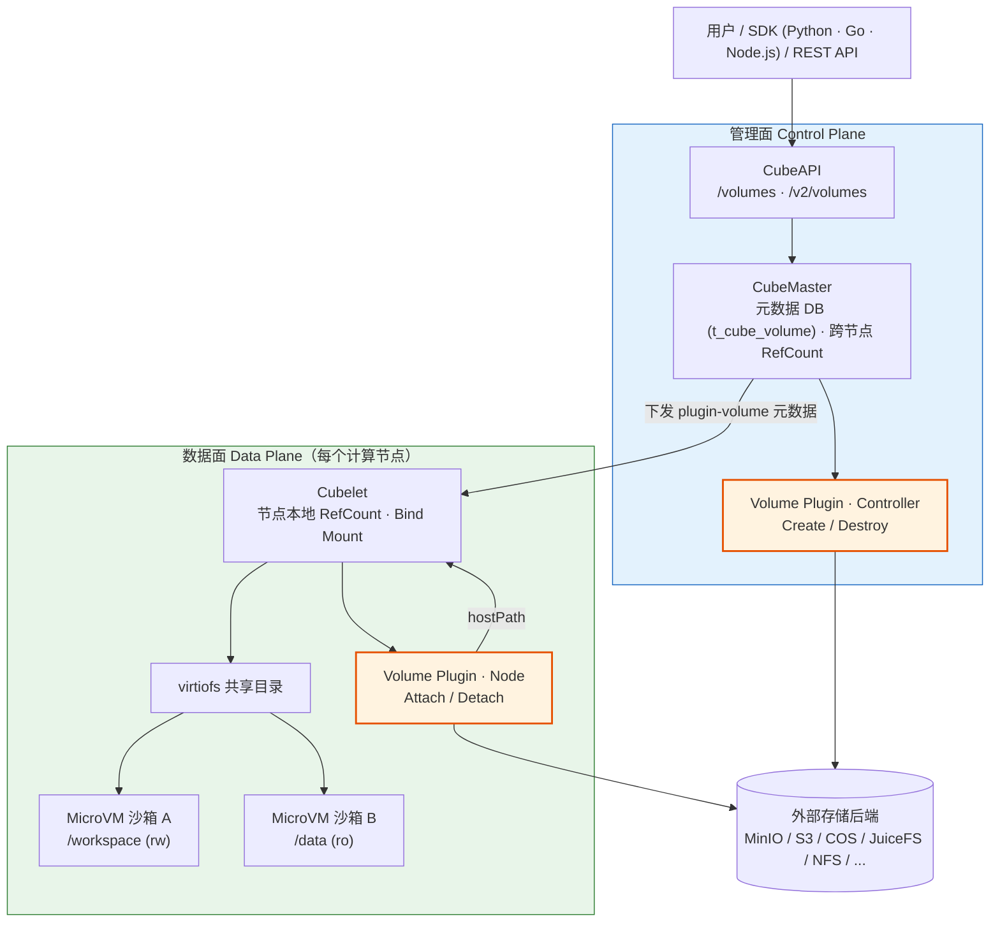

# Volume 使用

CubeSandbox 运行在轻量级 MicroVM 内，默认情况下沙箱内写入的所有数据都是**临时的**，沙箱销毁后即消失。**Volume（持久卷）** 为沙箱提供与生命周期解耦的持久化存储：创建一个 Volume → 挂载到沙箱内读写 → 沙箱销毁后数据保留 → 下次再挂载到新沙箱继续使用。

CubeSandbox 的 Volume 体系兼容 E2B Volume 协议，同时通过可插拔的 **Volume Plugin** 架构支持接入对象存储（S3 / 腾讯云 COS）、分布式 POSIX 文件系统（JuiceFS）、共享文件存储（NFS）等任意后端。

> **版本要求**
>
> - 基础 Volume 能力（创建、查询、删除、挂载、只读挂载、多沙箱共享）：要求 **Cube 平台 ≥ 0.6.0**（CubeAPI、CubeMaster、Cubelet 均需升级），使用 Python SDK 时要求 **`cubesandbox` ≥ 0.6.0**。
> - 通过 `private_data` 动态绑定桶与凭证（`POST /v2/volumes`）：要求 **CubeAPI、所有 CubeMaster、Cubelet ≥ 0.8.0**、所选插件支持该协议，以及 **Python / Go / Node SDK ≥ 0.8.0**。该接口不会自动回退到 `POST /volumes`。

---

## 一、Volume 架构

CubeSandbox 借鉴 Kubernetes CSI 的设计理念，将 Volume 拆分为**管理面（Control Plane）**与**数据面（Data Plane）**两层，实现存储生命周期与沙箱实例完全解耦：



### 核心设计特点

| 特性 | 说明 |
|------|------|
| **生命周期解耦** | Volume 由管理面独立创建与销毁；沙箱销毁时仅卸载挂载点，后端持久化数据完整保留。 |
| **凭证不进沙箱** | 对象存储密钥、元数据库密码等凭证只保存在宿主机节点（CubeMaster / Cubelet），沙箱内部只看到标准目录。 |
| **引用计数自动管挂载** | 同一节点上多个沙箱挂载同一个 Volume 时，Cubelet 只在首个沙箱创建时挂载一次（`0→1`），后续沙箱复用已有挂载；直到该节点最后一个沙箱销毁（`1→0`）才卸载。 |
| **安全删除保护** | CubeMaster 在 `t_cube_volume` 维护集群级引用计数；只要仍有节点持有挂载（`refcount ≠ 0`），`DELETE /volumes/{id}` 会返回 **409**，防止误删使用中的数据。 |
| **单沙箱读写/只读隔离** | 读写与只读是**每次挂载的属性**而非卷的全局属性。同一个 Volume 可以同时以读写方式挂给写入沙箱，以只读方式挂给多个只读沙箱。 |
| **兼容跨机恢复** | Volume 数据存放在共享后端，与 VM Snapshot 后端解耦；使用支持跨机的快照（`jfs` / `s3`）时，沙箱可在其他配置了相同驱动的节点上恢复并自动重新挂载。 |

### 生命周期速览

| 阶段 | 触发操作 | 平台与插件行为 |
|------|----------|----------------|
| **1. 创建卷** | `Volume.create(...)` | CubeMaster 调用 Controller `Create` 在后端准备资源，写入 `t_cube_volume`。 |
| **2. 首次挂载** | 节点上第 1 个沙箱挂载该卷 | Cubelet 调用 Node `Attach(refCount=0)` 将后端挂载到宿主机，再经 virtiofs bind-mount 进 MicroVM。 |
| **3. 共享复用** | 同节点第 N 个沙箱挂载该卷 | Cubelet 调用 Node `Attach(refCount>0)`，直接复用已有宿主挂载，不重复 mount。 |
| **4. 沙箱销毁** | 仍有其他沙箱使用该卷 | 卸载当前沙箱的 bind-mount 并扣减计数，共享后端挂载保持不变。 |
| **5. 最后卸载** | 节点上最后一个沙箱销毁 | Cubelet 调用 Node `Detach(refCount=0)` 卸载宿主侧挂载，**后端数据保留**。 |
| **6. 删除卷** | `Volume.destroy(...)` | 引用计数归零时，CubeMaster 调用 Controller `Destroy` 清理后端资源并删除 DB 记录。 |

> 想深入了解底层接口、Hook 协议、Mount Namespace 机制与自定义开发？请参阅 [Volume 插件开发](./volume-plugin.md)。

---

## 二、当前有哪些现成的 Volume 插件

CubeSandbox 仓库内置了 4 套面向不同存储后端的现成 Volume 插件，覆盖对象存储、高性能 POSIX 文件系统与企业级 NFS：

| 插件（driver 名） | 后端存储 | 插件形态 | 架构支持 | 典型特点 | 适用场景 |
|---|---|---|---|---|---|
| **[S3 (`s3`)](https://github.com/TencentCloud/CubeSandbox/blob/master/examples/volume/s3/README.zh.md)** | MinIO、AWS S3、腾讯云 COS、Cloudflare R2 等任意 S3 兼容存储 | `binary`（内置 S3 客户端的静态 Go 二进制 + `s3fs`） | `amd64` / `arm64` | **默认内置开箱即用**；支持动态桶与凭证引用（`private_data`）；控制节点无需额外 CLI | 通用持久化存储、模型/数据集、任务产物、多租户动态分桶 |
| **[JuiceFS (`juicefs`)](https://github.com/TencentCloud/CubeSandbox/blob/master/examples/volume/juicefs/README.zh.md)** | 对象存储（S3/COS/OSS/GCS）+ 元数据库（PostgreSQL / Redis / MySQL / TiKV） | `binary`（Shell + `juicefs` FUSE，每卷 `--subdir`） | `amd64` / `arm64` | **完整 POSIX 语义**；小文件、列目录、`git`、`SQLite` 性能远超 `s3fs`；多沙箱写入立即可见 | 代码工作区、`git` 仓库、编译构建、SQLite、高频小文件读写 |
| **[NFS (`nfs`)](https://github.com/TencentCloud/CubeSandbox/blob/master/examples/volume/nfs/README.zh.md)** | NFSv3 服务器 / 企业 NAS / 云文件存储 | `binary`（静态 Go 二进制 + `mount.nfs`） | `amd64` / `arm64` | 按需挂载预建 `<export>/<id>/data`；注销卷时保留原目录数据；支持与外部应用共享目录 | 复用已有 NFS / NAS 数据目录、多节点共享 POSIX 目录 |
| **[腾讯云 COS (`cos` / `cos-rpc`)](https://github.com/TencentCloud/CubeSandbox/blob/master/examples/volume/cos/README.zh.md)** | 腾讯云对象存储 COS | `binary`（Shell + `coscmd` + `cosfs`）与 `rpc`（Go gRPC + `cosfs`） | `amd64`（`cosfs` 限制；`arm64` 请使用 `s3` 驱动对接 COS） | 腾讯云 COS 原生插件，同时提供 `binary` 和 `rpc` 两套参考实现 | 腾讯云 COS 专用接入、开发自定义 RPC 插件时的参考模板 |

### 选型建议

- **快速开箱 / 常规持久化 / 多租户对象存储**：直接用默认的 **`s3`** 插件（默认安装已捆绑 MinIO，零配置可用；也支持一键切换外部 S3 / COS / R2）。
- **沙箱内频繁读写小文件、跑 `git` 或 `SQLite`**：优先选用 **`juicefs`** 插件。`s3fs` 每次文件操作都会发对象存储请求，而 JuiceFS 由元数据库加速目录和文件锁操作，在实测中 200 个小文件写入和 `git commit` 比 `s3fs` 快一个数量级，且原生支持 SQLite。
- **已有共享 NAS / NFS 文件系统**：选用 **`nfs`** 插件，按显式卷名按需挂载预建目录。
- **自定义内部存储系统**：按 [Volume 插件开发](./volume-plugin.md) 实现自己的 `binary` 或 `rpc` 插件。

---

## 三、如何部署 Volume

### 3.1 默认安装（开箱即用，无需手动配置）

如果你使用 **one-click 一键部署** 或 **Kubernetes Helm 默认值** 安装 CubeSandbox，系统已经自动完成以下配置：

1. 启动内置 **MinIO** 作为 S3 兼容对象存储后端（默认桶 `cube-volumes`）。
2. 自动安装 `cube-volume-s3` 插件与 `s3fs` 依赖，并生成 `volume-s3.conf`。
3. 在 CubeMaster 与 Cubelet 中将 `s3` 注册为默认驱动（`volume_plugins` 列表第一项）。

> 如果只需要使用默认 S3 持久卷，**不需要手动修改任何配置**，直接跳到 [四、如何使用 Volume](#四、如何使用-volume)。

### 3.2 接入外部 S3（AWS S3 / 腾讯云 COS / R2 / 自建 MinIO）

如需将默认 S3 插件的后端切换为外部对象存储，请按部署方式修改配置源——安装器会自动渲染 `volume-s3.conf`，**不要手动编辑 `volume-s3.conf`**（重新部署或升级时会被覆盖）。

#### one-click 部署

在控制节点的 `.one-click.env`（或 `.env`）中关闭内置 MinIO 并填入 `CUBE_S3_*`，再重新执行 `install.sh`：

```bash
CUBE_SANDBOX_MINIO_ENABLED=0
CUBE_S3_ENDPOINT=https://s3.example.com
CUBE_S3_ACCESS_KEY_ID=<your-access-key>
CUBE_S3_SECRET_ACCESS_KEY=<your-secret-key>
CUBE_S3_BUCKET=cube-volumes
# CUBE_S3_REGION=us-east-1
# MinIO 或含点号桶名等场景开启 path-style：
# CUBE_S3_S3FS_EXTRA_OPTS=-ouse_path_request_style
```

多节点集群中，计算节点不部署 MinIO，直接将控制节点上的 `CUBE_S3_*` 同步到计算节点的 `.env` 后执行安装：

```bash
# 在控制节点导出 S3 配置，粘贴到各计算节点 .env
grep '^CUBE_S3_' /usr/local/services/cubetoolbox/.one-click.env
```

> 使用控制节点内置 MinIO 供多机共享时，请确保计算节点可以访问控制节点的 `9000/tcp` 端口。详见 [one-click 部署说明](https://github.com/TencentCloud/CubeSandbox/blob/master/deploy/one-click/README_zh.md)。

#### Kubernetes Helm 部署

在 `values.yaml` 中关闭内置 MinIO，并配置 `volumeS3.*`（或通过 `volumeS3.existingSecret` 引用已有 Secret），执行 `helm upgrade`：

```yaml
minio:
  enabled: false

volumeS3:
  endpoint: https://s3.example.com
  accessKeyId: <your-access-key>
  secretAccessKey: <your-secret-key>
  bucket: cube-volumes
  # region: us-east-1
  # extraOpts: -ouse_path_request_style
```

#### 常见 S3 兼容后端参数参考

| 提供方 | `ENDPOINT` | `REGION` |
|--------|-----------|----------|
| AWS S3 | `https://s3.<region>.amazonaws.com` | 桶所在地域（如 `us-east-1`） |
| 腾讯云 COS | `https://cos.<region>.myqcloud.com` | 桶所在地域（如 `ap-guangzhou`） |
| Cloudflare R2 | `https://<account-id>.r2.cloudflarestorage.com` | `auto` |
| 自建 MinIO | `http://<minio-host>:9000` | 任意非空值（并开启 path-style） |

### 3.3 部署与注册其他插件（JuiceFS / NFS / COS / 自定义插件）

无论部署仓库内置的其他插件还是自行开发的插件，通用步骤均分为三步：

#### 第 1 步：安装宿主机依赖与插件程序

- **CubeMaster 节点**：部署插件二进制（或启动 RPC 守护进程）及插件所需配置/凭证。
- **每个 Cubelet 计算节点**：部署相同的插件二进制（或 RPC 服务）、配置/凭证，并安装挂载依赖（例如 `s3fs`、`juicefs`、`mount.nfs`、`cosfs`）且确认宿主机存在 `/dev/fuse`（FUSE 类插件必需）。

> **升级安全提示**：第三方或手动安装的插件请放到 `/usr/local/services/cubetoolbox` 目录之外（例如 `/opt/cube-plugins/` 或 `/usr/local/lib/cube-volume-plugins/`），避免 Cube 升级时被覆盖或重置。

各插件的完整依赖安装与配置说明：
- S3 手动部署与动态凭证引用：[`examples/volume/s3/README.zh.md`](https://github.com/TencentCloud/CubeSandbox/blob/master/examples/volume/s3/README.zh.md)
- JuiceFS 插件部署：[`examples/volume/juicefs/README.zh.md`](https://github.com/TencentCloud/CubeSandbox/blob/master/examples/volume/juicefs/README.zh.md)
- NFS 插件部署：[`examples/volume/nfs/README.zh.md`](https://github.com/TencentCloud/CubeSandbox/blob/master/examples/volume/nfs/README.zh.md)
- 腾讯云 COS 插件（binary / rpc）部署：[`examples/volume/cos/README.zh.md`](https://github.com/TencentCloud/CubeSandbox/blob/master/examples/volume/cos/README.zh.md)

#### 第 2 步：在 CubeMaster 与 Cubelet 中注册驱动

**CubeMaster（`conf.yaml`）**：

```yaml
volume_plugins:
  - name: s3
    type: binary
    binary_path: /usr/local/services/cubetoolbox/CubeMaster/plugin/cube-volume-s3

  - name: juicefs
    type: binary
    binary_path: /usr/local/lib/cube-volume-plugins/juicefs/cube-volume-juicefs

  # RPC 类型插件示例
  - name: my-rpc-driver
    type: rpc
    socket_path: /run/my-rpc-driver.sock   # 支持 Unix socket 裸路径或 TCP 地址
```

**Cubelet（`config.toml`）**：

```toml
[plugins."io.cubelet.internal.v1.storage"]
  # 所有插件返回的 host_path 必须位于此目录下（未配置时默认 /data/cube-shared/volume）
  volume_plugin_base_dir = "/data/cube-shared/volume"

[[plugins."io.cubelet.internal.v1.storage".volume_plugins]]
  name        = "s3"
  type        = "binary"
  binary_path = "/usr/local/services/cubetoolbox/Cubelet/plugin/cube-volume-s3"

[[plugins."io.cubelet.internal.v1.storage".volume_plugins]]
  name        = "juicefs"
  type        = "binary"
  binary_path = "/usr/local/lib/cube-volume-plugins/juicefs/cube-volume-juicefs"

[[plugins."io.cubelet.internal.v1.storage".volume_plugins]]
  name        = "my-rpc-driver"
  type        = "rpc"
  socket_path = "/run/my-rpc-driver.sock"
```

配置规则要点：
- **`name` 全链路一致且唯一**：CubeMaster 与所有 Cubelet 注册的 `name`（即 `driver`）必须完全一致，同一进程内不能重复。
- **默认驱动规则**：调用 `Volume.create()` 省略 `driver` 时，CubeMaster 使用 `volume_plugins` 列表中的**第一项**。在多后端集群中，建议在代码里显式传入 `driver` 参数。

#### 第 3 步：重启服务

修改配置后重启 CubeMaster 与各计算节点的 Cubelet 使注册生效。

---

## 四、如何使用 Volume

### 4.1 安装 SDK 与环境准备

::: warning 请使用 `cubesandbox` SDK，勿使用官方 e2b Python SDK
CubeAPI 提供与 E2B 协议兼容的 `/volumes` REST 接口，但官方 `e2b` Python SDK 将请求地址硬编码指向 `e2b.cloud`，**不能用于 CubeSandbox**。请使用 CubeSandbox 官方 SDK（Python / Go / Node.js）或直接调用 CubeAPI REST 接口。
:::

**安装 SDK：**

```bash
# Python SDK（基础 Volume ≥ 0.6.0；private_data 动态卷 ≥ 0.8.0）
pip install 'cubesandbox>=0.8.0'

# Go SDK
go get github.com/tencentcloud/CubeSandbox/sdk/go
```

**配置环境变量：**

```bash
export CUBE_API_URL=http://<cubeapi-host>:3000
export CUBE_TEMPLATE_ID=<your-template-id>

# 远程读写沙箱内文件时必填：数据面直连 CubeProxy，绕过 *.cube.app DNS
export CUBE_PROXY_NODE_IP=<cubeproxy-or-cubelet-node-ip>

# 集群开启鉴权时按需设置（对应 X-API-Key）
# export CUBE_API_KEY=<your-api-key>
```

#### API 与 SDK 能力一览

| 能力 | REST 接口 | Python SDK | Go SDK | Node.js SDK |
|------|-----------|------------|--------|-------------|
| 列出卷 | `GET /volumes` | `Volume.list()` | `client.ListVolumes` | `Volume.list()` |
| 创建卷 | `POST /volumes` | `Volume.create(...)` | `client.CreateVolume` | `Volume.create(...)` |
| 携带 `private_data` 创建（≥ 0.8.0） | `POST /v2/volumes` | `Volume.create_with_private_data(...)` | `client.CreateVolumeWithPrivateData` | `Volume.createWithPrivateData(...)` |
| 查询单个卷（含 `token`） | `GET /volumes/{volumeID}` | `Volume.get_info(...)` / `Volume.connect(...)` | `client.GetVolume` | `Volume.getInfo(...)` / `Volume.connect(...)` |
| 删除卷（使用中返回 409） | `DELETE /volumes/{volumeID}` | `Volume.destroy(...)` | `client.DeleteVolume` | `Volume.destroy(...)` |
| 挂载到沙箱（读写 / 只读） | `POST /sandboxes` (`volumeMounts`) | `Sandbox.create(volume_mounts={...})` | `CreateOptions.VolumeMounts` | `Sandbox.create({ volumeMounts })` |

> `Volume.list()` 不返回 `token`；仅创建与单查接口返回插件签发的 `token`（若插件未签发则为空字符串）。

### 4.2 完整生命周期示例

#### Python SDK

```python
from cubesandbox import Sandbox, Volume

# 1. 创建 Volume（省略 driver 时默认取 CubeMaster volume_plugins 第一项，默认安装即 s3）
vol = Volume.create("my-data", driver="s3")
print("created:", vol.volume_id, vol.name)

# 查询列表与单个卷信息
for v in Volume.list():
    print("list:", v.volume_id, v.name)
info = Volume.get_info(vol.volume_id)

# 也可通过已有 ID 重新获取 Volume 句柄
vol = Volume.connect(vol.volume_id)

# 2. 创建沙箱并挂载 Volume（触发 Node Attach）
with Sandbox.create(volume_mounts={"/workspace": vol}) as sb:
    sb.files.write("/workspace/hello.txt", "persisted across sandboxes")
    print(sb.files.read("/workspace/hello.txt"))

# 3. 退出 with 后沙箱销毁（触发 Node Detach），但后端数据完整保留
with Sandbox.create(volume_mounts={"/workspace": vol}) as sb:
    print("re-mounted:", sb.files.read("/workspace/hello.txt"))

# 4. 彻底删除 Volume（触发 Controller Destroy；卷不存在时返回 False，幂等）
Volume.destroy(vol.volume_id)
```

常用参数说明：
- `name`：可选，须匹配 `^[a-zA-Z0-9_-]+$` 且最长 128 字符；省略时由服务端自动生成 UUID 作为 `volume_id`（注：`nfs` 等需要匹配预建目录的插件要求显式指定 `name`）。
- `driver`：可选，对应 `volume_plugins[].name`；省略时使用列表第一项。
- `volume_mounts`：`{沙箱内绝对路径: Volume | volume_id | VolumeMount}`，单次创建可同时挂载多个不同 Volume；同一沙箱内不能重复挂载同一个 Volume。

#### Go SDK

```go
package main

import (
	"context"
	"errors"
	"fmt"

	cubesandbox "github.com/tencentcloud/CubeSandbox/sdk/go"
)

func main() {
	client := cubesandbox.NewClient(cubesandbox.NewConfigFromEnv())
	ctx := context.Background()

	// 1. 创建 Volume（Driver 省略时取 volume_plugins 第一项）
	vol, err := client.CreateVolume(ctx, cubesandbox.CreateVolumeOptions{
		Name:   "my-data",
		Driver: "s3",
	})
	if err != nil {
		panic(err)
	}

	// 2. 创建沙箱并挂载（ReadOnly: true 表示只读挂载）
	sb, err := client.Create(ctx, cubesandbox.CreateOptions{
		TemplateID: "base",
		VolumeMounts: []cubesandbox.VolumeMount{
			{Name: vol.VolumeID, Path: "/workspace"},
		},
	})
	if err != nil {
		panic(err)
	}

	// 3. 销毁沙箱（解绑 Volume）
	if err := sb.Kill(ctx); err != nil {
		panic(err)
	}

	// 4. 删除 Volume
	if err := client.DeleteVolume(ctx, vol.VolumeID); err != nil {
		switch {
		case errors.Is(err, cubesandbox.ErrVolumeInUse):
			fmt.Println("volume is still mounted by a sandbox (HTTP 409)")
		case errors.Is(err, cubesandbox.ErrVolumeNotFound):
			fmt.Println("volume already deleted")
		default:
			panic(err)
		}
	}
}
```

#### Node.js SDK

```ts
import { Sandbox, Volume, VolumeMount } from "cubesandbox";

// 1. 创建 Volume
const vol = await Volume.create({ name: "my-data", driver: "s3" });

// 2. 创建沙箱并挂载（支持 VolumeMount 包装只读属性）
const sb = await Sandbox.create({
  volumeMounts: {
    "/workspace": vol,
    // 只读示例："/dataset": new VolumeMount(datasetVol, { readOnly: true }),
  },
});
await sb.files.write("/workspace/hello.txt", "from node sdk");
await sb.kill();

// 3. 删除 Volume
await Volume.destroy(vol.volumeId);
```

### 4.3 只读挂载与多沙箱共享

同一个 Volume 可以同时被多个沙箱挂载，并且每个沙箱可以独立选择读写或只读模式（只读挂载为 CubeSandbox 扩展能力，官方 E2B SDK 无此选项）：

```python
from cubesandbox import Sandbox, Volume, VolumeMount

dataset = Volume.create("shared-dataset", driver="s3")

# 写入沙箱：默认读写
writer = Sandbox.create(volume_mounts={"/dataset": dataset})
writer.files.write("/dataset/index.txt", "v1")

# 读取沙箱：只读挂载，禁止修改但可看到 writer 的最新写入
reader = Sandbox.create(
    volume_mounts={"/dataset": VolumeMount(dataset, read_only=True)},
)
print(reader.files.read("/dataset/index.txt"))  # → v1

# 必须先销毁所有挂载该 Volume 的沙箱，再调用 Volume.destroy
writer.kill()
reader.kill()
Volume.destroy(dataset.volume_id)
```

> 只读是**单次挂载的属性**而非不可变快照：只读沙箱无法创建、修改或删除文件，但仍能观察到其他读写挂载产生的数据变更。

### 4.4 使用 `private_data` 动态绑定后端（Cube ≥ 0.8.0）

在多租户场景下，不同用户可能需要将 Volume 绑定到各自独立的存储桶、目录前缀与凭证，而不希望每次都修改集群配置或重启服务。Cube ≥ 0.8.0 提供 `POST /v2/volumes` 及对应 SDK 方法，允许在创建卷时向插件透传不透明的 `private_data` 字符串（最长 1024 字节）。

以内置 `s3` 插件为例，在各 CubeMaster / Cubelet 主机预先放置凭证引用文件 `/etc/cube/s3-credentials/user-a.conf`（权限 `0600`）后，即可按卷动态指定桶与前缀：

```python
import json
from cubesandbox import Sandbox, Volume

vol = Volume.create_with_private_data(
    name="user-a-workspace",
    driver="s3",
    private_data=json.dumps({
        "bucket": "customer-bucket",
        "prefix": "workspaces/user-a/",
        "cred_ref": "user-a",
    }),
)

with Sandbox.create(volume_mounts={"/workspace": vol}) as sb:
    sb.files.write("/workspace/result.txt", "isolated in customer-bucket")

Volume.destroy(vol.volume_id)
```

> **安全与使用注意**：
> - `private_data` 只能携带桶名、前缀、地域和**凭证引用名（如 `cred_ref`）**，**绝不能传入明文 AccessKey / SecretKey**。
> - 动态 S3 卷所使用的桶必须预先存在（不会自动建桶），且目标前缀必须为空。
> - 完整配置方法见 [`examples/volume/s3/README.zh.md#动态桶与凭证引用`](https://github.com/TencentCloud/CubeSandbox/blob/master/examples/volume/s3/README.zh.md#动态桶与凭证引用)。

### 4.5 配合快照、回滚、克隆与跨机恢复

Volume 采用**外部引用（external-reference）**语义——快照只保存卷 ID、容器挂载路径与只读标志，**不会复制 Volume 中的数据**：

- **FromSnap（从快照创建）**：可以省略 `volumeMounts`，平台会自动按快照记录重新挂载；也可以像 E2B 客户端一样重新传入 `volumeMounts`，但必须与快照记录完全一致（相同的卷、路径和只读属性），否则返回 HTTP 400。
- **fs-only 快照**：仅包含根文件系统，不记录挂载配置；从 fs-only 快照创建沙箱时，如需挂载卷必须重新声明 `volumeMounts`。
- **Rollback（回滚）**：恢复 VM 内存和根文件系统状态，保留当前外部 Volume 挂载；Volume 内数据保持最新状态，不会回滚到快照时刻。
- **Clone（克隆）**：克隆出的沙箱共享同一个 Volume；读写挂载的修改对源沙箱及其他克隆可见。
- **跨机恢复**：Volume 后端与 VM Snapshot 后端相互独立。只要 VM Snapshot 使用共享后端（`--backend s3` 或 `jfs` 且 `remote_status=ready`），并且目标节点注册了同名 Volume driver 且能访问同一后端存储，沙箱即可在目标节点自动 `Attach` 并恢复运行。更多条件见 [跨机迁移](./cross-node-snapshot/requirements.md)。

### 4.6 常见错误与排障

#### SDK 常见异常

| 现象 | SDK 异常 / 状态码 | 原因与处理 |
|------|-------------------|------------|
| 卷不存在 | `VolumeNotFoundError`（404） | `get_info` / `connect` 传入了无效或已删除的 `volume_id` |
| 未知驱动 | `ApiError`（400 / `130400`） | CubeMaster 未在 `volume_plugins` 中注册对应 `driver`，或未重启 |
| 卷仍被占用 | `ApiError` / `VolumeInUseError`（409 / `130409`） | 仍有沙箱挂载该 Volume；先销毁所有使用它的沙箱再删除 |
| 非法卷名 | `ValueError` | 名称须匹配 `^[a-zA-Z0-9_-]+$` 且 ≤ 128 字符 |
| 快照恢复挂载不匹配 | `ApiError`（400 / `130400`） | 从 VM 快照创建时传入的 `volumeMounts` 与快照原始挂载不一致 |

#### 部署与运行时排障

| 现象 | 排查方向 |
|------|----------|
| `no plugin registered for driver "<name>"` | 调度到的 Cubelet 节点未配置同名 `volume_plugins` 或未重启 |
| S3 插件 `s3fs mount failed` | 检查节点 `/dev/fuse` 是否存在；检查 `volume-s3.conf` 中的 `ENDPOINT` 与密钥 |
| `InvalidAccessKeyId` / `SignatureDoesNotMatch` | 密钥错误、缺少桶读写权限，或 `REGION` 与 Endpoint 期望的 SigV4 地域不符 |
| 桶名含点号导致 TLS 校验失败 | 改用无点号桶名，或在配置中设置 `S3FS_EXTRA_OPTS=-ouse_path_request_style`（MinIO 通常也需要） |
| 省略 `driver` 时没走到预期插件 | 省略 `driver` 取 `volume_plugins` 列表第一项；多驱动集群建议显式指定 `driver` |
| 远程 SDK 读写挂载目录失败 | 检查是否设置了 `CUBE_PROXY_NODE_IP`，以及 CubeProxy / CubeAPI 网络连通性 |

---

## 下一步

- 需要接入自有存储后端或深入了解 Hook 协议、引用计数与 Mount Namespace 细节？阅读 [Volume 插件开发](./volume-plugin.md)。
