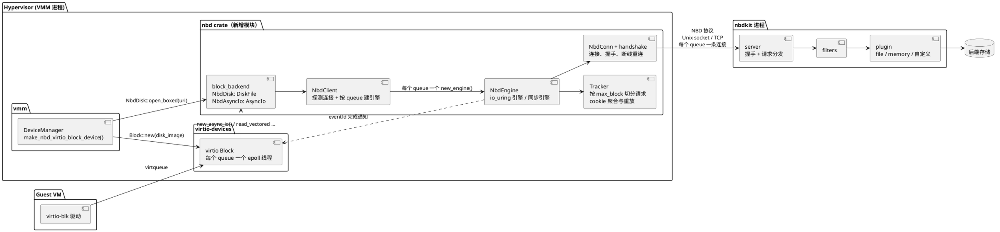
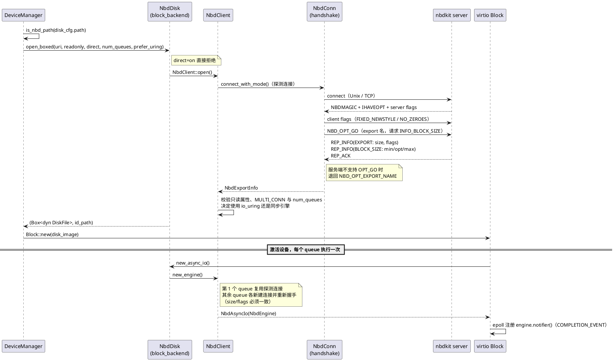
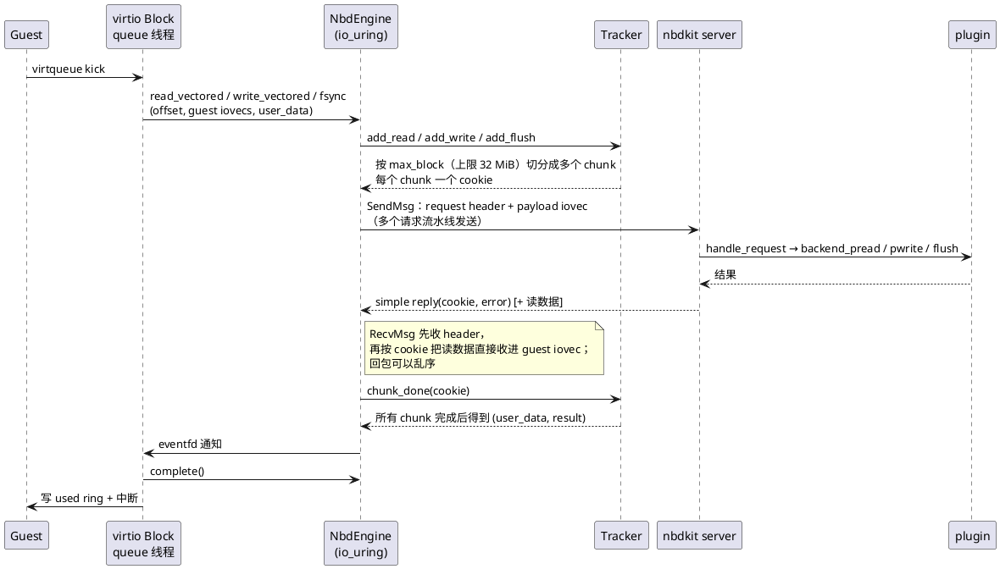
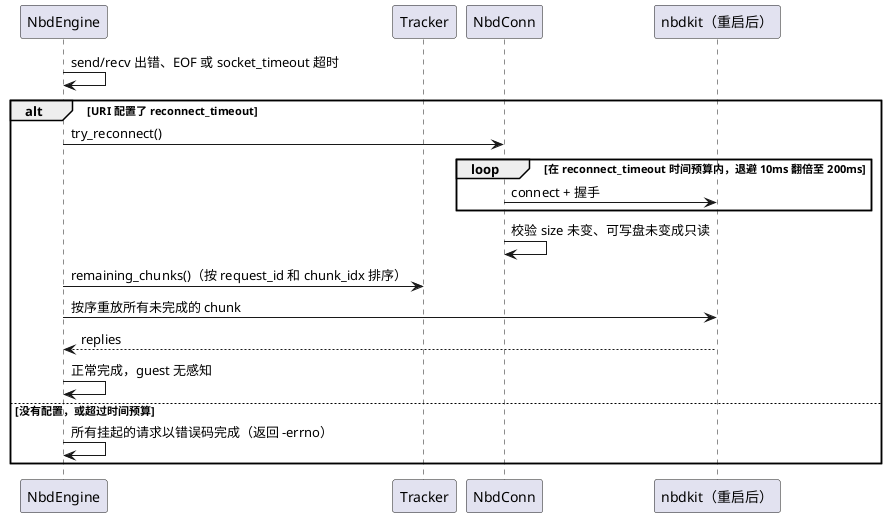

# Hypervisor NBD 模块与 nbdkit 交互架构

当 `--disk path=` 是 `nbd://` 或 `nbd+unix://` URI 时，hypervisor 不打开本地文件，而是由新增的 `nbd` crate 作为 NBD 客户端连接 nbdkit。virtio-block 设备只依赖 `DiskFile` / `AsyncIo` 这两个 trait，看不出后端是不是 NBD。

```text
--disk path=nbd+unix:///vol0?socket=/run/nbd.sock&reconnect_timeout=10
--disk path=nbd://10.0.0.1:10809/vol0?socket_timeout=30&tcp_keepalive=on
```

## 1. 架构图



重点：

- 接入点很小：vmm 只改了 `device_manager.rs` 里的一个 `else if` 分支，并加了一个 `make_nbd_virtio_block_device()`。适配代码都在 `nbd::block_backend` 里，`block_util` 和 virtio Block 都不用改。
- 多队列对应多连接：每个 virtio queue 有自己的 `NbdEngine` 和自己的 NBD 连接。可写盘需要 nbdkit 声明 `NBD_FLAG_CAN_MULTI_CONN`，否则多队列会被拒绝。
- 两种 I/O 引擎：优先用 io_uring 引擎（`SendMsg`/`RecvMsg`，请求流水线化，scatter/gather 直接读写 guest 内存，不做拷贝），内核不支持时退回同步引擎。两者都用 eventfd 通知完成。
- 可靠性：URI 上配置 `reconnect_timeout` 后，连接断开会按指数退避重连，并把还没完成的 chunk 重放。重连后会校验 export 的大小和只读属性没有变化。
- seccomp：virtio-block 工作线程和 vmm 线程新放行了 `socket`、`connect`、`sendmsg`、`recvmsg`、`setsockopt`、`getsockopt`、`poll` 等系统调用（地址族限 `AF_UNIX`/`AF_INET`/`AF_INET6`），因为重连会发生在 I/O 线程里。

## 2. 交互流程

### 2.1 设备创建与握手



### 2.2 I/O 请求（io_uring 引擎）



同步引擎的接口和完成语义与上面一致，只是在提交调用里逐个 chunk 阻塞地发请求、收回复，完成后同样写 eventfd。

### 2.3 断线重连与重放



## 3. 代码索引

| 角色 | 位置 |
| --- | --- |
| VMM 接入分支 | `hypervisor/vmm/src/device_manager.rs`（`is_nbd_path` 分支、`make_nbd_virtio_block_device`） |
| DiskFile/AsyncIo 适配 | `hypervisor/nbd/src/block_backend.rs` |
| 客户端与引擎分发 | `hypervisor/nbd/src/lib.rs`（`NbdClient`、`NbdEngine`） |
| URI 解析 | `hypervisor/nbd/src/uri.rs` |
| 握手 | `hypervisor/nbd/src/handshake.rs` |
| 连接与重连 | `hypervisor/nbd/src/conn.rs` |
| 请求切分与聚合 | `hypervisor/nbd/src/tracker.rs` |
| I/O 引擎 | `hypervisor/nbd/src/uring_engine.rs`、`hypervisor/nbd/src/sync_engine.rs` |
| nbdkit 握手 | `/data/nbdkit/server/protocol-handshake-newstyle.c`（`NBD_OPT_GO`） |
| nbdkit 请求处理 | `/data/nbdkit/server/protocol.c`（`handle_request`）、`/data/nbdkit/server/connections.c`（`handle_single_connection`） |
| 端到端测试 | `hypervisor/nbd/tests/nbdkit_integration.rs`（真实 nbdkit 下测试多队列、blocksize filter、Rust plugin 和重启重连） |
