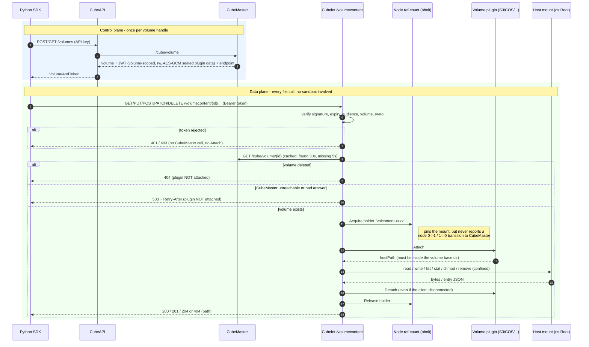

# Persistent Volumes

`Volume` is the class-level helper for managing CubeSandbox **persistent
volumes** — e2b-compatible stores backed by a volume plugin (COS, NFS, …).
Create a volume, mount it into a sandbox via
`Sandbox.create(volume_mounts={...})` (e2b-compatible mapping), and its data
survives sandbox restarts and can be shared across sandboxes.

```python
from cubesandbox import Sandbox, Volume, VolumeMount
```

Management calls remain class methods: `create` and `connect` return a live
`Volume` instance; `Volume.list()` returns `VolumeInfo` entries and
`Volume.get_info(id)` returns `VolumeAndToken`; `destroy` returns a `bool`. Instance file operations now follow the E2B
Volume API: `vol.read_file`, `vol.write_file`, `vol.list(path)`,
`vol.get_info(path)`, `vol.make_dir`, `vol.exists`, `vol.update_metadata`,
and `vol.remove`.

**Implementation status:** the Python direct-content client talks to the
`/volumecontent` service that Cubelet serves when it is enabled (see
[Server side](#server-side-volumecontent)). The service is **off by default**;
without it, direct methods need a separately deployed compatible gateway.
Volume tokens are only valid for the content service when CubeMaster is
configured with `CUBE_VOLUME_CONTENT_TOKEN_SECRET`. There is no hidden helper
sandbox or shell fallback.

---

## Configuration

Volume management calls only hit the management plane (`CUBE_API_URL`).
Reading/writing files *inside* a mounted volume goes through the data plane, so
`CUBE_PROXY_NODE_IP` is also required when running outside the CubeProxy node.

| Environment Variable | Required | Default | Used by |
|---|:---:|---|---|
| `CUBE_API_URL` / `E2B_API_URL` | override | `https://api.<domain>` for Volume; bound Config keeps its default | volume CRUD |
| `CUBE_VOLUME_API_URL` / `E2B_VOLUME_API_URL` | override | the `endpoint` returned with the token, else `https://api.<domain>`; debug uses localhost:8080 | volume-content service base URL |
| `CUBE_PROXY_NODE_IP` | remote mount access | none | `sb.files.*` on the mounted volume |
| `CUBE_TEMPLATE_ID` | for mount | none | `Sandbox.create(...)` |

Bind `Config(api_url=..., volume_api_url=...)` via `Volume.create/connect(config=...)`.
Direct operations inherit that configuration and accept `request_timeout=` per
call. They send only `Authorization: Bearer <volume token>` to the gateway,
never the management `X-API-Key` or sandbox access token. Empty plugin tokens
are not authorization: a compatible gateway must issue and verify a scoped
content token. HTTPS is required outside loopback, TLS verification is enabled,
and authenticated redirects are not followed.

---

## API reference

| Method | HTTP | Parameters | Returns |
|---|---|---|---|
| `Volume.create(name, **opts)` | `POST /volumes` | See parameter table below | `Volume` |
| `Volume.connect(volume_id, *, config=None)` | `GET /volumes/{id}` | `volume_id`: identifier | `Volume` |
| `Volume.list(*, config=None, **opts)` | `GET /volumes` | E2B management options | `list[VolumeInfo]` (ID and name only) |
| `Volume.get_info(volume_id, *, config=None, **opts)` | `GET /volumes/{id}` | `volume_id`: identifier | `VolumeAndToken` (token and optional domain) |
| `Volume.destroy(volume_id, *, config=None)` | `DELETE /volumes/{id}` | `volume_id`: identifier | `bool` (`True` on success, `False` on 404) |

**`Volume.create` parameters**

| Parameter | Type | Required | Description |
|---|---|---|---|
| `name` | `str` | Yes | Volume name. Non-empty names must match `^[a-zA-Z0-9_-]+$`, ≤128 chars. |
| `driver` | `str \| None` | No | Volume plugin name (e.g. `"cos"`). Pass `None` or `""` to omit the field → backend uses its default plugin. |
| `config` | `Config \| None` | No | SDK config, overrides environment variables. |

### `create`

Modeled on e2b, where `Volume.create(name)` takes no driver:

- **`create(name)`** — e2b-compatible. The request body is just
  `{"name": ...}`; the backend uses its **first configured** volume plugin.
- **`create(name, driver="cos")`** — CubeSandbox extension. Pass a non-empty
  `driver` to pin a specific plugin. Use it only when you must select among
  multiple plugins.

> The Python method requires a `name` argument. Server behavior for an omitted
> JSON field is not the public Python SDK signature.

### `VolumeInfo`

| Attribute | Type | Notes |
|---|---|---|
| `.volume_id` | `str` | Stable identifier (name or auto UUID). Maps from `volumeID`/`volume_id`. |
| `.name` | `str` | Display name. |
| `.token` | `str` | Present on Volume / VolumeAndToken, absent on list VolumeInfo entries. |
| `.domain` | `str \| None` | Optional domain on VolumeAndToken, obtained from the management response. |

### Mounting and per-sandbox access modes

Pass a dict mapping mount paths to volumes (e2b-compatible):

```python
Sandbox.create(volume_mounts={"/workspace": vol})
Sandbox.create(volume_mounts={"/workspace": "vol-xxx"})
```

Each value can be a `Volume`, `VolumeInfo`, or bare `volume_id` string and must resolve to an existing volume. Existing e2b-style values remain read-write.

To make one sandbox attachment read-only, wrap its value in `VolumeMount`:

```python
from cubesandbox import Sandbox, VolumeMount

Sandbox.create(
    volume_mounts={
        "/dataset": VolumeMount(vol, read_only=True),
        "/workspace": workspace_vol,
    }
)
```

`read_only` only mounts that attachment as read-only. It prevents the current sandbox from writing or modifying files through that mount, but does not create an immutable snapshot. The same Volume can be attached with different access modes in different sandboxes, for example read-write in sandbox A and read-only in sandbox B.

---

## Examples

### 1. Create

```python
from cubesandbox import Volume

vol = Volume.create("my-data")     # with a name
print(vol.volume_id, vol.name, vol.token)
```

### 2. Mount into a sandbox

```python
from cubesandbox import Sandbox, Volume

vol = Volume.create("my-data", driver="cos")

with Sandbox.create(
    volume_mounts={"/workspace": vol},
) as sb:
    sb.files.write("/workspace/note.txt", "persisted!")
    print(sb.files.read("/workspace/note.txt"))   # "persisted!"
```

### 3. Query and destroy

```python
for v in Volume.list():            # ID and name only; no token field
    print(v.volume_id, v.name)

one = Volume.get_info(vol.volume_id)  # one.token is populated
vol = Volume.connect(vol.volume_id)   # -> live Volume instance
Volume.destroy(vol.volume_id)         # kill all mounting sandboxes first (see Notes)
```

### 4. Cross-sandbox data sharing

Multiple sandboxes can mount the same volume concurrently. Data is visible
to all mounters in real time.

```python
from cubesandbox import Sandbox, Volume

vol = Volume.create("shared", driver="cos")
mount = {"/workspace": vol}

# Sandbox A writes data.
a = Sandbox.create(volume_mounts=mount)
a.files.write("/workspace/probe.txt", "hello from A")

# Sandbox B mounts the same volume and reads it immediately.
with Sandbox.create(volume_mounts=mount) as b:
    print(b.files.read("/workspace/probe.txt"))   # "hello from A"

# ⚠️ All mounting sandboxes must be killed before deleting the volume.
a.kill()
b.kill()  # context manager already killed it on exit; explicit for clarity
Volume.destroy(vol.volume_id)
```

---

## Direct content API and E2B comparison

The authoritative [Chinese E2B protocol and implementation contract](../../../docs/e2b-volume-contract.md)
is pinned to `e2b-dev/E2B@8cc9ed1e`, checked 2026-11-02. It lists exact
management/content routes, success statuses, options, return shapes and remaining
incompatibilities. This is not a claim of live E2B interoperability; the existing
compatibility suite's version list covers a separate sandbox API surface.

Python sync and Node now support E2B-style management arguments, VolumeAndToken,
response-domain discovery, per-call content address/token/headers/proxy/HTTP
version, and timeout=0. Content 404 is path-not-found regardless of body shape.
AsyncVolume is outside this synchronous task. Python wall-clock transfer deadlines
and full differential error validation remain unverified. The repository server still needs a real content
gateway and capability issuer.

| Instance operation | Direct HTTP protocol | Return |
|---|---|---|
| `vol.read_file(path, format="text")` | `GET /volumecontent/{id}/file?path=...` | `str` |
| `vol.read_file(path, format="bytes")` | same | `bytes`, without text decoding |
| `vol.read_file(path, format="stream")` | same, streaming response | lazy `Iterator[bytes]` |
| `vol.write_file(path, data, uid=None, gid=None, mode=None, force=None)` | `PUT .../file`, raw octet-stream; options in query | `VolumeEntryStat` |
| `vol.list(path, depth=None)` | `GET .../dir`, depth in query | `list[VolumeEntryStat]` |
| `vol.make_dir(path, uid=None, gid=None, mode=None, force=None)` | `POST .../dir`, options in query | `VolumeEntryStat` |
| `vol.get_info(path)` | `GET .../path` | `VolumeEntryStat` |
| `vol.exists(path)` | stat; only typed missing-path errors become false | `bool` |
| `vol.update_metadata(path, uid=None, gid=None, mode=None)` | `PATCH .../path`, JSON options | `VolumeEntryStat` |
| `vol.remove(path)` | `DELETE .../path` | `None` |

`Volume.list()` / `Volume.get_info(volume_id)` keep their management meaning.
Instance calls require a content `path`; `vol.list()` without a path and
`vol.get_info(non_absolute_volume_id)` do not fall back to management calls.
Use class methods explicitly for management, as in E2B.
File paths must be absolute **within the volume**, not host filesystem paths;
NUL, backslashes and dot traversal segments are rejected. Root removal is
rejected. The gateway must additionally enforce symlink-safe confinement.

File writes accept text, bytes and readable file-like objects. File-like uploads
are read in 64 KiB chunks without materializing the entire file; the SDK does not
close caller-owned files. Read streams are lazy and bound memory usage; explicitly
close the iterator on early exit. Each operation owns and closes its HTTP client,
so this first implementation does not promise cross-call connection pooling.
Ordinary operations use 60 seconds by default (or a bound Cube Config budget);
buffered file reads/writes use one hour. Stream reads use a 60-second read idle
timeout unless a per-call timeout is supplied. Timeout `0` disables transport
deadlines. These are transport timeouts, not an overall wall-clock deadline. Writes are never automatically retried
or re-uploaded as multipart on an authentication or server error.

**Example for a deployed compatible gateway only:** the current server cannot
issue `CUBE_VOLUME_CONTENT_TOKEN`. The operator must provide a gateway-issued
scoped capability; do not substitute the management API key or an arbitrary
non-empty plugin token.

```python
import os
from contextlib import closing
from cubesandbox import Config, Volume

config = Config(volume_api_url=os.environ["CUBE_VOLUME_API_URL"])
vol = Volume(
    os.environ["CUBE_VOLUME_ID"], "example",
    token=os.environ["CUBE_VOLUME_CONTENT_TOKEN"], config=config,
)
vol.make_dir("/data", force=True)
vol.write_file("/data/hello.txt", "hello", force=True)
assert vol.read_file("/data/hello.txt") == "hello"
with closing(vol.read_file("/data/hello.txt", format="stream")) as chunks:
    assert b"".join(chunks) == b"hello"
print(vol.list("/data"))
vol.remove("/data/hello.txt")
```

### Testing without starting a sandbox

From `sdk/python`, use the local tests and loopback E2E harness first:

```sh
python3 -m pytest -q tests/test_volume.py tests/test_volume_content.py tests/test_volume_direct_harness.py
```

The live suite is separate and defaults to read-only:

```sh
python3 -m pytest -q tests/test_volume_direct_e2e.py --run-e2e
```

Set `CUBE_VOLUME_API_URL` (or `E2B_VOLUME_API_URL`), `CUBE_VOLUME_ID`,
`CUBE_VOLUME_CONTENT_TOKEN`, and `CUBE_VOLUME_TEST_PATH` for a stable existing file.
No template, sandbox creation or volume creation is needed. Optional text/hash,
management and isolated mutation settings are documented in the
[README E2E section](../README.md#direct-volume-e2e-tests).

There are 16 cases, including the optional cases. `CUBE_VOLUME_E2E_WRITE=1`
explicitly enables mutations; only unique test paths are cleaned up, never the
supplied volume. Every test forbids SDK sandbox creation/connection and non-volume
HTTP routes. Default execution skips all live cases. Missing required settings
fail after `--run-e2e` is supplied. The loopback harness runs the same suite with
controlled data in both read-only and mutation modes; this is not evidence that
the production gateway, server-side leases or tenant/symlink isolation works.

### Existing chain and server-side implementation plan

Current chain:

```text
Volume CRUD -> CubeAPI /volumes -> CubeMaster /cube/volume
            -> plugin Create/Destroy -> t_cube_volume
Sandbox volumeMounts -> Master resolves driver/private_data
                     -> Cubelet plugin Attach/Detach -> hostPath/bind/virtiofs
sb.files -> CubeProxy -> sandbox envd -> mounted files
```

### Server side (`/volumecontent`)



The three failure answers mean different things to the SDK: 401/403 are
authentication errors, a content 404 is "path not found" (and also what a deleted
volume returns), and 503 is retryable.

The Cubelet side of this flow is covered end to end by
`TestDirectVolumeAccessEndToEnd` in
`Cubelet/plugins/volume/content/e2e_test.go`. It wires the real handler, token
verification, `MasterChecker`, `ManagerLeaser`, `volume.Manager` with a bbolt
ref-count and a local "mount" plugin against a fake CubeMaster, and checks:
read/write without a sandbox, content holders reporting no node transitions, a
deleted volume (readable only inside the cache window, then `404` with zero
plugin `Attach` calls), and CubeMaster outage (`503`, no `Attach`, recovers
without caching the error). Run it with:

```sh
cd Cubelet && go test -race -count=1 -run TestDirectVolumeAccessEndToEnd ./plugins/volume/content/
```

Management calls go through CubeAPI. File bytes go straight to Cubelet and never
pass through CubeAPI or CubeMaster. The token carries the plugin private data,
sealed with AES-GCM, so Cubelet needs no lookup to attach a volume. Cubelet does
make one small existence check against CubeMaster per volume (see
[Deleted volumes](#deleted-volumes)); it uses `cubemaster_http_addr` from the
node config (default `127.0.0.1:8089`).

| Variable | Where | Required | Meaning |
|---|---|:---:|---|
| `CUBE_VOLUME_CONTENT_TOKEN_SECRET` | CubeMaster **and** Cubelet (same value) | yes | HMAC secret, at least 32 bytes. Unset = feature off, responses unchanged. |
| `CUBE_VOLUME_CONTENT_AUDIENCE` | CubeMaster **and** Cubelet (same value) | yes | Public origin of the content service, e.g. `https://vol.example.com`. Returned to the SDK as `endpoint`. |
| `CUBE_VOLUME_CONTENT_ADDR` | Cubelet | yes | Listen address, e.g. `:8443`. Unset = service not started. |
| `CUBE_VOLUME_CONTENT_TLS_CERT` / `_TLS_KEY` | Cubelet | no | Serve TLS directly; otherwise terminate TLS in front. |
| `CUBE_VOLUME_CONTENT_TOKEN_ISSUER` | CubeMaster and Cubelet | no | JWT issuer. |
| `CUBE_VOLUME_CONTENT_TOKEN_TTL` | CubeMaster | no | 1 minute to 24 hours; default 1 hour. |
| `CUBE_VOLUME_CONTENT_MAX_UPLOAD_BYTES` | Cubelet | no | Upload size limit. |

Behavior and limits:

- The SDK sends the token as a Bearer credential, so use HTTPS. The SDK refuses
  plain HTTP outside loopback.
- Tokens are minted on create and get only, never on list. They are read/write
  and expire after the TTL; fetch a new one with `Volume.connect`.
- The audience must be an address the SDK can reach. With several Cubelet nodes,
  put one shared entry (for example an L4 load balancer) in front. Shared
  backends (S3/COS) work from any node; a node-local volume must be routed to
  the node that holds it, which is not handled here.
- Each request takes a short-lived attachment lease through the node's volume
  reference accounting, so the host mount cannot be torn down mid-request. Leases
  are released when the request ends and reclaimed on Cubelet restart.
- As in E2B, the content service is independent of sandbox accounting. A lease is
  not a sandbox reference: it never changes the cross-node `refCount` that
  CubeMaster uses to refuse `DELETE /volumes/{id}`. Deleting a volume is
  therefore not blocked by in-flight content requests.
- Paths are confined with `os.Root`, so `..` and symlinks cannot leave the volume.
  Uploads go to a temp file and are renamed atomically; setuid/setgid modes are
  rejected.
- Read-only is enforced server-side from the token's permission claim.
- Entry JSON includes name, type (`file/directory/symlink/unknown`), absolute
  volume path, integer size/mode/uid/gid, ISO timestamps atime/mtime/ctime,
  and optional symlink target. `ctime` retains filesystem metadata semantics,
  not a promise of original creation time.

#### Deleted volumes

A token stays cryptographically valid until it expires, even after its volume is
deleted. Using it must not touch the backend, so before any plugin `Attach`
Cubelet asks CubeMaster (`GET /cube/volume/{id}`) whether the volume still exists:

| CubeMaster answer | Result |
|---|---|
| volume exists | request proceeds |
| volume not found | `404`, and the plugin is **not** attached |
| unreachable, error, or unexpected response | `503` with `Retry-After`, and the plugin is **not** attached (fail closed) |

Attaching for a deleted volume is unexpected behavior and is never attempted:
depending on the plugin it could mount or recreate an empty backend location.
The check only runs after the token has been verified, so unauthenticated
requests cost nothing.

- "Exists" answers are cached for 30 seconds and "not found" for 5 seconds, per
  volume. Errors are never cached. So a deleted volume stays reachable for at
  most 30 seconds after deletion, and a CubeMaster outage only affects volumes
  that have not been used in the last 30 seconds.
- The check is by volume ID only. A volume that is deleted and then **re-created
  with the same name** has the same ID, so an old token would be accepted for the
  new volume until it expires. Do not reuse a volume name that earlier tokens may
  still be held for, or lower `CUBE_VOLUME_CONTENT_TOKEN_TTL`.

Not covered yet: tenant/owner scoping of volumes, token revocation, and
verification against a real S3/COS plugin on Linux. Check these before
enabling the feature in production.

For E2B interoperability, every content HTTP 404 maps to path-not-found,
including an empty or non-JSON body. Consequently `exists()` cannot distinguish
a missing route from a missing file. Validate the gateway deployment separately;
do not use `exists()` as a gateway health check. Malformed successful metadata
responses still raise `ApiError` rather than silently returning an empty directory.

## Errors & status codes

Volume management uses the mapping below. Direct methods raise
`VolumePathNotFoundException` (alias `VolumePathNotFoundError`) on every 404,
`AuthenticationException` on 401, `RateLimitException` on 429,
`ServiceBusyException` on 503, and `VolumeException` for other HTTP failures (including 403).
Redirects are errors, not credential-forwarding fallbacks. `exists()` suppresses
only path-not-found; authorization, transport and other server errors propagate.


| HTTP status | Exception raised | Meaning |
|---|---|---|
| 2xx | — (returns normally) | success |
| 401 | `AuthenticationException` (alias `AuthenticationError`) | unauthenticated |
| 429 | `RateLimitException` | rate limited |
| 503 | `ServiceBusyException` | service unavailable |
| 404 | `VolumeNotFoundException` for class get_info/connect; path exception for content; destroy returns False | resource missing |
| any other non-2xx (400 / 403 / 405 / 409 / 500 …) | `VolumeException` (also a Cube `ApiError`) | forbidden, bad params, conflict, backend error |

Client-side validation raises **before** any network call:

| Condition | Exception |
|---|---|
| `name` violates `^[a-zA-Z0-9_-]+$` or > 128 chars | `ValueError` |
| mount dict missing `name` / `path` | `ValueError` |

All API exceptions derive from `CubeSandboxError` and expose `.status_code`:

```python
from cubesandbox import Volume, VolumeNotFoundError, ApiError

try:
    Volume.get_info("does-not-exist")
except VolumeNotFoundError:
    ...                       # 404
except ApiError as e:
    print(e.status_code)      # 500
```

---

## Notes

- **Kill all mounting sandboxes before deleting a volume.** A volume can be
  mounted by multiple sandboxes concurrently. `Volume.destroy()` does not
  auto-detach — if any running sandbox still holds the volume, the delete may
  fail or leak backend mounts. Always `sb.kill()` every sandbox that mounts the
  volume before calling `Volume.destroy(volume_id)`.
- **`list` never returns tokens.** Tokens are only surfaced by `create` and
  `get_info`; call `Volume.get_info(volume_id)` when you need the token.
- **`name` is required by the Python create signature.** Pass an explicit name.
- **Read-only is per attachment.** Use `VolumeMount(volume, read_only=True)` at sandbox creation time. Creating the `Volume` itself remains unchanged.
