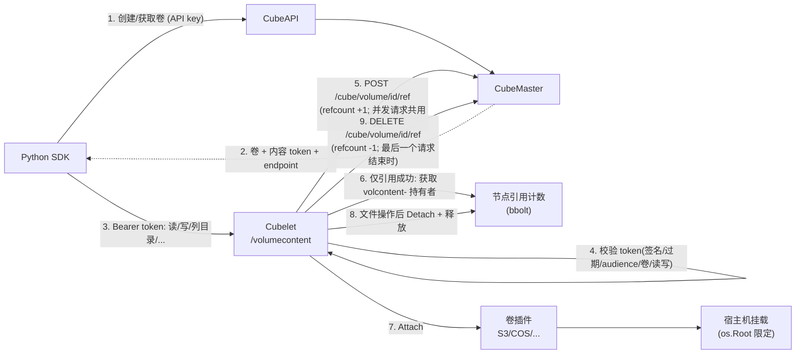

# 持久化卷：同步管理与无沙箱直通访问

英文参考见 [volume.md](volume.md)。固定 E2B 版本、HTTP 协议和兼容边界见
[E2B Volume 合同](../../../docs/e2b-volume-contract.md)，直通服务端范围见
[Volume 直通方案](../../../docs/volume-direct-access.md)。

本次只提供同步 Python，不加入异步或原生传输栈，也不为了读取卷而启动辅助沙箱。
现有卷管理、沙箱挂载与独立内容访问是三种不同能力。Cubelet 提供可选的
`/volumecontent` 内容服务（默认关闭），CubeMaster 在创建/获取卷时签发卷级 JWT 并返回
`endpoint`。未启用该服务时，客户端需对接已部署的兼容网关；仅有 CubeAPI 的管理接口
不能直接读取文件。服务端配置见 [volume.md](volume.md#server-side-volumecontent)。

## 配置与鉴权

| 配置 | 用途 |
|---|---|
| `CUBE_API_URL` / `E2B_API_URL` 或管理 `api_url` | 管理 `/volumes` |
| `CUBE_API_KEY` / `E2B_API_KEY` 或管理 `api_key` | 管理 `X-API-Key` |
| `CUBE_VOLUME_API_URL` / `E2B_VOLUME_API_URL` 或内容 `api_url` | 内容服务地址；未设置时使用服务端随 token 返回的 `endpoint` |
| 句柄 token 或内容 `token` | 内容 `Authorization: Bearer ...` |
| `domain`、`debug` | 无显式地址时按 E2B 域名/debug 规则解析 |
| `request_timeout`、`headers`、`proxy`、`http_version`、`logger` | 逐次请求选项 |

管理和内容地址分别解析。内容地址优先级：显式 `api_url` / `CUBE_VOLUME_API_URL`，
其次服务端返回的 `endpoint`，最后默认 `https://api.<domain>`（domain 为
`E2B_DOMAIN` 或 `e2b.app`；debug 使用 `http://localhost:8080`）。
Cube 额外保留绑定 `Config` 的兼容入口。非本机内容请求须 HTTPS，不能用管理 key
或空插件 token 冒充内容凭证。直通不需要模板、`CUBE_PROXY_NODE_IP` 或沙箱 access token。

普通请求默认 60 秒，绑定 Cube Config 时保留其预算；缓冲文件操作默认一小时。
`request_timeout=0` 禁用超时。同步流默认 read 空闲限制为 60 秒；和所核对的 E2B
同步实现一样，`stream_idle_timeout` 参数不单独生效。HTTPX 超时是阶段/空闲限制，
尚不是与 E2B 原生传输完全相同的 wall-clock 总期限。

## 已有管理 API

| Python 方法 | HTTP | 返回 |
|---|---|---|
| `Volume.create(name, **opts)` | `POST /volumes`，JSON `{name}` | `Volume` |
| `Volume.connect(volume_id, **opts)` | `GET /volumes/{id}` | `Volume`，不创建沙箱 |
| `Volume.list(**opts)` | `GET /volumes` | `list[VolumeInfo]` |
| `Volume.get_info(volume_id, **opts)` | `GET /volumes/{id}` | `VolumeAndToken` |
| `Volume.destroy(volume_id, **opts)` | `DELETE /volumes/{id}` | 成功 True，404 False |

`name` 是 Python 必填入参，非空值须满足 `^[a-zA-Z0-9_-]+$` 且最多 128 字符。
标准创建仅发送 name；Cube 可选 `driver` 扩展仅在显式非空时发送。
管理方法支持 E2B 风格直接 kwargs；`config` 作为 Cube 兼容扩展保留。

`VolumeInfo` 只有 `volume_id/name`，列表条目没有 token 属性。
`VolumeAndToken` 在基础信息上增加 `token/domain`。时间类型不涉及管理模型。
创建或连接句柄保留响应 domain；默认 S3 插件不会因此自动生成内容 token。

## 直通内容 API

以下是内容网关协议，不是把卷 ID 替换进现有沙箱文件接口。
所有路径使用 `/volumecontent/{volumeID}` 前缀，卷内 `path` 放在查询参数中。

| Python 方法 | HTTP | 返回 |
|---|---|---|
| `vol.read_file(path, format="text", stream_idle_timeout=None, **opts)` | `GET /file?path=...` | str / bytes / Iterator[bytes] |
| `vol.write_file(path, data, uid=None, gid=None, mode=None, force=None, **opts)` | `PUT /file`，原始字节；元数据查询参数 | `VolumeEntryStat` |
| `vol.list(path, depth=None, **opts)` | `GET /dir`，path/depth 查询参数 | `list[VolumeEntryStat]` |
| `vol.make_dir(path, uid=None, gid=None, mode=None, force=None, **opts)` | `POST /dir`，查询参数 | `VolumeEntryStat` |
| `vol.get_info(path, **opts)` | `GET /path?path=...` | `VolumeEntryStat` |
| `vol.update_metadata(path, uid=None, gid=None, mode=None, **opts)` | `PATCH /path`，JSON 元数据 | `VolumeEntryStat` |
| `vol.exists(path, **opts)` | 复用查询元数据 | bool |
| `vol.remove(path, **opts)` | `DELETE /path?path=...` | None |

类级 list/get_info 走管理，实例级方法必须有内容 path，不再按相对路径猜测管理调用。
path 为卷内绝对 POSIX 路径，不是宿主机路径；NUL、反斜线和点穿越段被拒绝，
禁止删除卷根目录。客户端校验不能代替网关的符号链接和跨租户隔离。
未指定元数据省略；显式 uid/gid/mode/depth 的 0 和 force=False 都保留。

文件线上返回原始字节。Python 文本为 str，bytes 为 bytes，stream 为惰性同步迭代器。
元数据字段为 `name/type/path/size/mode/uid/gid/atime/mtime/ctime/target`；
type 为 `unknown/file/directory/symlink` 枚举，时间返回 datetime，target 可为 None。

```python
import os
from contextlib import closing
from cubesandbox import Volume

vol = Volume(os.environ["CUBE_VOLUME_ID"], "dataset", os.environ["CUBE_VOLUME_CONTENT_TOKEN"])
opts = {"api_url": os.environ["CUBE_VOLUME_API_URL"]}
path = os.environ["CUBE_VOLUME_TEST_PATH"]
data = vol.read_file(path, format="bytes", **opts)
info = vol.get_info(path, **opts)
entries = vol.list("/", depth=1, **opts)
with closing(vol.read_file(path, format="stream", **opts)) as chunks:
    for chunk in chunks:
        pass
```

## 无沙箱 E2E

在 `sdk/python` 执行；完整变量表和清理说明见
[中文 README](../README.zh.md#直通卷-e2e-测试)。

```sh
python3 -m pip install -e '.[dev]'
python3 -m pytest -q tests/test_volume.py tests/test_volume_content.py tests/test_volume_direct_harness.py
python3 -m pytest -q tests/test_volume_direct_e2e.py --run-e2e
```

真实测试必需 `CUBE_VOLUME_API_URL`（或 `E2B_VOLUME_API_URL`）、`CUBE_VOLUME_ID`、
`CUBE_VOLUME_CONTENT_TOKEN`、`CUBE_VOLUME_TEST_PATH`；最后一项必须是稳定已有文件。
凭证从环境注入，不提交到仓库。可选 SHA-256 校验预期数据。

16 个用例覆盖二进制、流、可选文本、元数据、目录深度、路径缺失、非法 token、
逐次地址/token/headers 和提前关闭流。默认只读；管理验证由
`CUBE_VOLUME_TEST_MANAGEMENT=1` 开启，写入由 `CUBE_VOLUME_E2E_WRITE=1` 单独开启。
写入只在唯一 `sdk-e2e-*` 目录中进行并清理自建路径，绝不销毁传入的卷。
未加 `--run-e2e` 时所有真实用例跳过；开启后缺配置会失败。

本地回环验证器用相同用例校验只读/写入模式和清理；不是生产服务验证。
用例禁止 SDK 沙箱创建/连接和非卷 HTTP 路由，但服务端是否启动 VM、挂载租约是否
正确仍需服务端观测。没有部署兼容网关时测试失败应修服务，不允许启动沙箱兜底。

## 异常

| HTTP | Python 行为 |
|---|---|
| 内容 404 | `VolumePathNotFoundException`；exists 返回 False |
| 管理详情/连接 404 | `VolumeNotFoundException` |
| 管理 destroy 404 | False |
| 401 | `AuthenticationException`，兼容别名 `AuthenticationError` |
| 429 | `RateLimitException` |
| 503 | `ServiceBusyException` |
| 其他非 2xx（含 403） | `VolumeException`，同时兼容 Cube `ApiError` 捕获 |

鉴权和服务错误不变成空列表或 False。内容任何 404 都按 E2B 视为路径不存在，
因此不能用 exists 判断路由是否部署。所有认证请求禁止自动重定向。

## 数据流



- 控制面（步骤 1-2）每个卷句柄一次；文件字节（步骤 3 起）直达 Cubelet，不经过 CubeAPI/CubeMaster，也不启动沙箱。
- 步骤 4 失败返回 `401/403`，不会访问 CubeMaster。
- 步骤 5 卷不存在返回 `404`、CubeMaster 不可达或异常返回 `503`（带 `Retry-After`），两者都**不会**进入步骤 6/7。
- 请求和沙箱挂载一样算作对卷的使用：步骤 5 到 9 之间卷的 `refcount` 加 1，`DELETE /volumes/{id}` 返回 `409`。请求结束后立即归还，不会在两次请求之间继续占用。

测试：

- `tests/e2e/sdk_compat/cases/volume/test_direct_content.py`：对真实部署（CubeAPI、CubeMaster、Cubelet、S3 插件）运行。覆盖无沙箱读写、请求结束后卷不被占用、请求进行中 `DELETE` 返回 `409`、卷删除后旧 token 返回 `404` 且不会重建、两个沙箱与直通共用同一卷。未启用内容服务时自动跳过。在 `tests/e2e/sdk_compat` 下执行 `pytest --run-e2e -m volume cases/volume/test_direct_content.py`。
- `Cubelet/plugins/volume/content/integration_test.go`、`refs_test.go`：Cubelet 侧进程内测试，对接有状态的 CubeMaster 替身，覆盖故障、响应丢失和并发请求，无需集群即可在 CI 运行：`cd Cubelet && go test -race ./plugins/volume/...`。
- `CubeMaster/pkg/service/httpservice/cube/volume_ref_test.go`：引用接口与删除，使用真实数据库引擎。

## 卷引用

token 在过期前一直有效，即使卷已被删除。所以 Cubelet 在调用任何插件 `Attach` 之前，先向 CubeMaster
取得卷的一个引用（`POST /cube/volume/{id}/ref`）。它与沙箱挂载使用同一个 `t_cube_volume.refcount`：

- 引用成功：正常处理；归还前 `DELETE /volumes/{id}` 返回 `409`。
- 卷不存在：返回 `404`，**不会** Attach 插件。
- CubeMaster 不可达、出错或返回异常：返回 `503`（带 `Retry-After`），同样**不会** Attach 插件（失败关闭）。

对已删除的卷执行 Attach 属于预期之外的行为，可能让插件挂载或重建一个空的后端位置，所以不做。
`DELETE /volumes/{id}` 在同一把行锁下检查计数并删除，因此引用要么被删除操作看到，要么发现卷已不存在。

- 同一卷的并发请求共用一个引用：第一个取得，最后一个归还。持有期间新请求无需访问 CubeMaster，
  所以 CubeMaster 故障不影响正在使用的卷。
- 两次请求之间不占用：最后一个请求结束就归还，`write_file(...)` 之后立即 `Volume.destroy(...)` 可以成功。
- "不存在"缓存 5 秒、"不可用"缓存 2 秒，仅用于吸收突发请求；成功结果不缓存。
- 计数是匿名的，所以 Cubelet 不会重复发送结果未知的调用。被 CubeMaster 拒绝的归还会重试直到成功；
  响应丢失的归还不重试，因为再释放一次可能抹掉沙箱持有的引用。Cubelet 在不巧的时刻停止或丢失响应时，
  计数可能偏高导致卷暂时无法删除，需要修复（与沙箱引用按创建/销毁响应上报时的限制相同）；重试不会让计数偏低。
- 该检查只按卷 ID 判断：同名卷被删除后重新创建，旧 token 在过期前对新卷仍然有效，请避免复用仍可能被
  旧 token 持有的卷名，或缩短 `CUBE_VOLUME_CONTENT_TOKEN_TTL`。详见 [volume.md](volume.md#volume-references)。

## 沙箱挂载是另一条已有链路

原有 `Sandbox.create(volume_mounts={path: vol})` 保留。映射值可为 Volume、
VolumeInfo 或 ID 字符串；`VolumeMount(vol, read_only=True)` 仅控制本次沙箱挂载，
不生成不可变快照。这条链路不是直通读取前置条件，不会在上述 E2E 中调用。
删除卷应先释放所有真实挂载/读取引用，SDK 不自动 detach。
