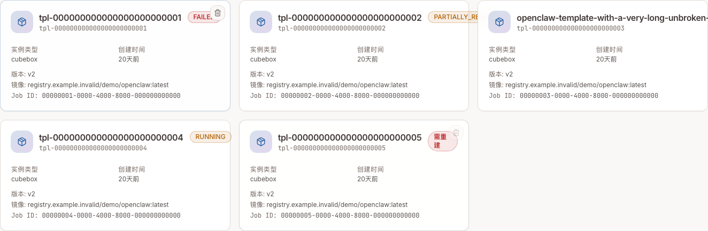
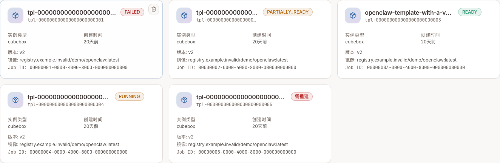
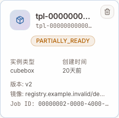

# CubeSandbox Dashboard (web/)

Modern, minimal, cool dashboard for CubeSandbox. Vite + React + TypeScript + Tailwind v3 + shadcn-style primitives + TanStack Query + cmdk (⌘K).

## Quickstart

```bash
make web-install
make web-dev     # → http://localhost:5173, proxies /cubeapi to CubeAPI @ :3000
make web-build   # → web/dist/
```

## Template-card layout regression

Run the WebUI locally, then use the optional Playwright browser check. It
intercepts API requests with synthetic responses and never contacts a cluster:

```bash
# Terminal 1, from web/
npm ci
npm run dev

# Terminal 2, from web/; use a disposable Python environment
python3 -m venv /tmp/cube-web-layout-venv
/tmp/cube-web-layout-venv/bin/pip install playwright
/tmp/cube-web-layout-venv/bin/playwright install chromium
/tmp/cube-web-layout-venv/bin/python scripts/test-template-card-layout.py
```

The check covers English/Chinese, five viewport widths (360–1440 px), long
template IDs/aliases, READY/RUNNING/FAILED/PARTIALLY_READY and UNKNOWN
compatibility. It checks badge/button bounds and collisions, wrapped-badge right
alignment, full-name tooltips, keyboard focus visibility, and the delete
confirmation without issuing DELETE. Pass `--output <directory>` for real Light
screenshots at 360/1440 px and geometry results, or `--browser-executable <path>`
to reuse an installed Chromium. `--baseline` requires the original bug to
reproduce instead of passing the fixed layout.

Local Light captures with the same synthetic API responses, before and after
the fix (not production template data):





This card crop from a 360px viewport shows a wrapped status staying right-aligned:



### Reproduce the committed capture names

Keep the current WebUI running on port 5173. In a separate terminal, start the
original layout at this PR's base revision (from the repository root):

```bash
git worktree add --detach /tmp/cube-web-layout-baseline f2777699da7e2f60b019519796f655c598a84342
cd /tmp/cube-web-layout-baseline/web
npm ci
npm run dev -- --host 127.0.0.1 --port 5174 --strictPort
```

Then, from the current branch's `web/` directory, use the same test script for
both servers and copy its generated captures to the names used above:

```bash
/tmp/cube-web-layout-venv/bin/python scripts/test-template-card-layout.py --url http://127.0.0.1:5174 --baseline --output /tmp/cube-layout-before
/tmp/cube-web-layout-venv/bin/python scripts/test-template-card-layout.py --url http://127.0.0.1:5173 --output /tmp/cube-layout-after
cp /tmp/cube-layout-before/template-cards-zh-1440-light.png scripts/fixtures/template-card-layout/before-light.png
cp /tmp/cube-layout-after/template-cards-zh-1440-light.png scripts/fixtures/template-card-layout/after-light.png
cp /tmp/cube-layout-after/template-cards-zh-360-light.png scripts/fixtures/template-card-layout/after-360-light.png
```

The custom fixtures deliberately include a long unbroken alias and partial /
unknown statuses; they are not a second general-purpose mock backend. Only the
four GET endpoints used by this page/shell are registered. Unknown API requests
and non-GET requests are recorded as failures and completed with HTTP 500, not
left hanging. The run also checks those handler paths directly. Font rendering
and relative dates can differ across machines and capture dates.

## Routes

- `/` Overview — cluster KPIs, recent sandboxes, template pipeline
- `/sandboxes` list + lifecycle actions (pause/resume/kill)
- `/sandboxes/:id` detail + logs
- `/templates` catalog
- `/nodes` fleet health
- `/keys` store `X-API-Key` locally
- `/network`, `/observability`, `/settings` — roadmap placeholders

## Backend

Talks to **CubeAPI** (`CubeAPI/` in repo), which proxies templates/cluster/nodes to CubeMaster. See `src/api/client.ts`.

The `X-API-Key` header (if present in localStorage under `cube.apiKey`) is injected on every request.

The dashboard always calls CubeAPI through the same-origin `/cubeapi/v1` prefix. In local development Vite proxies `/cubeapi` according to `vite.config.ts`; in one-click deployments a standard nginx container publishes port `12088`, mounts the packaged `webui/dist`, and proxies `/cubeapi` to the host CubeAPI through Docker `host-gateway`.
